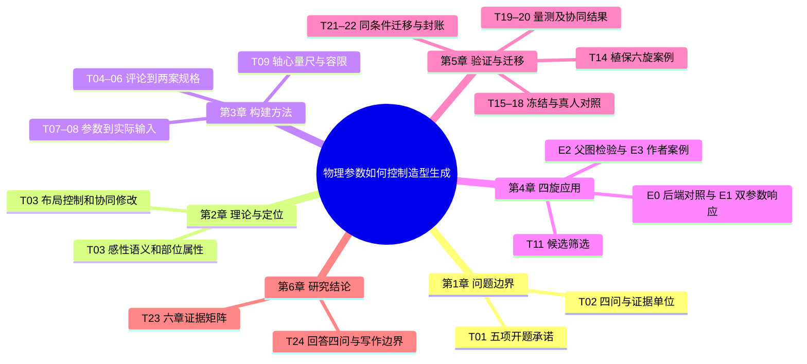

# 六章研究执行总清单
本清单受 [研究地基](foundation.md) 约束。

正式协议 · 2026-11-12。Claude 负责论证与稿件，Codex 负责条件编译、请求留档和复算，作者在 #3 决定费用、招募及导师事项。

## 研究路线与启动顺序

评论与产品样本 → 双人语义编码 → 3—4组双极词 → 部件规格 → 参数编译 → 顶视生成与设计者修订 → 独立量测与顶视盲评 → 四旋深化及植保六旋比较。3.2的词对进入3.3规格，在5.3用同一组词检验意图表达。

正式生成、修订、量测与盲评唯一视图为正交顶视。四旋处理机身平面轮廓与比例、臂根过渡、机鼻（相机舱）前缘轮廓、分件线与配色分区；六旋处理药箱与中央机架的平面整合及喷洒杆件布置。4.4最终展示图单列。原型沿用E盘配置器，旧模型调用保持禁用。

每批在首次出图前冻结单一改变因素、档位、每档次数、判据、未通过处置。禁止单张预试。模型实际标识、权重摘要或API版本、条件PNG与提示词需登记；系统错误、OOM、超时或受理状态未知即停，保留原件，禁止自动重试。跨后端相同重复编号不等于种子配对。

| 阶段 | 设计、判据、失败处置（计划量） |
|---|---|
| [E0 后端对照](https://github.com/Freeloop993/paper/issues/19) | 用同一顶视条件图和提示词，开源 Qwen-Image 2.1＋ControlNet Union、闭源 API 各做 W/L＝0.70、1.00、1.30，每档2次，共12张。逐臂报告四轴四桨可读率、W/L 档均值是否同向、是否像产品图。开源未达到可读且同向时停在本单，保留负结果，交作者裁定。 |
| [E1 参数响应与纯文字对照](https://github.com/Freeloop993/paper/issues/20) | 开源主线一次只改 W/L 或 d/D，各3档×4次，共24；同信息量的纯文字臂关闭 ControlNet，各3档×2次，共12。E1计划36张。d/D 三档须按桨盘不相交计算并在出图前登记。各因素档均值单调且相邻均值差大于独立读数误差的2倍。逐图±0.10命中率、同档四次离散分别报告。闭源只引用 E0 六张，计数归 E0。未通过写不可控或部分可控及适用条件，停止后续。 |
| [E2 父图修订能力](https://github.com/Freeloop993/paper/issues/21) | 2张父图分别接受2种修改指令，另为每种指令做1张无父图对照，共6张。以实体部位可辨改动、三项保持项至少两项保持为判据。未过先停并回执；如后续获准开展 D/S，两组都仅用纯文字修订。 |
| [E3 四旋方案展开与深化](https://github.com/Freeloop993/paper/issues/22) | 作者作设计者，以同一套词对与简报展开3方向×3候选，列全表、选择1案并记录理由，至多修订2次。以规格、全候选、取舍和父子版本链齐全为判据。无合格候选则4.2报告筛选边界。 |
| [E4 D/S 协同对照](https://github.com/Freeloop993/paper/issues/23) | 另招设计者≥4，目标6—8，作者不计。每人D/S各一场、A/B交叉，四种顺序平衡。每场1份初稿、至多1次修订，等时等机会，锁稿后填五题。按设计者作配对描述。人数不足4，降为作者案例加1—2人试用。 |
| [E5 顶视终稿独立评议](https://github.com/Freeloop993/paper/issues/24) | 评议者≥3，目标5，未参加设计且未见过程。先对8—10张有合法来源的真实产品顶视图作词对评分；E6后盲评E3、E4、E6锁定顶视终稿。r3沿用规格的3—4组双极词，另评任务契合、协调、是否值得深化。评前冻结阈值与分歧、缺失的处理；不足3人只报逐人原判。 |
| [E6 农业植保六旋应用与响应](https://github.com/Freeloop993/paper/issues/25) | 观察药箱与中央机架的平面整合、喷洒杆件的平面布置；遮挡喷头记不可判。1个方向做初稿与1次修订，另做W/L三档×2次；分别计数。按六旋基准归一，以E1的单调性和相邻均值差门槛判断。未通过只报案例；风格保持仅作描述。 |

**交接顺序。** 离线稿件由Claude复核 → 作者提供两后端并登记授权 → E0 → E1 → E2 → E3 → E4与E6 → E5终稿盲评 → 原件与分母冻结 → 第4—6章及摘要。真实产品词对评分可提前；出图前不具备前项条件时在对应单停报。

## 开题指标的去向

登记 F2、关键点→轴心及W/L、d/D误差；轮廓IoU和倒角距离→历史；一致性→E1同档离散；效率→场次时间和调用；主观评价→词对与评议。 有/无ControlNet→E1，有/无LoRA改有/无父图→E2，反馈→场内初终稿。D/S两组均有人。每项附章节、来源与限制。 机身长宽比由设计者决定、事后量测，臂宽轴距比 w/D 可选。画幅占比和中心偏移只作描述。独立助手盲读全部E0、E1、E6；知条件 AI 初读并列标注。历史样本及评议不补新分母。

## 执行思维导图

## 从评论到实验输入：两张工作表

| 依据 | 任务语义 | 观察／操作 | 证据边界 |
| --- | --- | --- | --- |
| E001、E003；E002为反例 | 日常携带；也有人更看重较大机身的稳定感 | 紧凑—松散为待试词对；从同视角样本记录机身占比、机鼻前缘轮廓 | 实际词对评分缺；评论推不出轴距或实际稳定性 |
| E011、E014；E006提示情境 | 外观简洁、精整感；加装防护后的体量感单列 | 候选属性为主体分件、臂根过渡、附件与壳体关系 | 形态属性需编码与人评；美观与功能分别留证 |
| 作者已定的植保简报＋产品手册 | 看清药箱、喷洒部件和机架关系 | 记录药箱承托与喷洒杆件平面关系，可改外壳及整合方式 | 植保任务独立建表；四旋评论不能充作农业用户样本 |

对称等径X架算例，D=250 mm、桨径127 mm为设计假设。前侧张角α=2 arctan(W/L)，W=D sin(α/2)，L=D cos(α/2)。四个轴心取(±W/2,±L/2)，用同一画布仿射变换导出；四副双叶、叶尖方位和展开状态同档对照。以下是输入几何，无生成观测。

| 目标W/L | 前侧夹角 | W / L（mm） | 理想最小桨盘净距（mm） |
| --- | --- | --- | --- |
| 0.70 | 69.98° | 143.37 / 204.81 | 16.37 |
| 1.00 | 90.00° | 176.78 / 176.78 | 49.78 |
| 1.30 | 104.86° | 198.16 / 152.43 | 25.43 |

输出用机头朝上的原始俯视整图。W/L按实体轴心水平跨度除以纵向跨度；尺度用水平跨度／原画幅宽，中心漂移用轴心质心与目标中心的距离。位置误差用对应实体轴心的平均欧氏距离，报告像素及除以画幅对角线的归一化值。若采用历史阈值，须同时保留该批原定义和单位。不得以重新裁图对齐后替代原尺度；夹角和跨度比联动，固定的D不产生轴距效应估计。

**方法选择**　感性工学指导建立产品印象与形态属性的关联。SD用于双极词感知量测；只有开展具备／不具备成对问卷，才讨论Kano需求分类。本计划的语义提取和SD不产出Kano类别。参数化几何、空间布局条件、部位—属性绑定、设计者主导的编辑与被试内评议分别解决不同问题。

[Chen 等原文](https://www.jstage.jst.go.jp/article/jamdsm/20/1/20_2026jamdsm0008/_article) · [作者全文](https://arxiv.org/html/2511.18333v1) · [CVPR 出版记录](https://openaccess.thecvf.com/content/CVPR2026/html/Shi_ConsistCompose_Unified_Multimodal_Layout_Control_for_Image_Composition_CVPR_2026_paper.html) · [GenAlign](https://doi.org/10.1016/j.aei.2026.105165) · [作者项目与论文](https://visvar.github.io/pub/park2026enhancing.html) · [Nagamachi](https://doi.org/10.1016/0169-8141(94)00052-5) · [Osgood 等](https://www.press.uillinois.edu/books/?id=p745393) · [Kano 等](https://doi.org/10.20684/quality.14.2_147)

## 第1章 绪论

研究问题、开题承诺与可证伪的判据

### T01 核对开题五项及指标去向

[交付工单 #26](https://github.com/Freeloop993/paper/issues/26)

- [ ] 按本版复核交付
- **写入目录**　1.1、1.4
- **责任与前置**　Claude｜开题第6—7页、地基§2、4
- **先读什么**　开题第6–7页、修订Word第4章和范围工单；逐条看原承诺和批示。
- **实际操作**　登记 F2、关键点→轴心及W/L、d/D误差；轮廓IoU和倒角距离→历史；一致性→E1同档离散；效率→场次时间和调用；主观评价→词对与评议。
- **交付与验收**　有/无ControlNet→E1，有/无LoRA改有/无父图→E2，反馈→场内初终稿。D/S两组均有人。每项附章节、来源与限制。

[开题报告原件 · 第 6–7 页](https://github.com/Freeloop993/paper/blob/8eef6f321439fcaeabad9b884c921757a699eebc/planning/proposal-original.pdf#page=6) · [已修订六章目录 · Word](https://github.com/Freeloop993/paper/blob/8eef6f321439fcaeabad9b884c921757a699eebc/planning/outline-revised.docx) · [全局计划 · 开题五项对账](https://github.com/Freeloop993/paper/blob/8eef6f321439fcaeabad9b884c921757a699eebc/docs/research-plan.md) · [作者与导师待定事项 · #3](https://github.com/Freeloop993/paper/issues/3)

### T02 固定研究问题与证据单位

[交付工单 #27](https://github.com/Freeloop993/paper/issues/27)

- [ ] 按本版复核交付
- **写入目录**　1.2、1.3、1.5、2.6、3.1、5.6、6.1
- **责任与前置**　Claude｜T01、证据矩阵
- **先读什么**　开题五项对账、证据矩阵；把RQ与最小观察单位逐问对应。
- **实际操作**　分别登记语义转译、参数响应、设计者修订、跨构型适配的可反驳主张。
- **交付与验收**　语义卡、图、设计者配对、案例各自计数；证据缺失的主张保持待验证。

[开题报告原件 · 第 6–7 页](https://github.com/Freeloop993/paper/blob/8eef6f321439fcaeabad9b884c921757a699eebc/planning/proposal-original.pdf#page=6) · [已修订六章目录 · Word](https://github.com/Freeloop993/paper/blob/8eef6f321439fcaeabad9b884c921757a699eebc/planning/outline-revised.docx) · [全局计划 · 开题五项对账](https://github.com/Freeloop993/paper/blob/8eef6f321439fcaeabad9b884c921757a699eebc/docs/research-plan.md) · [作者与导师待定事项 · #3](https://github.com/Freeloop993/paper/issues/3)

## 第2章 相关研究与理论基础

既有理论、AI方法与本文的增量

### T03 补齐理论与任务来源

[交付工单 #28](https://github.com/Freeloop993/paper/issues/28)

- [ ] 按本版复核交付
- **写入目录**　1.5、2.1、2.2、2.3、2.4、2.5、2.6、2.7
- **责任与前置**　Claude｜同行论文、开题与三份植保手册
- **先读什么**　Chen PDF13–14、18；GenAlign PDF10、12、20；ConsistCompose §3.2–3.3、§4.2、表1；Park等的任务划分与被试内比较。查成果层次与局限。
- **实际操作**　补核2.1的5—8篇构型与工业设计文献；2.2以可供性与产品语义为锚点。
- **交付与验收**　逐条附版本、页码、可支持的主张；仅有题名列待审。

[阶段阅读地图 · 原文版本与页码](https://github.com/Freeloop993/paper/blob/8eef6f321439fcaeabad9b884c921757a699eebc/references/reading-map.md) · [优先文献 · 版本核对表](https://github.com/Freeloop993/paper/blob/8eef6f321439fcaeabad9b884c921757a699eebc/references/catalogs/priority-fulltexts.md) · [章节主张与证据矩阵](https://github.com/Freeloop993/paper/blob/8eef6f321439fcaeabad9b884c921757a699eebc/manuscript/evidence-matrix.md) · [Chen 等原文](https://www.jstage.jst.go.jp/article/jamdsm/20/1/20_2026jamdsm0008/_article) · [作者全文](https://arxiv.org/html/2511.18333v1) · [CVPR 出版记录](https://openaccess.thecvf.com/content/CVPR2026/html/Shi_ConsistCompose_Unified_Multimodal_Layout_Control_for_Image_Composition_CVPR_2026_paper.html) · [GenAlign](https://doi.org/10.1016/j.aei.2026.105165) · [作者项目与论文](https://visvar.github.io/pub/park2026enhancing.html) · [Nagamachi](https://doi.org/10.1016/0169-8141(94)00052-5) · [Osgood 等](https://www.press.uillinois.edu/books/?id=p745393) · [Kano 等](https://doi.org/10.20684/quality.14.2_147)

## 第3章 造型意图转译与人智协同可控生成方法

需求和参数怎样成为可发给模型的规格

### T04 对真实评论做双人编码

[交付工单 #29](https://github.com/Freeloop993/paper/issues/29)

- [ ] 按本版复核交付
- **写入目录**　3.2、3.2.1、3.2.2
- **责任与前置**　Codex与编码助手｜原语境和反例
- **先读什么**　需求卡的来源与上下文、Chen PDF13–14、18；读“提取语义”的过程和反例，区别于满意度排序。
- **实际操作**　语义卡登记原评论索引、使用情境、反例、研究者解释、候选部位；一位助手独立编码约40条。
- **交付与验收**　报告一致与分歧、裁定及覆盖。四旋消费评论不能替代植保使用者证据。

[Google Doc 执行计划 · 归档快照](https://github.com/Freeloop993/paper/blob/8eef6f321439fcaeabad9b884c921757a699eebc/planning/google-doc-snapshot.md) · [全局计划 · 开题五项对账](https://github.com/Freeloop993/paper/blob/8eef6f321439fcaeabad9b884c921757a699eebc/docs/research-plan.md) · [阶段阅读地图 · 原文版本与页码](https://github.com/Freeloop993/paper/blob/8eef6f321439fcaeabad9b884c921757a699eebc/references/reading-map.md) · [农业植保 · 三款手册逐图试读](https://github.com/Freeloop993/paper/blob/8eef6f321439fcaeabad9b884c921757a699eebc/experiments/hexa-plant-protection/README.md)

### T05 锁定语义差异词对

[交付工单 #30](https://github.com/Freeloop993/paper/issues/30)

- [ ] 按本版复核交付
- **写入目录**　2.2、3.2、3.2.2、3.2.3、3.3.1、3.6.2、5.3.1
- **责任与前置**　Codex与评议者｜T04、真实产品图
- **先读什么**　Nagamachi 的产品印象—设计要素关系、Osgood 的双极词量测；回看词语原语境与原产品样本。
- **实际操作**　从评论提炼3—4组双极词，保留两极释义。评议者对8—10张真实产品顶视图评分，观察词对与可见属性的对应。
- **交付与验收**　输出图源与使用范围、匿名评分、词对版本。3.2、3.3、5.3沿用同版；仅描述，不作因子分析或Kano分类。

[Google Doc 执行计划 · 归档快照](https://github.com/Freeloop993/paper/blob/8eef6f321439fcaeabad9b884c921757a699eebc/planning/google-doc-snapshot.md) · [全局计划 · 开题五项对账](https://github.com/Freeloop993/paper/blob/8eef6f321439fcaeabad9b884c921757a699eebc/docs/research-plan.md) · [阶段阅读地图 · 原文版本与页码](https://github.com/Freeloop993/paper/blob/8eef6f321439fcaeabad9b884c921757a699eebc/references/reading-map.md) · [农业植保 · 三款手册逐图试读](https://github.com/Freeloop993/paper/blob/8eef6f321439fcaeabad9b884c921757a699eebc/experiments/hexa-plant-protection/README.md) · [优先文献 · 版本核对表](https://github.com/Freeloop993/paper/blob/8eef6f321439fcaeabad9b884c921757a699eebc/references/catalogs/priority-fulltexts.md) · [章节主张与证据矩阵](https://github.com/Freeloop993/paper/blob/8eef6f321439fcaeabad9b884c921757a699eebc/manuscript/evidence-matrix.md) · [Chen 等原文](https://www.jstage.jst.go.jp/article/jamdsm/20/1/20_2026jamdsm0008/_article) · [作者全文](https://arxiv.org/html/2511.18333v1) · [CVPR 出版记录](https://openaccess.thecvf.com/content/CVPR2026/html/Shi_ConsistCompose_Unified_Multimodal_Layout_Control_for_Image_Composition_CVPR_2026_paper.html) · [GenAlign](https://doi.org/10.1016/j.aei.2026.105165) · [作者项目与论文](https://visvar.github.io/pub/park2026enhancing.html) · [Nagamachi](https://doi.org/10.1016/0169-8141(94)00052-5) · [Osgood 等](https://www.press.uillinois.edu/books/?id=p745393) · [Kano 等](https://doi.org/10.20684/quality.14.2_147)

### T06 编制两案规格和任务卡

[交付工单 #31](https://github.com/Freeloop993/paper/issues/31)

- [ ] 按本版复核交付
- **写入目录**　3.1、3.2.3、3.3、3.3.1、3.3.2、3.3.3、4.1、4.1.1、4.2.1
- **责任与前置**　作者与Codex｜T04–05、手册部件图
- **先读什么**　P1需求回链与B02简报、GenAlign的部位—属性表达、六旋三款手册的载荷与安装图。
- **实际操作**　四旋规定机身平面轮廓与比例、臂根过渡、机鼻（相机舱）前缘轮廓、分件线与配色分区。卡A改前缘，卡B改臂根。六旋观察药箱与机架平面整合及喷洒杆件布置。
- **交付与验收**　规格登记词对、目标、改变、保持和自由项，作者确认版本；被挡的喷头记不可判。

[D/S 比较、参与者与评议方案](https://github.com/Freeloop993/paper/blob/8eef6f321439fcaeabad9b884c921757a699eebc/docs/methods.md) · [改稿台 · 过程记录](https://github.com/Freeloop993/paper/blob/8eef6f321439fcaeabad9b884c921757a699eebc/experiments/operator-workbench/README.md) · [农业植保 · 三款手册逐图试读](https://github.com/Freeloop993/paper/blob/8eef6f321439fcaeabad9b884c921757a699eebc/experiments/hexa-plant-protection/README.md) · [阶段阅读地图 · 原文版本与页码](https://github.com/Freeloop993/paper/blob/8eef6f321439fcaeabad9b884c921757a699eebc/references/reading-map.md)

### T07 定义几何变量与条件图

[交付工单 #32](https://github.com/Freeloop993/paper/issues/32)

- [ ] 按本版复核交付
- **写入目录**　2.3、3.1、3.4、3.4.1、3.4.2、3.4.3、4.1、4.1.2、5.5.1
- **责任与前置**　Codex｜配置器源、变量字典、地基F3
- **先读什么**　配置器来源记录、变量字典“四旋X架组合”、当前参考图与逐桨量测；核对模型实际收到哪一层。
- **实际操作**　机头朝上，按W/L计算轴心、按d/D确定双叶叶尖，导出轴心＋双叶＋机架线。整机横跨画幅约50%，一次只改一个量。
- **交付与验收**　保存坐标、原图和版本。W/L与d/D必做，w/D可选，机身长宽比自由、事后量测；画幅占比与中心偏移只描述。

[E 盘配置器 · 来源与纠偏](https://github.com/Freeloop993/paper/blob/8eef6f321439fcaeabad9b884c921757a699eebc/docs/configurator-realignment.md) · [研究变量与量尺](https://github.com/Freeloop993/paper/blob/8eef6f321439fcaeabad9b884c921757a699eebc/docs/research-variables.md) · [最近定位图、原图与逐桨量测](https://github.com/Freeloop993/paper/blob/8eef6f321439fcaeabad9b884c921757a699eebc/evidence/quad-guide-cmf-review/README.md) · [开题报告原件 · 第 6–7 页](https://github.com/Freeloop993/paper/blob/8eef6f321439fcaeabad9b884c921757a699eebc/planning/proposal-original.pdf#page=6)

### E0 后端对照

用同一顶视条件图和提示词，开源 Qwen-Image 2.1＋ControlNet Union、闭源 API 各做 W/L＝0.70、1.00、1.30，每档2次，共12张。逐臂报告四轴四桨可读率、W/L 档均值是否同向、是否像产品图。开源未达到可读且同向时停在本单，保留负结果，交作者裁定。

### T08 编入E1同信息量对照

[交付工单 #33](https://github.com/Freeloop993/paper/issues/33)

- [ ] 按本版复核交付
- **写入目录**　2.4、3.4、3.4.3、3.5、3.5.1、4.1.2、4.2.2
- **责任与前置**　Codex｜T07、E0
- **先读什么**　读取实际请求结构、ControlNet论文条件忠实度与图像质量的区分、布局控制论文的位置与身份评价。
- **实际操作**　两臂共用同版文字和几何信息；记录开源管线有/无ControlNet及图像输入，关闭控制时只传文字。
- **交付与验收**　纯文字各因素每档2次，共12次归E1；核对请求差异和种子策略。

[G2 原图与判读](https://github.com/Freeloop993/paper/blob/8eef6f321439fcaeabad9b884c921757a699eebc/evidence/g2-six/README.md) · [G2b 四种配置筛选](https://github.com/Freeloop993/paper/blob/8eef6f321439fcaeabad9b884c921757a699eebc/evidence/g2b-actual/README.md) · [G3 人评与 AI 分歧](https://github.com/Freeloop993/paper/blob/8eef6f321439fcaeabad9b884c921757a699eebc/evidence/g3-actual/README.md) · [正式采集冻结单 · 草案](https://github.com/Freeloop993/paper/blob/8eef6f321439fcaeabad9b884c921757a699eebc/docs/protocols/freeze-sheet-P3.md) · [阶段阅读地图 · 原文版本与页码](https://github.com/Freeloop993/paper/blob/8eef6f321439fcaeabad9b884c921757a699eebc/references/reading-map.md)

### T09 固定独立量尺和读数误差

[交付工单 #34](https://github.com/Freeloop993/paper/issues/34)

- [ ] 按本版复核交付
- **写入目录**　3.4、3.4.4、3.6、3.6.1、4.1.3、5.1.2、5.2.2
- **责任与前置**　Codex与量测助手｜原像素、轴心/叶尖定义
- **先读什么**　S1两次点位、P04双叶与最近尺度误差；核匿名量测流程、缺失原因与像素坐标定义。
- **实际操作**　至少一位不知道目标档位的助手读取全部E0、E1、E6图；匿名、独立、封存后揭盲。记录同图独立读数差与不可判原因，出图前写清误差估计及单位。
- **交付与验收**　轴心与W/L、桨端与d/D分别验算；知条件 AI 初读并列，不能替代真人。已知圆心点选不足以估计成图辨识误差。

[S1 六图轴心独立复测](https://github.com/Freeloop993/paper/blob/8eef6f321439fcaeabad9b884c921757a699eebc/evidence/s1-axis-repeat/README.md) · [P04 双叶四旋六图](https://github.com/Freeloop993/paper/blob/8eef6f321439fcaeabad9b884c921757a699eebc/evidence/p04-quad-biblade/README.md) · [最近定位图、原图与逐桨量测](https://github.com/Freeloop993/paper/blob/8eef6f321439fcaeabad9b884c921757a699eebc/evidence/quad-guide-cmf-review/README.md) · [研究变量与量尺](https://github.com/Freeloop993/paper/blob/8eef6f321439fcaeabad9b884c921757a699eebc/docs/research-variables.md)

## 第4章 四旋翼无人机造型生成与方法应用

四旋应用如何形成有依据的设计方案

### T10 按E1检验两个参数响应

[交付工单 #35](https://github.com/Freeloop993/paper/issues/35)

- [ ] 按本版复核交付
- **写入目录**　3.4.4、4.1.3、4.2、4.2.2、5.2.1
- **责任与前置**　Codex｜E0回执、T07–09
- **先读什么**　S1复测与最近定位图尺度反例，G2失败判读；比较可读性、跨度误差和绝对位置。
- **实际操作**　W/L＝0.70、1.00、1.30；d/D三档由最小轴心间距核算后冻结。两因素各3档×4次，加纯文字12次。
- **交付与验收**　逐因素检验档均值单调且相邻差>2倍独立读数误差；报告四次离散与±0.10命中率，失败停止。

[S1 六图轴心独立复测](https://github.com/Freeloop993/paper/blob/8eef6f321439fcaeabad9b884c921757a699eebc/evidence/s1-axis-repeat/README.md) · [P04 双叶四旋六图](https://github.com/Freeloop993/paper/blob/8eef6f321439fcaeabad9b884c921757a699eebc/evidence/p04-quad-biblade/README.md) · [最近定位图、原图与逐桨量测](https://github.com/Freeloop993/paper/blob/8eef6f321439fcaeabad9b884c921757a699eebc/evidence/quad-guide-cmf-review/README.md) · [研究变量与量尺](https://github.com/Freeloop993/paper/blob/8eef6f321439fcaeabad9b884c921757a699eebc/docs/research-variables.md) · [G2 原图与判读](https://github.com/Freeloop993/paper/blob/8eef6f321439fcaeabad9b884c921757a699eebc/evidence/g2-six/README.md) · [G2b 四种配置筛选](https://github.com/Freeloop993/paper/blob/8eef6f321439fcaeabad9b884c921757a699eebc/evidence/g2b-actual/README.md) · [G3 人评与 AI 分歧](https://github.com/Freeloop993/paper/blob/8eef6f321439fcaeabad9b884c921757a699eebc/evidence/g3-actual/README.md) · [正式采集冻结单 · 草案](https://github.com/Freeloop993/paper/blob/8eef6f321439fcaeabad9b884c921757a699eebc/docs/protocols/freeze-sheet-P3.md) · [阶段阅读地图 · 原文版本与页码](https://github.com/Freeloop993/paper/blob/8eef6f321439fcaeabad9b884c921757a699eebc/references/reading-map.md)

### T11 由作者筛选四旋候选

[交付工单 #36](https://github.com/Freeloop993/paper/issues/36)

- [ ] 按本版复核交付
- **写入目录**　3.5.1、4.2、4.2.1、4.2.2、4.2.3、4.3.1
- **责任与前置**　作者｜E0–E2及E3规格
- **先读什么**　正式样本重建口径、P04/P05/P06原图问题、B02任务和评图措辞；先定送评底线。
- **实际操作**　3方向×3候选全留。逐图检查机头端可判、四副实体双叶等长等宽、机臂连接及任务部位可读。
- **交付与验收**　候选全表列入选/未选理由，无合格候选在4.2交代边界。

[最近定位图、原图与逐桨量测](https://github.com/Freeloop993/paper/blob/8eef6f321439fcaeabad9b884c921757a699eebc/evidence/quad-guide-cmf-review/README.md) · [正式样本重建与退役记录](https://github.com/Freeloop993/paper/blob/8eef6f321439fcaeabad9b884c921757a699eebc/evidence/formal-reset/README.md) · [阶段阅读地图 · 原文版本与页码](https://github.com/Freeloop993/paper/blob/8eef6f321439fcaeabad9b884c921757a699eebc/references/reading-map.md) · [D/S 比较、参与者与评议方案](https://github.com/Freeloop993/paper/blob/8eef6f321439fcaeabad9b884c921757a699eebc/docs/methods.md)

### E2 父图修订能力

2张父图分别接受2种修改指令，另为每种指令做1张无父图对照，共6张。以实体部位可辨改动、三项保持项至少两项保持为判据。未过先停并回执；如后续获准开展 D/S，两组都仅用纯文字修订。

### T12 记录作者的一案修订

[交付工单 #37](https://github.com/Freeloop993/paper/issues/37)

- [ ] 按本版复核交付
- **写入目录**　2.5、3.3.3、3.5、3.5.2、3.5.3、3.5.4、4.3、4.3.1、4.3.2、4.3.3、5.4.1
- **责任与前置**　作者与Codex｜E2、T11
- **先读什么**　G3真人与AI对前摄的分歧，GenAlign的编辑目标和保持项；读真实版本选择记录。
- **实际操作**　从E3选定候选记录改变项、保持项、实际输入、父子图和选择理由，至多修改2次。
- **交付与验收**　每版保留，记录接受、回退或停止。

[改稿台 · 过程记录](https://github.com/Freeloop993/paper/blob/8eef6f321439fcaeabad9b884c921757a699eebc/experiments/operator-workbench/README.md) · [D/S 比较、参与者与评议方案](https://github.com/Freeloop993/paper/blob/8eef6f321439fcaeabad9b884c921757a699eebc/docs/methods.md) · [P06 视角与机载相机](https://github.com/Freeloop993/paper/blob/8eef6f321439fcaeabad9b884c921757a699eebc/evidence/p06-quad-front-camera/README.md) · [正式样本重建与退役记录](https://github.com/Freeloop993/paper/blob/8eef6f321439fcaeabad9b884c921757a699eebc/evidence/formal-reset/README.md)

### T13 完成一案深化表达

[交付工单 #38](https://github.com/Freeloop993/paper/issues/38)

- [ ] 按本版复核交付
- **写入目录**　4.4、4.4.1、4.4.2、4.4.3、4.5
- **责任与前置**　作者｜T12、4.4目录
- **先读什么**　现行目录4.4.1–4.4.3及同案来源；看部位分件、光泽和跨视角一致性。
- **实际操作**　深化分件与配色材料，记录同案关系。4.4可单列斜前上视作最终表达。
- **交付与验收**　正式出图、修订、量测和盲评统一正交顶视；4.4表达图不进统计。

[最近定位图、原图与逐桨量测](https://github.com/Freeloop993/paper/blob/8eef6f321439fcaeabad9b884c921757a699eebc/evidence/quad-guide-cmf-review/README.md) · [正式样本重建与退役记录](https://github.com/Freeloop993/paper/blob/8eef6f321439fcaeabad9b884c921757a699eebc/evidence/formal-reset/README.md) · [阶段阅读地图 · 原文版本与页码](https://github.com/Freeloop993/paper/blob/8eef6f321439fcaeabad9b884c921757a699eebc/references/reading-map.md) · [D/S 比较、参与者与评议方案](https://github.com/Freeloop993/paper/blob/8eef6f321439fcaeabad9b884c921757a699eebc/docs/methods.md) · [改稿台 · 过程记录](https://github.com/Freeloop993/paper/blob/8eef6f321439fcaeabad9b884c921757a699eebc/experiments/operator-workbench/README.md) · [P06 视角与机载相机](https://github.com/Freeloop993/paper/blob/8eef6f321439fcaeabad9b884c921757a699eebc/evidence/p06-quad-front-camera/README.md)

## 第5章 方法验证、跨构型适配与讨论

怎样独立验证，并检验六旋迁移边界

### T14 实施植保六旋单案

[交付工单 #39](https://github.com/Freeloop993/paper/issues/39)

- [ ] 按本版复核交付
- **写入目录**　2.1、3.2.3、5.5、5.5.1、5.5.2
- **责任与前置**　作者与Codex｜手册、E6
- **先读什么**　植保案例手册逐图索引、六旋拓扑规则、开题第（5）项；对照旧六旋任务来源。
- **实际操作**　六轴、机架、药箱与喷洒件为保持项；以1个方向做初稿和一次修订，保存规格与版本链。
- **交付与验收**　分别记录药箱轮廓与承托、杆件布局、臂根过渡。遮挡记不可判，只讨论可见平面关系。

[农业植保 · 三款手册逐图试读](https://github.com/Freeloop993/paper/blob/8eef6f321439fcaeabad9b884c921757a699eebc/experiments/hexa-plant-protection/README.md) · [开题报告原件 · 第 6–7 页](https://github.com/Freeloop993/paper/blob/8eef6f321439fcaeabad9b884c921757a699eebc/planning/proposal-original.pdf#page=6) · [全局计划 · 开题五项对账](https://github.com/Freeloop993/paper/blob/8eef6f321439fcaeabad9b884c921757a699eebc/docs/research-plan.md)

### T15 冻结三组参与者和协议

[交付工单 #40](https://github.com/Freeloop993/paper/issues/40)

- [ ] 按本版复核交付
- **写入目录**　5.1、5.1.1、5.1.2、5.1.3
- **责任与前置**　作者与Claude｜地基§6、#3
- **先读什么**　正式采集材料与冻结单C/D/E、X12同人复填、Park等任务顺序；核样本与授权责任。
- **实际操作**　设计者至少4目标6—8，评议者至少3目标5，量测与编码助手1—2。前两组分开，作者不计设计者人数。登记同意、退出、盲法、顺序、时间与费用。
- **交付与验收**　每场后五题为意图表达、可控感、负担、再用意愿和自由意见。设计者不足降为作者案例＋1—2人试用；评者不足3只呈逐人原判。

[正式采集冻结单 · 草案](https://github.com/Freeloop993/paper/blob/8eef6f321439fcaeabad9b884c921757a699eebc/docs/protocols/freeze-sheet-P3.md) · [D/S 比较、参与者与评议方案](https://github.com/Freeloop993/paper/blob/8eef6f321439fcaeabad9b884c921757a699eebc/docs/methods.md) · [X12 同人复填原件摘要](https://github.com/Freeloop993/paper/blob/8eef6f321439fcaeabad9b884c921757a699eebc/evidence/x12-calibration/r2-return.md) · [阶段阅读地图 · 原文版本与页码](https://github.com/Freeloop993/paper/blob/8eef6f321439fcaeabad9b884c921757a699eebc/references/reading-map.md)

### T16 核对D/S动作与机会

[交付工单 #41](https://github.com/Freeloop993/paper/issues/41)

- [ ] 按本版复核交付
- **写入目录**　3.5、3.5.2、5.1.1
- **责任与前置**　Codex｜E2、改稿台
- **先读什么**　改稿台两路请求、G3后端能力试验与原始回执；分别验软件、服务和人的操作。
- **实际操作**　离线验两组同源输入、后端、时限、操作预算及回退。真实服务验证由E2承担。
- **交付与验收**　E2通过才对两组同开父图；失败停报，后续若继续两组均限纯文字。

[G2 原图与判读](https://github.com/Freeloop993/paper/blob/8eef6f321439fcaeabad9b884c921757a699eebc/evidence/g2-six/README.md) · [G2b 四种配置筛选](https://github.com/Freeloop993/paper/blob/8eef6f321439fcaeabad9b884c921757a699eebc/evidence/g2b-actual/README.md) · [G3 人评与 AI 分歧](https://github.com/Freeloop993/paper/blob/8eef6f321439fcaeabad9b884c921757a699eebc/evidence/g3-actual/README.md) · [正式采集冻结单 · 草案](https://github.com/Freeloop993/paper/blob/8eef6f321439fcaeabad9b884c921757a699eebc/docs/protocols/freeze-sheet-P3.md) · [阶段阅读地图 · 原文版本与页码](https://github.com/Freeloop993/paper/blob/8eef6f321439fcaeabad9b884c921757a699eebc/references/reading-map.md) · [D/S 比较、参与者与评议方案](https://github.com/Freeloop993/paper/blob/8eef6f321439fcaeabad9b884c921757a699eebc/docs/methods.md) · [改稿台 · 过程记录](https://github.com/Freeloop993/paper/blob/8eef6f321439fcaeabad9b884c921757a699eebc/experiments/operator-workbench/README.md)

### T17 采集另招设计者的配对场次

[交付工单 #42](https://github.com/Freeloop993/paper/issues/42)

- [ ] 按本版复核交付
- **写入目录**　3.1、3.5.3、3.5.4、3.6.3、5.4.1、5.4.2
- **责任与前置**　作者与设计者｜T15–16、E4
- **先读什么**　D/S协议、顺序分配与退出记录表；核两卡难度、机会和主动操作／等待定义。
- **实际操作**　每人A/B两卡，D/S各一，四种顺序配平。练习10分钟，两场各约25分钟，每人约75分钟。各场初稿1次、修改≤1次。
- **交付与验收**　封存锁稿/不交与理由、端到端时间、调用和场后五题。不得以作者E3场次补人。

[D/S 比较、参与者与评议方案](https://github.com/Freeloop993/paper/blob/8eef6f321439fcaeabad9b884c921757a699eebc/docs/methods.md) · [改稿台 · 过程记录](https://github.com/Freeloop993/paper/blob/8eef6f321439fcaeabad9b884c921757a699eebc/experiments/operator-workbench/README.md) · [正式采集冻结单 · 草案](https://github.com/Freeloop993/paper/blob/8eef6f321439fcaeabad9b884c921757a699eebc/docs/protocols/freeze-sheet-P3.md) · [阶段阅读地图 · 原文版本与页码](https://github.com/Freeloop993/paper/blob/8eef6f321439fcaeabad9b884c921757a699eebc/references/reading-map.md)

### T18 用r3开展独立顶视盲评

[交付工单 #43](https://github.com/Freeloop993/paper/issues/43)

- [ ] 按本版复核交付
- **写入目录**　3.6、3.6.2、5.1.3、5.3、5.3.1、5.3.2
- **责任与前置**　独立评议者｜T05、锁定终稿、E5
- **先读什么**　X12措辞修订、G3人机分歧、正式盲评说明；核看图视角与评者可获得的任务说明。
- **实际操作**　冻结r3的词对、评分阈值、聚合及缺项规则；统一中立简报，先观察实体和可判性，再评词对、契合、协调、值得深化。
- **交付与验收**　独立评议E3/E4/E6全部锁定终稿，记录曝光与分歧。不足3人只报逐人原判。

[X12 同人复填原件摘要](https://github.com/Freeloop993/paper/blob/8eef6f321439fcaeabad9b884c921757a699eebc/evidence/x12-calibration/r2-return.md) · [G3 人评与 AI 分歧](https://github.com/Freeloop993/paper/blob/8eef6f321439fcaeabad9b884c921757a699eebc/evidence/g3-actual/README.md) · [D/S 比较、参与者与评议方案](https://github.com/Freeloop993/paper/blob/8eef6f321439fcaeabad9b884c921757a699eebc/docs/methods.md) · [Google Doc 执行计划 · 归档快照](https://github.com/Freeloop993/paper/blob/8eef6f321439fcaeabad9b884c921757a699eebc/planning/google-doc-snapshot.md)

### T19 复算参数误差与效应

[交付工单 #44](https://github.com/Freeloop993/paper/issues/44)

- [ ] 按本版复核交付
- **写入目录**　3.6.1、5.2、5.2.1、5.2.2、5.2.3、6.3
- **责任与前置**　Codex与量测助手｜封存原始读数
- **先读什么**　读S1误差分解、逐轴初读复测与冻结量尺；检查像素数据和可读图分母。
- **实际操作**　按原尺寸重算W/L与d/D、轴心误差、各档均值、相邻差及同档离散。记录每档全部机会与可读覆盖。
- **交付与验收**　分列人工、知条件 AI 初读与缺失；尺度及中心偏移为描述项。

[S1 六图轴心独立复测](https://github.com/Freeloop993/paper/blob/8eef6f321439fcaeabad9b884c921757a699eebc/evidence/s1-axis-repeat/README.md) · [P04 双叶四旋六图](https://github.com/Freeloop993/paper/blob/8eef6f321439fcaeabad9b884c921757a699eebc/evidence/p04-quad-biblade/README.md) · [最近定位图、原图与逐桨量测](https://github.com/Freeloop993/paper/blob/8eef6f321439fcaeabad9b884c921757a699eebc/evidence/quad-guide-cmf-review/README.md) · [研究变量与量尺](https://github.com/Freeloop993/paper/blob/8eef6f321439fcaeabad9b884c921757a699eebc/docs/research-variables.md) · [X12 同人复填原件摘要](https://github.com/Freeloop993/paper/blob/8eef6f321439fcaeabad9b884c921757a699eebc/evidence/x12-calibration/r2-return.md) · [G3 人评与 AI 分歧](https://github.com/Freeloop993/paper/blob/8eef6f321439fcaeabad9b884c921757a699eebc/evidence/g3-actual/README.md) · [D/S 比较、参与者与评议方案](https://github.com/Freeloop993/paper/blob/8eef6f321439fcaeabad9b884c921757a699eebc/docs/methods.md) · [Google Doc 执行计划 · 归档快照](https://github.com/Freeloop993/paper/blob/8eef6f321439fcaeabad9b884c921757a699eebc/planning/google-doc-snapshot.md) · [旧批原件复核与分母](https://github.com/Freeloop993/paper/blob/8eef6f321439fcaeabad9b884c921757a699eebc/evidence/denominators/README.md) · [正式样本重建与退役记录](https://github.com/Freeloop993/paper/blob/8eef6f321439fcaeabad9b884c921757a699eebc/evidence/formal-reset/README.md) · [章节主张与证据矩阵](https://github.com/Freeloop993/paper/blob/8eef6f321439fcaeabad9b884c921757a699eebc/manuscript/evidence-matrix.md)

### T20 归纳协同效果与代价

[交付工单 #45](https://github.com/Freeloop993/paper/issues/45)

- [ ] 按本版复核交付
- **写入目录**　3.6、3.6.3、5.3.2、5.4、5.4.1、5.4.2、5.4.3、6.2
- **责任与前置**　Claude与Codex｜T17–18
- **先读什么**　读D/S的实验单位、分配顺序、版本和时长定义；核目标改动与非目标保持的独立判读。
- **实际操作**　按人配对D/S，另逐场对照初稿与锁稿，分析改变/保持项、五题、时间、调用与回退。
- **交付与验收**　≥4人只作配对描述；人数不足只报告案例与试用，分开退出、未提交、未知。

[D/S 比较、参与者与评议方案](https://github.com/Freeloop993/paper/blob/8eef6f321439fcaeabad9b884c921757a699eebc/docs/methods.md) · [改稿台 · 过程记录](https://github.com/Freeloop993/paper/blob/8eef6f321439fcaeabad9b884c921757a699eebc/experiments/operator-workbench/README.md) · [正式采集冻结单 · 草案](https://github.com/Freeloop993/paper/blob/8eef6f321439fcaeabad9b884c921757a699eebc/docs/protocols/freeze-sheet-P3.md) · [阶段阅读地图 · 原文版本与页码](https://github.com/Freeloop993/paper/blob/8eef6f321439fcaeabad9b884c921757a699eebc/references/reading-map.md) · [X12 同人复填原件摘要](https://github.com/Freeloop993/paper/blob/8eef6f321439fcaeabad9b884c921757a699eebc/evidence/x12-calibration/r2-return.md) · [G3 人评与 AI 分歧](https://github.com/Freeloop993/paper/blob/8eef6f321439fcaeabad9b884c921757a699eebc/evidence/g3-actual/README.md) · [Google Doc 执行计划 · 归档快照](https://github.com/Freeloop993/paper/blob/8eef6f321439fcaeabad9b884c921757a699eebc/planning/google-doc-snapshot.md) · [旧批原件复核与分母](https://github.com/Freeloop993/paper/blob/8eef6f321439fcaeabad9b884c921757a699eebc/evidence/denominators/README.md) · [正式样本重建与退役记录](https://github.com/Freeloop993/paper/blob/8eef6f321439fcaeabad9b884c921757a699eebc/evidence/formal-reset/README.md) · [章节主张与证据矩阵](https://github.com/Freeloop993/paper/blob/8eef6f321439fcaeabad9b884c921757a699eebc/manuscript/evidence-matrix.md)

### T21 做E6归一化响应比较

[交付工单 #46](https://github.com/Freeloop993/paper/issues/46)

- [ ] 按本版复核交付
- **写入目录**　5.5、5.5.1、5.5.2、5.5.3、6.2、6.4
- **责任与前置**　Codex｜E1、T14、E6
- **先读什么**　共同对照manifest中的拓扑基准、3档水平、重复块；回读风格保持逐项表。
- **实际操作**　六旋W/L三档×2，按自身基准归一；保持同一顶视、可比设置与量尺。风格保持仅逐项描述。
- **交付与验收**　沿用E1响应门槛；不过只报植保案例，无跨拓扑普遍因果推断。

[共同对照 · 输入与编译](https://github.com/Freeloop993/paper/blob/8eef6f321439fcaeabad9b884c921757a699eebc/experiments/common-control/README.md) · [农业植保 · 三款手册逐图试读](https://github.com/Freeloop993/paper/blob/8eef6f321439fcaeabad9b884c921757a699eebc/experiments/hexa-plant-protection/README.md) · [全局计划 · 开题五项对账](https://github.com/Freeloop993/paper/blob/8eef6f321439fcaeabad9b884c921757a699eebc/docs/research-plan.md) · [开题报告原件 · 第 6–7 页](https://github.com/Freeloop993/paper/blob/8eef6f321439fcaeabad9b884c921757a699eebc/planning/proposal-original.pdf#page=6)

### T22 封存原件与分母

[交付工单 #47](https://github.com/Freeloop993/paper/issues/47)

- [ ] 按本版复核交付
- **写入目录**　5.2.3、5.6、5.7、6.3
- **责任与前置**　Codex与Claude｜各E单、同意条款
- **先读什么**　旧批分母审计与新样本退役清单；读缓存、像素去重、未受理与失败定义。
- **实际操作**　按实验分开原图、请求、失败、缺失、缓存与去重；关联源图、配置、读数、版本和费用。
- **交付与验收**　逐行核原始回执；旧排错分母独立。私人答卷按同意书保管。

[旧批原件复核与分母](https://github.com/Freeloop993/paper/blob/8eef6f321439fcaeabad9b884c921757a699eebc/evidence/denominators/README.md) · [正式样本重建与退役记录](https://github.com/Freeloop993/paper/blob/8eef6f321439fcaeabad9b884c921757a699eebc/evidence/formal-reset/README.md) · [章节主张与证据矩阵](https://github.com/Freeloop993/paper/blob/8eef6f321439fcaeabad9b884c921757a699eebc/manuscript/evidence-matrix.md)

## 第6章 结论与展望

哪些论点能写，哪些还缺实证

### T23 把证据写入六章

[交付工单 #48](https://github.com/Freeloop993/paper/issues/48)

- [ ] 按本版复核交付
- **写入目录**　1.6、2.7、3.7、4.5、5.7
- **责任与前置**　Claude｜逐节目录及T22
- **先读什么**　现行Word与逐节证据矩阵；每次写作回到任务中冻结的输入和产物。
- **实际操作**　每小节列可写主张、原件、引用页、人数或图数、反例和缺口；第四章落实“方法应用”。
- **交付与验收**　无实际数据的小节保留方法和边界。

[已修订六章目录 · Word](https://github.com/Freeloop993/paper/blob/8eef6f321439fcaeabad9b884c921757a699eebc/planning/outline-revised.docx) · [章节主张与证据矩阵](https://github.com/Freeloop993/paper/blob/8eef6f321439fcaeabad9b884c921757a699eebc/manuscript/evidence-matrix.md) · [Google Doc 执行计划 · 归档快照](https://github.com/Freeloop993/paper/blob/8eef6f321439fcaeabad9b884c921757a699eebc/planning/google-doc-snapshot.md) · [全局计划 · 开题五项对账](https://github.com/Freeloop993/paper/blob/8eef6f321439fcaeabad9b884c921757a699eebc/docs/research-plan.md)

### T24 汇总结论与适用范围

[交付工单 #49](https://github.com/Freeloop993/paper/issues/49)

- [ ] 按本版复核交付
- **写入目录**　5.6、6.1、6.2、6.3、6.4
- **责任与前置**　Claude与作者｜T01–23
- **先读什么**　开题差异表、各RQ反例、实际导师意见；章末分别核结论适用范围。
- **实际操作**　逐问报告支持、部分支持、失效或未知；列视图、样本、模型和迁移限制。
- **交付与验收**　数据冻结后补摘要和结论，作者另核导师意见与送审要求。

[已修订六章目录 · Word](https://github.com/Freeloop993/paper/blob/8eef6f321439fcaeabad9b884c921757a699eebc/planning/outline-revised.docx) · [章节主张与证据矩阵](https://github.com/Freeloop993/paper/blob/8eef6f321439fcaeabad9b884c921757a699eebc/manuscript/evidence-matrix.md) · [Google Doc 执行计划 · 归档快照](https://github.com/Freeloop993/paper/blob/8eef6f321439fcaeabad9b884c921757a699eebc/planning/google-doc-snapshot.md) · [全局计划 · 开题五项对账](https://github.com/Freeloop993/paper/blob/8eef6f321439fcaeabad9b884c921757a699eebc/docs/research-plan.md)

## 修订目录逐节索引

六章章名见上。以下保留79个二、三级标题。

| 修订目录 | 关联任务 |
| --- | --- |
| 1.1 研究背景与问题提出 | T01 |
| 1.2 研究目的与意义 | T02 |
| 1.3 研究目标与研究问题 | T02 |
| 1.4 研究对象与范围 | T01 |
| 1.5 研究内容、方法与技术路线 | T02、T03 |
| 1.6 论文组织结构 | T23 |
| 2.1 多旋翼无人机构型与造型设计 | T03、T14 |
| 2.2 设计语义、造型意象与设计意图 | T03、T05 |
| 2.3 参数化造型表达与条件构建 | T03、T07 |
| 2.4 可控图像生成、指令编辑与一致性保持 | T03、T08 |
| 2.5 人智协同中的设计主导权与交互反馈 | T03、T12 |
| 2.6 相关研究比较与本文研究定位 | T02、T03 |
| 2.7 本章小结 | T03、T23 |
| 3.1 方法总体框架与人智任务分工 | T02、T06、T07、T17 |
| 3.2 需求资料与产品样本分析 | T04、T05 |
| 3.2.1 资料来源与样本筛选 | T04 |
| 3.2.2 需求语义的整理与分类 | T04、T05 |
| 3.2.3 产品造型特征与构型边界分析 | T05、T06、T14 |
| 3.3 设计意图转译与造型规格构建 | T06 |
| 3.3.1 设计意图与造型属性的关联 | T05、T06 |
| 3.3.2 目标部位、可变项与保持项 | T06 |
| 3.3.3 造型规格的人工确认与修订 | T06、T12 |
| 3.4 造型参数与约束条件表达 | T07、T08、T09 |
| 3.4.1 主体轮廓与旋翼布局表达 | T07 |
| 3.4.2 造型变量、参数范围与组合规则 | T07 |
| 3.4.3 二维参数条件图构建 | T07、T08 |
| 3.4.4 输入参数与生成结果的对应关系 | T09、T10 |
| 3.5 人智协同生成与反馈机制 | T08、T12、T16 |
| 3.5.1 条件输入与候选方案生成 | T08、T11 |
| 3.5.2 生成结果检查与修改建议 | T12、T16 |
| 3.5.3 人工确认、停止与版本回退 | T12、T17 |
| 3.5.4 设计迭代与决策记录 | T12、T17 |
| 3.6 方法评价维度与验证思路 | T09、T18、T20 |
| 3.6.1 参数响应与结构保持 | T09、T19 |
| 3.6.2 设计意图符合度与方案感知 | T05、T18 |
| 3.6.3 协同反馈效果与操作代价 | T17、T20 |
| 3.7 本章小结 | T23 |
| 4.1 设计任务设定与应用原型 | T06、T07 |
| 4.1.1 设计目标与构型边界 | T06 |
| 4.1.2 原型组成与生成流程 | T07、T08 |
| 4.1.3 技术预试与条件选择 | T09、T10 |
| 4.2 多方向造型方案生成与探索 | T10、T11 |
| 4.2.1 设计方向与初始造型规格 | T06、T11 |
| 4.2.2 参数条件配置与候选方案生成 | T08、T10、T11 |
| 4.2.3 候选方案比较与筛选 | T11 |
| 4.3 反馈驱动的造型调整与迭代 | T12 |
| 4.3.1 生成问题识别与修改目标 | T11、T12 |
| 4.3.2 参数调整与人工决策 | T12 |
| 4.3.3 迭代过程与设计取舍 | T12 |
| 4.4 方案深化与最终设计表达 | T13 |
| 4.4.1 造型语言与形态细节深化 | T13 |
| 4.4.2 色彩、材料与表面处理设计 | T13 |
| 4.4.3 最终方案呈现与设计说明 | T13 |
| 4.5 本章小结 | T13、T23 |
| 5.1 验证方案与实施流程 | T15 |
| 5.1.1 对照条件与任务一致性 | T15、T16 |
| 5.1.2 评价指标与测量方法 | T09、T15 |
| 5.1.3 独立评议流程与材料处理 | T15、T18 |
| 5.2 造型参数响应与非目标结构保持 | T19 |
| 5.2.1 目标造型变化的响应情况 | T10、T19 |
| 5.2.2 非目标部位与构型布局的保持情况 | T09、T19 |
| 5.2.3 生成失败与偏差分析 | T19、T22 |
| 5.3 设计意图符合度与方案感知评价 | T18 |
| 5.3.1 造型意图的表达与辨识 | T05、T18 |
| 5.3.2 方案评价结果与评议分歧 | T18、T20 |
| 5.4 协同反馈效果与设计操作代价 | T20 |
| 5.4.1 修改目标与迭代结果 | T12、T17、T20 |
| 5.4.2 人工干预、生成调用与时间投入 | T17、T20 |
| 5.4.3 有效反馈与无效迭代分析 | T20 |
| 5.5 六旋翼构型适配验证 | T14、T21 |
| 5.5.1 构型差异与参数规则调整 | T07、T14、T21 |
| 5.5.2 适配案例与结果分析 | T14、T21 |
| 5.5.3 方法复用条件与适用边界 | T21 |
| 5.6 研究问题回应与综合讨论 | T02、T22、T24 |
| 5.7 本章小结 | T22、T23 |
| 6.1 主要研究结论 | T02、T24 |
| 6.2 方法贡献与设计启示 | T20、T21、T24 |
| 6.3 研究不足 | T19、T22、T24 |
| 6.4 后续研究展望 | T21、T24 |

## 下一班怎样接续

先读地基、接手快照和对应工单。稿件 PR 交 Claude 复核；作者在 #3 登记两端可用条件、费用、招募及导师意见。每步回执写文件或提交号、分母、限制、下一步。
