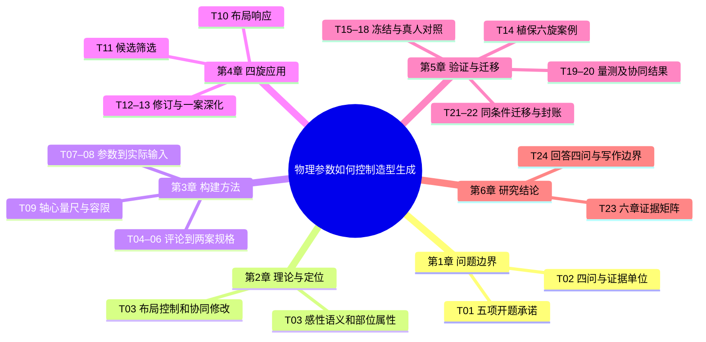

# 六章研究执行总清单

2026年11月12日执行版 · 《人智协同驱动的多旋翼无人机造型参数化可控生成方法研究》

**研究主线**　真实评论和产品样本给出设计语义，设计者选择目标部位与可改、保持和自由项。配置器把独立设定的几何参数变成生成条件。输出先检验布局响应，再观察设计者能否修改目标并保住非目标，最后由独立评者评价终稿。

**本版已确认**　修订六章目录与第4章“方法应用”；四旋为日常随行航拍，六旋为农业植保；四旋采用展开双叶，外壳轮廓自由；E盘配置器是现行原型，旧模型调用禁用。正交俯视量几何，斜前上视读四旋造型；六旋还需验证能看清载荷的视角。

**主要判据及边界**　RQ2逐档检验W/L、画幅尺度和定位漂移。RQ3在预先约定的机会和时间内，终稿是否同时满足目标修改、必要构型保持和可评价的造型完成度，另报分项。联合阈值、不可判与跨评者聚合仍需冻结。两类证据一起写，不能互相替代。

**截至本版**　新版正式图0，正式设计者场次0。历史主实验18图；另批39次受理、38条成图、33种像素，含缓存。S1六图旧坐标门槛0/6，两次AI轴心判读平均相差1.81像素。最近单图的水平跨度占画幅50.5%，目标27.6%。旧图与旧评议可解释技术选择，正式样本另表。

**接手后的第一班工作**　Codex先交T04证据编码、T06两案规格、T07参数对照三份可审材料，接着做T08两路离线请求与T09量测规程。Claude并行执行T01–03、T23，对每条主张填来源页和许可的表述。作者审规格和关乎开题的取舍；收集与运算另按冻结版本推进。

**状态怎么更新**　T号标识执行工作，原16个审核号用于作者反馈。一个任务归一个工单，完成时附产物路径、版本、可复算结果、失败及下一棒。勾选审核意见不改变实际运行状态。结果不足的任务可登记“已记录边界／未验证”，此状态允许写限制与结案，不计实证通过。

## 时间与交接

| 窗口（内部目标） | 工作 | 交付条件 |
| --- | --- | --- |
| 11月12日 · 离线先行 | T01–09、T23 | Codex整理两案规格、配置器几何和量尺；Claude将五项开题差异、方法和可写主张嵌入六章。作者与导师处理涉及承诺变更的项目。 |
| 11月13–18日 · 技术与筛选 | T09–11、T14前半、T15 | 技术输入和读数先冻结，再看各档真实响应。六旋手册与独立任务卡可并行。无合格四旋样本就记录筛选结果、暂不发评。 |
| 11月15–22日 · 案例与真人 | T12–18、T21 | 依据合格样本、真实服务和参与者条件推进。设计者操作和终稿盲评分开排；同条件拓扑对照另计。 |
| 11月23–26日 · 验证与封账 | T19–22 | 逐图、逐人、逐场核对，独立复算，注明未运行、不能测、退出及未通过；不能支撑的论点收窄。 |
| 11月27日–12月10日 · 六章初稿 | T23、T24 | 回填真实结果，章节图表逐一回链。已有材料对应章节可以提前起草。12月10日为内部初稿目标。 |
| 12月11–15日 · 内部修订 | T24 | 按实际导师回复修订，核对全文图表与引用。12月15日为内部目标，学校送审日期另核。 |

## 开题承诺与现行实施

| 开题项 | 任务 | 对应及差异 |
| --- | --- | --- |
| ① 参数→二维条件 | T07–10、T19 | 原包含轴距、桨径、夹角、机身长宽比、臂宽；先分开可配置、固定、实际检验。几何独立自由度与待裁定覆盖写清。 |
| ② 人智协同参数化流程 | T04–08、T12、T16–20 | 保留设计者确认、修改、拒绝、回选与停止。软件验收、真实服务和真人操作各有原件。 |
| ③ 小样本风格LoRA | T01、T08、T21 | 作者选择使用参考图；路线只按实际后端命名。替代训练的研究范围由导师裁定。 |
| ④ 评价与消融 | T09、T15–21 | D/S两套工作方式均有人参与。原开题的模块消融、修改前后配对和D/S整体比较是三个不同问题。 |
| ⑤ 四／六旋案例及规律 | T11–14、T19、T21、T24 | 两个应用分别报告；共同条件才能检验拓扑敏感性和风格保持。Y6/X8列展望。 |

## 执行思维导图

## 从评论到实验输入：两张工作表

| 依据 | 任务语义 | 观察／操作 | 证据边界 |
| --- | --- | --- | --- |
| E001、E003；E002为反例 | 日常携带；也有人更看重较大机身的稳定感 | 紧凑—松散为待试词对；从同视角样本记录机身占比、相机突出程度 | 实际词对评分缺；评论推不出轴距或实际稳定性 |
| E011、E014；E006提示情境 | 外观简洁、精整感；加装防护后的体量感单列 | 候选属性为主体分件、臂根过渡、附件与壳体关系 | 形态属性需编码与人评；美观与功能分别留证 |
| 作者已定的植保简报＋产品手册 | 看清药箱、喷洒部件和机架关系 | 记录承托、连接与部件体量，可改外壳及整合方式 | 植保任务独立建表；四旋评论不能充作农业用户样本 |

对称等径X架算例，D=250 mm、桨径127 mm为设计假设。前侧张角α=2 arctan(W/L)，W=D sin(α/2)，L=D cos(α/2)。四个轴心取(±W/2,±L/2)，用同一画布仿射变换导出；四副双叶、叶尖方位和展开状态同档对照。以下是输入几何，无生成观测。

| 目标W/L | 前侧夹角 | W / L（mm） | 理想最小桨盘净距（mm） |
| --- | --- | --- | --- |
| 0.85 | 80.73° | 161.91 / 190.48 | 34.91 |
| 1.00 | 90.00° | 176.78 / 176.78 | 49.78 |
| 1.15 | 97.98° | 188.65 / 164.04 | 37.04 |

输出用机头朝上的原始俯视整图。W/L按实体轴心水平跨度除以纵向跨度；尺度用水平跨度／原画幅宽，中心漂移用轴心质心与目标中心的距离。位置误差用对应实体轴心的平均欧氏距离，报告像素及除以画幅对角线的归一化值。若采用历史阈值，须同时保留该批原定义和单位。不得以重新裁图对齐后替代原尺度；夹角和跨度比联动，固定的D不产生轴距效应估计。

**方法选择**　感性工学指导建立产品印象与形态属性的关联。SD用于双极词感知量测；只有开展具备／不具备成对问卷，才讨论Kano需求分类。本计划的语义提取和SD不产出Kano类别。参数化几何、空间布局条件、部位—属性绑定、设计者主导的编辑与被试内评议分别解决不同问题。

[Chen 等原文](https://www.jstage.jst.go.jp/article/jamdsm/20/1/20_2026jamdsm0008/_article) · [作者全文](https://arxiv.org/html/2511.18333v1) · [CVPR 出版记录](https://openaccess.thecvf.com/content/CVPR2026/html/Shi_ConsistCompose_Unified_Multimodal_Layout_Control_for_Image_Composition_CVPR_2026_paper.html) · [GenAlign](https://doi.org/10.1016/j.aei.2026.105165) · [作者项目与论文](https://visvar.github.io/pub/park2026enhancing.html) · [Nagamachi](https://doi.org/10.1016/0169-8141(94)00052-5) · [Osgood 等](https://www.press.uillinois.edu/books/?id=p745393) · [Kano 等](https://doi.org/10.20684/quality.14.2_147)

## 第1章 绪论

研究问题、开题承诺与可证伪的判据

### T01 核对开题五项与六章边界

- [ ] 部分有据（截至本版）
- **写入目录**　1.1、1.4
- **责任与前置**　作者、导师、Claude；可从已有资料开始
- **先读什么**　开题第6–7页、修订Word第4章和范围工单；逐条看原承诺和批示。
- **实际操作**　把开题第6–7页五项逐句对到现行目录、RQ、操作和预期原件。把 LoRA、几何参数覆盖、原消融改为 D/S 的差异列入同一张对照表，保留导师批注。
- **交付与字段**　scope-crosswalk：承诺原文、章节、当前做法、差异、裁定人及原件
- **验收与失败处置**　四／六旋任务和第4章题名已有依据；未获导师意见的范围保留待定，先写已核范围。

[开题报告原件 · 第 6–7 页](https://github.com/Freeloop993/paper/blob/8eef6f321439fcaeabad9b884c921757a699eebc/planning/proposal-original.pdf#page=6) · [已修订六章目录 · Word](https://github.com/Freeloop993/paper/blob/8eef6f321439fcaeabad9b884c921757a699eebc/planning/outline-revised.docx) · [全局计划 · 开题五项对账](https://github.com/Freeloop993/paper/blob/8eef6f321439fcaeabad9b884c921757a699eebc/docs/research-plan.md) · [作者与导师待定事项 · #3](https://github.com/Freeloop993/paper/issues/3)

### T02 固定研究问题与证据单位

- [ ] 可先做（截至本版）
- **写入目录**　1.2、1.3、1.5、2.6、3.1、5.6、6.1
- **责任与前置**　Claude、Codex；T01
- **先读什么**　开题五项对账、证据矩阵；把RQ与最小观察单位逐问对应。
- **实际操作**　RQ1 看语义进入设计规格的路径，RQ2 看参数是否带来可测变化，RQ3 看人在修改中能否实现意图并保住结构，RQ4 看规则迁移到六旋何处失效。为每问列可推翻它的观测和分母。
- **交付与字段**　rq-evidence：研究问题、预测、反例、单位、目录号
- **验收与失败处置**　每个主张能指到一类独立原件；仅有生成图时，RQ3 的协同效果继续留空。

[开题报告原件 · 第 6–7 页](https://github.com/Freeloop993/paper/blob/8eef6f321439fcaeabad9b884c921757a699eebc/planning/proposal-original.pdf#page=6) · [已修订六章目录 · Word](https://github.com/Freeloop993/paper/blob/8eef6f321439fcaeabad9b884c921757a699eebc/planning/outline-revised.docx) · [全局计划 · 开题五项对账](https://github.com/Freeloop993/paper/blob/8eef6f321439fcaeabad9b884c921757a699eebc/docs/research-plan.md) · [作者与导师待定事项 · #3](https://github.com/Freeloop993/paper/issues/3)

## 第2章 相关研究与理论基础

既有理论、AI方法与本文的增量

### T03 做带页码的理论与方法对照

- [ ] 可先做（截至本版）
- **写入目录**　1.5、2.1、2.2、2.3、2.4、2.5、2.6、2.7
- **责任与前置**　Claude；T01
- **先读什么**　Chen PDF13–14、18；GenAlign PDF10、12、20；ConsistCompose §3.2–3.3、§4.2、表1；Park等的任务划分与被试内比较。查成果层次与局限。
- **实际操作**　精读需求到造型的直接近邻 Chen 等、布局控制 ConsistCompose、可编辑意图 GenAlign、交互修改研究。各摘任务、输入、测量、失败、适用范围。逐项与本文的部件级控制和人机分工比较。
- **交付与字段**　literature-claims：题名、版本、DOI、页码／图表、借用环节、差异
- **验收与失败处置**　每条理论主张回原页；只有摘要的留作检索线索。文献库条数和书目实际引用数分别统计。

[阶段阅读地图 · 原文版本与页码](https://github.com/Freeloop993/paper/blob/8eef6f321439fcaeabad9b884c921757a699eebc/references/reading-map.md) · [优先文献 · 版本核对表](https://github.com/Freeloop993/paper/blob/8eef6f321439fcaeabad9b884c921757a699eebc/references/catalogs/priority-fulltexts.md) · [章节主张与证据矩阵](https://github.com/Freeloop993/paper/blob/8eef6f321439fcaeabad9b884c921757a699eebc/manuscript/evidence-matrix.md) · [Chen 等原文](https://www.jstage.jst.go.jp/article/jamdsm/20/1/20_2026jamdsm0008/_article) · [作者全文](https://arxiv.org/html/2511.18333v1) · [CVPR 出版记录](https://openaccess.thecvf.com/content/CVPR2026/html/Shi_ConsistCompose_Unified_Multimodal_Layout_Control_for_Image_Composition_CVPR_2026_paper.html) · [GenAlign](https://doi.org/10.1016/j.aei.2026.105165) · [作者项目与论文](https://visvar.github.io/pub/park2026enhancing.html) · [Nagamachi](https://doi.org/10.1016/0169-8141(94)00052-5) · [Osgood 等](https://www.press.uillinois.edu/books/?id=p745393) · [Kano 等](https://doi.org/10.20684/quality.14.2_147)

## 第3章 造型意图转译与人智协同可控生成方法

需求和参数怎样成为可发给模型的规格

### T04 从真实评论建立语义编码表

- [ ] 部分有据（截至本版）
- **写入目录**　3.2、3.2.1、3.2.2
- **责任与前置**　Codex、Claude；可从已有资料开始
- **先读什么**　需求卡的来源与上下文、Chen PDF13–14、18；读“提取语义”的过程和反例，区别于满意度排序。
- **实际操作**　复用去重簇和证据卡，记录来源、语境、场景，区分功能诉求与视觉感知。对“便携”和“大机身带来稳定感”各保留正反语境。两人独立试编码一批，分歧回原语境；记录筛选理由与覆盖。
- **交付与字段**　needs-codes：来源ID、卡号、原语境索引、语义、反例、编码者、分歧
- **验收与失败处置**　7,443个簇、36卡／35来源、8处已回原语境是现有资产；多人转载、同一人重复、词频均不充当独立需求人数。

[Google Doc 执行计划 · 归档快照](https://github.com/Freeloop993/paper/blob/8eef6f321439fcaeabad9b884c921757a699eebc/planning/google-doc-snapshot.md) · [全局计划 · 开题五项对账](https://github.com/Freeloop993/paper/blob/8eef6f321439fcaeabad9b884c921757a699eebc/docs/research-plan.md) · [阶段阅读地图 · 原文版本与页码](https://github.com/Freeloop993/paper/blob/8eef6f321439fcaeabad9b884c921757a699eebc/references/reading-map.md) · [农业植保 · 三款手册逐图试读](https://github.com/Freeloop993/paper/blob/8eef6f321439fcaeabad9b884c921757a699eebc/experiments/hexa-plant-protection/README.md)

### T05 把感性词和可见形态对应起来

- [ ] 待采集（截至本版）
- **写入目录**　2.2、3.2、3.2.2、3.2.3、3.3.1、3.6.2、5.3.1
- **责任与前置**　Codex、设计研究者；T04
- **先读什么**　Nagamachi 的产品印象—设计要素关系、Osgood 的双极词量测；回看词语原语境与原产品样本。
- **实际操作**　按任务选择视角可比的真实产品样本；合并同义词，检查双极词是否可懂，如紧凑—松散。试填后确定词对、量表端点、展示顺序；分别编码相机嵌入、臂根曲面和分件，再做独立语义差异评分。 开始收集新人的评分前由作者确认知情同意与数据保存安排。
- **交付与字段**　semantic-scale、sample-attributes、sd-ratings：词对×样本×匿名评者；保留弃词、不可见
- **验收与失败处置**　先核评分语言和样本覆盖；已有情感倾向不足以给出新SD量表分值。样本有限报告分布和对应反例。

[Google Doc 执行计划 · 归档快照](https://github.com/Freeloop993/paper/blob/8eef6f321439fcaeabad9b884c921757a699eebc/planning/google-doc-snapshot.md) · [全局计划 · 开题五项对账](https://github.com/Freeloop993/paper/blob/8eef6f321439fcaeabad9b884c921757a699eebc/docs/research-plan.md) · [阶段阅读地图 · 原文版本与页码](https://github.com/Freeloop993/paper/blob/8eef6f321439fcaeabad9b884c921757a699eebc/references/reading-map.md) · [农业植保 · 三款手册逐图试读](https://github.com/Freeloop993/paper/blob/8eef6f321439fcaeabad9b884c921757a699eebc/experiments/hexa-plant-protection/README.md) · [优先文献 · 版本核对表](https://github.com/Freeloop993/paper/blob/8eef6f321439fcaeabad9b884c921757a699eebc/references/catalogs/priority-fulltexts.md) · [章节主张与证据矩阵](https://github.com/Freeloop993/paper/blob/8eef6f321439fcaeabad9b884c921757a699eebc/manuscript/evidence-matrix.md) · [Chen 等原文](https://www.jstage.jst.go.jp/article/jamdsm/20/1/20_2026jamdsm0008/_article) · [作者全文](https://arxiv.org/html/2511.18333v1) · [CVPR 出版记录](https://openaccess.thecvf.com/content/CVPR2026/html/Shi_ConsistCompose_Unified_Multimodal_Layout_Control_for_Image_Composition_CVPR_2026_paper.html) · [GenAlign](https://doi.org/10.1016/j.aei.2026.105165) · [作者项目与论文](https://visvar.github.io/pub/park2026enhancing.html) · [Nagamachi](https://doi.org/10.1016/0169-8141(94)00052-5) · [Osgood 等](https://www.press.uillinois.edu/books/?id=p745393) · [Kano 等](https://doi.org/10.20684/quality.14.2_147)

### T06 编制两种应用任务的造型规格

- [ ] 部分有据（截至本版）
- **写入目录**　3.1、3.2.3、3.3、3.3.1、3.3.2、3.3.3、4.1、4.1.1、4.2.1
- **责任与前置**　作者、Codex；T04
- **先读什么**　P1需求回链与B02简报、GenAlign的部位—属性表达、六旋三款手册的载荷与安装图。
- **实际操作**　从语义卡进入目标部位、改变、保持、自由项、可见证据。四旋聚焦随行航拍相机与机身、机臂与机身；六旋聚焦植保药箱、喷洒件与机架。记录语义解释与作者确认，保留不同意的改动。
- **交付与字段**　brief-quad、brief-hexa：需求ID、任务、部位、可变量、保持项、版本理由
- **验收与失败处置**　能从字段回到来源或明确的作者简报；物理尺寸由设计规格设定，不能用评论反推。

[D/S 比较、参与者与评议方案](https://github.com/Freeloop993/paper/blob/8eef6f321439fcaeabad9b884c921757a699eebc/docs/methods.md) · [改稿台 · 过程记录](https://github.com/Freeloop993/paper/blob/8eef6f321439fcaeabad9b884c921757a699eebc/experiments/operator-workbench/README.md) · [农业植保 · 三款手册逐图试读](https://github.com/Freeloop993/paper/blob/8eef6f321439fcaeabad9b884c921757a699eebc/experiments/hexa-plant-protection/README.md) · [阶段阅读地图 · 原文版本与页码](https://github.com/Freeloop993/paper/blob/8eef6f321439fcaeabad9b884c921757a699eebc/references/reading-map.md)

### T07 把物理参数编译成可见几何

- [ ] 部分有据（截至本版）
- **写入目录**　2.3、3.1、3.4、3.4.1、3.4.2、3.4.3、4.1、4.1.2、5.5.1
- **责任与前置**　Codex；T06
- **先读什么**　配置器来源记录、变量字典“四旋X架组合”、当前参考图与逐桨量测；核对模型实际收到哪一层。
- **实际操作**　沿用E盘配置器。约定机头、原点、单位、编号；校核轴距、相邻臂夹角、臂长、W/L、桨径与叶数的依赖关系。导出用于解释的连臂夹角预览和实际送模定位图，分别保存同一配置ID。
- **交付与字段**　geometry-contract、guide.png、preview、request.json：目标坐标、画幅、标尺、角度和输入角色
- **验收与失败处置**　角和360°，相邻桨盘有净距；变单个自由度可按坐标重算。标注预览里的线条、文字与外壳轮廓是否送模要从实际请求核对。

[E 盘配置器 · 来源与纠偏](https://github.com/Freeloop993/paper/blob/8eef6f321439fcaeabad9b884c921757a699eebc/docs/configurator-realignment.md) · [研究变量与量尺](https://github.com/Freeloop993/paper/blob/8eef6f321439fcaeabad9b884c921757a699eebc/docs/research-variables.md) · [最近定位图、原图与逐桨量测](https://github.com/Freeloop993/paper/blob/8eef6f321439fcaeabad9b884c921757a699eebc/evidence/quad-guide-cmf-review/README.md) · [开题报告原件 · 第 6–7 页](https://github.com/Freeloop993/paper/blob/8eef6f321439fcaeabad9b884c921757a699eebc/planning/proposal-original.pdf#page=6)

### T08 固定同信息量的输入对照

- [ ] 可先做（截至本版）
- **写入目录**　2.4、3.4、3.4.3、3.5、3.5.1、4.1.2、4.2.2
- **责任与前置**　Codex、Claude；T07
- **先读什么**　读取实际请求结构、ControlNet论文条件忠实度与图像质量的区分、布局控制论文的位置与身份评价。
- **实际操作**　按同一份设计规格生成数值文字与“同文＋参数定位图”两路。锁定图幅、模型、实际后端、呈现和生成机会；单列 ControlNet 权重／强度或普通附图接口、是否可锁种子、原始提示与实际请求。
- **交付与字段**　input-pairs：配对ID、参数、prompt哈希、图哈希、后端通道、种子能力、版本
- **验收与失败处置**　除要比较的通道外逐字段对照；内置模型独立抽样单列，不充作 Qwen、ControlNet 或同种子复现。

[G2 原图与判读](https://github.com/Freeloop993/paper/blob/8eef6f321439fcaeabad9b884c921757a699eebc/evidence/g2-six/README.md) · [G2b 四种配置筛选](https://github.com/Freeloop993/paper/blob/8eef6f321439fcaeabad9b884c921757a699eebc/evidence/g2b-actual/README.md) · [G3 人评与 AI 分歧](https://github.com/Freeloop993/paper/blob/8eef6f321439fcaeabad9b884c921757a699eebc/evidence/g3-actual/README.md) · [正式采集冻结单 · 草案](https://github.com/Freeloop993/paper/blob/8eef6f321439fcaeabad9b884c921757a699eebc/docs/protocols/freeze-sheet-P3.md) · [阶段阅读地图 · 原文版本与页码](https://github.com/Freeloop993/paper/blob/8eef6f321439fcaeabad9b884c921757a699eebc/references/reading-map.md)

### T09 验证点击量尺并冻结几何判读

- [ ] 可先做（截至本版）
- **写入目录**　3.4、3.4.4、3.6、3.6.1、4.1.3、5.1.2、5.2.2
- **责任与前置**　Codex、独立量测者；T07
- **先读什么**　S1两次点位、P04双叶与最近尺度误差；核匿名量测流程、缺失原因与像素坐标定义。
- **实际操作**　在已知坐标测试图上校准点击；另在匿名原始俯视图上独立点实体电机轴心，保存原像素、编号、缺失原因。计算重复读数误差，并在看正式结果前定可读性、比例／尺度容限和最低有用响应。
- **交付与字段**　measurement-protocol、points、repeatability：图ID、读者、坐标、误差、阈值来源
- **验收与失败处置**　可以用保存点位复算；遮挡、歧义标不可判。旧同模型双次AI复测与新独立真人复测分栏。

[S1 六图轴心独立复测](https://github.com/Freeloop993/paper/blob/8eef6f321439fcaeabad9b884c921757a699eebc/evidence/s1-axis-repeat/README.md) · [P04 双叶四旋六图](https://github.com/Freeloop993/paper/blob/8eef6f321439fcaeabad9b884c921757a699eebc/evidence/p04-quad-biblade/README.md) · [最近定位图、原图与逐桨量测](https://github.com/Freeloop993/paper/blob/8eef6f321439fcaeabad9b884c921757a699eebc/evidence/quad-guide-cmf-review/README.md) · [研究变量与量尺](https://github.com/Freeloop993/paper/blob/8eef6f321439fcaeabad9b884c921757a699eebc/docs/research-variables.md)

## 第4章 四旋翼无人机造型生成与方法应用

四旋应用如何形成有依据的设计方案

### T10 先检验布局与尺度是否真的跟随

- [ ] 依赖冻结（截至本版）
- **写入目录**　3.4.4、4.1.3、4.2、4.2.2、5.2.1
- **责任与前置**　Codex；T08、T09
- **先读什么**　S1复测与最近定位图尺度反例，G2失败判读；比较可读性、跨度误差和绝对位置。
- **实际操作**　用相同构型三档目标和独立重复块测试输入路线。每张均读点，分别算跨度比、夹角、中心偏移、相对画幅尺度；逐档画目标—观测曲线，核对饱和、反向和只保比例而失尺度的例子。 新运行先取得本批条件与资源范围；无资源可完成测量协议，保持待采集。
- **交付与字段**　layout-response：设计档位、图ID、实际生成／读取分母、各指标、原图与失败
- **验收与失败处置**　三档与重复均按预定规则报告，观测变化需能与读数误差区分；失败就保留反例、限定变量，不以挑图换规则。

[S1 六图轴心独立复测](https://github.com/Freeloop993/paper/blob/8eef6f321439fcaeabad9b884c921757a699eebc/evidence/s1-axis-repeat/README.md) · [P04 双叶四旋六图](https://github.com/Freeloop993/paper/blob/8eef6f321439fcaeabad9b884c921757a699eebc/evidence/p04-quad-biblade/README.md) · [最近定位图、原图与逐桨量测](https://github.com/Freeloop993/paper/blob/8eef6f321439fcaeabad9b884c921757a699eebc/evidence/quad-guide-cmf-review/README.md) · [研究变量与量尺](https://github.com/Freeloop993/paper/blob/8eef6f321439fcaeabad9b884c921757a699eebc/docs/research-variables.md) · [G2 原图与判读](https://github.com/Freeloop993/paper/blob/8eef6f321439fcaeabad9b884c921757a699eebc/evidence/g2-six/README.md) · [G2b 四种配置筛选](https://github.com/Freeloop993/paper/blob/8eef6f321439fcaeabad9b884c921757a699eebc/evidence/g2b-actual/README.md) · [G3 人评与 AI 分歧](https://github.com/Freeloop993/paper/blob/8eef6f321439fcaeabad9b884c921757a699eebc/evidence/g3-actual/README.md) · [正式采集冻结单 · 草案](https://github.com/Freeloop993/paper/blob/8eef6f321439fcaeabad9b884c921757a699eebc/docs/protocols/freeze-sheet-P3.md) · [阶段阅读地图 · 原文版本与页码](https://github.com/Freeloop993/paper/blob/8eef6f321439fcaeabad9b884c921757a699eebc/references/reading-map.md)

### T11 筛选可用于设计评价的四旋候选

- [ ] 依赖冻结（截至本版）
- **写入目录**　3.5.1、4.2、4.2.1、4.2.2、4.2.3、4.3.1
- **责任与前置**　作者、Codex；T06、T08、T09、T10
- **先读什么**　正式样本重建口径、P04/P05/P06原图问题、B02任务和评图措辞；先定送评底线。
- **实际操作**　在同一简报下预先登记造型方向、机会、结构底线和观察视角。逐张检查四轴四副双叶的完整性、等长等宽、臂体连接、机鼻前摄方向与可辨性。再判断部位整合、厚度和形体过渡。
- **交付与字段**　quad-candidates：全部机会、拓扑、缺失、剔除理由、原图、进入设计评议标记
- **验收与失败处置**　筛选前后均报分母；糟糕或不可读的技术图留失败档。无合格候选则4.2报告筛选边界，停止把草图交给人打造型分。

[最近定位图、原图与逐桨量测](https://github.com/Freeloop993/paper/blob/8eef6f321439fcaeabad9b884c921757a699eebc/evidence/quad-guide-cmf-review/README.md) · [正式样本重建与退役记录](https://github.com/Freeloop993/paper/blob/8eef6f321439fcaeabad9b884c921757a699eebc/evidence/formal-reset/README.md) · [阶段阅读地图 · 原文版本与页码](https://github.com/Freeloop993/paper/blob/8eef6f321439fcaeabad9b884c921757a699eebc/references/reading-map.md) · [D/S 比较、参与者与评议方案](https://github.com/Freeloop993/paper/blob/8eef6f321439fcaeabad9b884c921757a699eebc/docs/methods.md)

### T12 留下一次可重放的单案修订

- [ ] 待真实操作（截至本版）
- **写入目录**　2.5、3.3.3、3.5、3.5.2、3.5.3、3.5.4、4.3、4.3.1、4.3.2、4.3.3、5.4.1
- **责任与前置**　设计者、Codex；T11
- **先读什么**　G3真人与AI对前摄的分歧，GenAlign的编辑目标和保持项；读真实版本选择记录。
- **实际操作**　从合格候选锁定修订起点，写清要改变哪处和保留哪处。保存前图、真实修改输入、改后图、设计者接受／拒绝／回选／停止及理由。单次修改不以改善为默认。
- **交付与字段**　case-history：父子图ID、版本、目标、非目标、选择与时间
- **验收与失败处置**　父图只用于具体修订或显式比较，初稿可从参数起步。修订不起效也能重建实际过程。

[改稿台 · 过程记录](https://github.com/Freeloop993/paper/blob/8eef6f321439fcaeabad9b884c921757a699eebc/experiments/operator-workbench/README.md) · [D/S 比较、参与者与评议方案](https://github.com/Freeloop993/paper/blob/8eef6f321439fcaeabad9b884c921757a699eebc/docs/methods.md) · [P06 视角与机载相机](https://github.com/Freeloop993/paper/blob/8eef6f321439fcaeabad9b884c921757a699eebc/evidence/p06-quad-front-camera/README.md) · [正式样本重建与退役记录](https://github.com/Freeloop993/paper/blob/8eef6f321439fcaeabad9b884c921757a699eebc/evidence/formal-reset/README.md)

### T13 完成一案深化及同一对象的呈现

- [ ] 待案例（截至本版）
- **写入目录**　4.4、4.4.1、4.4.2、4.4.3、4.5
- **责任与前置**　设计者、Claude；T12
- **先读什么**　现行目录4.4.1–4.4.3及同案来源；看部位分件、光泽和跨视角一致性。
- **实际操作**　在4.4.1深化相机净空的可见关系与臂根转折；4.4.2仅对入选方向定义部件、色材、光泽、分件和选择理由。4.4.3输出俯视几何与能看清整合的产品视图，记录同一设计的来源。
- **交付与字段**　design-plate、cmf-by-part、view-lineage：面板、细节、参照及证据限制
- **验收与失败处置**　两张图若不能证实同一设计，就分别注明；材质牌号、重心、加工性能或可飞性不能凭渲染验收。

[最近定位图、原图与逐桨量测](https://github.com/Freeloop993/paper/blob/8eef6f321439fcaeabad9b884c921757a699eebc/evidence/quad-guide-cmf-review/README.md) · [正式样本重建与退役记录](https://github.com/Freeloop993/paper/blob/8eef6f321439fcaeabad9b884c921757a699eebc/evidence/formal-reset/README.md) · [阶段阅读地图 · 原文版本与页码](https://github.com/Freeloop993/paper/blob/8eef6f321439fcaeabad9b884c921757a699eebc/references/reading-map.md) · [D/S 比较、参与者与评议方案](https://github.com/Freeloop993/paper/blob/8eef6f321439fcaeabad9b884c921757a699eebc/docs/methods.md) · [改稿台 · 过程记录](https://github.com/Freeloop993/paper/blob/8eef6f321439fcaeabad9b884c921757a699eebc/experiments/operator-workbench/README.md) · [P06 视角与机载相机](https://github.com/Freeloop993/paper/blob/8eef6f321439fcaeabad9b884c921757a699eebc/evidence/p06-quad-front-camera/README.md)

## 第5章 方法验证、跨构型适配与讨论

怎样独立验证，并检验六旋迁移边界

### T14 实施农业植保六旋独立应用

- [ ] 部分有据（截至本版）
- **写入目录**　2.1、3.2.3、5.5、5.5.1、5.5.2
- **责任与前置**　Codex、作者；T06、T07
- **先读什么**　植保案例手册逐图索引、六旋拓扑规则、开题第（5）项；对照旧六旋任务来源。
- **实际操作**　读三款产品手册中的载荷安装图，标明页码与可见部位；固定六旋拓扑，给药箱轮廓、承托及喷洒组件连接留下设计空间。先校核六轴与载荷可见视角，再用同一规格卡保存生成、筛选、一次真实取舍。 手册与离线准备可立即进行，任何新生成须先完成输入校核、记录实际后端和本批边界。
- **交付与字段**　hexa-case：手册参照、六轴配置、装置整合图、候选全表与选择理由
- **验收与失败处置**　两个整合关系分别可见可评；被遮挡的记录不可判。旧测绘六旋数据保留旧任务名称；植保效果仅限可见造型。

[农业植保 · 三款手册逐图试读](https://github.com/Freeloop993/paper/blob/8eef6f321439fcaeabad9b884c921757a699eebc/experiments/hexa-plant-protection/README.md) · [开题报告原件 · 第 6–7 页](https://github.com/Freeloop993/paper/blob/8eef6f321439fcaeabad9b884c921757a699eebc/planning/proposal-original.pdf#page=6) · [全局计划 · 开题五项对账](https://github.com/Freeloop993/paper/blob/8eef6f321439fcaeabad9b884c921757a699eebc/docs/research-plan.md)

### T15 冻结正式协议与参与者安排

- [ ] 待裁定（截至本版）
- **写入目录**　5.1、5.1.1、5.1.2、5.1.3
- **责任与前置**　Claude、作者、导师；T01、T06、T08、T09
- **先读什么**　正式采集材料与冻结单C/D/E、X12同人复填、Park等任务顺序；核样本与授权责任。
- **实际操作**　预先填参与者资格、招募同意与撤回、样本目标、任务A/B、D/S分配、预算、错误停止、盲评指标与聚合、最小有用差异。旧草案目标8／最低4名设计者，人数和处置以正式签定版本为准。
- **交付与字段**　freeze-sheet、allocation、consent-version：版本、日期、负责人、未决栏
- **验收与失败处置**　有记录才能计入正式样本；预算、人数、导师认可和伦理状态均不能从旧工单推定。未决期间可写方法和做离线核对。

[正式采集冻结单 · 草案](https://github.com/Freeloop993/paper/blob/8eef6f321439fcaeabad9b884c921757a699eebc/docs/protocols/freeze-sheet-P3.md) · [D/S 比较、参与者与评议方案](https://github.com/Freeloop993/paper/blob/8eef6f321439fcaeabad9b884c921757a699eebc/docs/methods.md) · [X12 同人复填原件摘要](https://github.com/Freeloop993/paper/blob/8eef6f321439fcaeabad9b884c921757a699eebc/evidence/x12-calibration/r2-return.md) · [阶段阅读地图 · 原文版本与页码](https://github.com/Freeloop993/paper/blob/8eef6f321439fcaeabad9b884c921757a699eebc/references/reading-map.md)

### T16 核验两种改稿流程的能力公平

- [ ] 依赖冻结（截至本版）
- **写入目录**　3.5、3.5.2、5.1.1
- **责任与前置**　Codex；T08、T15
- **先读什么**　改稿台两路请求、G3后端能力试验与原始回执；分别验软件、服务和人的操作。
- **实际操作**　在同后端、同等机会验证两路都能引用前图、自由编写文字、回退、停止。记录实际可用动作、编译输入、服务回执，独立检查目标部位变动和非目标漂移。
- **交付与字段**　workflow-parity：动作×D/S、输入、真实服务能力、失败记录
- **验收与失败处置**　离线软件通过与真实服务通过分别记；任一路缺能力就统一能力后重新冻结，不能把工具差异算作方法优势。

[G2 原图与判读](https://github.com/Freeloop993/paper/blob/8eef6f321439fcaeabad9b884c921757a699eebc/evidence/g2-six/README.md) · [G2b 四种配置筛选](https://github.com/Freeloop993/paper/blob/8eef6f321439fcaeabad9b884c921757a699eebc/evidence/g2b-actual/README.md) · [G3 人评与 AI 分歧](https://github.com/Freeloop993/paper/blob/8eef6f321439fcaeabad9b884c921757a699eebc/evidence/g3-actual/README.md) · [正式采集冻结单 · 草案](https://github.com/Freeloop993/paper/blob/8eef6f321439fcaeabad9b884c921757a699eebc/docs/protocols/freeze-sheet-P3.md) · [阶段阅读地图 · 原文版本与页码](https://github.com/Freeloop993/paper/blob/8eef6f321439fcaeabad9b884c921757a699eebc/references/reading-map.md) · [D/S 比较、参与者与评议方案](https://github.com/Freeloop993/paper/blob/8eef6f321439fcaeabad9b884c921757a699eebc/docs/methods.md) · [改稿台 · 过程记录](https://github.com/Freeloop993/paper/blob/8eef6f321439fcaeabad9b884c921757a699eebc/experiments/operator-workbench/README.md)

### T17 采集设计者被试内配对过程

- [ ] 待真人场次（截至本版）
- **写入目录**　3.1、3.5.3、3.5.4、3.6.3、5.4.1、5.4.2
- **责任与前置**　真实设计者、作者、Codex；T15、T16
- **先读什么**　D/S协议、顺序分配与退出记录表；核两卡难度、机会和主动操作／等待定义。
- **实际操作**　同一人完成两种工作方式、两张等难任务卡；跨人平衡任务与顺序。两边同训练、时间与修改机会。记录实际初稿、每次修改、终稿选择、停止、主动操作及等待时间。
- **交付与字段**　sessions：匿名人ID、卡、顺序、D/S、请求ID、版本、接受／拒绝、时长
- **验收与失败处置**　一人两场仍是一人；报告分配、完成对、单边缺失和退出。AI演练与作者自测单列。

[D/S 比较、参与者与评议方案](https://github.com/Freeloop993/paper/blob/8eef6f321439fcaeabad9b884c921757a699eebc/docs/methods.md) · [改稿台 · 过程记录](https://github.com/Freeloop993/paper/blob/8eef6f321439fcaeabad9b884c921757a699eebc/experiments/operator-workbench/README.md) · [正式采集冻结单 · 草案](https://github.com/Freeloop993/paper/blob/8eef6f321439fcaeabad9b884c921757a699eebc/docs/protocols/freeze-sheet-P3.md) · [阶段阅读地图 · 原文版本与页码](https://github.com/Freeloop993/paper/blob/8eef6f321439fcaeabad9b884c921757a699eebc/references/reading-map.md)

### T18 分开评设计意图、协调度和可深化性

- [ ] 待真人评议（截至本版）
- **写入目录**　3.6、3.6.2、5.1.3、5.3、5.3.1、5.3.2
- **责任与前置**　作者、独立评议者；T11、T15、T17
- **先读什么**　X12措辞修订、G3人机分歧、正式盲评说明；核看图视角与评者可获得的任务说明。
- **实际操作**　随机匿名展示同标准产品视图；意图判断给同一条中性任务说明，隐藏方法、作者、AI与筛选标签。单列相机／臂根的目标改动、非目标保持、造型协调、深化选择；允许“不可判”和自由说明。
- **交付与字段**　blind-ratings：匿名评者、经验、盲态、图ID、任务文本、逐项评分、缺失与理由
- **验收与失败处置**　每张保留各人原判及分歧，重复填答按人去重。结构示意图只作训练或量测；同任务表现可好看却不合规，或反之。

[X12 同人复填原件摘要](https://github.com/Freeloop993/paper/blob/8eef6f321439fcaeabad9b884c921757a699eebc/evidence/x12-calibration/r2-return.md) · [G3 人评与 AI 分歧](https://github.com/Freeloop993/paper/blob/8eef6f321439fcaeabad9b884c921757a699eebc/evidence/g3-actual/README.md) · [D/S 比较、参与者与评议方案](https://github.com/Freeloop993/paper/blob/8eef6f321439fcaeabad9b884c921757a699eebc/docs/methods.md) · [Google Doc 执行计划 · 归档快照](https://github.com/Freeloop993/paper/blob/8eef6f321439fcaeabad9b884c921757a699eebc/planning/google-doc-snapshot.md)

### T19 复算几何效应并解释偏差

- [ ] 待观测（截至本版）
- **写入目录**　3.6.1、5.2、5.2.1、5.2.2、5.2.3、6.3
- **责任与前置**　Codex、Claude；T09、T10
- **先读什么**　读S1误差分解、逐轴初读复测与冻结量尺；检查像素数据和可读图分母。
- **实际操作**　按水平、后端、重复块列目标与观测；画跨度响应并单列尺度与平移；对缺桨、轴位偏、遮挡、自由机壳被锁等逐项举反例。按全机会与可量测图分别统计。
- **交付与字段**　geometry-results、failure-atlas：逐图读数、分母、原图定位、汇总脚本
- **验收与失败处置**　复算表与原始点一致，失败／无结果分开；单张达标只支持该图，不能写普遍可控。

[S1 六图轴心独立复测](https://github.com/Freeloop993/paper/blob/8eef6f321439fcaeabad9b884c921757a699eebc/evidence/s1-axis-repeat/README.md) · [P04 双叶四旋六图](https://github.com/Freeloop993/paper/blob/8eef6f321439fcaeabad9b884c921757a699eebc/evidence/p04-quad-biblade/README.md) · [最近定位图、原图与逐桨量测](https://github.com/Freeloop993/paper/blob/8eef6f321439fcaeabad9b884c921757a699eebc/evidence/quad-guide-cmf-review/README.md) · [研究变量与量尺](https://github.com/Freeloop993/paper/blob/8eef6f321439fcaeabad9b884c921757a699eebc/docs/research-variables.md) · [X12 同人复填原件摘要](https://github.com/Freeloop993/paper/blob/8eef6f321439fcaeabad9b884c921757a699eebc/evidence/x12-calibration/r2-return.md) · [G3 人评与 AI 分歧](https://github.com/Freeloop993/paper/blob/8eef6f321439fcaeabad9b884c921757a699eebc/evidence/g3-actual/README.md) · [D/S 比较、参与者与评议方案](https://github.com/Freeloop993/paper/blob/8eef6f321439fcaeabad9b884c921757a699eebc/docs/methods.md) · [Google Doc 执行计划 · 归档快照](https://github.com/Freeloop993/paper/blob/8eef6f321439fcaeabad9b884c921757a699eebc/planning/google-doc-snapshot.md) · [旧批原件复核与分母](https://github.com/Freeloop993/paper/blob/8eef6f321439fcaeabad9b884c921757a699eebc/evidence/denominators/README.md) · [正式样本重建与退役记录](https://github.com/Freeloop993/paper/blob/8eef6f321439fcaeabad9b884c921757a699eebc/evidence/formal-reset/README.md) · [章节主张与证据矩阵](https://github.com/Freeloop993/paper/blob/8eef6f321439fcaeabad9b884c921757a699eebc/manuscript/evidence-matrix.md)

### T20 回答协同收益及代价

- [ ] 待观测（截至本版）
- **写入目录**　3.6、3.6.3、5.3.2、5.4、5.4.1、5.4.2、5.4.3、6.2
- **责任与前置**　Codex、Claude；T17、T18
- **先读什么**　读D/S的实验单位、分配顺序、版本和时长定义；核目标改动与非目标保持的独立判读。
- **实际操作**　按设计者配对比较终稿达到意图、保持必要构型、达到可评完成度的场次，并同时列三分项。分开报告初稿至终稿变化、被拒修改、停止、时间和调用；样本小列逐人差值与分歧。
- **交付与字段**　paired-outcomes：设计者、两任务、条件、三项结果、调用、主动与等待时间
- **验收与失败处置**　真实场次作分母；主动停止不填成改善；D/S比较只归因整套工作方式，不能拆成功能因果。

[D/S 比较、参与者与评议方案](https://github.com/Freeloop993/paper/blob/8eef6f321439fcaeabad9b884c921757a699eebc/docs/methods.md) · [改稿台 · 过程记录](https://github.com/Freeloop993/paper/blob/8eef6f321439fcaeabad9b884c921757a699eebc/experiments/operator-workbench/README.md) · [正式采集冻结单 · 草案](https://github.com/Freeloop993/paper/blob/8eef6f321439fcaeabad9b884c921757a699eebc/docs/protocols/freeze-sheet-P3.md) · [阶段阅读地图 · 原文版本与页码](https://github.com/Freeloop993/paper/blob/8eef6f321439fcaeabad9b884c921757a699eebc/references/reading-map.md) · [X12 同人复填原件摘要](https://github.com/Freeloop993/paper/blob/8eef6f321439fcaeabad9b884c921757a699eebc/evidence/x12-calibration/r2-return.md) · [G3 人评与 AI 分歧](https://github.com/Freeloop993/paper/blob/8eef6f321439fcaeabad9b884c921757a699eebc/evidence/g3-actual/README.md) · [Google Doc 执行计划 · 归档快照](https://github.com/Freeloop993/paper/blob/8eef6f321439fcaeabad9b884c921757a699eebc/planning/google-doc-snapshot.md) · [旧批原件复核与分母](https://github.com/Freeloop993/paper/blob/8eef6f321439fcaeabad9b884c921757a699eebc/evidence/denominators/README.md) · [正式样本重建与退役记录](https://github.com/Freeloop993/paper/blob/8eef6f321439fcaeabad9b884c921757a699eebc/evidence/formal-reset/README.md) · [章节主张与证据矩阵](https://github.com/Freeloop993/paper/blob/8eef6f321439fcaeabad9b884c921757a699eebc/manuscript/evidence-matrix.md)

### T21 比较四／六旋的可控性与风格保持

- [ ] 依赖冻结（截至本版）
- **写入目录**　5.5、5.5.1、5.5.2、5.5.3、6.2、6.4
- **责任与前置**　Codex、独立读图者；T09、T10、T15
- **先读什么**　共同对照manifest中的拓扑基准、3档水平、重复块；回读风格保持逐项表。
- **实际操作**　复核离线2拓扑×3相对水平×2重复的12个条件，采用相同语境、后端与画幅，按各自基准归一。冻结风格线索（分件、臂根语言、载荷整合）并逐项盲读保持／改变／不可判。
- **交付与字段**　cross-topology：条件矩阵、相对响应、可读率、风格条目及对照原图
- **验收与失败处置**　两个应用场景天然混杂；仅共同对照支持拓扑间比较。重复不足限定为探索，取消或失败的格子留空。

[共同对照 · 输入与编译](https://github.com/Freeloop993/paper/blob/8eef6f321439fcaeabad9b884c921757a699eebc/experiments/common-control/README.md) · [农业植保 · 三款手册逐图试读](https://github.com/Freeloop993/paper/blob/8eef6f321439fcaeabad9b884c921757a699eebc/experiments/hexa-plant-protection/README.md) · [全局计划 · 开题五项对账](https://github.com/Freeloop993/paper/blob/8eef6f321439fcaeabad9b884c921757a699eebc/docs/research-plan.md) · [开题报告原件 · 第 6–7 页](https://github.com/Freeloop993/paper/blob/8eef6f321439fcaeabad9b884c921757a699eebc/planning/proposal-original.pdf#page=6)

### T22 冻结数据并处理旧批、失败和缺失

- [ ] 待汇总（截至本版）
- **写入目录**　5.2.3、5.6、5.7、6.3
- **责任与前置**　Codex；T11、T14、T19、T20、T21
- **先读什么**　旧批分母审计与新样本退役清单；读缓存、像素去重、未受理与失败定义。
- **实际操作**　逐批核对机会、实发、受理、原图、像素身份、缓存、可评图和真实人数，逐项对上原件。旧批、软件控制、新预试和正式各一栏；记录每次剔除的时间、理由、判定人。
- **交付与字段**　denominators、exclusions、manifest：样本与图哈希、解盲表、版本号
- **验收与失败处置**　正式每行能回到冻结版本与原图。即使任务未取得数据也可凭失败／缺证说明封存；绝不把未知写0。

[旧批原件复核与分母](https://github.com/Freeloop993/paper/blob/8eef6f321439fcaeabad9b884c921757a699eebc/evidence/denominators/README.md) · [正式样本重建与退役记录](https://github.com/Freeloop993/paper/blob/8eef6f321439fcaeabad9b884c921757a699eebc/evidence/formal-reset/README.md) · [章节主张与证据矩阵](https://github.com/Freeloop993/paper/blob/8eef6f321439fcaeabad9b884c921757a699eebc/manuscript/evidence-matrix.md)

## 第6章 结论与展望

哪些论点能写，哪些还缺实证

### T23 按六章交证据与草稿

- [ ] 可先分章写（截至本版）
- **写入目录**　1.6、2.7、3.7、4.5、5.7
- **责任与前置**　Claude、Codex；T02、T03、T04、T06、T07
- **先读什么**　现行Word与逐节证据矩阵；每次写作回到任务中冻结的输入和产物。
- **实际操作**　先写1–3章已有边界、文献、原型和操作，第4章已发生的预试单列。4.2–4.4和第5章每个结果待对应原件到位；将每条结论写入章节—主张—证据—反例矩阵。
- **交付与字段**　manuscript/evidence-matrix.md及对应章节：主张、材料ID、页码、图表号、状态
- **验收与失败处置**　有方法可写、有结果可写和仍缺证各自标明。导师唯一题名批注已落实为第4章“方法应用”。

[已修订六章目录 · Word](https://github.com/Freeloop993/paper/blob/8eef6f321439fcaeabad9b884c921757a699eebc/planning/outline-revised.docx) · [章节主张与证据矩阵](https://github.com/Freeloop993/paper/blob/8eef6f321439fcaeabad9b884c921757a699eebc/manuscript/evidence-matrix.md) · [Google Doc 执行计划 · 归档快照](https://github.com/Freeloop993/paper/blob/8eef6f321439fcaeabad9b884c921757a699eebc/planning/google-doc-snapshot.md) · [全局计划 · 开题五项对账](https://github.com/Freeloop993/paper/blob/8eef6f321439fcaeabad9b884c921757a699eebc/docs/research-plan.md)

### T24 形成结论、限制与送审前稿

- [ ] 待结论审阅（截至本版）
- **写入目录**　5.6、6.1、6.2、6.3、6.4
- **责任与前置**　Claude、作者、导师；T13、T22、T23
- **先读什么**　开题差异表、各RQ反例、实际导师意见；章末分别核结论适用范围。
- **实际操作**　逐问列支持／部分支持／未验证、替代解释及适用对象；对照五项承诺列改动与批示。图表、引文、数据分母、个资授权逐项交叉检查，Y6／X8仅列未来方向。
- **交付与字段**　claim-audit、revision-log、六章整稿：逐条证据及导师修改回执
- **验收与失败处置**　有缺数据时写边界或调整范围并留裁定；达到写作节点与完成完整研究分开登记。

[已修订六章目录 · Word](https://github.com/Freeloop993/paper/blob/8eef6f321439fcaeabad9b884c921757a699eebc/planning/outline-revised.docx) · [章节主张与证据矩阵](https://github.com/Freeloop993/paper/blob/8eef6f321439fcaeabad9b884c921757a699eebc/manuscript/evidence-matrix.md) · [Google Doc 执行计划 · 归档快照](https://github.com/Freeloop993/paper/blob/8eef6f321439fcaeabad9b884c921757a699eebc/planning/google-doc-snapshot.md) · [全局计划 · 开题五项对账](https://github.com/Freeloop993/paper/blob/8eef6f321439fcaeabad9b884c921757a699eebc/docs/research-plan.md)

## 修订目录逐节索引

六章章名见上。以下保留79个二、三级标题。

| 修订目录 | 关联任务 |
| --- | --- |
| 1.1 研究背景与问题提出 | T01 |
| 1.2 研究目的与意义 | T02 |
| 1.3 研究目标与研究问题 | T02 |
| 1.4 研究对象与范围 | T01 |
| 1.5 研究内容、方法与技术路线 | T02、T03 |
| 1.6 论文组织结构 | T23 |
| 2.1 多旋翼无人机构型与造型设计 | T03、T14 |
| 2.2 设计语义、造型意象与设计意图 | T03、T05 |
| 2.3 参数化造型表达与条件构建 | T03、T07 |
| 2.4 可控图像生成、指令编辑与一致性保持 | T03、T08 |
| 2.5 人智协同中的设计主导权与交互反馈 | T03、T12 |
| 2.6 相关研究比较与本文研究定位 | T02、T03 |
| 2.7 本章小结 | T03、T23 |
| 3.1 方法总体框架与人智任务分工 | T02、T06、T07、T17 |
| 3.2 需求资料与产品样本分析 | T04、T05 |
| 3.2.1 资料来源与样本筛选 | T04 |
| 3.2.2 需求语义的整理与分类 | T04、T05 |
| 3.2.3 产品造型特征与构型边界分析 | T05、T06、T14 |
| 3.3 设计意图转译与造型规格构建 | T06 |
| 3.3.1 设计意图与造型属性的关联 | T05、T06 |
| 3.3.2 目标部位、可变项与保持项 | T06 |
| 3.3.3 造型规格的人工确认与修订 | T06、T12 |
| 3.4 造型参数与约束条件表达 | T07、T08、T09 |
| 3.4.1 主体轮廓与旋翼布局表达 | T07 |
| 3.4.2 造型变量、参数范围与组合规则 | T07 |
| 3.4.3 二维参数条件图构建 | T07、T08 |
| 3.4.4 输入参数与生成结果的对应关系 | T09、T10 |
| 3.5 人智协同生成与反馈机制 | T08、T12、T16 |
| 3.5.1 条件输入与候选方案生成 | T08、T11 |
| 3.5.2 生成结果检查与修改建议 | T12、T16 |
| 3.5.3 人工确认、停止与版本回退 | T12、T17 |
| 3.5.4 设计迭代与决策记录 | T12、T17 |
| 3.6 方法评价维度与验证思路 | T09、T18、T20 |
| 3.6.1 参数响应与结构保持 | T09、T19 |
| 3.6.2 设计意图符合度与方案感知 | T05、T18 |
| 3.6.3 协同反馈效果与操作代价 | T17、T20 |
| 3.7 本章小结 | T23 |
| 4.1 设计任务设定与应用原型 | T06、T07 |
| 4.1.1 设计目标与构型边界 | T06 |
| 4.1.2 原型组成与生成流程 | T07、T08 |
| 4.1.3 技术预试与条件选择 | T09、T10 |
| 4.2 多方向造型方案生成与探索 | T10、T11 |
| 4.2.1 设计方向与初始造型规格 | T06、T11 |
| 4.2.2 参数条件配置与候选方案生成 | T08、T10、T11 |
| 4.2.3 候选方案比较与筛选 | T11 |
| 4.3 反馈驱动的造型调整与迭代 | T12 |
| 4.3.1 生成问题识别与修改目标 | T11、T12 |
| 4.3.2 参数调整与人工决策 | T12 |
| 4.3.3 迭代过程与设计取舍 | T12 |
| 4.4 方案深化与最终设计表达 | T13 |
| 4.4.1 造型语言与形态细节深化 | T13 |
| 4.4.2 色彩、材料与表面处理设计 | T13 |
| 4.4.3 最终方案呈现与设计说明 | T13 |
| 4.5 本章小结 | T13、T23 |
| 5.1 验证方案与实施流程 | T15 |
| 5.1.1 对照条件与任务一致性 | T15、T16 |
| 5.1.2 评价指标与测量方法 | T09、T15 |
| 5.1.3 独立评议流程与材料处理 | T15、T18 |
| 5.2 造型参数响应与非目标结构保持 | T19 |
| 5.2.1 目标造型变化的响应情况 | T10、T19 |
| 5.2.2 非目标部位与构型布局的保持情况 | T09、T19 |
| 5.2.3 生成失败与偏差分析 | T19、T22 |
| 5.3 设计意图符合度与方案感知评价 | T18 |
| 5.3.1 造型意图的表达与辨识 | T05、T18 |
| 5.3.2 方案评价结果与评议分歧 | T18、T20 |
| 5.4 协同反馈效果与设计操作代价 | T20 |
| 5.4.1 修改目标与迭代结果 | T12、T17、T20 |
| 5.4.2 人工干预、生成调用与时间投入 | T17、T20 |
| 5.4.3 有效反馈与无效迭代分析 | T20 |
| 5.5 六旋翼构型适配验证 | T14、T21 |
| 5.5.1 构型差异与参数规则调整 | T07、T14、T21 |
| 5.5.2 适配案例与结果分析 | T14、T21 |
| 5.5.3 方法复用条件与适用边界 | T21 |
| 5.6 研究问题回应与综合讨论 | T02、T22、T24 |
| 5.7 本章小结 | T22、T23 |
| 6.1 主要研究结论 | T02、T24 |
| 6.2 方法贡献与设计启示 | T20、T21、T24 |
| 6.3 研究不足 | T19、T22、T24 |
| 6.4 后续研究展望 | T21、T24 |

## 下一班怎样接续

新任务分别在既有工单对应的 experiments/（协议、配置、分析脚本）、evidence/（可公开原件或派生量表、清单与验收）、manuscript/（写作和主张矩阵）下按批次存放。上文交付名表示所需文件或表，尚未采集的数据不建空结果。含身份的招募、答卷、原始评论与受限全文保存在本机私有项目。

当班结束时，在原工单补任务号、交付版本、证据路径、实际分母、未决项和下一步。Claude 更新章节矩阵与可写范围；Codex 更新证据与技术状态；作者记录取舍；导师意见保留原件。公开库只存脱敏摘要和可分享材料。

[Claude 写作与全局工单](https://github.com/Freeloop993/paper/issues/1) · [Codex 执行工单](https://github.com/Freeloop993/paper/issues/2) · [作者与导师范围裁定](https://github.com/Freeloop993/paper/issues/3)
