# 逐图复盘表（2026-11-13，Claude）

从早期配置器到今天的 P2，每批选能说明问题的代表图和反例。每行写：图号、实际发出的提示词和参考图、看得见的问题、可能原因、现有对照能支持到哪里。“可能原因”是推测，只有最后一栏写明有对照的才算有证据。看图的是 Claude，知道条件，不是盲读。

## 1. 一句话的结论

1. **图平、臂根断开**出现在“条件图经边缘提取、全程控制”的那些批次（E0、E1、L1-A/B）。E1 有同种子配对，能支持“加上整条控制支路后图变平、几何变准”，但拆不开是强度、作用区间还是条件图画法的作用。
2. **参考图被印进成图**出现在参考图里画了“不该成为产品的东西”时：文字和坐标轴（一年前并排图）、方向线（L1-A）、桨盘圆片（P1-G2）、蓝线（P1-G3）。参考图只画机臂和电机座时没有出现（P1-G4/G5、P2-R1），但每格只有一到三张。
3. **顶面出现朝上的镜片**出现在提示词要求“看得见相机”而又是顶视时（P05、D2-P1、L1-G）。写明“镜头朝前、从上面只看得到相机舱顶面”后没有再出现（P06、P2-R1 多数图），没有配对种子。
4. **图像玩具、堆零件**出现在提示词是通用特征清单时（P1-T1）。换成从规格卡编译的部位短语后（P2-R1），画面变成浅灰壳体加深色机臂的干净方案，三张卡之间看得出差别。这是两批不同的提示词，没有逐项对照。
5. **到今天没有一张图经过作者选稿或独立评议**。上面说的“干净”“像方案”都是我的非盲判断。

## 2. 逐图

| 图 | 实际提示词与参考图 | 看得见的问题 | 可能原因 | 现有对照能支持到哪 |
|---|---|---|---|---|
| <a href="https://github.com/Freeloop993/paper/blob/4ffdd95206d6a724bd91d98159e1fef354144350/evidence/historic-guides/author-pilot/quad-layout-and-output.png">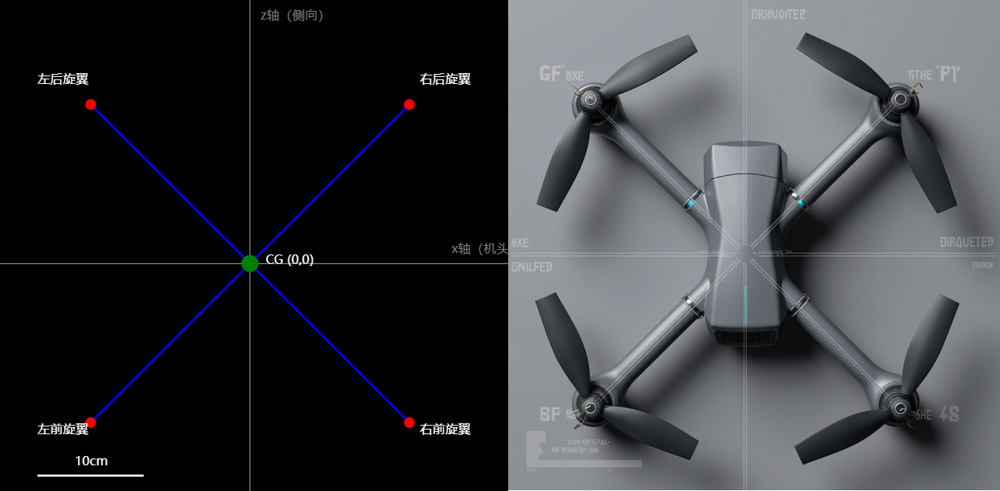</a> **作者一年前的并排图** | 参考图：黑底、红色电机点、蓝色机臂线，带轴线、文字和比例尺。提示词、模型、种子都没有记录 | 右图有体积，臂根连贯，是一台像样的四旋；但轴线、白线和乱码文字被画进了成图 | 参考图里的标注被当成画面内容 | 只有一张截图，没有请求记录。只能作设计动机，不能作证据 |
| <a href="../evidence/desktop-parameter-first-example/gpt-image-top.png">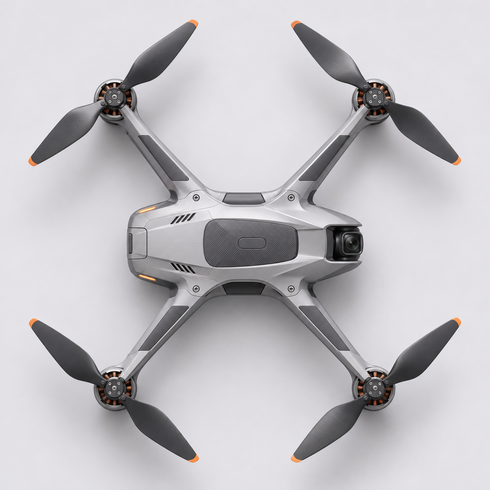</a> **桌面原型第一次接通** | 提示词是一段短任务句：“日常随行航拍，观察前摄和臂根…机壳的轮廓、表面、臂根过渡、材质与分件由你设计。前向相机融入右侧机鼻”（[回执](../evidence/desktop-parameter-first-example/receipt.json)）。参考图：配置器导出的四点骨架图。GPT Image，无种子 | 有机鼻相机舱、臂根过渡和分件线，是一张能讨论的方案图。四个轴心平均偏差约 23 px | — | 一张，Codex 知条件目测。说明“任务短句加骨架图”在闭源模型上能出方案图，不说明可重复 |
| <a href="../evidence/quad-guide-cmf-review/product.png">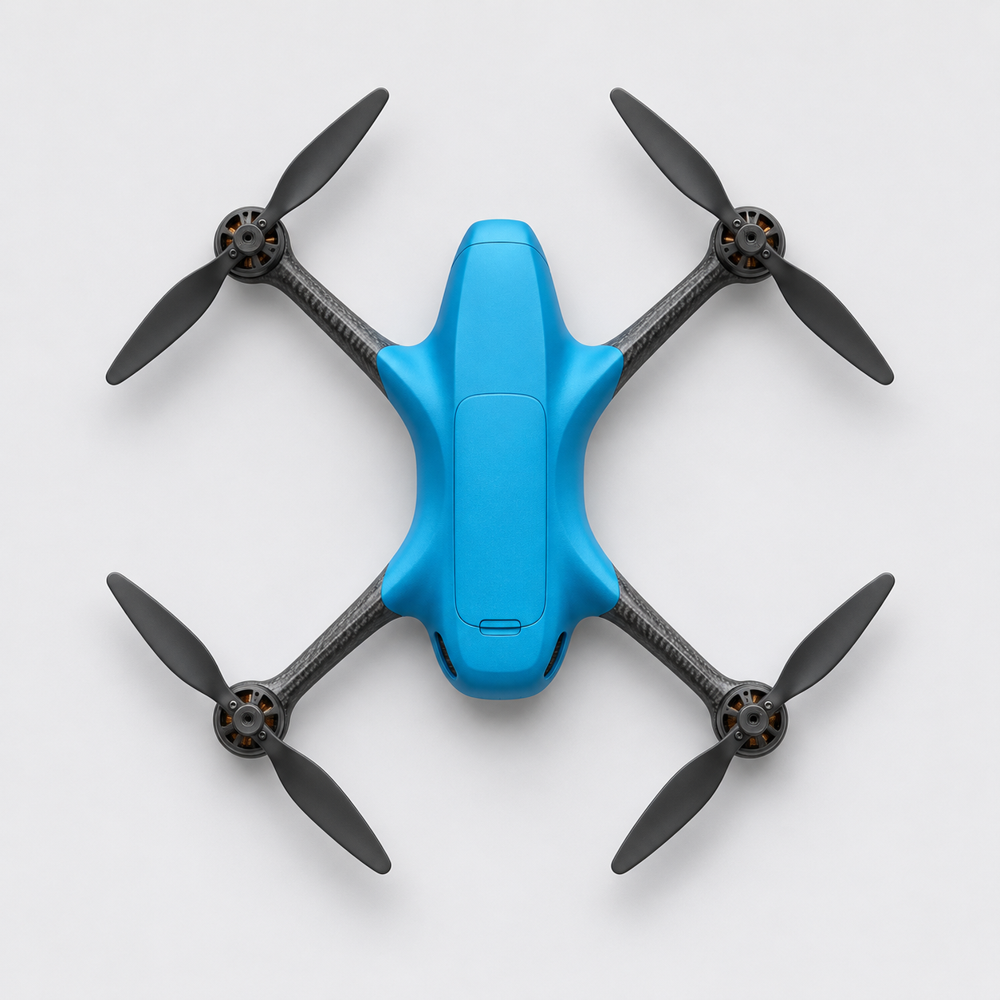</a> **蓝色上壳 CMF 示范** | [提示词](../evidence/quad-guide-cmf-review/prompt.txt)：任务、目标部位、改变、保持、自由项、CMF、相机姿态、布局说明，共十余句。参考图：蓝色机架线、红色轴心、青色双叶方向线 | 双叶方向跟上了（偏差约 2°）；W/L 1.05；整机占画幅 50%，目标 27.6%；相机整合在顶视看不出。作者指出配色材料模糊、不协调 | 参考图和文字在同一次调用里一起改了 | 一次调用，无配对。哪一项起作用无法判断 |
| <a href="../evidence/p06-quad-front-camera/result.png">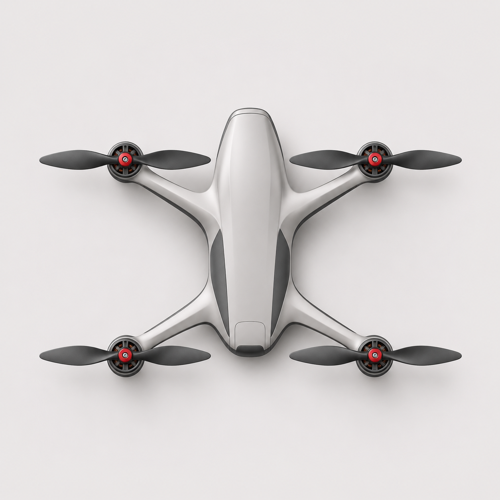</a> **P06（对照 P05）** | P05 的句子里同时有“保留前向相机”和“相机沿旋翼平面法线垂直向下”。P06 只改相机安装和制图视角两处文字，[输入](../evidence/p06-quad-front-camera/square.txt)，定位图与 P05 字节相同 | P05 顶面出现正对观察者的圆镜片。P06 没有，但相机是否存在、如何与机鼻连接看不出；W/L 读到 1.28（目标 1.00） | P05 把机载相机朝向和渲染视线写在一句里，产生歧义 | 各一次调用，种子不可配对。支持“这样写会出朝上镜片”这个观察，不支持因果 |
| <a href="../evidence/e1-open-20261112/E1-actual/E1-control-wl1.00-r2/original.png">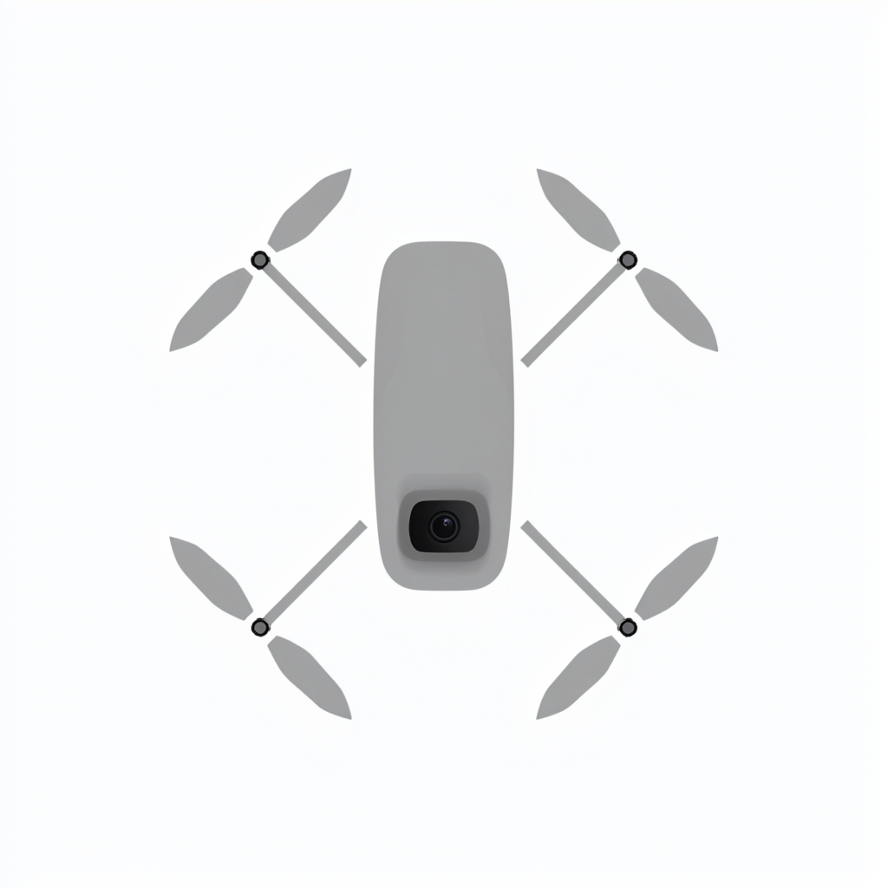</a> **E1-control-wl1.00-r2** | “Develop one compact drone for everyday personal aerial photography. Integrate the camera into the body and resolve the arm roots… matte neutral gray shell…”，不含造型内容。参考图 `wl-1.00-dd-0.50.png`（桨叶剪影、轴心、细臂线）→ Canny → ControlNet 强度 0.7，作用 0—1。Qwen-Image 2.1 | 平涂灰色，机臂是细杆，臂根与机身之间有白缝，没有体积 | 全程边缘控制把线稿的画法带进成图；条件图中央留白；提示词没有造型内容 | 24 张带条件图：W/L、d/D 各 12/12 命中。12 对同种子配对：有无整条控制支路。支持“控制支路让几何变准、图变平”；拆不开强度、区间和画法 |
| <a href="../evidence/e1-open-20261112/E1-actual/E1-text-wl1.00-r2/original.png">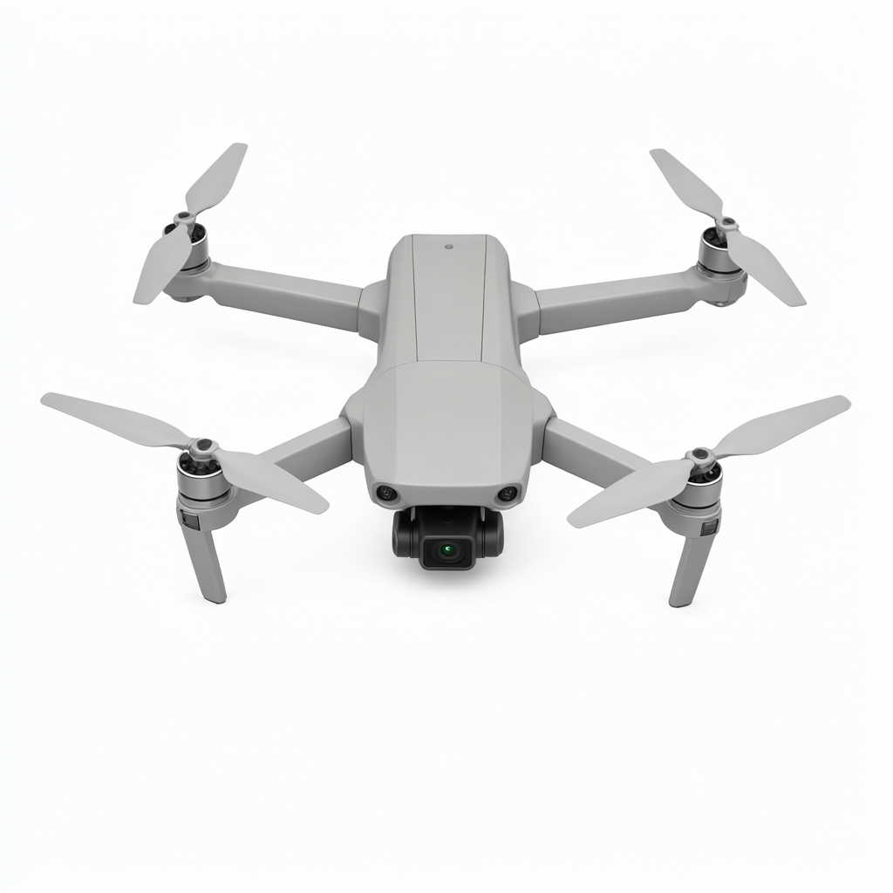</a> **E1-text-wl1.00-r2** | 与上一行同一句提示词、同一种子，不接控制支路 | 有体积和臂根，像现成的折叠机；视角歪成斜俯视，露出机身前壁和脚架；W/L 约 2.0 | 模型按已有商品机的样子画；文字里的比例不起作用 | 12 张纯文字：W/L 0/6 命中，均值不随档位变化 |
| <a href="../evidence/l1-layout-actual/L1-actual/L1-A-wl0.70-r1/original.png">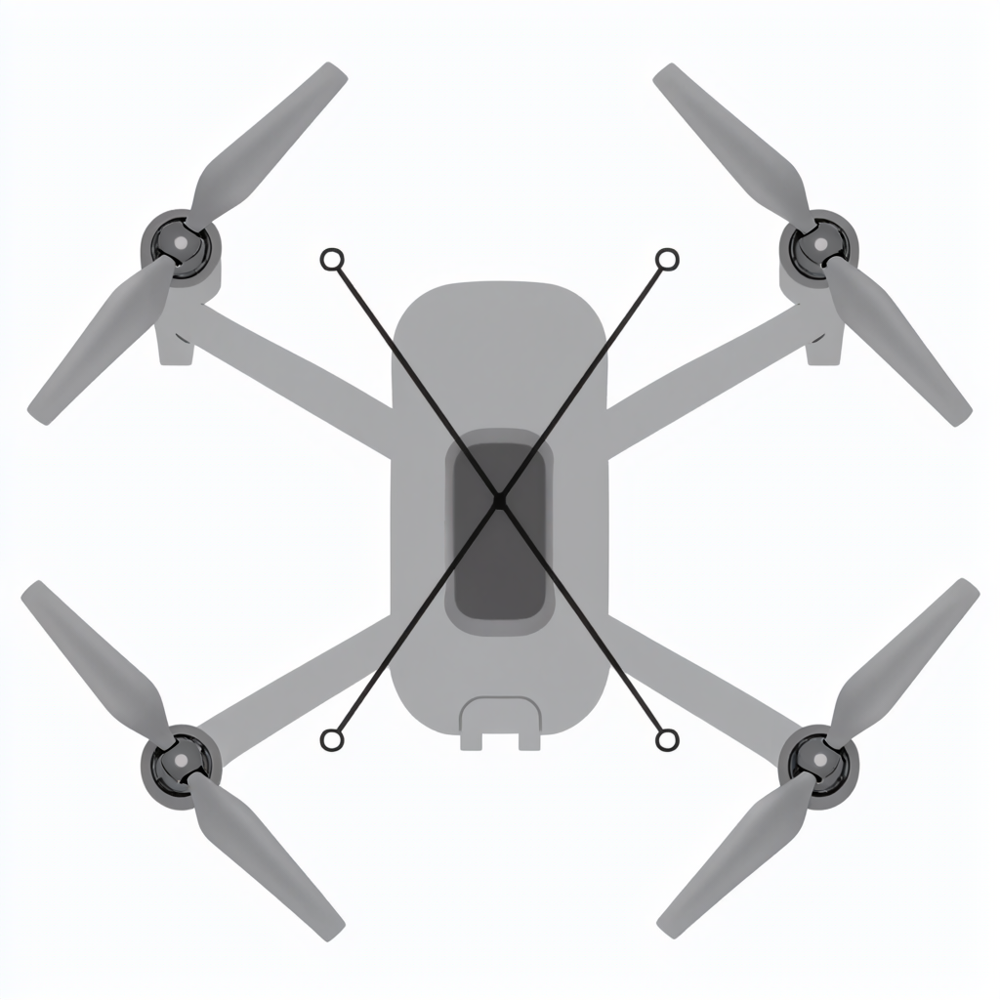</a> **L1-A-wl0.70-r1** | E1 的句子加“one two-blade propeller on each of the four motors”。参考图：方向线加轴心圈 → Canny → 强度 0.7，0—1 | 两条 X 线和轴心圈直接印在机身上 | 方向线被当作要画出来的边缘 | 两名盲读 AI 判 A 组 3/4 有残留；只在前段作用的 C 组 2/4。七组全部未过几何判据 |
| <a href="../evidence/l1-layout-actual/L1-actual/L1-G-wl1.30-r2/original.png">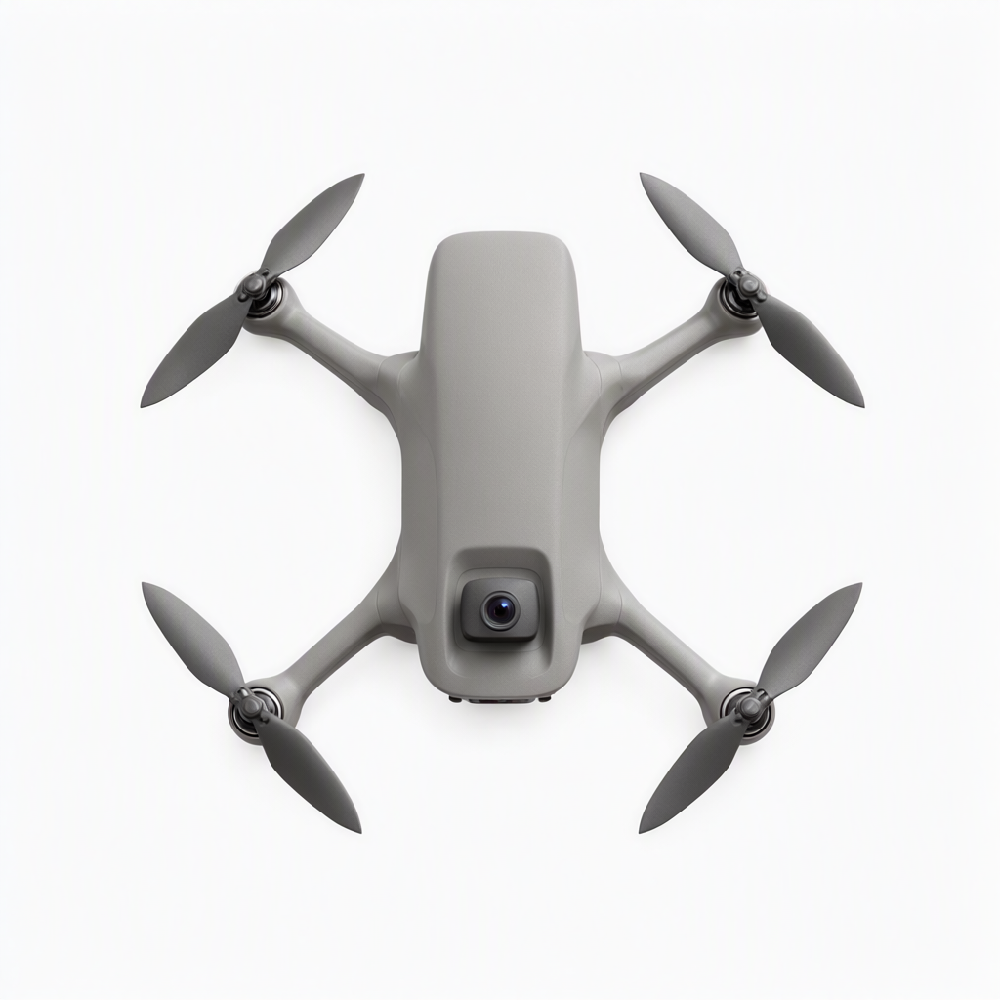</a> **L1-G-wl1.30-r2** | 编辑通路：“Redraw this drone as a realistic studio product render seen from directly above. Keep the four motor hubs exactly where they are…one camera at the front”。父图是一张 E1 带条件图的成图 | 有体积，但机身顶面有朝向观察者的镜头；归一化轴位偏移 0.061，超过 0.05 | 父图顶面本来就画了相机窗；句子只说“前面有一个相机” | G 组两档均值 0.712 和 1.208，四张里三张在限值内。相机题的问法只问“能否指出位置”，判不出朝向 |
| <a href="../evidence/d2-tuning/D2-actual/D2-P1-s1/original.png">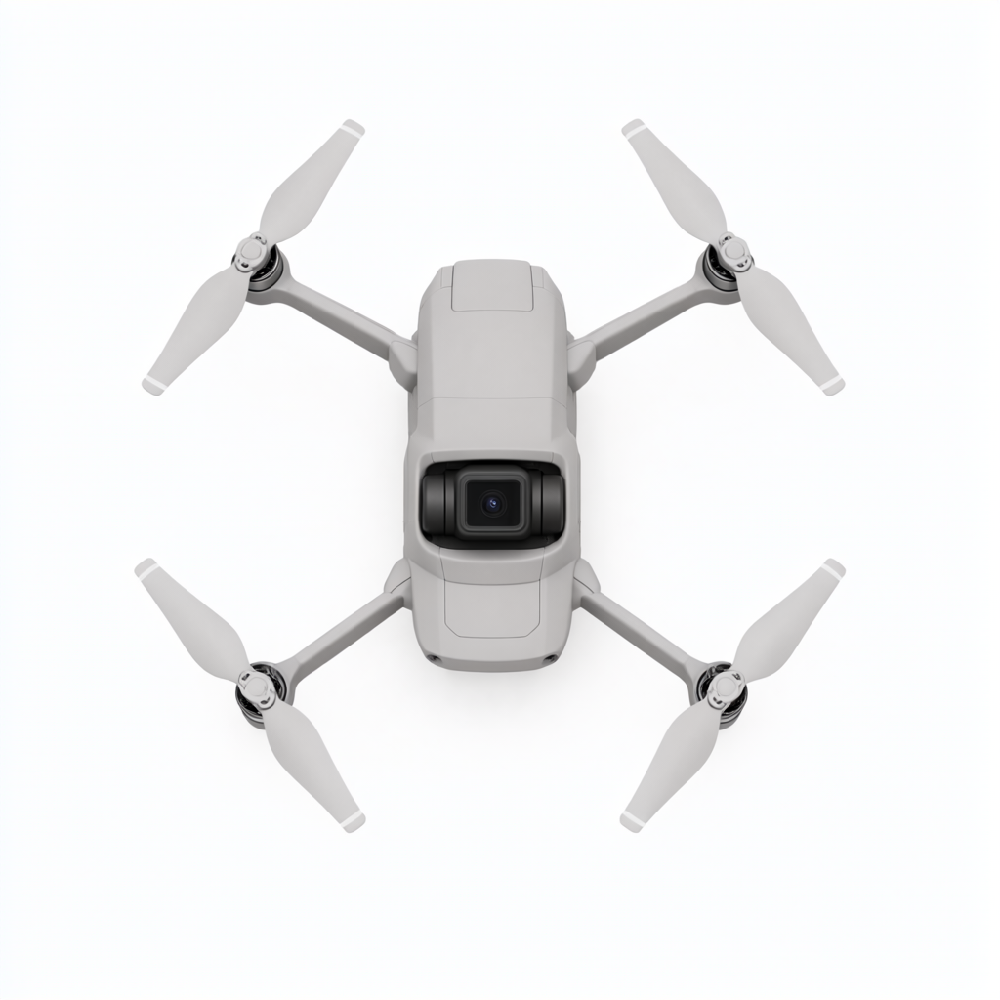</a> **D2-P1-s1** | 纯文字，E1 的句子（含“distinct dark camera window”），CFG 3 | 机身顶面正中一个朝上的大镜头；同组 s2 歪成斜视 | “看得见的相机窗”加顶视，等于要求镜片朝上 | P 臂每格两个种子，无控制。与 P05 是同一类现象 |
| <a href="../evidence/d2-tuning/D2-actual/D2-P4-s1/original.png">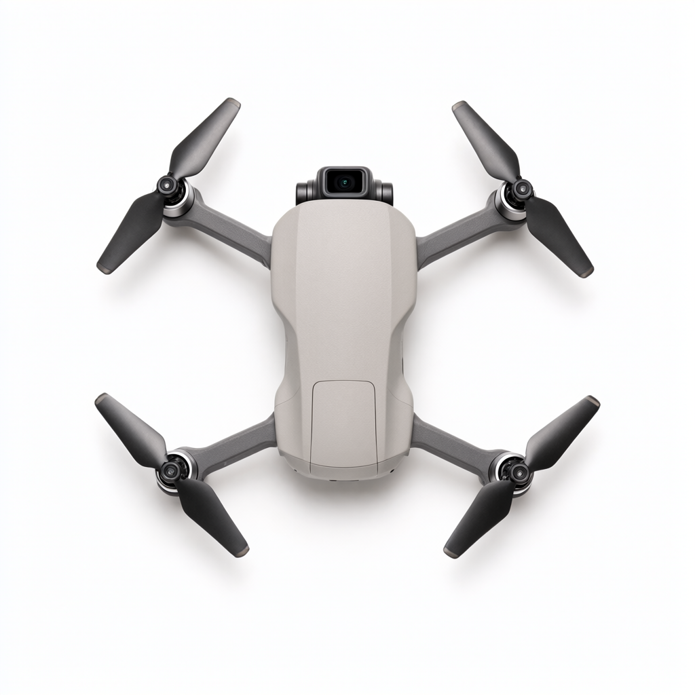</a> **D2-P4-s1** | 纯文字，长段 v2 提示词：相机安装、“Form language: one continuous pebble-like body…”、材料、灯光，另有长负面词 | 相机舱到了机鼻前缘，镜片不朝上；但机身仍是现成折叠机的样子，“卵石”没有表达出来，P2—P5 五格彼此很像 | 长段造型描述压不过模型对商品机的印象；一段话里要求太多 | P 臂 10 张，无对照臂。只能说这批提示词没有拉开造型 |
| <a href="https://github.com/Freeloop993/paper/blob/2996f6b/evidence/p1-param-prompt/T1-author-raw.png">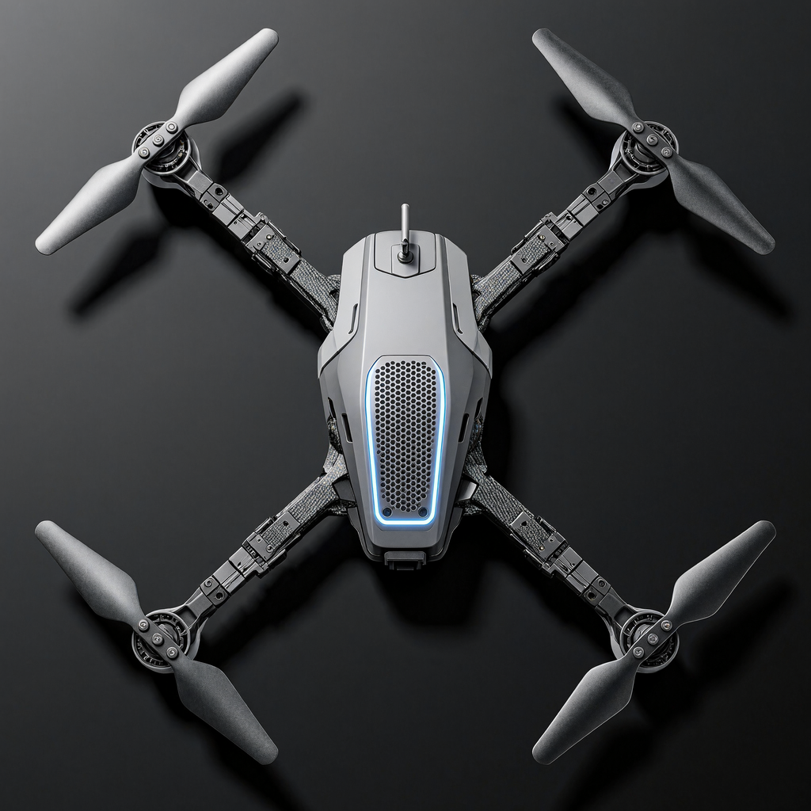</a> **P1-T1-author-raw** | 作者一年前的原句（X 布局、30cm、蜂窝格栅、蓝色灯带、GPS 天线、快拆件…），无参考图，关闭提示词改写。MiniMax H3-Image | 堆满零件的玩具机：外露铰链、格栅、灯带、天线杆；没有机鼻相机舱 | 句子是通用特征清单，没有使用任务、目标部位和词对 | 一张。作者判定不是产品设计 |
| <a href="https://github.com/Freeloop993/paper/blob/2996f6b/evidence/p1-param-prompt/T1-author-enhanced.png">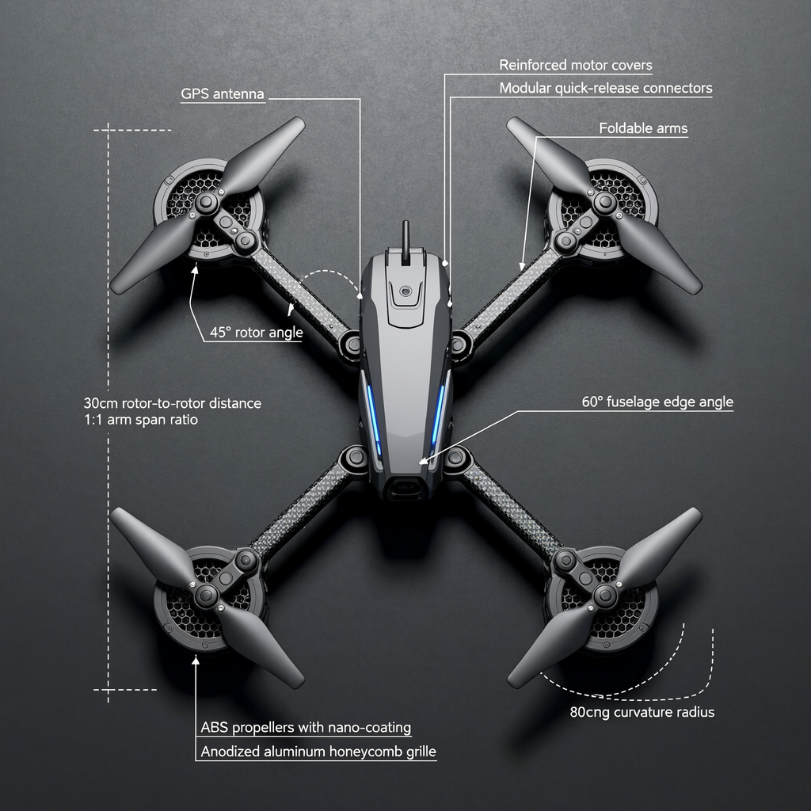</a> **P1-T1-author-enhanced** | 同一句，开启服务端提示词改写 | 句子里的数值变成了图上的标注线和文字 | 服务端把参数改写成“画标注” | 响应里的 `revised_prompt` 写明要画 callout，这一条有直接记录 |
| <a href="https://github.com/Freeloop993/paper/blob/2996f6b/evidence/p1-param-prompt/G2-blockout-0.7.png">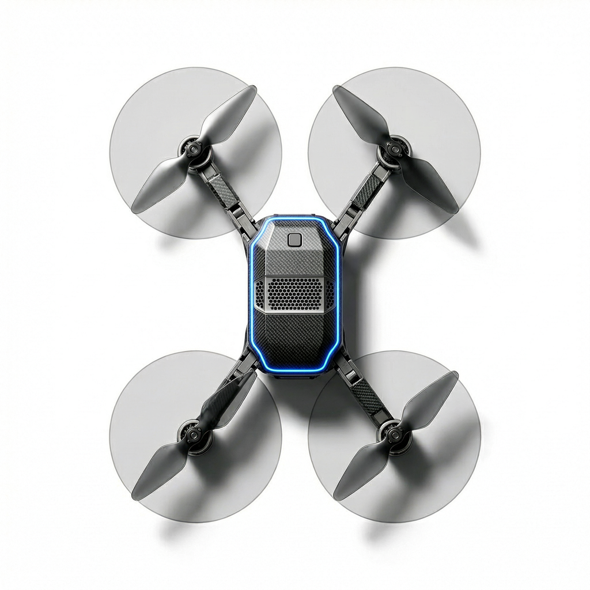</a> **P1-G2-blockout-0.7** | 原句加“按块面图保持桨盘、机臂、机身位置”。参考图：灰色桨盘、机臂、圆角矩形机身 | W/L 读到 0.70，但四个灰色圆片被画进成图，机身照抄了占位的圆角矩形 | 参考图里画了要交给设计的部件，模型照着画 | 每档一张，非盲 |
| <a href="https://github.com/Freeloop993/paper/blob/2996f6b/evidence/p1-param-prompt/G3-move-1.3.png">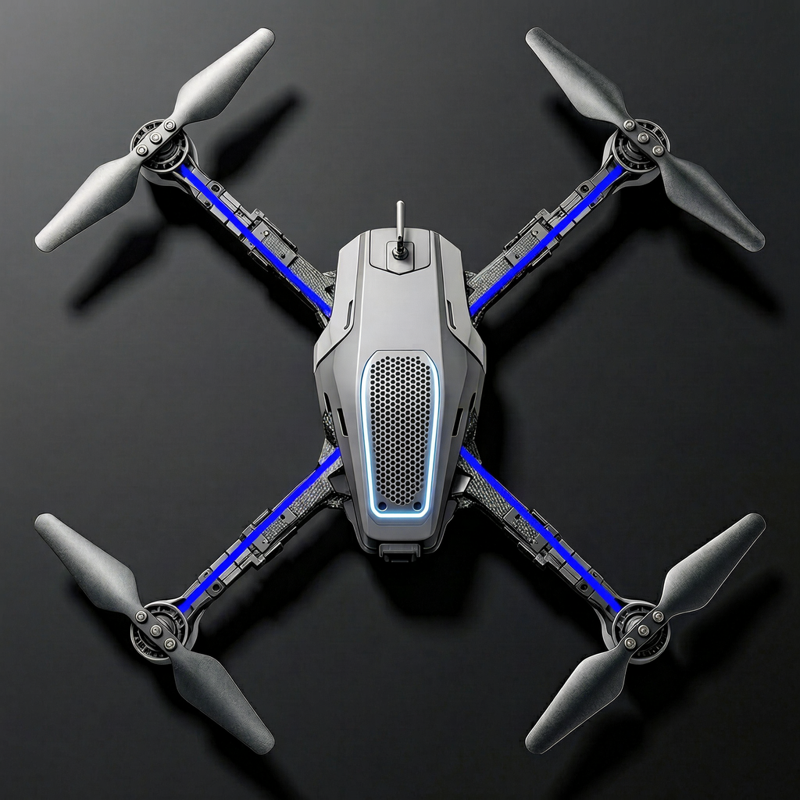</a> **P1-G3-move-1.3** | 两张参考图：T1 成图和点线图，要求把电机移到红点上 | 电机没动，蓝线被画到机臂上 | 成图的约束强于点线图 | 每档一张，非盲 |
| <a href="https://github.com/Freeloop993/paper/blob/2996f6b/evidence/p1-param-prompt/G5-skeleton-0.7-direction-A.png">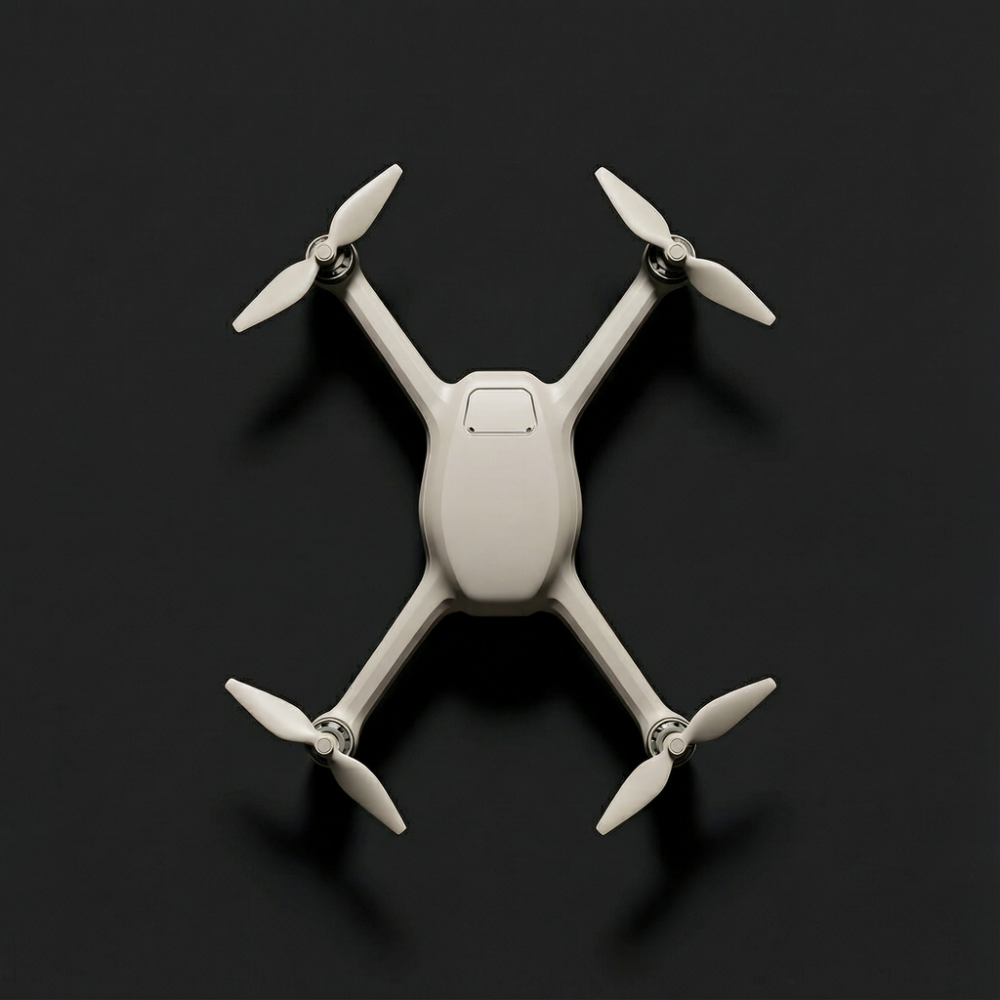</a> **P1-G5-skeleton-0.7-direction-A** | 原句改成卵石、暖灰、无格栅等取值。参考图：只有机臂和电机座 | W/L 读到 0.70；没有残留；造型随取值变了。仍然没有相机舱 | 参考图只给结构，其余交给文字 | G4、G5 四格，每格一张，非盲 |
| <a href="../evidence/p2-spec-cards/R1-A-1.png">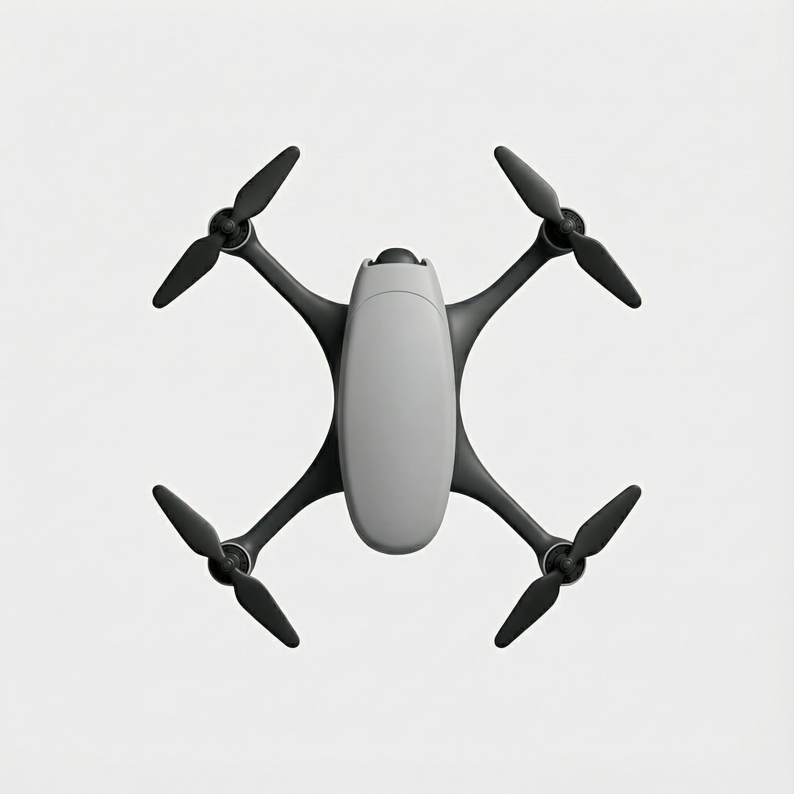</a> **P2-R1-A-1** | 规格卡 A 编译的短语：任务、顶视与机头方向、四个部位各一句、相机朝前、配色、光（[请求](../evidence/p2-spec-cards/R1-A-1.request.json)）。参考图：浅色底骨架图。MiniMax 编辑接口 | 浅灰卵石机身，深色机臂从壳体长出，机鼻端有相机舱顶面；没有残留 | — | 卡 A 三张之一。盲读结果见 P2 记录 |
| <a href="../evidence/p2-spec-cards/R1-A-3.png">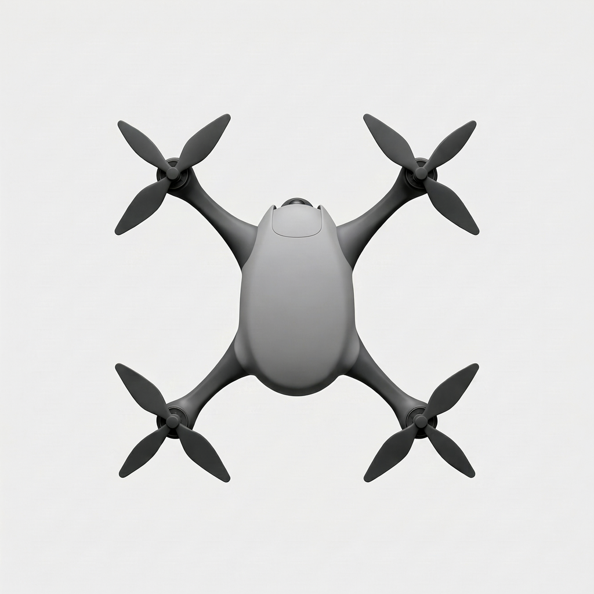</a> **P2-R1-A-3（反例）** | 与上一行逐字相同的请求 | 每个电机画成四片桨叶 | 不明。服务端改写后的文字仍写着“two-blade”，所以不是改写造成的；接口没有种子 | 同一请求三次里出现一次；卡 C 也有一张（R1-C-3） |
| <a href="../evidence/p2-spec-cards/R1-A-2.png">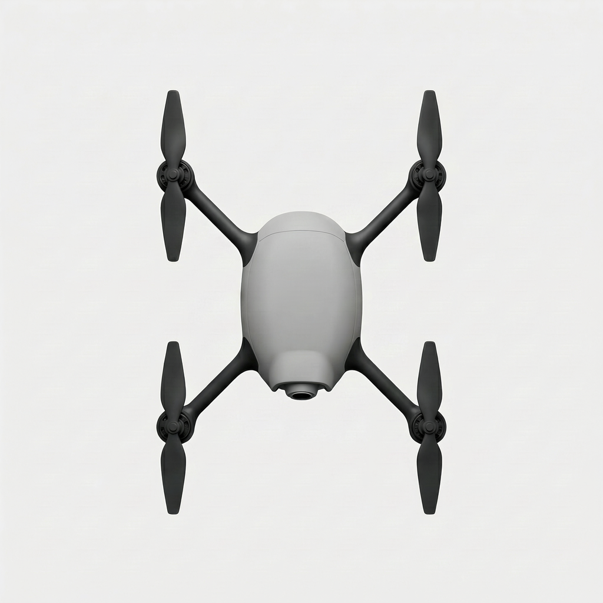</a> **P2-R1-A-2（反例）** | 同上 | 机头朝下，下端有一个看得见的镜头；四副桨都竖着 | 骨架图上下对称，没有给机头方向 | 同一请求三次里出现一次 |
| <a href="../evidence/p2-spec-cards/R1-C-1.png">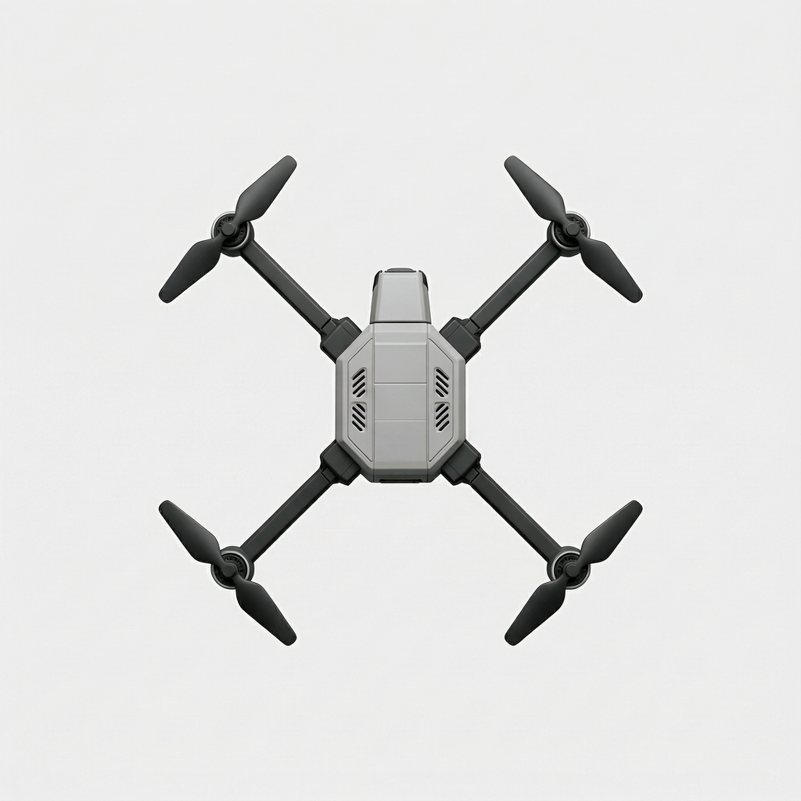</a> **P2-R1-C-1** | 规格卡 C 的短语，同一张骨架图 | 切角方形机身、臂根夹持座、前置相机模块、散热开孔，与卡 A、B 的图分得开 | — | 卡 C 三张之一 |

## 3. 这张表不能支持的话

- 不能说哪个提示词“更好”：除 E1 的配对外，各批之间同时变了后端、提示词和参考图。
- 不能说骨架图“能控制布局”：P1、P2 每格只有一到三张，读数非盲，后端没有种子。
- 不能说 P2 的图是合格的设计方案：没有作者选稿，没有独立评议。
