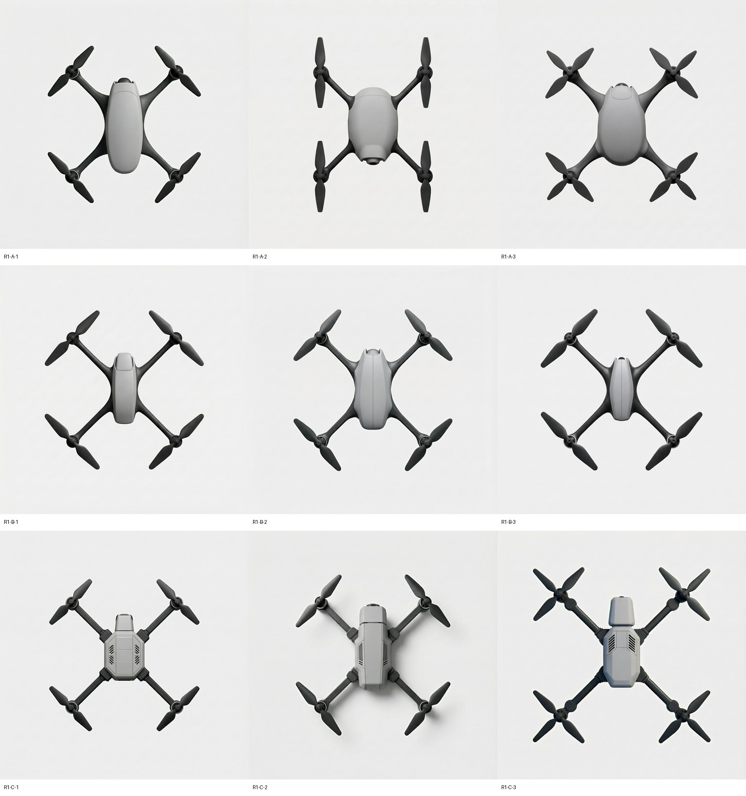

# 四旋三个造型方向（草案，待作者审核）与 E2—E6 缺口

[作者本次审阅版：三张规格卡、两处俯视辨认方法、CMF 提案与 E2/E3 父图](4.2.1-design-cards.md)。下文保留早期提示词与出图时的判据。

**状态：** 2026-11-13，Claude 起草。方向由作者决定，下面每一项取值都是提议；标“设计者判断”的没有评论依据。**输入：** [研究地基 v1.2](../foundation.md)、[词对 v1](https://github.com/Freeloop993/paper/blob/dad19783e8e798f3974f896ccb95e4a298685162/docs/protocols/word-pairs-v1-draft.md)、[36 张证据卡](../../evidence/semantic-cards/cards.csv)、[逐图复盘表](../image-retrospective-20261113.md)。

初稿只用三组词对：紧凑—舒展、简洁—繁复、整体—拼凑。“低调—醒目”留到配色深化，所以三个方向的初稿配色相同。

按这份草案的原文，P2 已在 MiniMax 上跑了第一轮 9 张（[登记与标准](../../experiments/p2-spec-cards/README.md)）。作者改动方向后，改动处重新编译、重新出图。

## 1. 三个方向一览

A 是基准。B 只在第一组词对上与 A 不同。C 在第二、三组上与 A 不同。这样看图和盲评时，每组词对的意图有没有表达出来可以分开判断。

| 方向 | 紧凑—舒展 | 简洁—繁复 | 整体—拼凑 | 一句话 |
|---|---|---|---|---|
| A 卵石一体 | 紧凑 | 简洁 | 整体 | 机身和机臂是一个连续的形体 |
| B 舒展 | 舒展 | 简洁 | 整体 | 细长机身，机臂伸开，部件之间留白多 |
| C 分件 | 紧凑 | 繁复 | 偏拼凑一侧 | 机身、机臂、相机舱各自独立，交接处看得见 |

## 2. 三个方向都保持的

| 项 | 取值 |
|---|---|
| 使用任务 | 日常随行航拍四旋翼：随身带，随手拍。携带语境的卡：E001、E003/E004、E009 |
| 构型 | 四个电机，X 布局，W/L = 1.00，对置轴距 250 mm |
| 桨 | 每轴一副双叶桨，完全展开，两侧等长，桨径 127 mm（d/D 取 0.50 档） |
| 视图 | 正交顶视，视线垂直向下，机头朝画面上沿 |
| 机载相机 | 在机鼻前缘下方，镜头水平朝前；顶视只看得到相机舱顶面和前缘 |
| 配色 | 浅灰哑光机壳，深石墨色机臂与桨，无强调色 |
| 背景与光 | 浅色中性背景，柔和均匀的棚拍光，明暗能表现体积 |

## 3. 三个方向

### A　卵石一体

| 栏目 | 内容 |
|---|---|
| 评论证据 | 紧凑：E001“机身小巧便携”、E010 嫌大机型的尺寸；反例 E002“二代机身更大，更稳定”。简洁：E011—E015，未见反例，五张都没说是哪里显得简洁。整体：E016“如果可以集成进机身内部是最好的”、E023 一体式桨保带来辨识度；把“整体”落到臂根和相机舱是研究者的推断 |
| 目标词对 | 紧凑、简洁、整体 |
| 机身平面轮廓与比例 | 卵石形，长约为宽的 1.6 倍，最宽处在中段，外轮廓是一条连续曲线 |
| 臂根过渡 | 机臂从壳体长出，连续圆角过渡，根部没有接缝 |
| 机鼻相机舱前缘 | 相机舱收在机鼻轮廓内，前缘是一条连续圆弧 |
| 分件线与色块 | 顶面只有一条上盖分缝，没有开孔 |
| 改变什么 | 相对现成折叠机的样子：机身轮廓改成卵石形，臂根改成连续过渡 |
| 保持什么 | 第 2 节全部 |
| 留给模型探索 | 壳面曲率、机臂截面与宽度、电机座造型、桨叶细部 |
| 顶视判断标准 | 四个臂根处都指不出独立的接缝或台阶，机身外轮廓是一条不间断的曲线 |

### B　舒展

| 栏目 | 内容 |
|---|---|
| 评论证据 | 舒展一极没有直接支持的卡。E002 肯定较大的机身，E025“I wouldn't say huge for the quad”不把外廓大当缺点，只能作旁证。选这个方向是设计者判断。简洁、整体的依据同 A |
| 目标词对 | 舒展、简洁、整体 |
| 机身平面轮廓与比例 | 细长梭形，长约为宽的 2.6 倍，机身宽度不超过左右电机间距的四分之一 |
| 臂根过渡 | 细长机臂以长的渐缩过渡并入机身两侧，根部没有接缝 |
| 机鼻相机舱前缘 | 前缘收窄成小圆弧，相机舱在轮廓内 |
| 分件线与色块 | 一条沿机身纵向的分缝，没有开孔 |
| 改变什么 | 相对 A：机身变窄变长，机臂在机身外的可见长度变大 |
| 保持什么 | 第 2 节全部 |
| 留给模型探索 | 同 A |
| 顶视判断标准 | 机身宽度不超过左右电机间距的四分之一，四条臂在机身外的可见长度都大于机身宽度 |

### C　分件

| 栏目 | 内容 |
|---|---|
| 评论证据 | 没有卡直接支持繁复或分件。E015“细节处理非常到位”、E012 和 E014“质感”、E036“颜色搭配机身材料显得很高级”说明有人看重细节与质感，可作旁证；同一批卡也说“简洁”。E016 希望集成，是这个方向的反例。属设计者判断，也是 A 的对照 |
| 目标词对 | 紧凑、繁复；第三组偏“拼凑”一侧（作者可改为“不作要求”） |
| 机身平面轮廓与比例 | 切角长方形，长约为宽的 1.6 倍（与 A 相同，不混入比例差异） |
| 臂根过渡 | 机臂是独立构件，由可见的夹持座接在机身四角，根部有清楚的接缝和台阶 |
| 机鼻相机舱前缘 | 相机舱是独立的前置模块，比机身窄，与机身之间有一道可见分缝 |
| 分件线与色块 | 顶面至少四条分件线，两组散热开孔；颜色与 A、B 相同 |
| 改变什么 | 相对 A：臂根由连续改为分件，相机舱由收入轮廓改为独立模块，分件线和开孔增多 |
| 保持什么 | 第 2 节全部 |
| 留给模型探索 | 同 A |
| 顶视判断标准 | 每个臂根都能指出一道接缝或台阶，相机舱与机身之间有一道分缝，顶面分件线不少于四条 |

## 4. 实际会发送的短提示词

规则：固定开头，加该方向四个部位各一句，加固定结尾。三个方向只有中间四句不同。每句是“部位：取值”。发送时在末尾再加一句参考图说明（见 `experiments/p2-spec-cards/run_p2.py`）。

**固定开头**

> Industrial design rendering of a compact quadcopter for everyday carry-along aerial photography. Strict orthographic top view, looking straight down, nose toward the top edge, light neutral background. X layout, four motors, one fully unfolded two-blade propeller on each motor, both blades the same length.

**A**

> Fuselage: rounded pebble outline, about 1.6 times as long as wide, widest at mid-body, one unbroken curve. Arm roots: each arm grows out of the shell through a continuous fillet, no joint line. Nose: the camera pod stays inside the nose outline under one continuous rounded leading edge. Top shell: a single cover seam, no vents.

**B**

> Fuselage: slender spindle outline, about 2.6 times as long as wide, narrower than a quarter of the motor spacing. Arm roots: long slender arms merge into the sides of the body through long tapered blends, no joint line. Nose: narrows to a small rounded tip with the camera pod inside the outline. Top shell: one lengthwise seam, no vents.

**C**

> Fuselage: chamfered rectangular outline, about 1.6 times as long as wide. Arm roots: each arm is a separate member held by a visible clamp block at a corner of the body, with a clear step and joint line. Nose: the camera pod is a separate front module narrower than the body, with a visible gap line between pod and body. Top shell: at least four panel lines and two groups of cooling slots.

**固定结尾**

> A forward-facing camera sits under the nose with its lens pointing forward, so from above only the top of the camera pod shows. Matte light grey shell, dark graphite arms and propellers, no accent colour. Soft even studio light; shading shows the volume. No text, lines or markings.

## 5. 怎么区分三个方向（用已有图片）

看四处就能分开。每处都能在顶视图上指出来或量出来。

| 看哪里 | A 卵石一体 | B 舒展 | C 分件 |
|---|---|---|---|
| 机身宽 ÷ 左右电机间距 | 约 0.4 以上，机身占据中间 | 0.25 以下，机身是一条细梭 | 约 0.4 以上 |
| 机身外轮廓 | 一条连续曲线 | 两头收尖的曲线 | 直边加切角 |
| 臂根 | 指不出接缝 | 指不出接缝，过渡段长 | 每个臂根有夹持座和台阶 |
| 相机舱与机鼻 | 收在轮廓里 | 收在收窄的鼻尖里 | 独立模块，与机身之间有分缝 |
| 顶面分件线与开孔 | 一条，无开孔 | 一条，无开孔 | 四条以上，两组开孔 |

**按这份草案出的第一轮图**（MiniMax，每行一个方向，从上到下 A、B、C）：

| 方向 | 最接近的图 | 没做到的图 |
|---|---|---|
| A | [R1-A-1](../../evidence/p2-spec-cards/R1-A-1.png)：卵石机身，机臂从壳体长出 | [R1-A-3](../../evidence/p2-spec-cards/R1-A-3.png) 画成四叶桨；[R1-A-2](../../evidence/p2-spec-cards/R1-A-2.png) 机头朝下 |
| B | [R1-B-1](../../evidence/p2-spec-cards/R1-B-1.png)、[R1-B-3](../../evidence/p2-spec-cards/R1-B-3.png)：细梭形机身，机臂可见长度大 | [R1-B-2](../../evidence/p2-spec-cards/R1-B-2.png) 机身偏宽，接近 A |
| C | [R1-C-1](../../evidence/p2-spec-cards/R1-C-1.png)：切角机身、夹持座、前置相机模块、开孔 | [R1-C-3](../../evidence/p2-spec-cards/R1-C-3.png) 画成四叶桨 |

**旧图里的参照。**

- 接近 A 的处理：[蓝色上壳示范](../../evidence/quad-guide-cmf-review/product.png)的上壳是卵石形，机臂从壳体下伸出。作者对它的配色材料不满意，这里只借它看轮廓和臂根。
- 接近 C 的处理：[桌面原型第一次接通的银色四旋](../../evidence/desktop-parameter-first-example/gpt-image-top.png)，分件线多，有开孔，相机舱是外露的前置模块。
- “拼凑”一极的反面教材：[E1-control-wl1.00-r2](../../evidence/e1-open-20261112/E1-actual/E1-control-wl1.00-r2/original.png)，细杆机臂和机身之间有白缝。这是出图缺陷造成的断开，方向 C 要的是有设计的分件，不是这种断开。
- 作者一年前并排图的右半：机身方正、臂根连贯，介于 A 与 C 之间。

## 6. 参数去向

| 参数 | 取值 | 去哪里 |
|---|---|---|
| 电机数与布局 | 4，X | 条件图和提示词 |
| W/L | 1.00 | 条件图的轴心坐标 |
| 对置轴距 | 250 mm | 条件图的比例尺，不写进提示词 |
| d/D | 0.50 | 条件图（若画叶尖）；提示词只写每轴双叶、两侧等长 |
| 机身平面形与长宽比 | 各方向不同 | 提示词；出图后量测 |
| 臂根过渡 | 各方向不同 | 提示词 |
| 机鼻相机舱前缘 | 各方向不同 | 提示词 |
| 分件线数与开孔 | 各方向不同 | 提示词；出图后计数 |
| 配色、视图、背景、光 | 三个方向相同 | 提示词的固定段 |
| 壳面曲率、机臂截面、电机座 | 自由 | 不写；出图后只记录 |

## 7. 要作者裁定的地方

1. **三个方向本身。** 尤其是 C：它没有评论依据，是 A 的对照。可以保留，可以把第三组改成“不作要求”，也可以换成另一个你真想做的方向。
2. **质量参照。** 一年前并排图的右半、桌面原型的银色四旋、蓝色上壳示范，哪一张算“符合预期”，或者都不是。
3. **提示词规则与旧规格冲突。** [E3 旧规格](semantic-to-E3-spec.md)第 7 节写“固定短提示词加不超过两句方向句、不写数字”。本页按作者 11/13 的要求写成按部位分组的短语。作者确认后我改第 7 节。
4. **三个方向的 W/L 和 d/D 都固定为 1.00 和 0.50。** 造型差异不和布局差异混在一起；布局响应由 E1 承担。
5. **初稿不出现配色差异。** “简洁—繁复”的释义里有“色块”，初稿只用分件线和开孔表达这一组。

## 8. 按论文目录：E2—E6 各缺什么

| 实验 | 章节 | 要做什么 | 现在有什么 | 缺什么 |
|---|---|---|---|---|
| **E2 父图修订** | 3.5.2—3.5.3、5.4 | 以初稿为父图，按指令改目标部位，其余保持。2 张父图 × 2 种指令，另各 1 张无父图对照，共 6 张 | G3 小测 1 对图，1 位真人和 1 位 AI 读过，结论不一致；它不能充当 E2 | 父图已按 #21 的 E1 同格首张核对，两条修改指令（改机鼻前缘、改臂根）已事前登记；待完成修订通路的设置；评图表按“先问看得见的变化，再问是否达到目标”改版；读者 |
| **E3 作者设计过程** | 4.2—4.4 | 作者作设计者：3 个方向 × 3 张初稿，逐张写取舍理由，选 1，修订至多 2 次，锁稿，再做配色与表达图 | 本页三个方向草案；P2 第一轮 9 张开发图 | 作者确认的规格；正式后端上的出图设置；9 张正式初稿；选择表；父子版本链；锁定终稿；4.4 的配色深化（“低调—醒目”在这里进场）和斜前上视表达图 |
| **E4 设计者对照** | 5.4 | 至少 4 名设计者，每人 D（自由文字）、S（结构化规格）各一场，任务卡 A/B，顺序平衡，每场初稿 1 次加修订至多 1 次，场后 5 题问卷 | 离线改稿台；任务卡定义 | 设计者招募（作者）；伦理与知情同意；D、S 两种界面用同一后端和同等修改机会；场次记录表；问卷；不足 4 人时降为作者案例加试用 |
| **E5 独立评议** | 5.3 | 至少 3 名评议者：先给 8—10 张真实产品顶视图打词对分，再盲评 E3、E4、E6 的锁定终稿 | 评议工具；词对 v1 | 真实产品顶视图样本（Codex 在收集）；评议表加词对量表（7 点加“看不出”）；评前冻结阈值；评议者招募；锁定终稿 |
| **E6 农业植保六旋** | 5.5 | 同一条线走一遍：植保规格 → 1 个方向（初稿加 1 次修订）；W/L 三档 × 2 次，按六旋基准归一 | 三款手册第 13 页已核药箱、喷洒件与机架；4 张旧测绘图只作历史资料 | 植保规格卡：药箱与中央机架的平面整合、喷洒杆件的平面布置、六臂机架，被机臂或桨遮住的喷头记“不可判”；六旋条件图；需求依据只能来自作者的植保简报和手册，消费评论不能用；出图与读数 |

**顺序上的依赖。** E2 按 [#21 的事前规则](https://github.com/Freeloop993/paper/issues/21#issuecomment-6821671015) 取两张 E1 中档原图。E3 正式生成接在 E2 之后，另需作者确认规格和可用的出图设置。E3 修订用作者在本实验九张初稿中选出的父图。E5 要等 E3、E4、E6 的终稿锁定。E4 和 E6 可以在 E3 之后并行。

## 9. 不能据此说的话

三个方向是草案，不是作者的设计决定。B、C 没有评论直接支持。顶视图上看不到镜片、厚度和相机俯仰，相机舱只能评价可见的前缘、遮挡和接缝。P2 的图只说明请求能不能把规格写的东西做出来，不说明方案值得深化。
