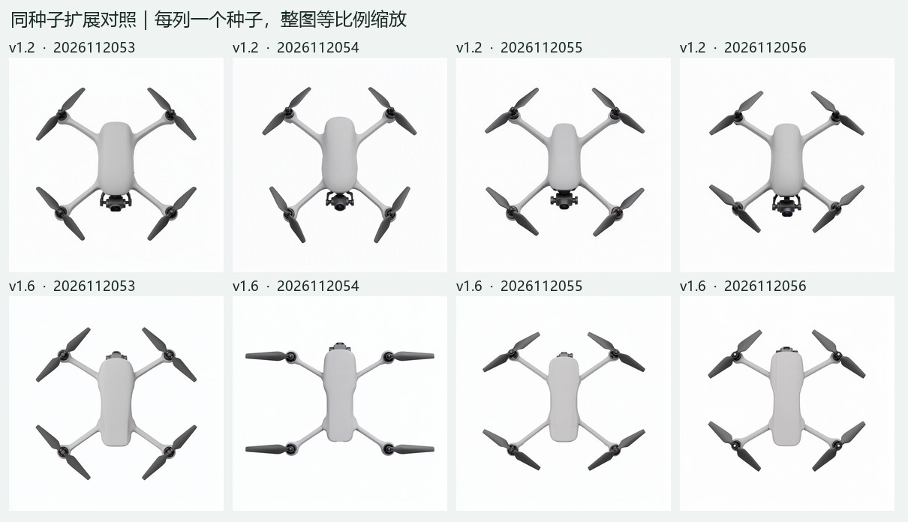

# 相机舱端位的同种子对照与真人逐图分歧

本次复算使用已回收原图、运行记录和已交回的读数。图版供揭盲后复核，仅向研究者展示。

## 相同种子下，改写提示词后哪些特征变了

前伸云台档的两个扩展批共有四个种子。正交顶视下，本实验规定画面上端为机头。下表取两次盲态 AI 判读 L、M，两者对表中每项均一致。镜片朝上按图上可见线索判读。

| 种子 | 旧版相机舱位置 | 新版相机舱位置 | 旧版镜片朝上 | 新版镜片朝上 | 旧版／新版各轴可见叶数 |
|---|---|---|---|---|---|
| 2026112053 | 下端 | 上端 | 是 | 看不清 | 2／2 |
| 2026112054 | 下端 | 上端 | 是 | 看不清 | 2／1 |
| 2026112055 | 下端 | 上端 | 是 | 否 | 2／2 |
| 2026112056 | 下端 | 上端 | 是 | 看不清 | 2／2 |

同种子四对的逐图工作流仅在正向提示词、负向提示词及输出文件名前缀三个字段有差异。图像输入节点、种子和采样设置一致。新词典同时调整了机头定位、相机、机尾与旋翼等描述，四对结果支持本组整套措辞与端位变化有关；单句的作用仍需另行检验。镜片方向在新词典的三张图上不可判，一张四轴均仅见单叶。

旧版另有四个种子无新版配对，其中一张相机在下端、三张在上端。故整个旧版扩展为 5/8 在下端，成对部分为 4/4 在下端。早先正式批 r01—r04 的读数另计。12 份扩展运行的 prompt ID 和解码 RGB 摘要各有 12 个不同值。原图 SHA-256 已对照回收账，图中种子已对照运行清单。[逐图证据及未配对记录](camera-matched-seeds.json)

## 12 张图上，真人分歧集中在哪里

三份完整回件中，两位自报此前未接触条件，以下逐图比较取这两份。第三份已接触，完整保留在上一级逐人表。同一张图至少三处臂根同类才归入该整图类别。

| 项目 | 两份答卷共同读到什么 | 产生分歧的位置 |
|---|---|---|
| 外露承座 | 4 张目标中有 3 张两人都把四处臂根读作承座。4 张基准均未被整图读成承座。 | S2-r01 的四处臂根，一人全部读为承座，另一人全部读为铰接。S0-r02 两个后臂根，一人读为承座，另一人选看不清，整图两人均归为混合或不可判。 |
| 多块顶盖 | 4 张目标均获两人判多块。基准 S0-r02 也被两人判多块，S0-r03 均判单块。 | 基准 S0-r01 一人判单块、一人看不清；S0-r04 一人判多块、一人判单块。 |

按图比较，两人对臂根整图类别在 11/12 张相同，对顶盖在 10/12 张相同。四处臂根逐位置相同为 42/48；这些位置来自同一组 12 张图和两份答卷。该数字仅描述两份答卷的一致情况。两人均达到承座的预设判据，顶盖仅一人达到。两份回件都没有文字备注，不能判定具体哪条缝或哪处视觉线索导致分歧。[逐图分类](human-per-image.json) · [三份原选择](../human-readings.json) · [原计分办法和两项判据](../README.md)
