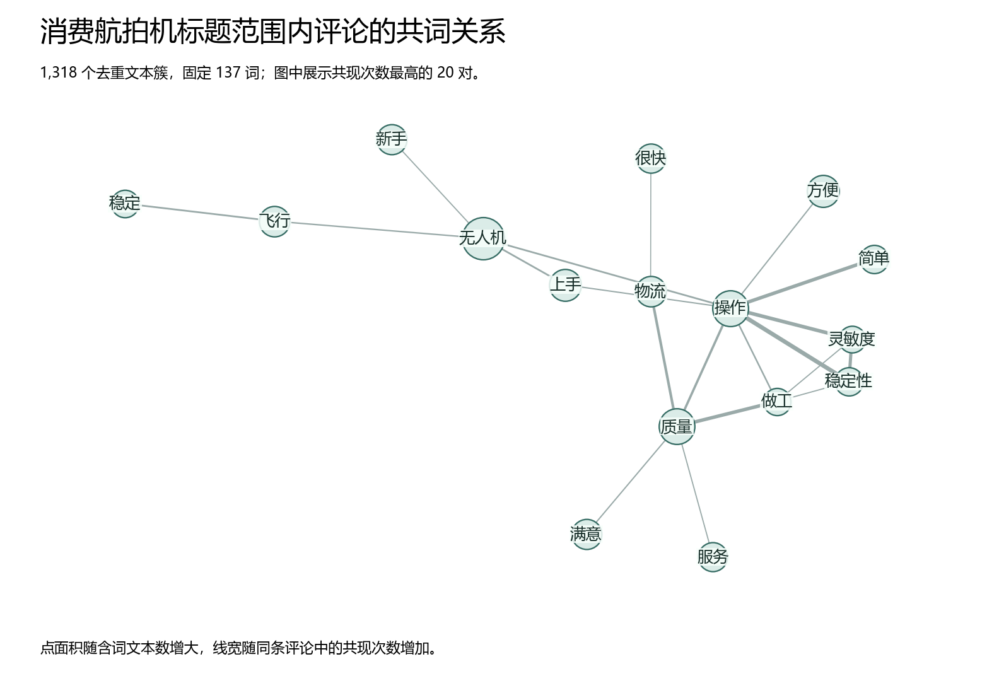

# 航拍机评论复算与人工抽查

正式台账有 7,443 个跨品类去重文本簇。取商品标题分类包含 Q 的 1,318 个，其中含多重商品标签；单属 Q 的有 1,221 个。每簇计一次。同一购买者可能出现在多个文本簇中。样本只能描述这批检索资料。

## 图 3.2 的替代图



图用航拍子集重新计算。为便于对照早期探索，固定使用原矩阵表头的 137 个词；没有将原矩阵中的频数带入计算。将词加入 jieba 0.42.1 词典，词频参数统一为 100000，关闭 HMM。每簇中每个词、每对不同词各计一次。1,185 簇至少命中一个词，产生 5,905 对至少共现一次的词。完整资料见[节点](nodes.csv)、[边](edges.csv)、[输入摘要与软件版本](summary.json)。图展示共现次数最高的 20 对，并列时按词序排序。计数受词表和分词规则影响。

例如，「操作」与「稳定性」共现于 62 簇，「做工」与「质量」共现于 57 簇。它们给出用户用词的语境。某个造型需求的重要程度仍需回到去重文本的独立主题编码。旧 Gephi 图保留为早期探索材料，此图另存，供作者审阅。

## S2 文字核查

在 228 个保留簇中抽 50 个，在 1,090 个其余簇中抽 100 个，层内等概率不放回。源表按稳定 ID 排序，抽样后混排并重新编号。正式抽样设置随研究者对应键保存在[私有阅读库](https://github.com/Freeloop993/paper-reading-room)。参与者的单文件离线 HTML 仅显示原话与问题，不含原标记、机器主题或对应键。主持人私下发送完整 HTML，参与者可分次导出、载入草稿，完成后回传 JSON。公开目录提供空模板、汇总图表和复算脚本。

**题面与统计。** 第一题判文字是否谈机体外形，可答信息不足；第二题可多选，包括携带、轻重、颜色和材质等。一条评论可谈携带但没有外形信息。因此主题按全部 1,318 簇解释。收齐 50 和 100 条才按设计权重还原。「信息不足」单报；明确涉及率和以明确判定为基准的召回率需与它一起解释。分层计数、加权主题比例及保守区间由脚本产生；区间对每个主题分别覆盖，不据此排列需求优先级。本次只有材料与软件测试，尚无这 150 条的真人结果。

持有授权私有数据的研究者可用 Python 3.11 运行以下命令。矩阵 CSV 来自仓库的 `evidence/semantic-cards/early-crawl/comments-cooccurrence.csv`。绘图用 Matplotlib 3.10.3、NetworkX 3.4.2；评分使用 SciPy 的超几何分布。

```sh
python build.py 08-semantic-analysis.zip comments-cooccurrence.csv .
python figure.py /path/to/chinese-font.ttf
python score.py private/key.json S2-完整答卷.json
```

公开版 build.py 仅生成 nodes.csv、edges.csv 与 summary.json。评分脚本由获授权的主持人在持有对应键及完整答卷后运行。

复算检查包括两层全部明确涉及、两层全部未涉及和缺一条时拒收。浏览器用虚拟答卷测试了窄屏打开、草稿下载与载入、漏答定位及完整答卷导出，测试数据不进入研究。

## S2 题面 b 版（2026-11-20，Claude 审后修订）

作者要求在发给研究生之前把题面过一遍。对照登记任务 S2（从 1,318 条里抽 150 条，保留层 50、其余层 100，由一名没接触过结果的研究生独立判断“是否在说机体造型、属于哪个主题”）和蓝图的 RQ1：

**a 版合用的地方**：150 条、两层 50 和 100，与对应键一致；题目顺序打乱过，编号里看不出层；页面里只有评论原话和题目，没有原标记；两道题就是登记的两问；“随身携带”和“小巧或紧凑”分开勾，正好对上蓝图里“紧凑是折叠后小，还是展开时显得小”这一问。

**a 版缺的三样**，b 版补上了，题目、顺序、编号都没有动，对应键照用：

| 缺什么 | 为什么要 | b 版怎么补 |
| --- | --- | --- |
| 不记作答者是谁 | 登记要求“没接触过结果的研究生”，答卷里要有凭据 | 开始前四问：身份、专业方向、是否看过分类结果或论文稿、是否打开过资料库 |
| 只有手动导出草稿，关掉页面就丢 | 150 条要一个小时左右 | 每次作答自动存在本机浏览器，重开接着做；手动导出、载入草稿仍在 |
| 不记用时 | S5 的经验：有一份答卷每张图 3 秒，靠用时才查出来 | 记每条停留的时间，评分脚本给出中位数和 3 秒以下的条数 |

**发哪个文件**：[S2-评论核查.html](S2-评论核查.html)，只发这一个。对应键 `key.json` 和它在同一个库里（`archive/paper-reading-room/…/researcher/s2/`），不要让作答者看到，也不要把库的地址给对方。

```sh
python3 build_form_b.py                                   # 由 a 版题面重新生成 b 版页面
node qa-form-b.mjs <输出目录>                              # 走查，12 项
python3 score.py ../../../archive/paper-reading-room/studies/20261117-offline/researcher/s2/key.json S2-完整答卷.json
```

`score.py` 改了两处：a、b 两版的答卷都收；主题表直接写在脚本里，评分时不必再装分词库。

**还差一件，要作者在发出之前定下来：怎么读结果。** 登记写的是“主题、通过标准在抽样前登记”，库里找不到通过标准。抽样已经做了，至少要在看到答卷之前写下来。建议不设及格线，改为预先写明两条读法：

1. 保留层 50 条里判“涉及”的不到 40 条（80%），3.2 节就要写明保留的 228 条里混有不谈外形的评论，各主题的条数只能当上限。
2. 按两层加权估出的召回率低于 70%（大致相当于其余层 100 条里判“涉及”的超过 9 条），3.2 节就要写明 228 条是少算了的，主题比例改用加权样本的估计，不用 228 条里的计数。

两条都不触发，就按现在的写法，附上两层的比例和区间。作者同意或改动后，把定下的写法记在这里再发题面。

另有一处我核不了：b 版沿用的 9 个主题，是否就是论文 3.2 节统计的那几个主题。论文源码不在主分支上，请 Codex 或作者对一下。
