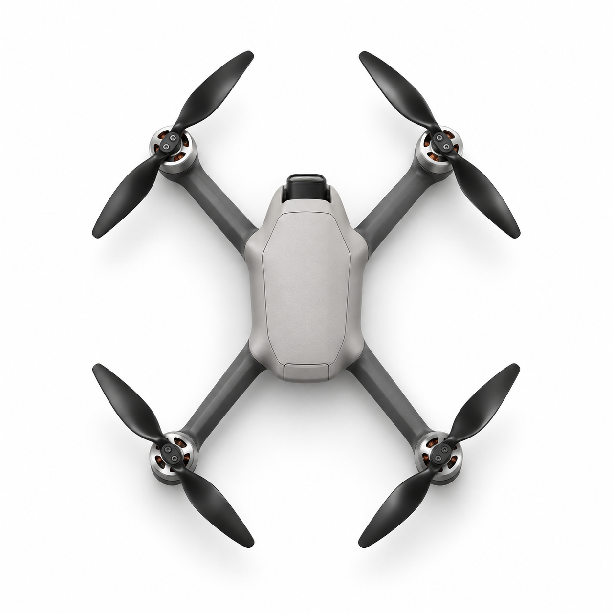
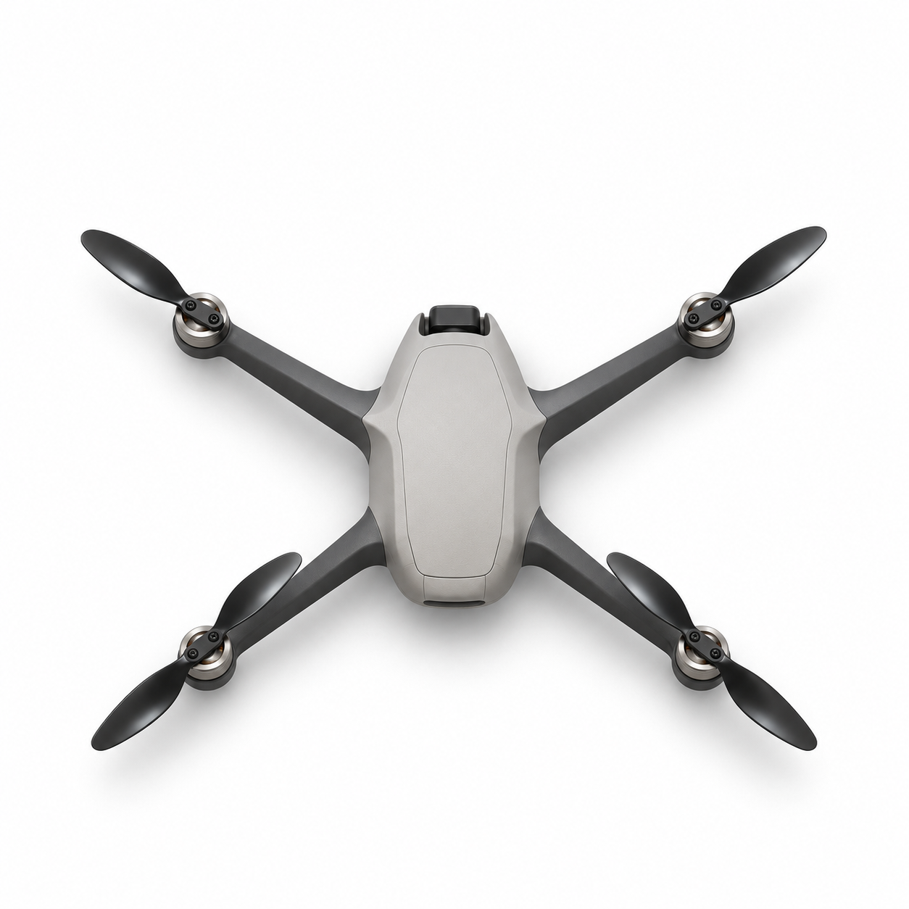
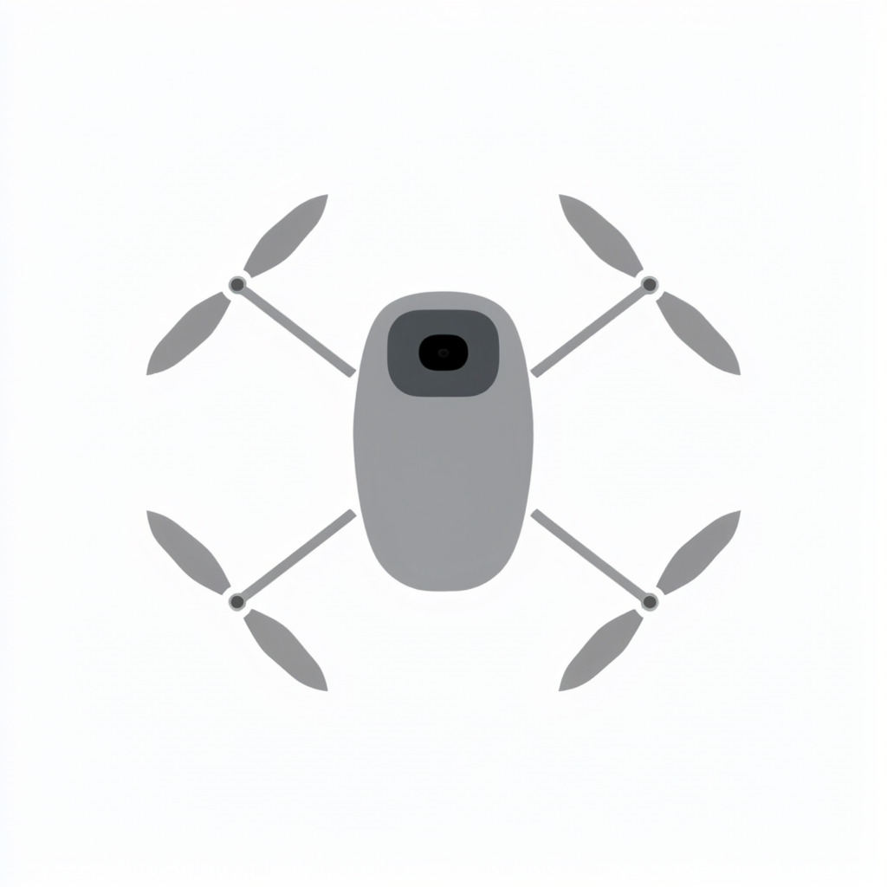
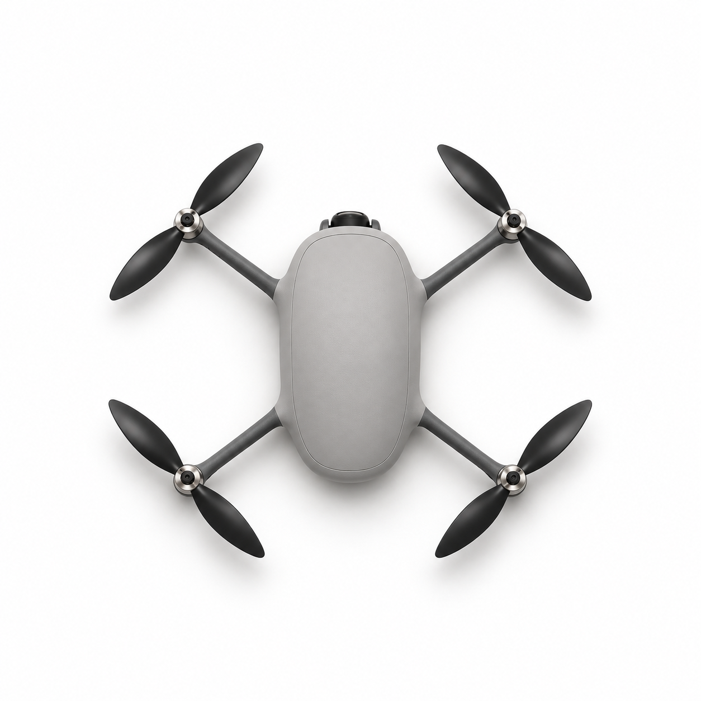
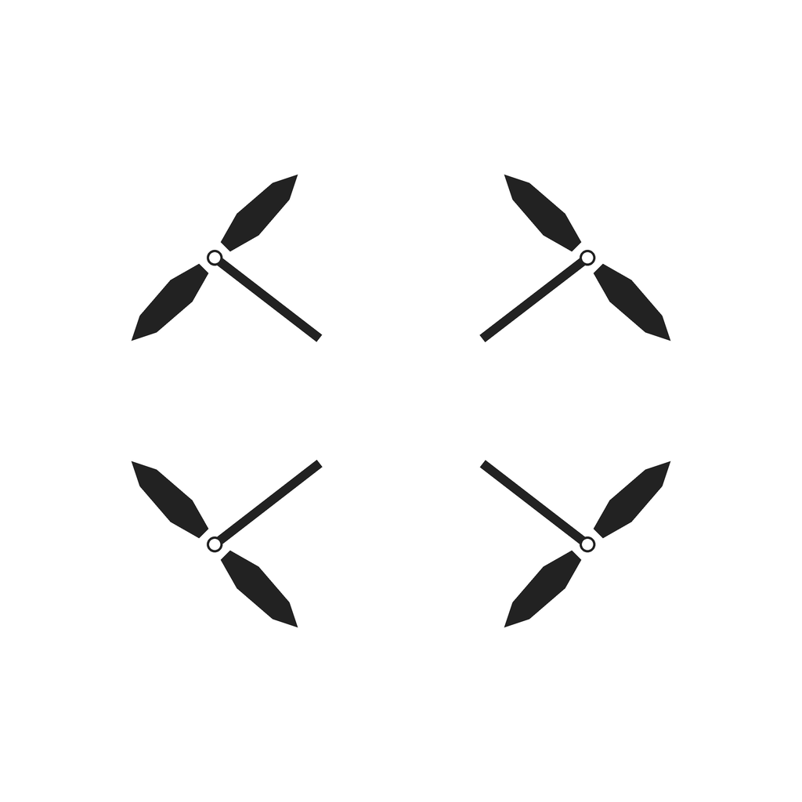
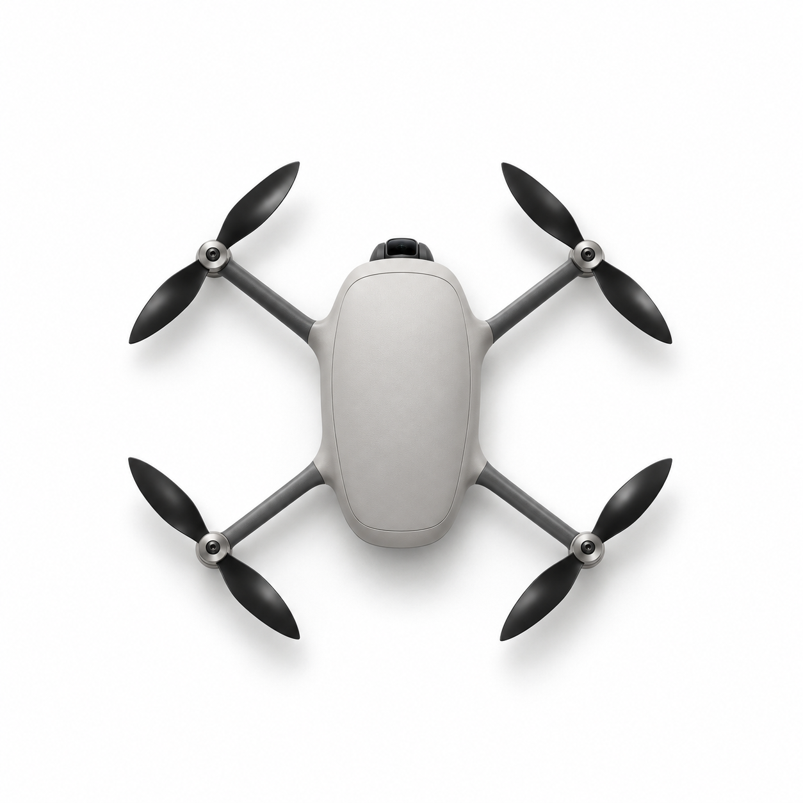
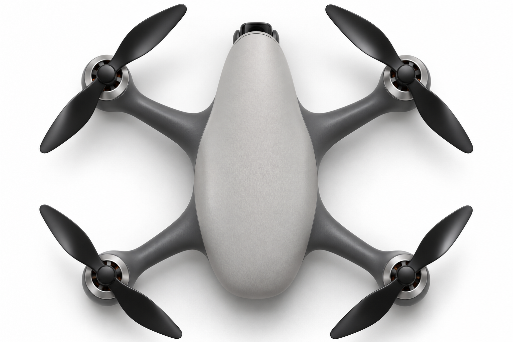
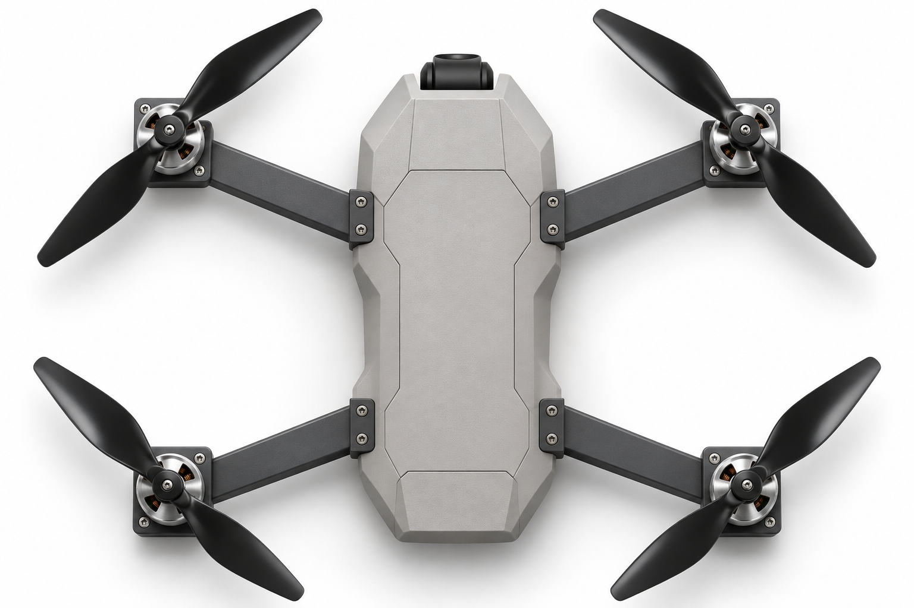

# 六张闭源生成图的输入与输出

按图号查看当次提交的完整英文提示词、参考 PNG 和返回的原始 PNG。点击缩略图可打开对应文件。03 和 04 共用同一张父图，04 的两张参考图按实际传入顺序排列。05 和 06 只输入文字。

| 图号与提示词 | 参考图（输入顺序） | 实际生成图 |
|---|---|---|
| **01 · 轴心布局偏窄（W/L 0.70）** [完整提示词](prompts/01-D2-KD-s0.7-e0.5-wl0.70.txt) <code>D2-KD-s0.7-e0.5-wl0.70</code> |  1. 窄布局灰度图 |  |
| **02 · 轴心布局偏宽（W/L 1.30）** [完整提示词](prompts/02-D2-KD-s0.7-e0.5-wl1.30.txt) <code>D2-KD-s0.7-e0.5-wl1.30</code> |  1. 宽布局灰度图 |  |
| **03 · 从父图重绘（G2）** [完整提示词](prompts/03-D2-G2-wl1.30-r1.txt) <code>D2-G2-wl1.30-r1</code> |  1. E1 父图 |  |
| **04 · 父图加桨臂定位图（G3）** [完整提示词](prompts/04-D2-G3-e0.3-wl1.30.txt) <code>D2-G3-e0.3-wl1.30</code> |  1. E1 父图  2. 桨臂定位图 |  |
| **05 · 连续卵石形机身（P6）** [完整提示词](prompts/05-D2-P6-s1.txt) <code>D2-P6-s1</code> | 纯文字 |  |
| **06 · 切面机身与外接支架（P7）** [完整提示词](prompts/06-D2-P7-s1.txt) <code>D2-P7-s1</code> | 纯文字 |  |

[可复核的逐图记录](manifest.json)包含参考图顺序、原始尺寸、提示词全文和各文件 SHA-256。文本末尾的 `Avoid:` 段随正文一起发送。

六张图由 Codex 内置图像工具生成，作者指定 GPT Image 2.6，接口没有返回可核验的具体版本。图号沿用对应的 [Qwen 开源试验设计](../../experiments/d2-tuning/addendum.py)，其中的种子、ControlNet 强度和作用区间只描述开源设置。六张图用于讨论造型、相机位置和提示词，单独记录为开发样本。
