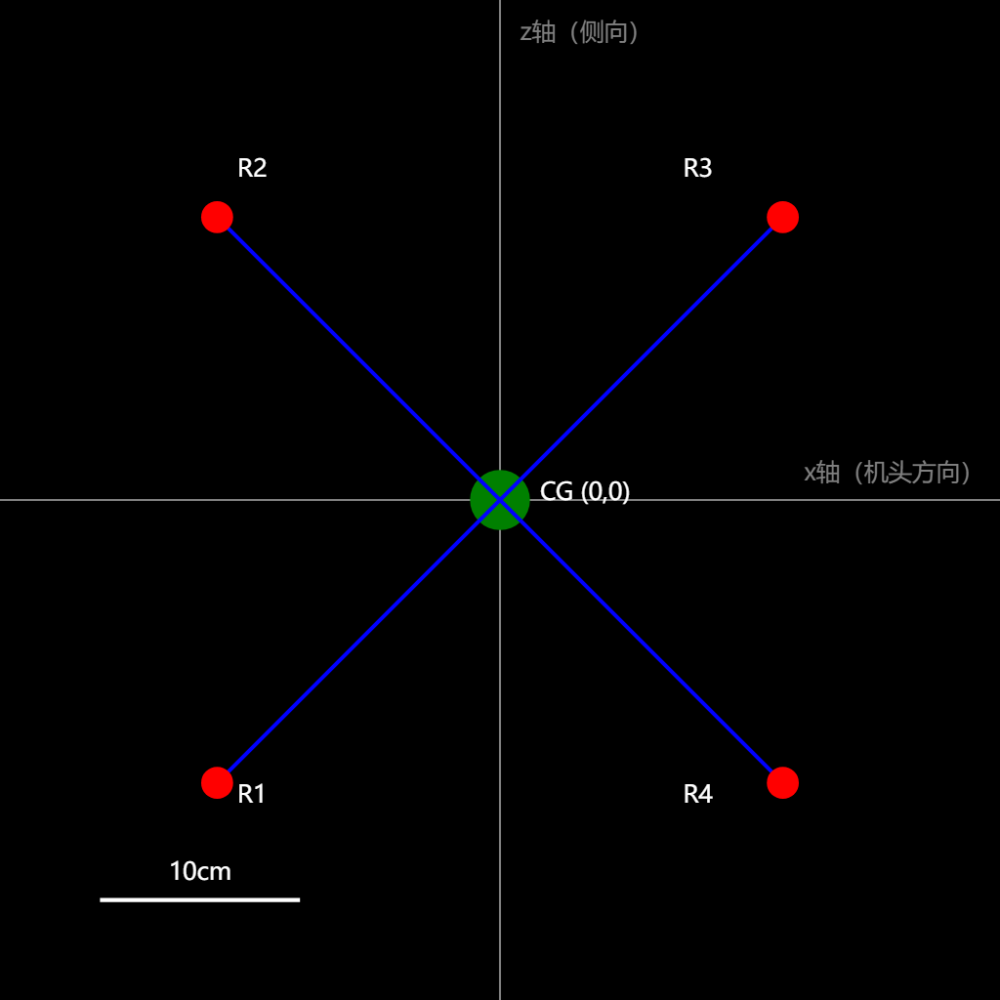
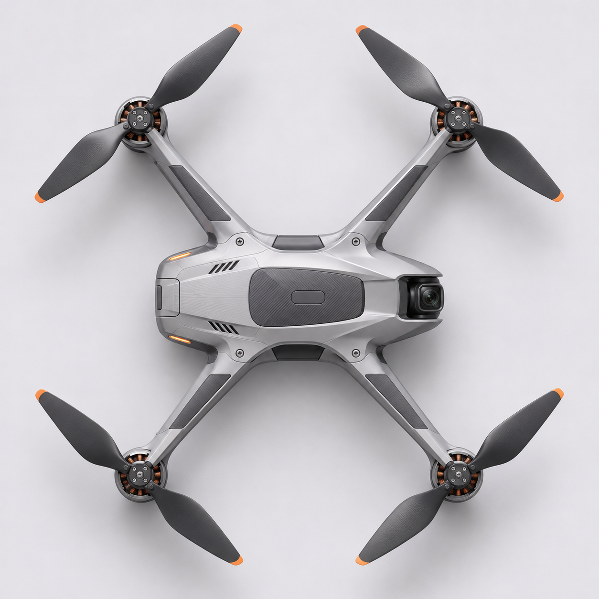

# 桌面参数配置器的首次参考图接通样例

对应 3.4.3、3.4.4、4.1.2、4.1.3。这一次从原 React 参数面板应用四旋 X 型、40 cm、臂展比 1，下载实际顶视定位 PNG 和同名参数记录，然后由 Codex 将该 PNG 作为唯一的图像文件交给 GPT Image，得到一张原始输出。提示词及原件摘要见 [receipt.json](receipt.json)。这里的 40 cm 是原型输入值。

| 网页导出的布局 | GPT Image 读取布局后的原始输出 |
|---|---|
|  |  |

[输入参数和四个轴心](drone-quad-x-af19f1313ba0.json)记录俯视画面的像素坐标及比例尺。页面等比导出 1024² PNG。浏览器实际下载了四旋 30 cm、40 cm 和六旋 30 cm 三组 PNG/JSON；各组文件摘要相符，独立读取 PNG 红色点的质心与该组坐标相差小于 0.5 像素。桌面工具保留原骨架表示，超出画布时等比缩小，记录导出比例尺。

输出在原始 1254² 栅格上由 Codex 在知晓条件下目测四个电机中心，只按画布尺寸换算至输入 1024²，平均偏差约 23 像素。这是一份顶视接通示例，无独立评议或预定合格判定，不能据单一样例判定布局变量的控制效果。实际请求由 Codex 在网页外发起；网页上的 ComfyUI 尚未连接。
