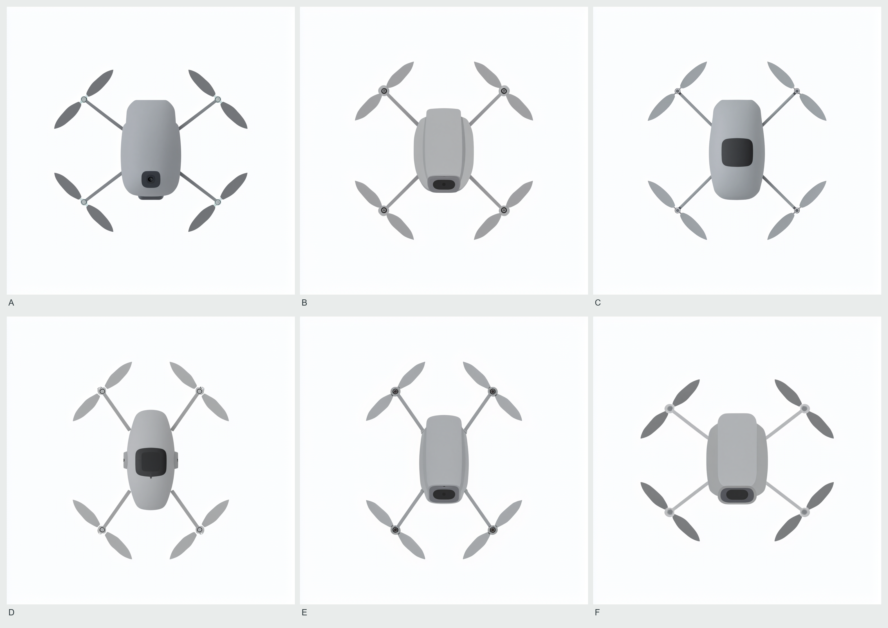
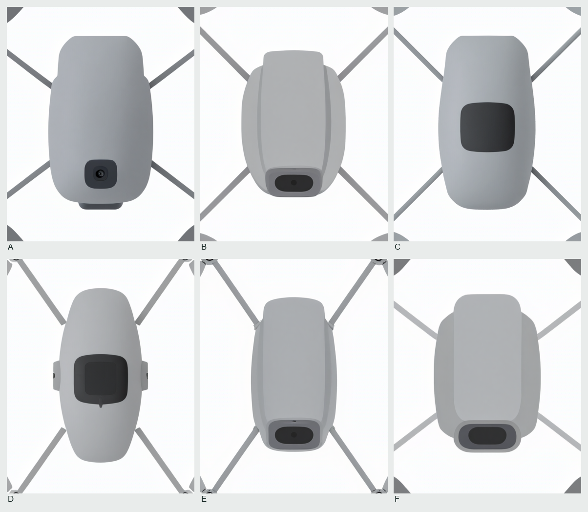

# E0 开源六张原图

每格保留原图的 1024 × 1024 RGB 像素。以下局部取自每张图同一范围，左上角 (320, 272)，右下角 (704, 752)，按左闭右开截取。两张拼图的字母顺序相同，字母均在图外。

| 图 | 原请求 | 图 | 原请求 |
|---|---|---|---|
| A | [W/L 1.30，重复 2](E0-actual/E0-control-wl1.30-r2/original.png) | D | [W/L 0.70，重复 2](E0-actual/E0-control-wl0.70-r2/original.png) |
| B | [W/L 1.00，重复 1](E0-actual/E0-control-wl1.00-r1/original.png) | E | [W/L 0.70，重复 1](E0-actual/E0-control-wl0.70-r1/original.png) |
| C | [W/L 1.00，重复 2](E0-actual/E0-control-wl1.00-r2/original.png) | F | [W/L 1.30，重复 1](E0-actual/E0-control-wl1.30-r1/original.png) |

两名独立 AI 在六张图上读得桨径与对角轴距之比为 0.492–0.495（目标 0.50）。作者关心的外形在图中仍有明确局限。A 的小镜头轮廓较易辨认，B、E、F 的机身下缘均有深色窗框，C、D 的中央暗面难以辨认镜头。六张的机臂大多以细直杆接入机身，D 的接合尤其突兀。这些是图像观察。独立真人造型评议另行登记。

[两名 AI 的独立读数与计算](open-gate.json) · [未经拼接的原始 ZIP](E0-originals.zip)
