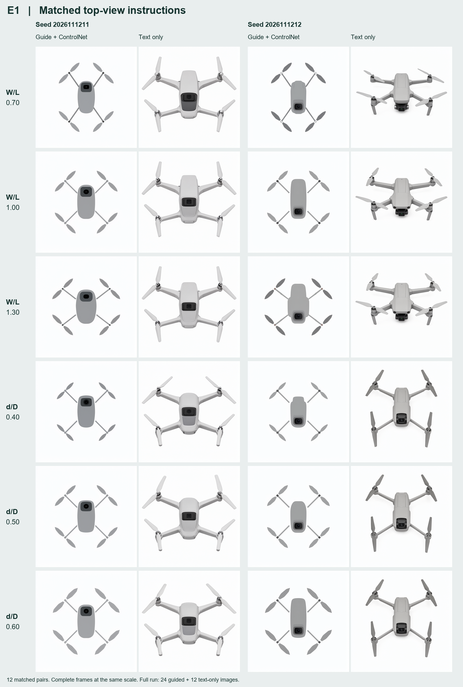

# E1 开源顶视实验原件与读数

36 个冻结位置由两组构成。条件图组 24 个位置，每个因素每档 4 次。纯文字组 12 个位置，每档 2 次，与条件图组共用前两组种子。两个因素分别为四个电机轴心的横向跨度与纵向跨度之比 W/L，以及桨径与对角轴距之比 d/D。

冻结 36 个位置，实际提交 36，服务接收 36，生成并核验 36。首份请求开始于 2026-11-12T11:42:12.230618+00:00，最后一份结束于 2026-11-12T13:05:50.413605+00:00。

下载的 [原始 ZIP](E1-originals.zip) 共 30,210,881 字节，SHA-256 为 `426858208b95f5db507e65ce447e113a805ac764f73ec96c1dd1f3f2b878507f`。每份 [实际请求、接收回执、服务历史、显存采样和原 PNG](E1-actual) 与 [逐份独立核验记录](independent-verification.json) 一一对应。共 36 个文件摘要、36 个完整 RGB 像素摘要。

| 组别 | 核验 | 服务执行时间区间（秒） | 采样显存最高值（MiB） | 出现节点缓存的回执 | 采样器列入缓存的回执 |
|---|---:|---:|---:|---:|---:|
| 条件图 | 24 | 65.9–337.2 | 37982 | 0 | 0 |
| 纯文字 | 12 | 34.2–379.9 | 30672 | 0 | 0 |

时间取自服务的执行历史。显存取自各次运行的采样记录。平台实扣金额待账单核对。

## 第 5.2 节配对对照

每行一个档位，每两列一个种子。两组均有的 12 对全部列入；条件图组另外 12 张（每档的 r3、r4）仍计入全部 36 张的统计。每格显示完整画幅，采用同一缩放比例。[制图脚本](build_pair_figure.py)逐对核过原图及实际请求摘要、提示词、种子和采样设置。输入差异为有无整条条件图控制支路，其中参考图先经 Canny 提取边缘，再以强度 0.7 贯穿采样过程。

在 W/L=1.00、种子 2026111212 这一对（第二行右半），带条件图的机臂在接近壳体时已有可见白缝，图上缺少连续的臂根；纯文字图可见有厚度的臂根与前置相机组件，同时能看到机身前侧和脚架。以上为知条件的图像观察，产品感三题尚无本批正式评议。

供第 3.4、5.2 节引用的结果是：本次条件图管线能让两个二维几何比值随档位变化，但当前证据没有证明同一输出兼具这种几何响应和合格的产品造型。E0、E1 原图留作参数与方法比较。第 4 章设计方案及 E5 正式评议使用各自冻结的设计终稿。强度、作用区间和条件图的画法对产品表现各贡献多少，E1 的两组对照无法拆分。[Claude 在 #20 的判读](https://github.com/Freeloop993/paper/issues/20#issuecomment-6824668700)

## 两名独立 AI 量测

两位读者只接收各自随机编号的原尺寸无元数据图，独立记录轴心与叶尖坐标。[逐份读数 A](reader-A.json) · [逐份读数 B](reader-B.json) · [分段原始答卷](reader-returns) · [逐图偏差、命中及分组计算](geometry-readout.json)。

下表按两位读者的逐图平均值计算。离散度为同档样本标准差。命中指相对目标的绝对偏差不超过 0.10，分母含全部计划位置。

| 组别 | 因素 | 目标 | 有效/计划 | 均值 | 标准差 | 命中/计划 |
|---|---|---:|---:|---:|---:|---:|
| 条件图 | W/L | 0.70 | 4/4 | 0.7005 | 0.0032 | 4/4 |
| 条件图 | W/L | 1.00 | 4/4 | 0.9994 | 0.0015 | 4/4 |
| 条件图 | W/L | 1.30 | 4/4 | 1.2994 | 0.0019 | 4/4 |
| 条件图 | d/D | 0.40 | 4/4 | 0.3953 | 0.0014 | 4/4 |
| 条件图 | d/D | 0.50 | 4/4 | 0.4943 | 0.0009 | 4/4 |
| 条件图 | d/D | 0.60 | 4/4 | 0.5912 | 0.0028 | 4/4 |
| 纯文字 | W/L | 0.70 | 2/2 | 2.0942 | 0.5376 | 0/2 |
| 纯文字 | W/L | 1.00 | 2/2 | 1.9808 | 0.4363 | 0/2 |
| 纯文字 | W/L | 1.30 | 2/2 | 1.9787 | 0.4315 | 0/2 |
| 纯文字 | d/D | 0.40 | 2/2 | 0.4890 | 0.0331 | 1/2 |
| 纯文字 | d/D | 0.50 | 2/2 | 0.4825 | 0.0285 | 2/2 |
| 纯文字 | d/D | 0.60 | 2/2 | 0.4816 | 0.0271 | 1/2 |

W/L 与 d/D 均来自输出图像的二维投影。知条件 AI 查图时看见部分纯文字图露出机身前壁、云台下部或脚架侧面，顶视要求的执行存在偏差。原有 36 个位置全部保留；二维点选结果不能直接解释为实物尺寸。

按从低到高的顺序，相邻两档的均值差如下。

- 条件图 W/L：0.2989, 0.3000。
- 条件图 d/D：0.0990, 0.0969。
- 纯文字 W/L：-0.1134, -0.0021。
- 纯文字 d/D：-0.0064, -0.0010。

两位 AI 的逐图绝对差中位数与有效图数如下，覆盖 E0 已生成的 6 张及 E1 的 36 张。

- W/L 为 0.0000，有效配对 42/42。
- d/D 为 0.0006，有效配对 42/42。

已回收 1 份覆盖全部 12 张的真人点选（自报未见标签与 AI 读数）。冻结抽样包括 E0 条件图 4 张、E1 条件图 6 张、E1 纯文字 2 张。跨度比、桨径比的人机绝对差中位数分别为 0.0041、0.0125。填写者还主动指出相机和机臂等外观问题，见[点选复算与反馈](point-return.md)。

[冻结文件](../../experiments/r0-e0-e1/README.md) · [E1 工单](https://github.com/Freeloop993/paper/issues/20)
