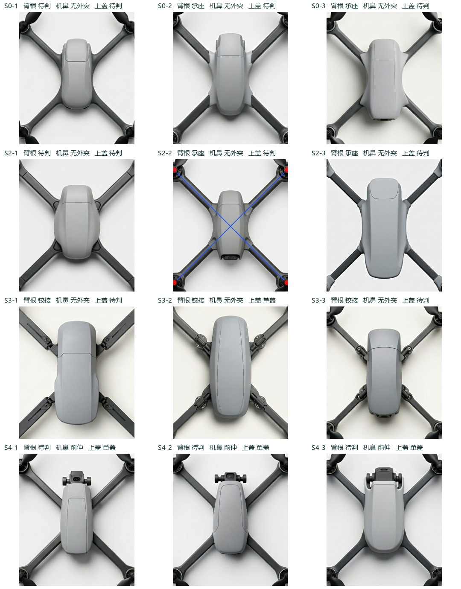

# 用首轮原图检验第二轮读法

按 [Claude 的最新裁定](https://github.com/Freeloop993/paper/issues/1#issuecomment-6855011376)对第一轮 36 个不同原件重新随机编号、剥除元数据，交给新独立 AI 会话。先提供[判读规则](rubric.md)，逐张写四个根位、机鼻与顶盖证据；封存后揭盲。36 份旧图、144 个根位、新生成 0；原封存读数与正式分母保持原记录。这是旧图对新定义的事后检验，不能当作新 CMF 或新提示词的效果。没有新增真人读数。

| 第一轮条件（各三张） | 新读法看臂根 | 新读法看机鼻 | 新读法看顶盖 |
|---|---|---|---|
| S0 无缝基准 | 承座 2，待判 1，无缝 0 | 无外突 3 | 待判 3，均只有一处可见分段 |
| S2 承座 | 承座 2，待判 1 | 无外突 3 | 待判 3 |
| S3 铰接 | 铰接 3 | 无外突 3 | 单盖 1，待判 2 |
| S4 前伸 | 待判 3 | 前伸 3 | 单盖 3 |
| S5 多盖 | 承座 1，待判 2 | 无外突 2，待判 1 | 多盖 2，待判 1 |

- **S0-2 与 S2-3** 都看得见承座结构。S0-2 有浅肩包住扁臂端的槽壁和下唇；S2-3 有凸出杆侧的短套、横截边。S0-1 的壳盖遮住最后一段接合面，故保留待判。S3 三张都能看到铰链枢轴。只排除色界仍未让 S0 与 S2 分开，色界是待测成因，同色可能减轻色差、也可能降低真接缝的可见性。无须同时改臂根两句文字。
- **机鼻比内部相机可读。** 36 张中，无可见外突 31、前伸 3、待判 2；S0 三张与 S4 三张在新读法下全部分开。曾读为“机内可见且朝向相符”的 S2-2 在下端有疑似镜头件，顶端仍可记无外突；应另送人工核位置。参考[机头与机尾原像素对照](camera-evidence.md)。
- **上盖和臂根保留不可判。** 全部图中臂根整图可分无缝 3、承座 6、铰接 3、不可判 24；四个位置逐图举证，共 92/144 个根位不可判。顶盖单盖 16、多块 3、不可判 17。S0 原图上能读出一条穿过主面的缝，刚好落在两个档位之间。这给出了改写单盖句的直接依据。
- **尺寸。** 在已有 9 张 G-r 图上量得壳长 / 壳体中段宽，三档均值 2.14、2.34、2.30；原方法的最大净宽仍仅 1/9 可读。建议停止灰框三档，保留文中描述量。[粉色测点与逐图数据](geometry.md)。
- **第二轮待冻结。** 保留 S0–S5 的六个文字条件，只替换 CMF 和基准单盖两句；W 改 10/25 mm 两档，L 用暗点深灰线与常规图配对。已在[逐项差异与判据](round2.md)列出 L-W25 的同轮对照及“blue bars”措辞冲突，请 Claude 裁定后再冻结。

[匿名原表](blind.jsonl) · [封存 SHA](seal.json) · [揭盲键](key.json) · [逐图首轮与此次新码并排](by-image.csv) · [完整计数](recheck-results.json)。两个读者使用了不同定义，不据此计算评者间一致性。第一轮原通用三项 35/36；本次不重算。
