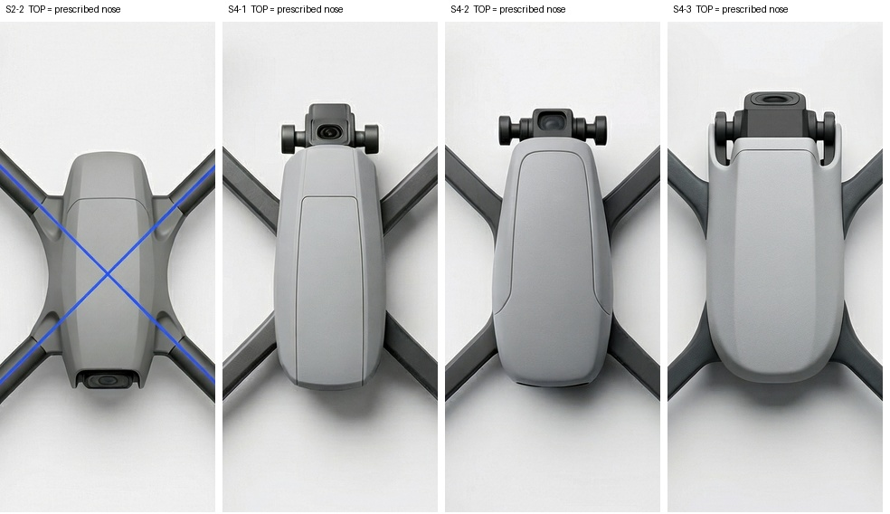

# 相机分类与错位复核

首次盲态 v2 分类为 27 张不可见、6 张不可判、3 张可见相符、0 张实见错位。后续作者或导师看到镜头位置有问题时，请把位置和观察依据独立记录；0/36 的确切含义只是“首位读者没有编码明确错误”。

按本轮规格，**图上边缘是指定机头端**。S2-2 上端壳面光滑，下端有一枚疑似镜头的深色开口。第一次盲记录将它写成 inside/consistent。现图知条件复核把这一例列作“下端疑似模组，待人工核查”，不替第一轮重新打分。若在盲读中确认下端确是相机，错误是位置在指定尾端；即使机鼻编码为“无外突”，也要单独记错位。若只见黑片且用途不能辨，错位项留不可判。

S4-1、S4-2、S4-3 的顶端都看得见越出鼻缘的模块和两侧支撑；这是可答的外形问题。S4-1、S4-2 顶端也出现深色光学面，透视与倒影使精确光轴含混。不可从一个“前伸”码推断“镜头必然水平”。本次没有第二视角或内部装配证据。

