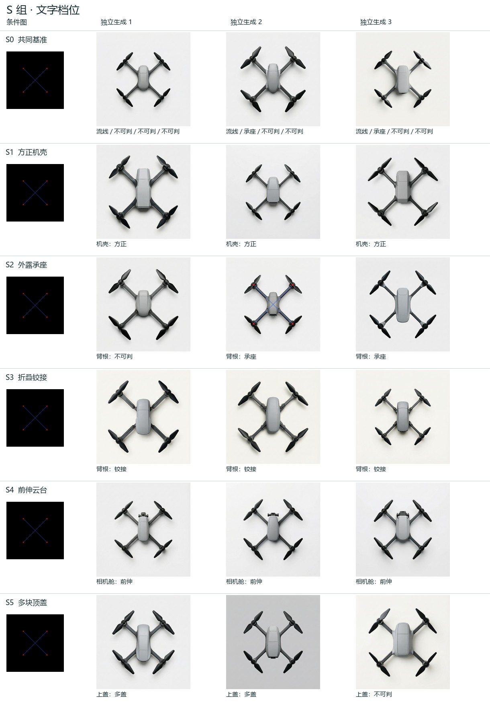
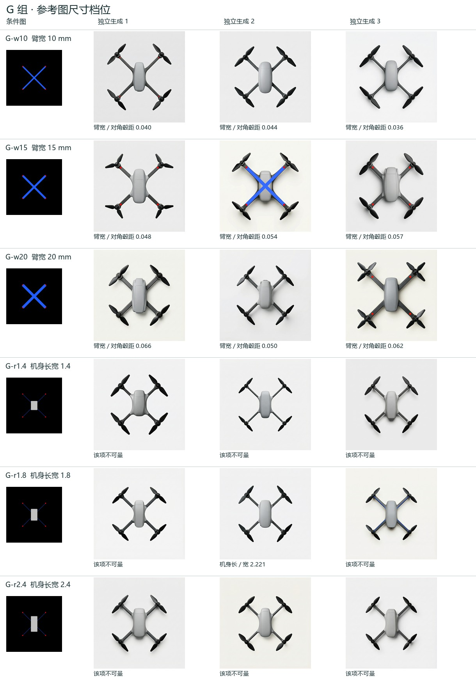

# H3 开发第一轮 · 文字档位和条件图尺寸

日常航拍四旋翼，同一顶视任务。36 次实际调用、36 份不同原图、36 份模型改写回执。每格三次独立服务调用；模型无可提交种子。

独立 AI 先在新会话读取随机 RGB 图、逐图填写；锁定 36 行原表后才对应条件。通用三项同时满足 **35/36**，本轮门槛为 30/36。可辨四轴均双叶 35/36，按冻结定义没有实见相机错位 36/36，像产品图 36/36。相机不可见 27、可见性或方向不可判 6、实见错位 0；“未实见错位”范围大于“已证实相符”。

[逐张读数](by-image.csv) · [匿名原表](blind-readings.jsonl) · [封存摘要](blind-lock.json) · [揭盲键](unblind.json) · [实发词和服务端改写并排](prompt-audit.csv) · [两组逐张原图索引](gallery.md) · [量测与判定预案](freeze.md)

**产品感与护圈已盲态补读。** 首位读者导出时把这两列写成常量，已确认作废。另一独立 AI 会话对重新编号的 36 张逐图记录两项及依据，封存后并入最终表。以上产品感与通用三项均取该复核；护圈有 0 张，无 36 张。保留[首读方法](reader-method)、[补读原因](audit-two.md)、[逐图证据](audit-readings.jsonl)、[第二把揭盲键](audit-key.json)、[补读封存](audit-lock.json)。

## S 组 · 同一 E 盘点线图，一次改一项

| 条件 | 目标 | 命中 / 3 | 预设判定 | 非目标明确异档 / 不可判（字段次数） |
|---|---|---:|---|---:|
| S0 | 共同基准，全四项 | 0/3 | 未过 | 2 / 7 |
| S1 | 方正机壳 | 3/3 | 通过 | 0 / 7 |
| S2 | 外露承座 | 2/3 | 通过 | 0 / 5 |
| S3 | 折叠铰接 | 3/3 | 通过 | 0 / 5 |
| S4 | 前伸云台 | 3/3 | 通过 | 0 / 4 |
| S5 | 多块顶盖 | 2/3 | 通过 | 1 / 5 |

S0 同时核四项，后一列列出四个基准项的偏离或不可判。S1–S5 各有三个保持项，每格三图共九项。对前伸云台、顶盖等目标的正确判读不能抵消其他参数漂移。

## G 组 · 同一基准文字，分别改变线宽和占位框长度

| 输入档 | 读取量 | 有效 n / 3 | 均值 | 样本标准差 | 残留 / 残留不可判 |
|---|---|---:|---:|---:|---:|
| G-w10 | 四臂均宽 / 对角毂距 | 3/3 | 0.0398 | 0.0038 | 1 / 0 |
| G-w15 | 四臂均宽 / 对角毂距 | 3/3 | 0.0532 | 0.0043 | 3 / 0 |
| G-w20 | 四臂均宽 / 对角毂距 | 3/3 | 0.0591 | 0.0081 | 1 / 0 |
| G-r1.4 | 机身投影长 / 宽 | 0/3 | — | — | 0 / 0 |
| G-r1.8 | 机身投影长 / 宽 | 1/3 | 2.2214 | — | 1 / 0 |
| G-r2.4 | 机身投影长 / 宽 | 0/3 | — | — | 0 / 0 |

**机臂宽度未过**。相邻差 0.0134 对档内 SD 0.0043，相邻差 0.0060 对档内 SD 0.0081。九图量测完整，有标记残留或不可判。

**机身长宽比未过**。相邻差 — 对档内 SD —，相邻差 — 对档内 SD —。存在量测缺失，有标记残留或不可判。

## 解释边界

各档三张、一个后端。结构和量测由一名独立 AI 读取，产品感与护圈由另一名盲态 AI 专项复核；各字段均无真人复测。形体读数是图上像素估计，隐藏的相机装配无法由俯视图确认。几何层只用于诊断，不据此确定正式方案外壳。相同原始提示词可能被服务端不同地改写；这轮不能把失败单独归因于原句、改写器或生成器。

封存读数 SHA-256 `e5afaaf004ef94274eb4f8a9ebac8efdfb9e51c9f548a2c619d6dc2292b20e17`。[入场请求](manifest.json)、[服务端回执与原件](actual)、[软件核验](verification.json)、[逐档统计](results.json)。服务端回执用量合计 343,116 tokens。实际计费金额未知，未收到可用的 HTTP request ID。正式与真人分母均未增加。

[需要 Claude 裁定的档位与修改建议](review.md) · [可见性与模型改写的解释边界](reading-limitations.md)
