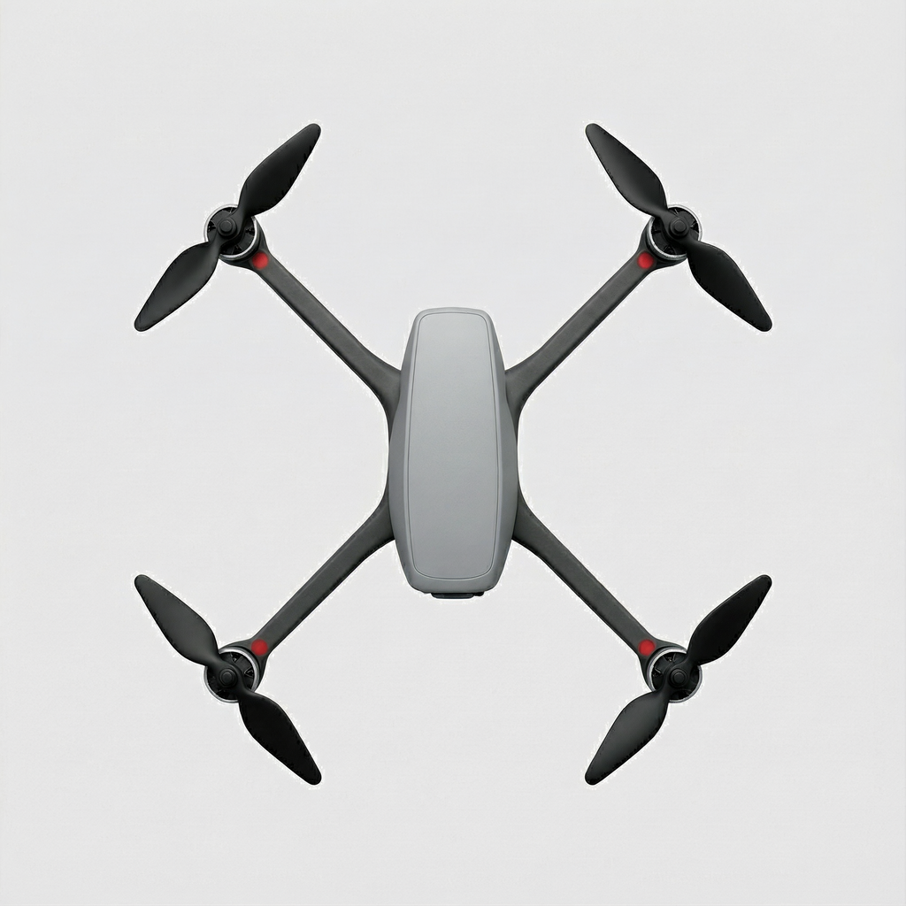
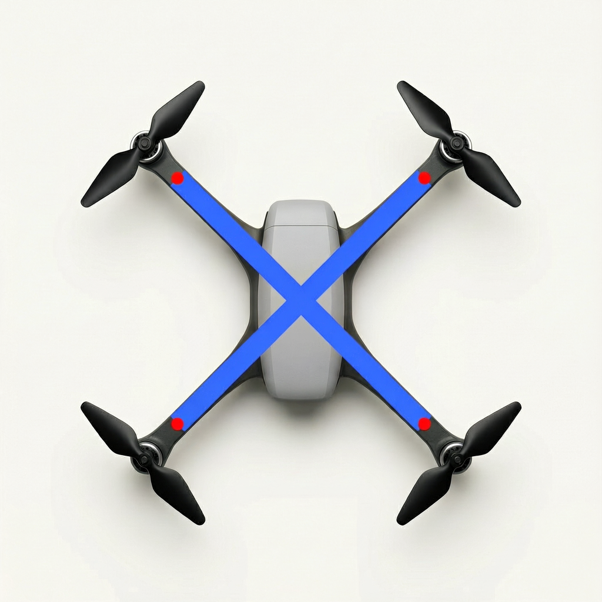
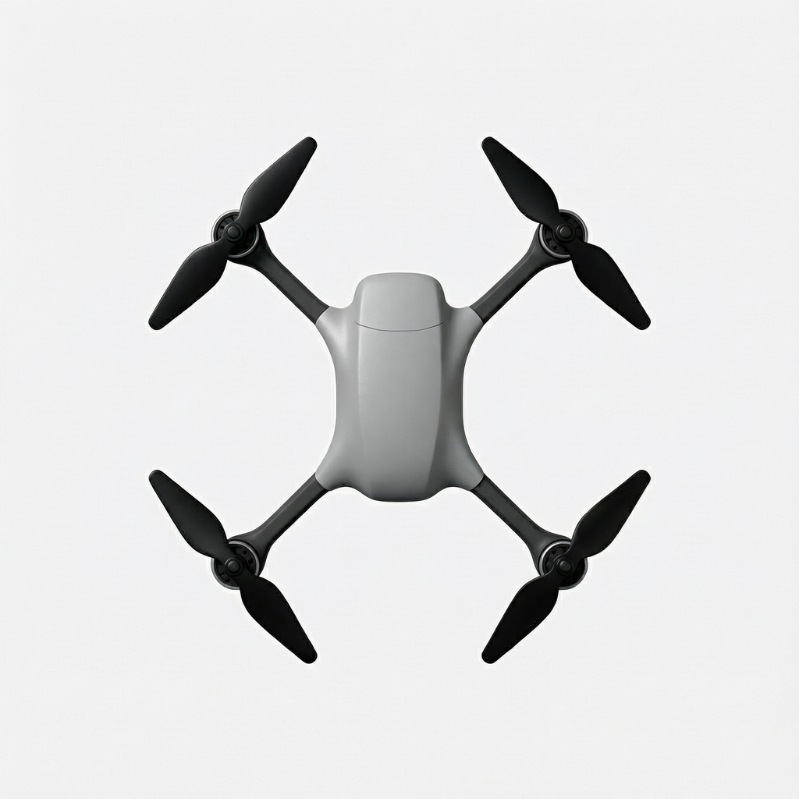
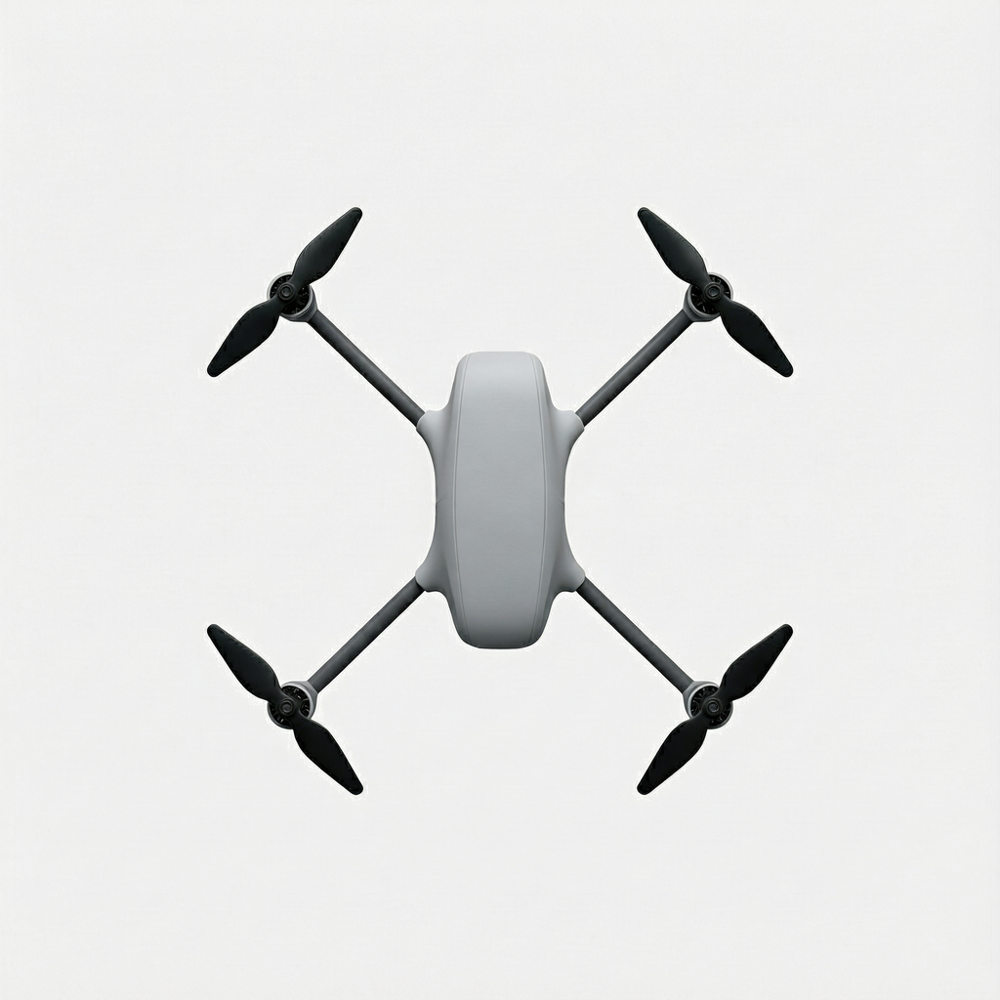

# 两组原图、参考图和逐图记录
同一行的三张为同档全部重复，每个编号链接到原始 PNG。
| 条件与参考图 | 重复 1 | 重复 2 | 重复 3 |
|---|---|---|---|
| [S0 输入](guides/dots.png) |  |  |  |
| [S1 输入](guides/dots.png) |  |  |  |
| [S2 输入](guides/dots.png) |  |  |  |
| [S3 输入](guides/dots.png) |  |  |  |
| [S4 输入](guides/dots.png) |  |  |  |
| [S5 输入](guides/dots.png) |  |  |  |
| [G-w10 输入](guides/G-w10.png) |  |  |  |
| [G-w15 输入](guides/G-w15.png) |  |  |  |
| [G-w20 输入](guides/G-w20.png) |  |  |  |
| [G-r1.4 输入](guides/G-r1.4.png) |  |  |  |
| [G-r1.8 输入](guides/G-r1.8.png) |  |  |  |
| [G-r2.4 输入](guides/G-r2.4.png) |  |  |  |
