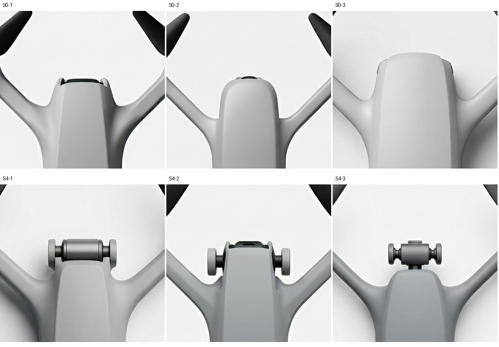

# 两轮 H3 之后需要补的验证

这份记录用于安排研究任务。对应[现行六章目录](../../../manuscript/outline.md)。本次使用已有图片、封存读数和实发回执，新增出图 0、真人回收 0。

## 4.1.3 开发预试的补查

从第二轮清单提取常规点线图 S0—S5 全部 18 张。对每张同时比对请求中的机壳平面形、臂根、机鼻外突和顶盖分件与封存 AI 读数。这是揭盲后的描述性补查，没有改变任何原门槛。[按图号的四项结果](regular-18.csv) · [复算脚本](joint_audit.py) · [原判据和分母](../round-2/freeze.md)

| 条件 | 四项都能从同一图确认 | 未确认的原因 |
|---|---:|---|
| S0 基准 | 1/3 | S0-1 和 S0-2 的机鼻待判 |
| S1 方正 | 0/3 | S1-1 顶盖待判，S1-2 和 S1-3 机鼻待判。三张机壳均读为方正 |
| S2 承座 | 2/3 | S2-3 机鼻待判 |
| S3 铰接 | 3/3 | 三张四项均可辨 |
| S4 前伸 | 2/3 | S4-2 机鼻待判 |
| S5 多盖 | 3/3 | 三张四项均可辨 |

合计 11/18 四项同图可确认，余下 7 张各有一项待判，其中机鼻 6 张、顶盖 1 张。各项分别为机壳 18/18、臂根 18/18、机鼻 12/18、顶盖 17/18。这个指标只检验四个外形请求，未包含双叶、朝向、产品质量或审美，各条件每档仅三次。原来在全部 36 张上评价的通用三项仍为 30/36。这两个分母分别回答不同的问题。

### 机鼻原图与服务端改写

用同一矩形从六张 1024 原图截取机头，图上顺序按条件，复核者已知请求和之前读数。上排 S0-1 中央暗横件夹在两耳间，S0-2 只有一小段黑弧，S0-3 的最前缘可沿壳顶追踪。下排 S4-1 和 S4-3 可见有厚度的中央件和支撑共同伸出；S4-2 最显眼的是两侧横轴和端盘，中央黑件与两耳近乎齐平。三张疑图继续保留待判。

逐份核查 S0、S4 六份及尾端错位的 L-W25-3，共七份改写。S0 三份均保留了相机朝前、鼻壳包覆、顶视无外露支耳的要求，S4 三份均保留了向前伸出和侧支撑。L-W25-3 的改写也保留了机鼻包覆朝前镜头的设定。图文不一致存在于这些例子中。它排除了“这七份回执把朝前或内外要求删掉”这一具体解释，尚无对照隔离改写措辞、图像条件或生成波动的贡献。[逐项请求与服务改写](../round-2/prompt-audit.csv) · [含机尾的原图证据](../round-2/camera-direction-review.jpg)

## 目录上的缺口和下一项行动

| 对应目录 | 当前依据 | 补什么，怎样算完成 |
|---|---|---|
| 3.2、3.3 需求到规格 | 7,443 个去重文本簇，36 张评论卡来自 35 条来源。词对 v1 已定，颜色词对仅用于深化。 | **可立即交独立编码者。** 40 条匿名短引文含 35 条入卡来源和 5 条干扰项。修正一处旧词“紧凑—松散”为“紧凑—舒展”，逐行核验 40 条编号、原文、顺序和待填内容。收回答卷后统计一致、分歧、不可判，保留作者对分歧的解释。[卡表](../../semantic-cards/README.md) · [词对 v1](https://github.com/Freeloop993/paper/blob/dad19783e8e798f3974f896ccb95e4a298685162/docs/protocols/word-pairs-v1-draft.md) |
| 3.4.4、5.2.1 参数响应 | 正式开源 E0 已有 6 张，E1 已有 36 张，条件图 24 张与纯文字 12 张。两位 AI 量得条件图六档各 4/4 在原容差内。H3 两轮 72 张另存开发分母。 | **可立即发 12 张几何盲包给一名未见条件或答案的人。** 包内有 E0 条件图 4 张、E1 条件图 6 张、E1 纯文字 2 张。已核包内 12 张 PNG、脚本和页面均与发放目录字节一致。收回 JSON 后按原方案比较轴心、桨尖和比值误差。[E1 数据及抽样规则](../../e1-open-20261112/README.md) |
| 3.4.2、4.1.3 造型参数 | 三种臂根在第二轮常规图各达 3/3，S0 无外突 1/3。W 两档各有一张无法量臂宽，低对比图的承座命中下降。 | 臂根留为可选规格；常规点线继续作为设计参考，臂宽只列探索性观察。现有疑图可交人独立复读。开发整组门槛保持未过；若未来缩小正式验证问题，要先登记新范围和判据。全部“产品可读、无护圈”两列待人核查。[第二轮原表及常量复核页](../round-2/README.md) |
| 3.5、4.2—4.4 四旋方法应用 | E 盘配置器可导出 A/B/C 实发规格。不同版本给 A/B 的细部约束不同。H3 局部编辑开发有 4 份父图编辑、2 份布局图对照。正式 E2 六份请求本次离线核验通过。 | 先把 4.2.1 三个方向的最新取值交作者确认，允许对机鼻与臂根写“自由”。E2 的父图已取自 E1。待正式通路与方法版本确定后按登记取回 E2 结果；E3 参照编辑结论做三方向候选、作者取舍、至多两次修订、锁稿或停止；4.4 再做 CMF 和表达。完整交付是可追溯的一条作者决策记录。[配置器与三案](../../../experiments/form342-h3-pilot/README.md) · [E2 登记](../../../experiments/e2-registered/README.md) · [4.2.1 历史规格卡](https://github.com/Freeloop993/paper/blob/69f350fd1ab90b99db427efbd36937f7ecbb1d6c/docs/protocols/4.2.1-design-cards.md) |
| 3.6、5.3—5.4 感知与协同 | 有两种工作方式和评议工具。产品实拍记录已核 4 个不同型号。作者的选择、盲评者的判断与参与设计者的操作承担不同观察任务。 | 招募与发放准备可并行。E4 原计划至少 4 名设计者，每人两场，记录修改动作、停止、调用、耗时；人数不足按既有降级规则报告个案。E5 原计划至少 3 名独立评议者，先读真实产品图，再盲评锁定终稿。补实拍到原计划 8–10 或交代实际覆盖。[人数与降级](../../../docs/foundation.md) · [实拍样本现况](https://github.com/Freeloop993/paper/issues/30#issuecomment-6824351853) |
| 5.5 六旋植保适配 | 三款产品手册已有药箱、机架、喷洒部件的页码与部位核查。旧草案用了斜视。 | 先把 E6 正式输入改为正交顶视。按六旋自身基准登记 W/L 三档，按地基计划每档两次；另留一条药箱与机架、喷洒杆与机臂的设计修订记录。遮挡的部位记不可判，六旋证据单列。[手册及历史草案](../../../experiments/hexa-plant-protection/README.md) |
| 1、2、5.6、6 论据与边界 | 已有开题、目录和文献证据索引。 | 第 2.1 节补无人机构型与产品设计文献的全文页码；到 5.6 与第 6 章按真实收到的参数量测、设计过程、感知和六旋案例逐项回应，不设成功率目标。[六章目录](../../../manuscript/outline.md) · [文献地图](../../../references/reading-map.md) |

**现在的优先顺序。** 先发真人点选与第二编码，整理作者可改的 A/B/C 规格。在人回读期间准备四旋选稿记录与六旋顶视材料。工程准备、真人回收、作者选稿各自记账。臂根本轮复读到此为止。
