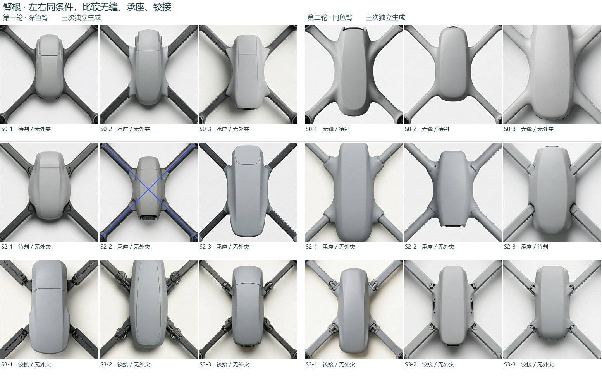
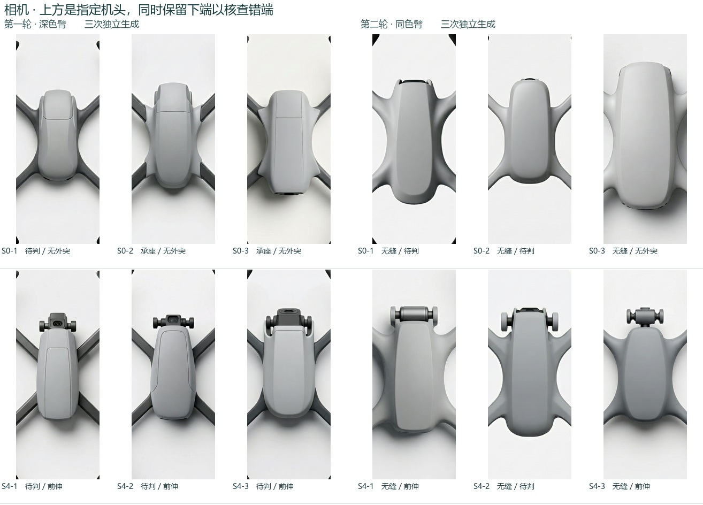

# H3 第二轮 · 生成、盲读及两轮对照

第二轮新提交 36 次，回收 36 张不同原图及 36 份服务端提示词改写。提交时间 2026-11-13T14:30:28.007453+00:00 至 2026-11-13T14:33:23.779144+00:00。第一轮另有 36 次真实生成；旧图复读新增生成 0。第二轮前冻结 fdae71c。量测与可见证据由两位新会话 AI 分工独立记录。实际金额未知，服务端记录 337960 tokens。GPU 启动 0 次。

[第二轮全部原图](gallery.md) · [逐图数据](by-image.csv) · [实发/改写并排](prompt-audit.csv) · [冻结口径](freeze.md) · [第一轮同读法复测](../round-1-recheck/README.md) · [两轮每张对照](two-rounds.csv)

## 臂根与相机 · 同条件两轮各三张

| 条件 | 首轮臂根 | 次轮臂根 | 首轮机鼻 | 次轮机鼻 |
|---|---|---|---|---|
| S0 | 待判1、承座2 | 无缝3 | 无外突3 | 待判2、无外突1 |
| S1 | 待判2、无缝1 | 无缝3 | 无外突3 | 无外突1、待判2 |
| S2 | 待判1、承座2 | 承座3 | 无外突3 | 无外突2、待判1 |
| S3 | 铰接3 | 铰接3 | 无外突3 | 无外突3 |
| S4 | 待判3 | 无缝3 | 前伸3 | 前伸2、待判1 |
| S5 | 待判2、承座1 | 无缝3 | 无外突2、待判1 | 无外突3 |

同一行是同一设计条件。样本按生成序号排列，两轮随机种子与盲读者均不同。首轮原图使用后来登记的 v2.1 复测（原冻结读数另存），次轮使用预先登记的 v2.1。固定配色和单盖文字同轮调整，不能从跨轮数据识别单一改动的因果效应。机鼻类别只描述外突与否。相机位置/朝向另记：{'U': 18, 'invisible': 14, 'consistent': 3, 'wrong': 1}。

[相机位置例图：第一轮疑似 S2-2 与第二轮实见错位 L-W25-3](camera-direction-review.jpg)。第二轮 S0-1 的横件在两耳之后，S0-2 只见小黑拱，均不强判无外突或朝向。S4-2 两支耳突出但中间模组近乎齐平，仍待判。顶视看不见镜头不计错位，也不证明朝向正确。

## 候选版本和判定

S0 三个基准项：无缝 3/3，单盖 3/3，无外突 1/3；读成承座 0/3。S1 方正、S2 承座、S3 铰接、S4 前伸、S5 多盖分别为 3/3、3/3、3/3、2/3、3/3。
本轮通用三项同时达成 30/36。四轴均双叶 31/36。产品感 {'product': 36}，护圈 {'no': 36}。S 及通用项合并按 AI 读数未达到阈值。正式签署与人工确认另列。

W 的 10 和 25 mm 常规条件各三张，分别有 2/3、2/3 可量。仅可量子集的相对臂宽均值为 4.59% / 8.71%。未满六张，未进行预定全组六张的均值差与 SD 检验。两张均因蓝条盖住实体臂边无法测量；明确残留分别为 2、1 张。W 未达到预设条件。

L 比较本轮常规与低对比各12张。常规残留 {'no': 10, 'U': 1, 'yes': 1}，低对比 {'no': 11, 'U': 1}。承座命中 3/3 → 2/3；前伸 2/3 → 3/3。L 未达到预设条件。

| 同轮参照 | 常规残留 (yes/U) | 低对比残留 (yes/U) |
|---|---|---|
| S0 | 0 / 1 | 0 / 0 |
| S2 | 0 / 0 | 0 / 1 |
| S4 | 0 / 0 | 0 / 0 |
| W25 | 1 / 0 | 0 / 0 |

[全表和档内三次数值](results.json) · [结构 AI 原记录](morph-ai.jsonl) · [量测及外观 AI 原记录](visible-ai.jsonl) · [结构封存摘要](morph-ai-lock.json) · [量测封存摘要](visible-ai-lock.json)

全同列检测以分类的实际原记录为准，详细见[人工核查页](human-check.md)。字典 v1.2、读法 v2.1、常规/低对比点线图分别报告；每字段有效读者一名，尚无真人确认。本批不自动升格为正式数据。
