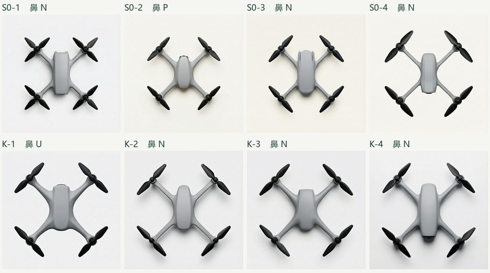

# H3 第三轮 · 机鼻无外突与轴距

原定八格全部实际返回，八个不同原始 RGB 摘要。两组各四张，使用常规点线图、字典 v1.2、同一个 H3 编辑接口，无指定种子。开源 GPU 本轮启动零次。冻结提交 [f8c540b](https://github.com/Freeloop993/paper/commit/f8c540bd82e07bd738c1c5140181ed7b40bf8751)。读者只获八张等像素重编码的匿名 PNG 与中性操作定义；一名独立 AI 逐图读取，锁存原答后由脚本映射分组，未收真人读数。

| 预定问题 | 实测 | 按冻结判据 |
| --- | --- | --- |
| S0 鼻端能否稳定无外突？ | 本轮 250 mm 四张为 3 N、1 P；和第二轮 1 N、2 U 合并为 4 N、1 P、2 U（7 张）。S0-2 可见鼻缘前方的拱形件与两侧框边。 | **未过**。要求至少 5 N、0 P。顶视可描述外缘与露件，不能确认舱内结构。 |
| 加大轴距能否稳定降低壳长／对角毂距？ | S0 250 mm 均值 0.5514、样本 SD 0.0842；K 320 mm 均值 0.5228、SD 0.0552。八张全部可量，观察到标记残留 0/8。 | **未过**。均值差 0.0286，小于较大组内 SD 0.0842。未取得把轴距列入正式 5.2.1 为紧凑度代理的开发依据。 |

P 为可辨模组和支架超出鼻缘，N 为无明显外突，U 为不可判。相机水平朝前仍是任务规格。判据只覆盖机鼻读数和壳长／轴距。本轮不复测 W/L 几何实验、臂宽、造型审美或独立感知。保留第二轮已达各自门槛的档位供 Qwen 小测；S0 机鼻记“H3 判读不稳”。A、B 短肩/长肩可作为设计语言，正式响应仍是同一个无缝档。K 不进入本次正式响应方案；正式与开发分母分开。

[盲态原读数](blind-readings.json) · [封存摘要](blind-readings.sha256) · [匿名映射](blind-key.json) · [逐图坐标、鼻缘、比值与汇总](results.json) · [复算脚本](score.py) · [登记与原规则](freeze.md) · [实发输入清单](manifest.json)

| 独立原图 | 实发请求 | 服务端改写与回执 |
|---|---|---|
| [S0-1](actual/S0-1/original.png) | [参数](actual/S0-1/submission.json) | [回执](actual/S0-1/receipt.json) |
| [S0-2](actual/S0-2/original.png) | [参数](actual/S0-2/submission.json) | [回执](actual/S0-2/receipt.json) |
| [S0-3](actual/S0-3/original.png) | [参数](actual/S0-3/submission.json) | [回执](actual/S0-3/receipt.json) |
| [S0-4](actual/S0-4/original.png) | [参数](actual/S0-4/submission.json) | [回执](actual/S0-4/receipt.json) |
| [K-1](actual/K-1/original.png) | [参数](actual/K-1/submission.json) | [回执](actual/K-1/receipt.json) |
| [K-2](actual/K-2/original.png) | [参数](actual/K-2/submission.json) | [回执](actual/K-2/receipt.json) |
| [K-3](actual/K-3/original.png) | [参数](actual/K-3/submission.json) | [回执](actual/K-3/receipt.json) |
| [K-4](actual/K-4/original.png) | [参数](actual/K-4/submission.json) | [回执](actual/K-4/receipt.json) |

**交接。** [#1 的判据和后续顺序](https://github.com/Freeloop993/paper/issues/1#issuecomment-6858488547) · [4.2.1 方向卡与作者的材质决定](../../section421-h3-span/specs-after-review.md)。交 Claude 写入 PR #68 第 2 节，再由作者签署第 3 节。后续开机须依实际签署、开机窗口及批次登记；此次未消耗 Qwen E2 六个位置或 Qwen 小测十二个位置。
