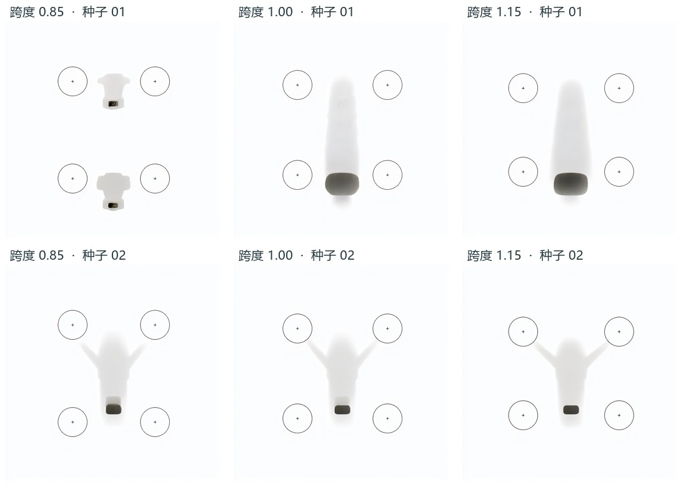

# G2 四旋翼布局三档对照

六次均生成了 1024 × 1024 原始 PNG。两位独立 AI 读者各自在六张图的 24 个预期位置寻找电机轴心，每人均判 24 处不可辨。图上保留了细圆和十字，中央能看到浅色壳体或片段，四处均缺少可以定位旋转中心的轴帽、桨根或电机结构。依据生成前指定的“≥2 图四轴不可辨”判据，两位读者均判本批控制路线失败。真人复测由作者安排，待收到封存读数后逐人追加。[预定判据](../../docs/protocols/G2-axis-control-spec.md)

|目标横纵跨度比|种子 2026111001|种子 2026111002|两位读者各自可量测的完整图数|
|---|---|---|---:|
|0.85|[原图](originals/G2-n4-r085-s2026111001.png)|[原图](originals/G2-n4-r085-s2026111002.png)|0/2|
|1.00|[原图](originals/G2-n4-r100-s2026111001.png)|[原图](originals/G2-n4-r100-s2026111002.png)|0/2|
|1.15|[原图](originals/G2-n4-r115-s2026111001.png)|[原图](originals/G2-n4-r115-s2026111002.png)|0/2|

**写作口径。** 六个输出分别有不同的 PNG 和 RGB 像素摘要。输出中可见控制图的圆和十字，读者均辨为平面线标。两位对其中 1 张的机身可辨性有分歧，A 判可辨机身 5/6，B 判 6/6。实际电机轴位的横纵跨度比、随输入是否单调、坐标误差以及两读者之间的像素距离都缺少可量测点，数值保留为空。把十字中心当电机中心会把输入标记的复现误报成部件控制成功。当前证据支持本次线稿、强度 1.0 和两种子下的失效边界。参考产品图的造型改善仍须独立比较。

**执行与计费。** 同一台原 CompShare 实例，Qwen-Image 2.1 BF16 与原 Union ControlNet。四个权重实际摘要通过，六次请求均与对应成功 history 逐字段相等。6 次受理、6 次完成、采样缓存命中 0、自动重试 0。原 ZIP 为 4,393,626 字节，云端与本地 SHA-256 均为 `d28b62a0d6b7be16a45c6e61605825bcf8fe32b986a72f06b8fd349bb48b8232`。容器计费北京时间 23:05:13 至 23:17:22，12 分 09 秒，已入账 0.41 元。从开机前保守起点到刷新确认关机约 16 分 05 秒。系统盘界面报价为 0.00 元/小时，关机后收费项显示“无”。[执行摘要](verification.json) · [运行图与回执](executed.json) · [后端](backend.json) · [费用记录](billing.json)

**盲读复算。** 去除 PNG 元数据后逐张确认匿名 RGB 像素与原图相同，由两个未继承上下文的 AI 会话各自观察原图和电机局部。读者只获随机图像及点选说明。先封存原读数，再与条件编号对齐。运行 `python -X utf8 -B recompute.py` 可重建两读者的结果。六图是共同的观察对象，两份判读未扩大图像样本量。[读者 A](reading-A.json) · [读者 B](reading-B.json) · [匿名映射](blind-key.json) · [逐图可读性与缺失](scored.json)
