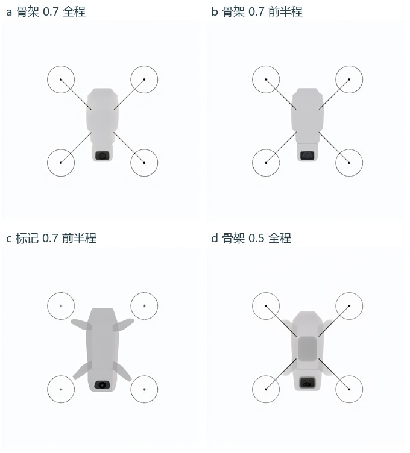

# 四旋翼骨架控制筛选 G2b
固定相对跨度 1.00，种子 2026111104。四种配置各生成 1 张完整原图，两名独立 AI 读者分别按四项筛选条件读图。各自均判可用 0/4；每位检查的 16 个位置全部缺少可定位的实体电机轴心。四张均可辨无人机的示意布局，也均出现引导线标记照抄。G2c 的启动条件未满足，确认批实际调用为 0，共同对照仍暂停。[原先登记的筛选配置](../../experiments/g2b-screen/screen.json)

|配置|两位各自可定位的轴心|两位读者对机身与四臂连接的观察|实体部件与标记|
|---|---:|---|---|
|[a 骨架 0.7 全程](originals/G2b-a.png)|0/4|均未辨出四条实体臂|外围细圆、实心点与细线|
|[b 骨架 0.7 前半程](originals/G2b-b.png)|0/4|均未辨出四条实体臂|不规则黑点及细线|
|[c 标记 0.7 前半程](originals/G2b-c.png)|0/4|均辨出与机身相连的四段短臂，末端未到达轴位|圆线内有十字|
|[d 骨架 0.5 全程](originals/G2b-d.png)|0/4|均辨出与机身相连的四段短臂，末端未到达轴位|外围细圆、点与斜线|

轴位误差逐图保留缺失。每种配置只有一个种子，结论限于本批四个候选。G2b 的实心轴心点半径、臂中线宽度和中央留白尺寸见编译器。旧 C1 指引画出有宽度的臂段与双叶桨，小圈标轴心，中央的白色遮罩随机身目标变化；旧 C1 的引导形状与这四个候选不同。[历史指引原件](../historic-guides/README.md)

读图使用两次独立、无会话继承的本机 Codex 客户端调用，均获同一组四张匿名 RGB 图和四象限局部放大图；全图始终可见，放大图取固定位置。两次运行共享模型服务，可能有共同偏差。生成端四个唯一 prompt ID，四种不同的 RGB 像素内容，逐份原请求与成功 history 的图一致。采样缓存命中 0，重试 0。四次筛选与两次 G3 共用一个容器，合计账期 9 分 33 秒、0.32 元。此费用只计一次。[读者 A](reader-A.json) · [读者 B](reader-B.json) · [逐图筛选](result.json) · [运行原件摘要](receipts.json) · [联合账期](billing.json)
