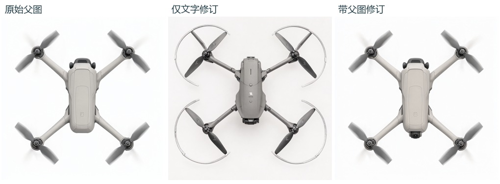

# G3 相同修改要求，有无父图的两张真实输出
原图为已有的 S1-B1-T，任务是让前摄与机鼻的过渡更顺。两个请求共同使用种子 2026111101、顶视、1024²、40 步和相同的修改文字。两图分别有独立的成功 history，实际请求与冻结请求逐字段相同，采样缓存命中与重试均为 0。

一位非作者真人评者与一位独立 AI 读者各看同一张父图和两张匿名改稿。作者确认真人在填写前未看带条件标签的对照图，也未看 AI 结论。下表按封存映射揭盲，选项保留原值。[父图](../s1-axis-repeat/originals/S1-B1-T.png) · [纯文字改稿](originals/G3-text-only.png) · [带父图改稿](originals/G3-with-reference.png)

| 出图前规定的题项 | 真人 · 纯文字 | 真人 · 带父图 | AI · 纯文字 | AI · 带父图 |
|---|---|---|---|---|
| 轮廓与肩部宽窄 | 改变 | 不可判 | 改变 | 保持 |
| 上盖主要分件 | 改变 | 保持 | 改变 | 保持 |
| 臂根交界形式 | 改变 | 保持 | 改变 | 保持 |
| 前摄与机鼻的过渡改动 | 可辨 | 可辨 | 不可辨 | 不可辨 |
| 看起来是否整张照搬 | 否 | 否 | 否 | 否 |

**结构保持。** 带父图改稿的人评为两项保持、一项不可判，AI 为三项保持。纯文字改稿两位均判三项改变。两位对上盖与臂根的判断一致。原判据要求每位读者都能判断三项，故此次配对的联合保持判据未满足。轮廓的未知保留为未知。[冻结判据](../../experiments/g3-reference/README.md)

**局部修改。** 真人将两图的前摄过渡改动都选为“可辨”。带父图一侧，评者认出了画面下方新增的摄像头，并对机身另一端黑色部件的功能感到困惑。纯文字一侧，评者观察到整体变化大，尤其关注旋翼部分的变化。AI 则认为两图都缺乏壳面朝镜头连续收拢或包覆的可见证据。两张输出的 RGB 均与父图不同。按出图前规则，此对图不足以支持正式 D/S 开放参考图修订。样本范围为一张父图、一个种子、一位真人及一位 AI。[真人脱敏选项](human-summary.json) · [AI 封存读数](reader-A.json) · [联合复算](result.json)

**评图表的措辞。** 原表把“前摄与机鼻的过渡改动”放入一个可辨性选项。文字理由反映了评者察觉的部件变化，但未明确说明壳体过渡是否达到设计意图。这使“看出新增镜头”和“看出融合改善”两种理解都成为可能；分歧的具体成因不能由这一份答卷确定。未来 G3b 将先问可见变化，再问相机与机壳的整合是否达到指定目标。此项修订自下一版表起生效。

两张 G3 与四张 G2b 共用一次实例开机，容器合计 0.32 元。[请求及成功回执摘要](receipts.json) · [共用订单](../g2b-actual/billing.json)
