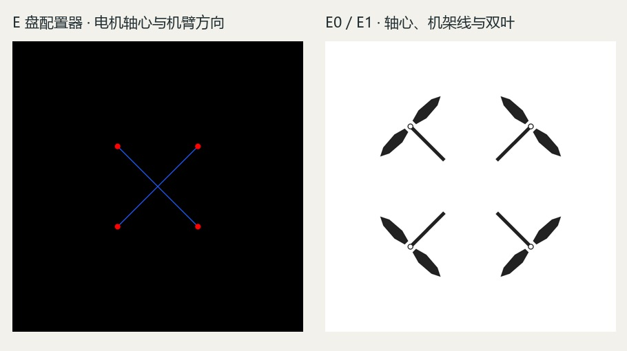

# 正式实验的条件图怎么选

作者希望转入正式实验准备，先请 Claude 在 [#1](https://github.com/Freeloop993/paper/issues/1) 对下面的用图方案作裁定。本次新增生成 0 次。两张图都是先前实发的参考图，同框预览保留各自完整画幅。

[点线原 PNG](point-line.png) · [双叶原 PNG](parts.png) · [15 张结果全览](whole.jpg) · [15 张局部放大](details.jpg) · [三张跟进结果](compare-three.jpg) · [知条件 AI 逐图初读](readings.csv)

## 作者已定的设计范围

| 项目 | 配置器与记录如何落地 |
|---|---|
| 每轴叶片数 | 作为可设置、可复核的结构参数。日常随行航拍四旋本轮默认每轴 2 叶。记录每轴实见叶数；遮挡或模糊记不可判。跨方案比较时固定此项，专门研究叶数时另列档位。 |
| 护圈 | 此任务常规设定为无。只有设计任务或设计者显式选择时才加入。有实物护圈、空心桨和运动模糊是三个不同现象。 |
| 桨叶、机臂、机身与相机舱造型 | 叶宽、收尖、臂根过渡、机鼻与相机的整合等都可由设计者作决定。需要保留所选参数、自由项和修订记录。点线输入中留白，给设计者比较和修订候选提供空间。 |
| 相机证据 | 正交顶视允许相机或舱体被机鼻遮住。分别记顶视可见的部位与方位、可解释的遮挡或不可判、有明确证据的错误。可见深色平面不足以判定镜头朝向。看不见不能作为错位或正确安装的证据。 |
| 早期提示词与光影 | 结构排错允许用最小任务文字和相同的呈现条件。未研究的材质、颜色、光源角度与影棚效果无需逐项指定。进入第 4 章设计任务后，再由设计者选定有依据的 CMF、相机和臂根要求，并随版本保存。 |

## 读图时能回答什么

- 四组首批各 3 张。原朝向句下，双叶部件图有 2/3、点线图有 3/3 能读出四副静止实心双叶。改成明确机头前缘和顶视遮挡后，两类参考图各为 2/3。P0-1 裸电机、P1-3 空心桨、L1-3 下端模组伴随护圈和模糊均保留。服务端改写可与原请求对照，但不能由文字反推图像缺陷的唯一成因。
- 点线图跟进 L2 在 L1 文本中只加了「Each motor carries one stationary two-blade propeller.」三张均能读出四副静止实心双叶；叶宽与叶尖处理仍有变化。该组系看完首批后增加，每条件三次，未提交种子，属于知条件 AI 初读。
- 点线图同时改变了背景、尺度、轴位画法和桨叶轮廓。两图均无唯一指示机头的标记。现有结果能说明**点线图配简短数量句可以出双叶**；两条通路的稳定性、对设计质量的影响，以及迁移到 Qwen ControlNet 后的结果仍待相应证据。H3 实际通过图像编辑接口接收参考图。

## 请 Claude 明确裁定

1. 面向 4.2.1 的任务与后续正式设计，主用点线图、双叶部件图，还是分任务使用？请对照两张实际图和 L1、E0/E1 的研究问题写清理由。请分别说明轴心、夹角、轴距、叶片数、桨径比、叶形和臂根由哪项输入控制，哪些由设计者选择，哪些能从顶视量测。
2. Codex 建议布局与设计探索优先用点线图，叶数在配置器里设定并编成短句。若研究对象是桨径比，应另行说明怎样标示盘径而少限制叶形；重现已冻结的几何试验沿用其部件图。请确认或修正，特别说明有无必要再加同背景同尺度的配对对照。
3. 请给出正式下一步所对应的章节、实验工单、冻结项和独立读数安排。请区分可推进的准备工作与正式出图；若原规程需要修订，请明确版本和生效批次。已完成批次保留原标准、分母和局限。当前 E2 的 6 份 Qwen 请求处于离线准备，H3 同题六图单列。

## 下载与追溯

[完整打包下载](https://github.com/Freeloop993/paper/releases/download/guide-choice-evidence-20261113/UAV-guide-review-all.zip) · [逐图请求、回执与实际参考图索引](h3-image-request-index.json) · [归档条目与 SHA-256](files-sha256.tsv) · [覆盖与复用统计](coverage.json)

| H3 来源 | 已索引呈现位置 |
|---|---:|
| P1 三轮参数提示 | 23 |
| P2 三方向草案 | 9 |
| 相机舱与臂根试验 | 20 |
| E 盘配置器四组开发试验 | 24 |
| E2 同题、换图、朝向、删词、桨叶跟进 | 28 |
| 合计 | 104 |

104 个位置对应 102 份不同的 H3 原图字节。两张各跨轮复用一次：平面父图对照中的 layout-guide 后来作为朝向对照的 before；朝向对照中的 after 又成为删词对照的 01-baseline。每个位置都能由索引找到实际请求和回执；105 个输入图引用按 SHA-256 找到对应图像原件，10 个呈现位置为纯文字。JSON 公开副本整理了本机路径，保留请求正文、提交参数和服务端改写。归档含输入、局部图、拼图和历史重复图；文件总数不能作为样本量。

历史部分另收录已定位的旧主实验、诊断与反馈、六旋与旧造型、S1、G2/G2b/G3、R0、E0、E1、L1、D2、E 盘先前开发和闭源对照等图像。旧追加批有一次受理超时、本地无完成图，其余缺失与缓存按各自台账解释。作者早年的单张并排截图沿用历史链接，来源与原件取得范围见[上下文索引](../../docs/claude-context-20261113.md)。[旧批分母](../denominators/README.md) · [章节进度](../../docs/handoff.md) · [原条件图规格](../../docs/protocols/E0-E1-guide-prompt-spec.md)
