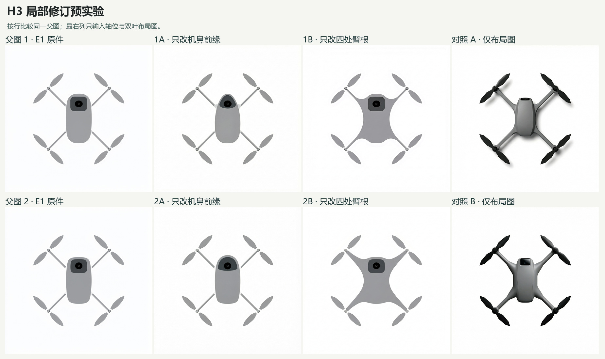

# MiniMax H3 · 顶视局部修订预实验

作者请先用 H3。六张 1024 × 1024 原始 PNG 已回收，六个解码后的 RGB 摘要各异。四张用两张 E1 原 PNG 分别修改机鼻、臂根，另两张只给布局图和对应的完整生成提示。每格一次。输入路径和 SHA、实发提示、参数见 [manifest.json](manifest.json)。每格目录包含提交记录、接口回执、实收原图及字节和 RGB 摘要。

**知条件 AI 初读。** 1A 的机鼻明显收窄，2A 前缘较其父图更圆。两张的圆形镜面仍从正上方可见。1B 和 2B 的肩部都明显变宽，曲面扩张到机身侧边和后部，其中 2B 最明显。两张仅给布局图的对照都有可辨的壳体体积与阴影。它们同时使用完整产品描述，不能从这批分离父图与提示词各自的贡献。

实际编辑请求选择 MiniMax-H3-Image，无自定义 seed 或 ControlNet，均由 /v1/images/edits 接收一张参考图。回执中的 revised_prompt 保留接口实际改写。例如 1A 和 2A 的改写主动要求延续原图的平面画风。四张带父图的结果中，外观延续程度和对局部指令的响应须分别考察。这个小批次没有独立真人读数，不能替代登记的 Qwen E2。独立读者应只领取其匿名材料。
