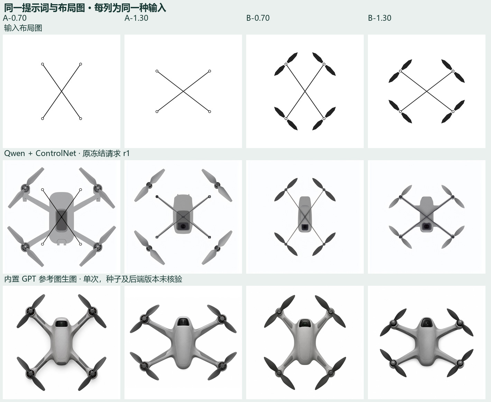

# 前向航拍相机与材质表达：四张闭源参考图诊断

作者在查看 L1 的 A/B/C 组后，要求并行测试同一段提示词和原参考图。四个输入各提交一次，保留四张原始输出。作者看过结果后的意见是“四张相机位置都有问题”，并怀疑提示词是主要原因。该意见属于知条件的设计审阅。正式 L1 的分母仍为 28。

| 条件图 | 参考图 | Qwen 对应原图 | GPT 原始输出 | GPT 原始像素 |
|---|---|---|---|---|
| A · 0.70 | [轴心与方向线](../../experiments/l1-layout/guides/line-wl0.70.png) | [原 PNG](../l1-layout-actual/L1-actual/L1-A-wl0.70-r1/original.png) | [原 PNG](A-0.70.png) | 1254 × 1254 |
| A · 1.30 | [轴心与方向线](../../experiments/l1-layout/guides/line-wl1.30.png) | [原 PNG](../l1-layout-actual/L1-actual/L1-A-wl1.30-r1/original.png) | [原 PNG](A-1.30.png) | 1430 × 1100 |
| B · 0.70 | [另含双叶轮廓](../../experiments/l1-layout/guides/blades-wl0.70.png) | [原 PNG](../l1-layout-actual/L1-actual/L1-B-wl0.70-r1/original.png) | [原 PNG](B-0.70.png) | 1254 × 1254 |
| B · 1.30 | [另含双叶轮廓](../../experiments/l1-layout/guides/blades-wl1.30.png) | [原 PNG](../l1-layout-actual/L1-actual/L1-B-wl1.30-r1/original.png) | [原 PNG](B-1.30.png) | 1254 × 1254 |

每列复用同一条件 PNG 和实际 Qwen 正向提示词。闭源入口接收原 PNG，原负向词以文本尾注 “Avoid:” 写入。实际入口为 Codex 内置 GPT 图像生成工具。作者指定 GPT Image 2.6，工具没有暴露可选模型 ID 或返回版本，此处版本记为未知。闭源种子、CFG、采样器、步数、Canny 和 ControlNet 的强度或区间均不可对齐。四份原图保持原始画幅，展示缩略图等比缩放。完整提示词、请求来源、图像摘要与尺寸见[输入输出记录](requests-and-originals.json)。

## 需要 Claude 审阅的设计问题

1. **相机的安装端与观察方向。** 四张闭源图都把深色相机窗放在画面上端，窗内可见近乎正圆、朝观察者的镜头。对于机头朝上、前向航拍相机处于水平中位、从正上方观察的任务，这种画法更像机背朝上的镜头。二维图能够判读外观线索，无法反推出精确光轴。Qwen 的 C 组则多在画面下端显示相机窗口。两个问题分别涉及安装端和镜头朝向。
2. **原提示词怎样产生歧义。** 原文同时要求 “front up”、“Integrate the camera into the body” 和 “distinct dark camera window”。“front up”规定了画面方向；文本没有规定相机安装在机头下方、光轴方向、俯仰状态，或顶视时镜面是否可见。顶视中“窗口要醒目”可能鼓励模型直接展示镜片。四张出现相似模式，值得优先检验这一解释。目前没有只改变相机描述的样本。
3. **材质线索与形体自由度。** 闭源四张可见亮暗过渡、臂根曲面、分件缝以及桨叶与机壳的光泽差异，四次又收敛到相近的总体造型。同一句灰色哑光简报容许出现这些线索。当前跨后端同时改变了模型、参考图通路、采样条件与部分画幅，无法据此锁定 Qwen 某一个参数。体积表现、相机合理性、轴位精度应分别审阅。

## 供复核的相机措辞草案

建议 Claude 先核对日常随行航拍任务是否采用前向云台水平中位。若采用，将原文的相机整合句和 “distinct dark camera window” 两处替换为以下相机描述。其余要求继续使用同一原文，包括灰壳、软光、轴位、四轴双叶和白底。只修改相机语义因素。此草案尚未执行。

> The nose points toward the top edge of the image. Mount one forward-looking camera beneath the nose in a shallow recessed gimbal bay. In its neutral position the optical axis is horizontal and points forward, parallel to the rotor plane. From directly overhead the nose lip and the upper edge of the camera housing may be visible. The top shell covers the lens face in this view. Keep the arm-root design free.

请分别判断机头端是否一致、是否出现朝天的镜面、安装关系是否能从这一视图辨认；被机鼻正常遮住时可以记“此视图无法判断”。校正后的问题应避免奖励一个本来不该在正交顶视中正对观察者的圆镜头。原 L1 读数表按冻结题照常记录，“能指出相机”只说明可定位。材质因素若需试验，可在另一组里单独替换材料描述，在固定相机语义、输入、种子和开源参数下观察。待 Claude 与作者审阅后再决定是否立项。
