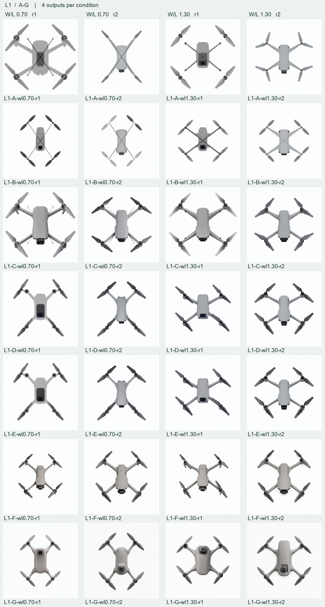

# L1 布局通路 · 28 张实际输出

A 至 G 每组四张。依 manifest 顺序提交、受理、完成各 28 次，28 个 prompt ID、28 种 RGB，KSampler 输出缓存命中 0。云端最终 ZIP 和本地下载字节一致（25,397,178 B，SHA-256 `cd966e77dd6c715ac89f27ab1567001566ee88d0e3cf8a8cd8483c74c39d6e8f`）。检查了全部原图、实际请求、history 节点图、输入和服务器输出引用。北京时间 11 月 12 日 22:33:55 首次提交，11 月 13 日 00:42:56 批记录结束。金额尚未在本批拆账。

[逐张原图、实际请求及输入](../prompt-parameter-review/by-image.md) · [28 份运行证据](L1-actual) · [独立恢复核验](verification.json) · [条件图及冻结规则](../../experiments/l1-layout/README.md)。盲读包采用随机编号、剥离元数据并核对 RGB；真人答卷仍待独立评者提交。技术完成数与可用设计方案数分别登记。
