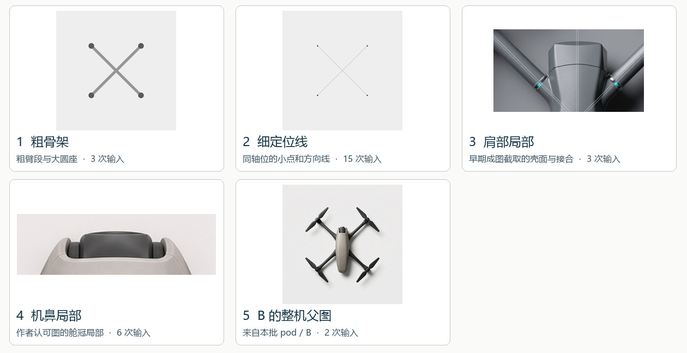

# MiniMax 开发批实际输入 · 20 次

以下逐项取自已归档的 request.json 和 response.json。序号按轮次及方向编排；提交时间见各请求。每次一张，1024 × 1024，模型请求名 MiniMax-H3-Image。展开每条可对读提交英文和接口返回的改写。

## 粗骨架

A-bar · 完整英文

输入顺序 [skeleton-light-wl1.0.png](../../experiments/p2-spec-cards/skeleton-light-wl1.0.png)

[实发请求](A-bar/request.json) · [服务回执](A-bar/response.json) · [输出原图](A-bar/original.png)

**实发提示词**

Photorealistic industrial design photograph of a daily-carry aerial camera quadcopter. Orthographic 90-degree overhead, nose at twelve o'clock. True X, four motors, arms at 45 degrees to the nose axis, square hub layout, opposite hubs 250 mm apart. Four stationary propellers, each a single balanced pair of opposite equal blades, 125 mm tip to tip. Pebble body, 1.6:1. At the rounded nose, two shell cheeks wrap a recessed forward-camera pod; only a narrow crescent of its dark crown peeks between the cheeks. Each arm grows from a broad radiused shoulder, the upper skin sweeping into the first third of the arm. Satin warm-grey molded shell, graphite composite arms, charcoal blades. Soft 5500 K sidelight, defined contact shadows, pale seamless background. Use the four reference endpoints for motor locations. Unlettered product, full aircraft in frame.

**服务端返回的改写**

The four circular endpoint markers at the corners of the X-shaped diagram in <Picture 1> are <Subject 1>. The intersecting diagonal lines connecting the endpoints in <Picture 1> are <Subject 2>. The target image is a photorealistic, orthographic 90-degree overhead industrial design photograph of a daily-carry aerial camera quadcopter positioned with its nose pointing toward twelve o'clock, replacing the flat schematic diagram with a physical aircraft whose four motors align with <Subject 1> and whose arms follow <Subject 2>. <Subject 1> supplies the exact spatial positions transferred to the four motor hubs of the quadcopter. <Subject 2> serves as a weak structural reference for the placement and 45-degree diagonal orientation of the quadcopter's four arms relative to the central body axis. The full unlettered aircraft sits centered within the frame against a pale seamless background, oriented vertically along the twelve-to-six o'clock axis so that opposite motor hubs sit 250 mm apart across a square hub layout aligned with <Subject 1>. At the top rounded nose (twelve o'clock), the pebble-shaped central fuselage features a 1.6:1 length-to-width ratio wrapped in a satin warm-grey molded shell; two sculpted shell cheeks curve around a recessed forward-camera pod at the front tip, leaving only a narrow crescent of the dark lens crown peeking between them. From the lower rear and mid-body radiused shoulders, four matte graphite composite arms extend outward along the diagonals of <Subject 2>, with the upper warm-grey skin sweeping smoothly into the first third of each arm before transitioning into the darker composite material. Each arm terminates precisely at one of the four locations defined by <Subject 1>, supporting a compact cylindrical motor housing topped with a stationary propeller. Each propeller consists of a single balanced pair of opposite equal blades with a 125 mm tip-to-tip span, crafted from smooth charcoal composite. Soft 5500 K sidelighting illuminates the scene from the side, creating gentle specular highlights along the curved satin warm-grey shell, subtle tonal separation on the graphite arms and charcoal blades, and crisp, defined contact shadows cast onto the pale surface beneath the aircraft.

B-bar · 完整英文

输入顺序 [skeleton-light-wl1.0.png](../../experiments/p2-spec-cards/skeleton-light-wl1.0.png)

[实发请求](B-bar/request.json) · [服务回执](B-bar/response.json) · [输出原图](B-bar/original.png)

**实发提示词**

Photorealistic industrial design photograph of a daily-carry aerial camera quadcopter. Orthographic 90-degree overhead, nose at twelve o'clock. True X, four motors, arms at 45 degrees to the nose axis, square hub layout, opposite hubs 250 mm apart. Four stationary propellers, each a single balanced pair of opposite equal blades, 125 mm tip to tip. Slender spindle body, 2.6:1. Twin longitudinal ridges cradle a slim flush camera hood at the nose; its tapered U-shaped rim is visible from above. Long blade-like arm roots run alongside the body then sweep diagonally outward in one uninterrupted taper. Satin warm-grey molded shell, graphite composite arms, charcoal blades. Soft 5500 K sidelight, defined contact shadows, pale seamless background. Use the four reference endpoints for motor locations. Unlettered product, full aircraft in frame.

**服务端返回的改写**

The X-shaped geometric layout with four circular endpoints at 45-degree diagonals in <Picture 1> is <Subject 1>. The target image replaces the flat schematic diagram of <Picture 1> with a photorealistic orthographic overhead industrial design photograph of a daily-carry aerial camera quadcopter aligned to <Subject 1>. <Subject 1> supplies the exact spatial placement and diagonal geometry transferred to the quadcopter's four motor hubs, central intersection, and sweeping arms. Seen from a true 90-degree top-down view with its nose pointing at twelve o'clock, the full unlettered aircraft features a slender spindle-shaped fuselage with a 2.6:1 length-to-width ratio finished in a satin warm-grey molded shell. Twin longitudinal ridges run along the body, cradling a slim flush camera hood at the nose whose tapered U-shaped rim is visible from above. Four matte graphite composite arms originate as long blade-like roots running alongside the fuselage before sweeping outward in one uninterrupted taper along the 45-degree diagonals to terminate precisely at the four dark grey circular endpoint locations of <Subject 1>, forming a square hub layout with opposite hubs spaced 250 mm apart. Mounted atop each hub is a stationary propeller consisting of a single balanced pair of opposite equal charcoal blades spanning 125 mm tip-to-tip. Soft 5500 K sidelight illuminates the scene against a pale seamless background, creating smooth highlights across the curved shell and defined contact shadows beneath the airframe and rotor blades.

C-bar · 完整英文

输入顺序 [skeleton-light-wl1.0.png](../../experiments/p2-spec-cards/skeleton-light-wl1.0.png)

[实发请求](C-bar/request.json) · [服务回执](C-bar/response.json) · [输出原图](C-bar/original.png)

**实发提示词**

Photorealistic industrial design photograph of a daily-carry aerial camera quadcopter. Orthographic 90-degree overhead, nose at twelve o'clock. True X, four motors, arms at 45 degrees to the nose axis, square hub layout, opposite hubs 250 mm apart. Four stationary propellers, each a single balanced pair of opposite equal blades, 125 mm tip to tip. Compact bevelled body, 1.6:1. A narrower transverse camera cartridge nests between short nose lugs; a fine parting seam and its satin metal end caps remain visible from above. Four separate arms seat flush in recessed shoulder sockets, each with one fitted collar. Tight joints and two banks of inset cooling slots. Satin warm-grey molded shell, graphite composite arms, charcoal blades. Soft 5500 K sidelight, defined contact shadows, pale seamless background. Use the four reference endpoints for motor locations. Unlettered product, full aircraft in frame.

**服务端返回的改写**

The four dark-gray circular endpoint markers at the corners of the X-shaped diagram in <Picture 1> are <Subject 1>. The square canvas framing and centered layout of <Picture 1> is <Subject 2>. The target image replaces the flat schematic diagram from <Picture 1> with a photorealistic, orthographic 90-degree overhead industrial design photograph of an unlettered daily-carry aerial camera quadcopter positioned nose-up at twelve o'clock against a pale seamless background, using <Subject 1> to mark the four motor locations within <Subject 2>. <Subject 1> supplies the exact spatial coordinates transferred to the four motor hubs of the quadcopter. <Subject 2> is fully preserved. The quadcopter features a compact, beveled central body with a 1.6:1 length-to-width ratio finished in a satin warm-grey molded shell, oriented vertically along the longitudinal axis. At the front nose, a narrower transverse camera cartridge nests between short nose lugs, displaying a fine parting seam and two visible satin metal end caps from above. Along the flanks of the central hub, two banks of inset cooling slots are recessed into the warm-grey shell, while the opposite motor hubs sit 250 mm apart across the square diagonal geometry. Four separate arms in matte graphite composite extend outward at 45 degrees to the nose axis, seating flush into recessed shoulder sockets on the central body, with each arm secured by a single fitted collar around its base and featuring tight mechanical joints. At the four exact positions defined by <Subject 1>, the arms terminate in cylindrical motor pods topped with stationary propellers. Each propeller consists of a single balanced pair of opposite equal blades in dark charcoal, spanning 125 mm tip-to-tip, aligned diagonally along the respective arm axes. Soft 5500 K sidelight illuminates the aircraft from the side, creating gentle specular highlights along the beveled edges, satin metal caps, and collar rims, while casting crisp contact shadows beneath the overlapping propeller blades, motor housings, and recessed seams onto the clean, pale seamless studio surface.

## 细定位线

A-ray · 完整英文

输入顺序 [points-rays.png](../../experiments/minimax-junction-pilot/points-rays.png)

[实发请求](A-ray/request.json) · [服务回执](A-ray/response.json) · [输出原图](A-ray/original.png)

**实发提示词**

Photorealistic industrial design photograph of a daily-carry aerial camera quadcopter. Orthographic 90-degree overhead, nose at twelve o'clock. True X, four motors, arms at 45 degrees to the nose axis, square hub layout, opposite hubs 250 mm apart. Four stationary propellers, each a single balanced pair of opposite equal blades, 125 mm tip to tip. Pebble body, 1.6:1. At the rounded nose, two shell cheeks wrap a recessed forward-camera pod; only a narrow crescent of its dark crown peeks between the cheeks. Each arm grows from a broad radiused shoulder, the upper skin sweeping into the first third of the arm. Satin warm-grey molded shell, graphite composite arms, charcoal blades. Soft 5500 K sidelight, defined contact shadows, pale seamless background. Use the four reference endpoints for motor locations. Unlettered product, full aircraft in frame.

**服务端返回的改写**

The four circular endpoint markers at the corners of the X-shaped wireframe diagram in <Picture 1> are <Subject 1>. The pale neutral background in <Picture 1> is <Subject 2>. The target image replaces the wireframe lines of <Picture 1> with a photorealistic, orthographic 90-degree overhead industrial design photograph of an unlettered daily-carry aerial camera quadcopter centered on <Subject 2>, using <Subject 1> as the exact motor hub locations. <Subject 1> supplies the exact spatial positions transferred to the four motor hubs of the quadcopter. <Subject 2> is partially preserved; its pale seamless tone remains while gaining soft contact shadows beneath the aircraft. Seen from directly above with its nose pointing toward twelve o'clock, the quadcopter features a pebble-shaped central body with a 1.6:1 length-to-width ratio and a square hub layout where opposite motor hubs align with <Subject 1> at 45 degrees to the longitudinal axis, spaced 250 mm apart. At the rounded nose, two sculpted shell cheeks wrap around a recessed forward-camera pod so that only a narrow crescent of its dark glossy crown peeks out between them. Each arm extends from a broad radiused shoulder where the upper skin sweeps smoothly into the first third of the arm before transitioning into matte graphite composite tubing. The main body has a satin warm-grey molded shell finish, completely free of any text or logos. Mounted precisely at <Subject 1>, the four stationary motors hold charcoal propellers, each formed as a single balanced pair of opposite equal blades measuring 125 mm tip-to-tip. Soft 5500 K sidelight illuminates the scene, creating gentle specular highlights along the curved shell shoulders and casting defined contact shadows onto <Subject 2>, with the entire aircraft fully contained within the frame.

B-ray · 完整英文

输入顺序 [points-rays.png](../../experiments/minimax-junction-pilot/points-rays.png)

[实发请求](B-ray/request.json) · [服务回执](B-ray/response.json) · [输出原图](B-ray/original.png)

**实发提示词**

Photorealistic industrial design photograph of a daily-carry aerial camera quadcopter. Orthographic 90-degree overhead, nose at twelve o'clock. True X, four motors, arms at 45 degrees to the nose axis, square hub layout, opposite hubs 250 mm apart. Four stationary propellers, each a single balanced pair of opposite equal blades, 125 mm tip to tip. Slender spindle body, 2.6:1. Twin longitudinal ridges cradle a slim flush camera hood at the nose; its tapered U-shaped rim is visible from above. Long blade-like arm roots run alongside the body then sweep diagonally outward in one uninterrupted taper. Satin warm-grey molded shell, graphite composite arms, charcoal blades. Soft 5500 K sidelight, defined contact shadows, pale seamless background. Use the four reference endpoints for motor locations. Unlettered product, full aircraft in frame.

**服务端返回的改写**

The four dark circular endpoint dots at the corners of the X-shaped wireframe in <Picture 1> are <Subject 1>. The diagonal line segments connecting the center to <Subject 1> in <Picture 1> are <Subject 2>. The pale light-grey background in <Picture 1> is <Subject 3>. The target image is a photorealistic, strictly orthographic 90-degree overhead industrial design photograph of an unlettered daily-carry aerial camera quadcopter centered on <Subject 3>, with its four stationary motors positioned directly at <Subject 1> and its arms extending along <Subject 2>. <Subject 1> is partially preserved; the exact positions of the four points remain fixed as the motor locations, while the flat dots are replaced by physical quadcopter motors. <Subject 2> serves as a weak spatial reference for the arm geometry; the 45-degree diagonal angles and central hub intersection guide the layout, while the thin lines become solid tapered arms. <Subject 3> is partially preserved; its pale seamless tone remains while gaining soft contact shadows beneath the aircraft. Seen from directly above with the nose pointing at twelve o'clock, the quadcopter features a slender spindle-shaped central body with a 2.6:1 length-to-width ratio finished in a satin warm-grey molded shell. Twin longitudinal ridges run along the upper deck to cradle a slim, flush-mounted camera hood at the nose, whose tapered U-shaped rim is visible from above. From the square central hub layout, long blade-like arm roots emerge alongside the fuselage and sweep diagonally outward at 45 degrees in one uninterrupted taper into matte graphite composite arms aligned with <Subject 2>. At the four endpoints of <Subject 1>, opposite hubs sit 250 mm apart across each axis, mounting compact cylindrical brushless motors topped with stationary charcoal propellers. Each propeller consists of a single balanced pair of opposite equal blades spanning 125 mm tip to tip. Soft 5500 K sidelighting illuminates the entire aircraft within the frame, casting subtle highlights along the curved shell and defined contact shadows onto <Subject 3>.

C-ray · 完整英文

输入顺序 [points-rays.png](../../experiments/minimax-junction-pilot/points-rays.png)

[实发请求](C-ray/request.json) · [服务回执](C-ray/response.json) · [输出原图](C-ray/original.png)

**实发提示词**

Photorealistic industrial design photograph of a daily-carry aerial camera quadcopter. Orthographic 90-degree overhead, nose at twelve o'clock. True X, four motors, arms at 45 degrees to the nose axis, square hub layout, opposite hubs 250 mm apart. Four stationary propellers, each a single balanced pair of opposite equal blades, 125 mm tip to tip. Compact bevelled body, 1.6:1. A narrower transverse camera cartridge nests between short nose lugs; a fine parting seam and its satin metal end caps remain visible from above. Four separate arms seat flush in recessed shoulder sockets, each with one fitted collar. Tight joints and two banks of inset cooling slots. Satin warm-grey molded shell, graphite composite arms, charcoal blades. Soft 5500 K sidelight, defined contact shadows, pale seamless background. Use the four reference endpoints for motor locations. Unlettered product, full aircraft in frame.

**服务端返回的改写**

The four dark grey circular endpoint dots at the corners of the central X-shaped wireframe in <Picture 1> are <Subject 1>. The pale off-white background in <Picture 1> is <Subject 2>. The target image is an orthographic 90-degree overhead industrial design photograph of a daily-carry aerial camera quadcopter centered on <Subject 2>, with its nose pointing toward twelve o'clock and its four motors positioned directly at <Subject 1>. <Subject 1> is partially preserved; the exact four-point spatial coordinates remain as the motor hub locations, while the flat dots are replaced by three-dimensional cylindrical motor housings. <Subject 2> is partially preserved; its pale seamless tone remains, now receiving soft contact shadows from the aircraft above. Replacing the thin intersecting lines of <Picture 1>, the quadcopter features a compact bevelled central body with a 1.6:1 length-to-width ratio crafted from a satin warm-grey molded shell, completely unlettered. A narrower transverse camera cartridge nests between short nose lugs at the top, showing a fine parting seam and satin metal end caps from above. Four separate graphite composite arms seat flush into recessed shoulder sockets along the square hub layout, each secured by one fitted collar and featuring two banks of inset cooling slots, extending outward at 45 degrees to the nose axis so opposite hubs align with the 250 mm spacing of <Subject 1>. At <Subject 1>, each stationary propeller consists of a single balanced pair of opposite equal charcoal blades spanning 125 mm tip to tip. Soft 5500 K sidelight illuminates the full aircraft within the frame, casting defined contact shadows onto <Subject 2>.

## 肩部表面参照

finish-reference/A-ray · 完整英文

输入顺序 [points-rays.png](../../experiments/minimax-junction-pilot/points-rays.png) → [author-shoulder.png](../../experiments/minimax-junction-pilot/finish-reference/author-shoulder.png)

[实发请求](finish-reference/A-ray/request.json) · [服务回执](finish-reference/A-ray/response.json) · [输出原图](finish-reference/A-ray/original.png)

**实发提示词**

Photorealistic industrial design photograph of a daily-carry aerial camera quadcopter. Orthographic 90-degree overhead, nose at twelve o'clock. True X, four motors, arms at 45 degrees to the nose axis, square hub layout, opposite hubs 250 mm apart. Four stationary propellers, each a single balanced pair of opposite equal blades, 125 mm tip to tip. Pebble body, 1.6:1. At the rounded nose, two shell cheeks wrap a recessed forward-camera pod; only a narrow crescent of its dark crown peeks between the cheeks. Each arm grows from a broad radiused shoulder, the upper skin sweeping into the first third of the arm. Satin warm-grey molded shell, graphite composite arms, charcoal blades. Soft 5500 K sidelight, defined contact shadows, pale seamless background. Use the four reference endpoints for motor locations. Unlettered product, full aircraft in frame. Picture 2 shows finish and shoulder highlights only; apply the surface treatment to this design.

**服务端返回的改写**

The square X-shaped layout of four diagonal lines and circular endpoint markers in <Picture 1> is <Subject 1>. The matte satin warm-grey molded shell finish, graphite composite arm texture, and smooth shoulder-to-arm highlight transitions on the central hub assembly in <Picture 2> are <Subject 2>. The target image is a photorealistic orthographic 90-degree overhead industrial design photograph of a complete, unlettered daily-carry aerial camera quadcopter centered against a pale seamless background, with its four motor hubs aligned to <Subject 1> and its surface materials and shoulder highlights guided by <Subject 2>. <Subject 1> supplies the exact spatial placement and 45-degree diagonal geometry transferred to the quadcopter's four motor hubs and arms. <Subject 2> serves as an attribute transfer reference for the surface finishes and specular shoulder transitions applied to the new quadcopter body and arms. Viewed from directly above with the nose pointing at twelve o'clock, the aircraft features a pebble-shaped central body with a 1.6:1 length-to-width ratio and a square hub layout where opposite motors sit 250 mm apart. At the rounded nose, two sculpted shell cheeks wrap around a recessed forward-camera pod so that only a narrow crescent of its dark crown peeks between them. Four stationary arms extend outward at 45 degrees from the central body toward the four endpoints of <Subject 1>, each growing from a broad radiused shoulder where the upper warm-grey satin skin sweeps smoothly into the first third of the tapered graphite composite arm. Each motor mount terminates in a stationary charcoal propeller consisting of a single balanced pair of opposite equal blades spanning 125 mm tip to tip. Soft 5500 K sidelight illuminates the full aircraft within the frame, creating crisp specular highlights along the radiused shoulders and defined contact shadows across the pale seamless background.

finish-reference/B-ray · 完整英文

输入顺序 [points-rays.png](../../experiments/minimax-junction-pilot/points-rays.png) → [author-shoulder.png](../../experiments/minimax-junction-pilot/finish-reference/author-shoulder.png)

[实发请求](finish-reference/B-ray/request.json) · [服务回执](finish-reference/B-ray/response.json) · [输出原图](finish-reference/B-ray/original.png)

**实发提示词**

Photorealistic industrial design photograph of a daily-carry aerial camera quadcopter. Orthographic 90-degree overhead, nose at twelve o'clock. True X, four motors, arms at 45 degrees to the nose axis, square hub layout, opposite hubs 250 mm apart. Four stationary propellers, each a single balanced pair of opposite equal blades, 125 mm tip to tip. Slender spindle body, 2.6:1. Twin longitudinal ridges cradle a slim flush camera hood at the nose; its tapered U-shaped rim is visible from above. Long blade-like arm roots run alongside the body then sweep diagonally outward in one uninterrupted taper. Satin warm-grey molded shell, graphite composite arms, charcoal blades. Soft 5500 K sidelight, defined contact shadows, pale seamless background. Use the four reference endpoints for motor locations. Unlettered product, full aircraft in frame. Picture 2 shows finish and shoulder highlights only; apply the surface treatment to this design.

**服务端返回的改写**

The four dark circular endpoint markers arranged in an X-pattern at 45-degree angles on the light grey background in <Picture 1> are <Subject 1>. The matte metallic surface finish and crisp specular shoulder highlights of the central housing and angled arms in <Picture 2> are <Subject 2>. The target image is a photorealistic, unlettered industrial design photograph showing a daily-carry aerial camera quadcopter from a strict 90-degree orthographic overhead view with its nose pointing to twelve o'clock, replacing the thin intersecting lines of <Picture 1> while placing its four motors directly over <Subject 1> and applying <Subject 2> across the airframe. <Subject 1> is partially preserved; the exact four-point spatial coordinates and square hub geometry remain, while the flat dots are replaced by physical motor hubs and propellers. <Subject 2> supplies the surface treatment and highlight behavior transferred to the new quadcopter's molded shell and arm roots. Centered along the vertical axis, the slender spindle body features a 2.6:1 length-to-width ratio clad in a satin warm-grey molded shell that catches soft 5500 K sidelight with clean, defined shoulder highlights along its longitudinal edges. Twin longitudinal ridges run down the front of the fuselage to cradle a slim, flush-mounted camera hood at the twelve o'clock nose, whose tapered U-shaped rim is clearly visible from above. From the mid-body, long blade-like arm roots run parallel alongside the fuselage before sweeping diagonally outward in one uninterrupted taper into graphite composite arms positioned at 45 degrees to the nose axis, with opposite hubs spaced proportionally to 250 mm apart. Each of the four diagonal arms terminates precisely at the locations of <Subject 1> in a compact cylindrical motor hub topped by a stationary charcoal propeller, where each rotor consists of a single balanced pair of opposite equal blades spanning 125 mm tip-to-tip. The entire aircraft fits comfortably within the frame against a pale seamless studio background, grounded by crisp contact shadows cast beneath the recessed body and arms.

finish-reference/C-ray · 完整英文

输入顺序 [points-rays.png](../../experiments/minimax-junction-pilot/points-rays.png) → [author-shoulder.png](../../experiments/minimax-junction-pilot/finish-reference/author-shoulder.png)

[实发请求](finish-reference/C-ray/request.json) · [服务回执](finish-reference/C-ray/response.json) · [输出原图](finish-reference/C-ray/original.png)

**实发提示词**

Photorealistic industrial design photograph of a daily-carry aerial camera quadcopter. Orthographic 90-degree overhead, nose at twelve o'clock. True X, four motors, arms at 45 degrees to the nose axis, square hub layout, opposite hubs 250 mm apart. Four stationary propellers, each a single balanced pair of opposite equal blades, 125 mm tip to tip. Compact bevelled body, 1.6:1. A narrower transverse camera cartridge nests between short nose lugs; a fine parting seam and its satin metal end caps remain visible from above. Four separate arms seat flush in recessed shoulder sockets, each with one fitted collar. Tight joints and two banks of inset cooling slots. Satin warm-grey molded shell, graphite composite arms, charcoal blades. Soft 5500 K sidelight, defined contact shadows, pale seamless background. Use the four reference endpoints for motor locations. Unlettered product, full aircraft in frame. Picture 2 shows finish and shoulder highlights only; apply the surface treatment to this design.

**服务端返回的改写**

The centered X-shaped geometric diagram with four circular endpoint markers and intersecting diagonal lines in <Picture 1> is <Subject 1>. The matte metallic surface finish, cyan-accented collar detail, and crisp shoulder highlights of the mechanical assembly in <Picture 2> are <Subject 2>. The target image is a photorealistic, orthographic 90-degree overhead industrial design photograph of an unlettered daily-carry aerial camera quadcopter on a pale seamless background, replacing the flat graphic of <Subject 1> while applying the material finish and highlight treatment of <Subject 2>. <Subject 1> is partially preserved; its centered square hub layout, four 45-degree arm angles, and exact four-corner motor positions remain as the structural footprint, while its flat grey lines and dots transform into a three-dimensional quadcopter. <Subject 2> serves as an attribute transfer for the quadcopter's satin metallic surface finish, specular edge highlights, and collar accent styling. The full aircraft sits in frame with its nose at twelve o'clock, featuring a compact beveled central body with a 1.6:1 length-to-width ratio in a satin warm-grey molded shell. A narrower transverse camera cartridge nests between short nose lugs, showing a fine parting seam and satin metal end caps from above. Four separate graphite composite arms seat flush into recessed shoulder sockets at the four corners defined by <Subject 1>, opposite hubs spaced proportionally to 250 mm apart. Each arm features one fitted collar with a subtle cyan accent band and tight joints, plus two banks of inset cooling slots along the fuselage sides. At each of the four corner motor locations, a stationary propeller made of charcoal blades forms a single balanced pair of opposite equal blades spanning proportionally to 125 mm tip-to-tip. Soft 5500 K sidelight creates crisp shoulder highlights matching <Subject 2> and casts defined contact shadows onto the pale seamless studio floor.

## 改机鼻文字

nose-language/A-ray · 完整英文

输入顺序 [points-rays.png](../../experiments/minimax-junction-pilot/points-rays.png)

[实发请求](nose-language/A-ray/request.json) · [服务回执](nose-language/A-ray/response.json) · [输出原图](nose-language/A-ray/original.png)

**实发提示词**

Photorealistic industrial design photograph of a daily-carry aerial camera quadcopter. Orthographic 90-degree overhead, nose at twelve o'clock. True X, four motors, arms at 45 degrees to the nose axis, square hub layout, opposite hubs 250 mm apart. Four stationary propellers, each a single balanced pair of opposite equal blades, 125 mm tip to tip. Pebble body, 1.6:1. At twelve o'clock the pale nose forms a shallow scalloped visor over a recessed charcoal optical housing. Its small smoked crown and two side reveals are visible from above; the glass aperture is concealed on the vertical forward face. Each arm grows from a broad radiused shoulder, the upper skin sweeping into the first third of the arm. Satin warm-grey molded shell, graphite composite arms, charcoal blades. Soft 5500 K sidelight, defined contact shadows, pale seamless background. Use the four reference endpoints for motor locations. Unlettered product, full aircraft in frame.

**服务端返回的改写**

The four dark grey circular endpoint dots arranged in a square X pattern in <Picture 1> are <Subject 1>. The thin intersecting diagonal guide lines connecting the endpoints in <Picture 1> are <Subject 2>. The solid pale light-grey background in <Picture 1> is <Subject 3>. The target image replaces the minimalist diagram with a photorealistic, orthographic 90-degree overhead industrial design photograph of an unlettered daily-carry aerial camera quadcopter positioned with its nose at twelve o'clock against <Subject 3>, using <Subject 1> as the exact motor locations and <Subject 2> as the structural arm axes. <Subject 1> is partially preserved; the exact four-point spatial coordinates remain while the flat dots become the centers of four physical brushless motors. <Subject 2> is partially preserved; the 45-degree diagonal intersection geometry remains while the thin lines transform into four physical graphite composite arms extending from a central hub to the motors. <Subject 3> is partially preserved; its pale seamless tone remains while gaining soft contact shadows cast by the aircraft. Centered over the intersection of <Subject 2>, the pebble-shaped central body has a 1.6:1 length-to-width ratio with a satin warm-grey molded shell and rounded radiused shoulders that sweep smoothly into the first third of each graphite arm. At the twelve o'clock forward end, the pale nose forms a shallow scalloped visor over a recessed charcoal optical housing; viewed directly from above, only the small smoked-glass crown and two side reveals appear, concealing the vertical forward glass aperture. At each point of <Subject 1>, a stationary propeller spans 125 mm tip-to-tip, formed as a single balanced pair of opposite equal blades in matte charcoal with subtle leading-edge contours. Soft 5500 K sidelight illuminates the full aircraft within the frame, creating gentle specular highlights along the curved warm-grey shell and casting defined contact shadows onto <Subject 3>.

nose-language/B-ray · 完整英文

输入顺序 [points-rays.png](../../experiments/minimax-junction-pilot/points-rays.png)

[实发请求](nose-language/B-ray/request.json) · [服务回执](nose-language/B-ray/response.json) · [输出原图](nose-language/B-ray/original.png)

**实发提示词**

Photorealistic industrial design photograph of a daily-carry aerial camera quadcopter. Orthographic 90-degree overhead, nose at twelve o'clock. True X, four motors, arms at 45 degrees to the nose axis, square hub layout, opposite hubs 250 mm apart. Four stationary propellers, each a single balanced pair of opposite equal blades, 125 mm tip to tip. Slender spindle body, 2.6:1. Two long dorsal rails converge at twelve o'clock to flank a slim graphite optical carriage. A shallow scoop exposes its rear crown and side clearances; the glass looks over the front edge, out of view. Long blade-like arm roots run alongside the body then sweep diagonally outward in one uninterrupted taper. Satin warm-grey molded shell, graphite composite arms, charcoal blades. Soft 5500 K sidelight, defined contact shadows, pale seamless background. Use the four reference endpoints for motor locations. Unlettered product, full aircraft in frame.

**服务端返回的改写**

The four diagonal endpoint dots and their intersecting X-axis layout in <Picture 1> are <Subject 1>. The target image is a photorealistic overhead industrial design photograph of an unlettered daily-carry aerial camera quadcopter positioned in strict orthographic 90-degree top-down view with its nose pointing at twelve o'clock, replacing the schematic lines of <Picture 1> while using <Subject 1> as the exact motor hub locations. <Subject 1> supplies the exact spatial positions and 45-degree diagonal geometry transferred to the four motor hubs and arms of the quadcopter. The full aircraft fits cleanly within the frame against a pale seamless background. At the center sits a slender spindle-shaped fuselage with a 2.6:1 length-to-width ratio, finished in a satin warm-grey molded shell. Two long dorsal rails run along the top of the body, converging toward the twelve o'clock nose to flank a slim graphite optical carriage; the front lens glass looks forward over the nose edge and remains hidden from this top-down angle. Toward the rear, a shallow scoop cutout exposes the crown and side clearances of the housing. From the central square hub layout, four blade-like arm roots emerge alongside the fuselage and sweep diagonally outward at 45 degrees in one uninterrupted taper, crafted from dark graphite composite to reach the four motor hubs located precisely at <Subject 1>, with opposite hubs spaced 250 mm apart. Mounted atop each hub is a stationary propeller featuring a single balanced pair of opposite equal blades in matte charcoal, measuring 125 mm tip-to-tip. Soft 5500 K sidelight illuminates the scene, creating subtle highlights across the curved warm-grey shell and casting defined contact shadows onto the pale surface below.

nose-language/C-ray · 完整英文

输入顺序 [points-rays.png](../../experiments/minimax-junction-pilot/points-rays.png)

[实发请求](nose-language/C-ray/request.json) · [服务回执](nose-language/C-ray/response.json) · [输出原图](nose-language/C-ray/original.png)

**实发提示词**

Photorealistic industrial design photograph of a daily-carry aerial camera quadcopter. Orthographic 90-degree overhead, nose at twelve o'clock. True X, four motors, arms at 45 degrees to the nose axis, square hub layout, opposite hubs 250 mm apart. Four stationary propellers, each a single balanced pair of opposite equal blades, 125 mm tip to tip. Compact bevelled body, 1.6:1. At twelve o'clock a compact graphite camera with a flat smoked crown sits in a close-fitting three-sided nose recess. Two small side pivots attach it to the shell; the lens looks ahead through the vertical front face, hidden from this overhead view. Four separate arms seat flush in recessed shoulder sockets, each with one fitted collar. Tight joints and two banks of inset cooling slots. Satin warm-grey molded shell, graphite composite arms, charcoal blades. Soft 5500 K sidelight, defined contact shadows, pale seamless background. Use the four reference endpoints for motor locations. Unlettered product, full aircraft in frame.

**服务端返回的改写**

The four circular endpoint markers at the corners of an X in <Picture 1> are <Subject 1>. The intersecting diagonal lines connecting the endpoints in <Picture 1> are <Subject 2>. The pale neutral background in <Picture 1> is <Subject 3>. The target image is a photorealistic, strictly orthographic 90-degree overhead industrial design photograph of an unlettered daily-carry aerial camera quadcopter centered on <Subject 3>, with its nose pointing toward twelve o'clock and its four motors positioned directly over <Subject 1>. <Subject 1> is partially preserved; the exact spatial coordinates and symmetrical square-hub geometry remain as the motor locations, while the simple dark dots are replaced by physical quadcopter motor hubs. <Subject 2> serves as a weak structural reference for the arm layout; the 45-degree diagonal axes guide the placement of the four arms extending from the central hub to <Subject 1>. <Subject 3> is partially preserved; its clean, pale seamless appearance remains while gaining soft contact shadows beneath the aircraft. Replacing the flat schematic marks, the quadcopter features a compact, bevelled central body with a 1.6:1 length-to-width proportion crafted from a satin warm-grey molded shell with tight joints and two banks of inset cooling slots along its flanks. At the twelve o'clock leading edge, a compact graphite camera module sits nestled inside a close-fitting three-sided nose recess, secured by two small side pivots; it has a flat smoked crown facing upward, while its lens looks straight ahead through the vertical front face so it remains hidden from this direct top-down view. Extending outward at 45 degrees to the nose axis along the trajectories of <Subject 2>, four separate matte graphite composite arms seat flush into recessed shoulder sockets on the central shell, each featuring a single fitted collar at the socket joint and spanning 250 mm between opposite motor hubs at <Subject 1>. Mounted atop each of the four hubs at <Subject 1> is a stationary propeller with a 125 mm tip-to-tip span, consisting of a single balanced pair of opposite equal charcoal blades. Soft 5500 K sidelight illuminates the entire aircraft within the frame, casting subtle highlights across the beveled edges, collars, and blade surfaces, while producing defined contact shadows against <Subject 3>.

## 加入舱冠

pod-reference/A-ray · 完整英文

输入顺序 [points-rays.png](../../experiments/minimax-junction-pilot/points-rays.png) → [parent-pod.png](../../experiments/minimax-junction-pilot/pod-reference/parent-pod.png)

[实发请求](pod-reference/A-ray/request.json) · [服务回执](pod-reference/A-ray/response.json) · [输出原图](pod-reference/A-ray/original.png)

**实发提示词**

Photorealistic industrial design photograph of a daily-carry aerial camera quadcopter. Orthographic 90-degree overhead, nose at twelve o'clock. True X, four motors, arms at 45 degrees to the nose axis, square hub layout, opposite hubs 250 mm apart. Four stationary propellers, each a single balanced pair of opposite equal blades, 125 mm tip to tip. Pebble body, 1.6:1. At twelve o'clock the pale nose forms a shallow scalloped visor over a recessed charcoal optical housing. Its small smoked crown and two side reveals are visible from above; the glass aperture is concealed on the vertical forward face. Each arm grows from a broad radiused shoulder, the upper skin sweeping into the first third of the arm. Satin warm-grey molded shell, graphite composite arms, charcoal blades. Soft 5500 K sidelight, defined contact shadows, pale seamless background. Use the four reference endpoints for motor locations. Unlettered product, full aircraft in frame. Picture 2 is only the appearance of the opaque crown of a forward optical pod seen from above. Suit its housing and side supports to this brief.

**服务端返回的改写**

The four dark circular endpoint dots and their intersecting diagonal line layout in <Picture 1> are <Subject 1>. The pale background in <Picture 1> is <Subject 2>. The recessed charcoal optical pod with a rounded smoked crown, two side supports, and a surrounding pale scalloped visor seen from above in <Picture 2> is <Subject 3>. The target image is an orthographic 90-degree overhead photorealistic industrial design photograph of a daily-carry aerial camera quadcopter centered on <Subject 2>, using <Subject 1> to place the four motors and incorporating <Subject 3> at the twelve o'clock nose. <Subject 1> supplies the exact motor locations and X-arm geometry transferred to the quadcopter's four motors and arms. <Subject 2> is partially preserved; its uniform pale tone remains while it gains soft contact shadows beneath the aircraft. <Subject 3> is partially preserved; its top-down appearance, opaque smoked crown, side reveals, and scalloped pale visor remain while it is scaled and integrated into the full nose of the quadcopter body. The unlettered quadcopter has a pebble-shaped satin warm-grey molded shell with a 1.6:1 length-to-width ratio, oriented with its nose pointing straight up at twelve o'clock. At the twelve o'clock nose, <Subject 3> sits recessed inside a shallow scalloped pale visor, showing only the small smoked crown and two dark side reveals from directly above while the glass aperture stays hidden on the vertical forward face. From the central square hub layout, four graphite composite arms extend outward at 45-degree angles to the nose axis, terminating precisely at the four positions of <Subject 1> where opposite hubs sit 250 mm apart. Each arm grows smoothly from a broad radiused shoulder as the upper warm-grey skin sweeps seamlessly into the first third of the arm before transitioning into the matte graphite composite shaft. Mounted at the four endpoints of <Subject 1> are four stationary propellers, each formed as a single balanced pair of opposite equal charcoal blades spanning 125 mm tip to tip. Soft 5500 K sidelight illuminates the entire aircraft within the frame, casting defined contact shadows onto <Subject 2>.

pod-reference/B-ray · 完整英文

输入顺序 [points-rays.png](../../experiments/minimax-junction-pilot/points-rays.png) → [parent-pod.png](../../experiments/minimax-junction-pilot/pod-reference/parent-pod.png)

[实发请求](pod-reference/B-ray/request.json) · [服务回执](pod-reference/B-ray/response.json) · [输出原图](pod-reference/B-ray/original.png)

**实发提示词**

Photorealistic industrial design photograph of a daily-carry aerial camera quadcopter. Orthographic 90-degree overhead, nose at twelve o'clock. True X, four motors, arms at 45 degrees to the nose axis, square hub layout, opposite hubs 250 mm apart. Four stationary propellers, each a single balanced pair of opposite equal blades, 125 mm tip to tip. Slender spindle body, 2.6:1. Two long dorsal rails converge at twelve o'clock to flank a slim graphite optical carriage. A shallow scoop exposes its rear crown and side clearances; the glass looks over the front edge, out of view. Long blade-like arm roots run alongside the body then sweep diagonally outward in one uninterrupted taper. Satin warm-grey molded shell, graphite composite arms, charcoal blades. Soft 5500 K sidelight, defined contact shadows, pale seamless background. Use the four reference endpoints for motor locations. Unlettered product, full aircraft in frame. Picture 2 is only the appearance of the opaque crown of a forward optical pod seen from above. Suit its housing and side supports to this brief.

**服务端返回的改写**

The four dark circular endpoint dots arranged in an X pattern in <Picture 1> are <Subject 1>. The top-down appearance of the rounded dark-grey opaque optical pod crown and its flanking side supports inside a warm-grey housing in <Picture 2> is <Subject 2>. The target image is a photorealistic, orthographic 90-degree overhead industrial design photograph of a complete unlettered daily-carry aerial camera quadcopter centered on a pale seamless background, with its nose pointing at twelve o'clock and its four motors positioned at <Subject 1>. <Subject 1> is partially preserved; the exact four-corner spatial coordinates remain as the motor hub locations while the thin crossing lines are replaced by the physical quadcopter arms and stationary propellers. <Subject 2> serves as an attribute transfer reference for the material finish, color palette, and structural styling of the central fuselage's forward dorsal optical carriage, adapted into a slimmer profile suited to the new airframe. The aircraft features a slender spindle-shaped body with a 2.6:1 length-to-width ratio, constructed from a satin warm-grey molded shell matching the outer tone of <Subject 2>. Along the upper surface, two long dorsal rails sweep forward to converge at twelve o'clock, framing a slim graphite optical carriage modeled after <Subject 2>; this carriage has a smooth matte charcoal-grey opaque crown nestled between curved side clearance supports within a shallow front scoop that conceals the forward glass edge. Four dark graphite composite arms emerge from blade-like roots running parallel to the fuselage before sweeping diagonally outward at 45 degrees in one uninterrupted taper to reach the hubs at <Subject 1>, forming a square hub layout with opposite hubs spaced 250 mm apart. Each hub holds a stationary two-bladed propeller with opposite equal blades spanning 125 mm tip to tip in matte charcoal. Soft 5500 K sidelighting casts crisp contact shadows across the recessed mechanical joints and onto the pale background beneath the full aircraft.

pod-reference/C-ray · 完整英文

输入顺序 [points-rays.png](../../experiments/minimax-junction-pilot/points-rays.png) → [parent-pod.png](../../experiments/minimax-junction-pilot/pod-reference/parent-pod.png)

[实发请求](pod-reference/C-ray/request.json) · [服务回执](pod-reference/C-ray/response.json) · [输出原图](pod-reference/C-ray/original.png)

**实发提示词**

Photorealistic industrial design photograph of a daily-carry aerial camera quadcopter. Orthographic 90-degree overhead, nose at twelve o'clock. True X, four motors, arms at 45 degrees to the nose axis, square hub layout, opposite hubs 250 mm apart. Four stationary propellers, each a single balanced pair of opposite equal blades, 125 mm tip to tip. Compact bevelled body, 1.6:1. At twelve o'clock a compact graphite camera with a flat smoked crown sits in a close-fitting three-sided nose recess. Two small side pivots attach it to the shell; the lens looks ahead through the vertical front face, hidden from this overhead view. Four separate arms seat flush in recessed shoulder sockets, each with one fitted collar. Tight joints and two banks of inset cooling slots. Satin warm-grey molded shell, graphite composite arms, charcoal blades. Soft 5500 K sidelight, defined contact shadows, pale seamless background. Use the four reference endpoints for motor locations. Unlettered product, full aircraft in frame. Picture 2 is only the appearance of the opaque crown of a forward optical pod seen from above. Suit its housing and side supports to this brief.

**服务端返回的改写**

The four dark circular endpoint markers arranged in an X pattern at 45-degree diagonals on the light grey background in <Picture 1> are <Subject 1>. The matte graphite optical pod crown with a rounded rectangular top and flanking side pivot supports in <Picture 2> is <Subject 2>. The target image is a photorealistic, orthographic 90-degree overhead industrial design photograph of a compact daily-carry aerial camera quadcopter centered on a pale seamless background, using <Subject 1> to mark the four motor hub locations and adapting <Subject 2> as the forward nose-mounted optical pod. <Subject 1> supplies the exact spatial placement transferred to the four motor hubs of the quadcopter. <Subject 2> serves as a weak reference for the appearance and housing structure of the forward optical pod, whose proportions and surrounding shell integration are adapted to fit the twelve o'clock nose of the new aircraft. Seen from directly above with its nose pointing at twelve o'clock, the complete unlettered quadcopter features a compact bevelled satin warm-grey molded central body with a 1.6:1 length-to-width ratio and a square hub layout where opposite motor hubs align with <Subject 1> at 250 mm spacing. Four separate matte graphite composite arms extend outward along the 45-degree diagonals toward <Subject 1>, each seating flush into a recessed shoulder socket on the main shell via a single fitted collar with tight joints and two banks of inset cooling slots. At each hub position of <Subject 1> sits a stationary propeller consisting of a single balanced pair of opposite equal charcoal blades spanning 125 mm tip to tip. At the twelve o'clock nose, the opaque flat-topped smoked graphite crown inspired by <Subject 2> rests inside a close-fitting three-sided recess in the warm-grey shell, attached by two small dark side pivots so that its vertical front lens face remains hidden from this direct overhead perspective. Soft 5500 K sidelighting illuminates the scene, casting defined contact shadows beneath the bevelled shell edges, arm collars, and rotor blades against the clean pale studio surface.

## 指定接合方式

mount/A-ray · 完整英文

输入顺序 [points-rays.png](../../experiments/minimax-junction-pilot/points-rays.png) → [parent-pod.png](../../experiments/minimax-junction-pilot/pod-reference/parent-pod.png)

[实发请求](mount/A-ray/request.json) · [服务回执](mount/A-ray/response.json) · [输出原图](mount/A-ray/original.png)

**实发提示词**

Photorealistic industrial design photograph of a daily-carry aerial camera quadcopter. Orthographic 90-degree overhead, nose at twelve o'clock. True X, four motors, arms at 45 degrees to the nose axis, square hub layout, opposite hubs 250 mm apart. Four stationary propellers, each a single balanced pair of opposite equal blades, 125 mm tip to tip. Pebble body, 1.6:1. At twelve o'clock the pale nose forms a shallow scalloped visor over a recessed charcoal optical housing. Its small smoked crown and two side reveals are visible from above; the glass aperture is concealed on the vertical forward face. Each arm grows from a broad radiused shoulder, the upper skin sweeping into the first third of the arm. Satin warm-grey molded shell, graphite composite arms, charcoal blades. Soft 5500 K sidelight, defined contact shadows, pale seamless background. Use the four reference endpoints for motor locations. Unlettered product, full aircraft in frame. The body itself cups the dark module inside a shallow crescent notch; its broad continuous lip is almost flush with the crown. Picture 2 is only the appearance of the opaque crown of a forward optical pod seen from above. Suit its housing and side supports to this brief.

**服务端返回的改写**

The four dark circular endpoint dots and the intersecting diagonal lines connecting them in <Picture 1> are <Subject 1>. The pale background in <Picture 1> is <Subject 2>. The top-down appearance of the recessed charcoal optical pod with its opaque smoked crown, flanking side supports, and surrounding pale grey scalloped visor housing in <Picture 2> is <Subject 3>. The target image is a photorealistic orthographic 90-degree overhead industrial design photograph of a daily-carry aerial camera quadcopter centered on <Subject 2>, using <Subject 1> as the exact motor locations and incorporating <Subject 3> at the twelve o'clock nose. <Subject 1> is partially preserved; the four endpoint positions remain fixed while the thin intersecting guide lines are replaced by the physical quadcopter arms and motors. <Subject 2> is partially preserved; its uniform pale seamless tone remains while gaining soft contact shadows beneath the aircraft. <Subject 3> is partially preserved; its top-down optical pod geometry, materials, and colors are retained and integrated into the front nose of the full quadcopter body. Seen from directly above with its nose oriented at twelve o'clock, the complete unlettered quadcopter features a pebble-shaped central hub with a 1.6:1 length-to-width ratio crafted from a satin warm-grey molded shell. At the twelve o'clock tip, the pale nose forms a shallow crescent notch and scalloped visor that cups <Subject 3>, whose broad continuous lip sits nearly flush with the small smoked crown and two side reveals while the glass aperture remains hidden on the vertical forward face. Four stationary motors sit precisely at the four endpoints of <Subject 1>, arranged in a square hub layout with opposite hubs spaced 250 mm apart and arms extending at 45 degrees to the longitudinal nose axis. Each arm emerges from a broad radiused shoulder where the upper warm-grey skin sweeps smoothly into the first third of the arm before transitioning into a graphite composite shaft. Mounted atop each motor is a stationary propeller consisting of a single balanced pair of opposite equal blades in matte charcoal, spanning 125 mm tip to tip. Soft 5500 K sidelighting illuminates the scene, creating subtle specular highlights along the curved satin shell, smoked crown, and blade surfaces, while casting defined contact shadows onto <Subject 2>.

mount/B-ray · 完整英文

输入顺序 [points-rays.png](../../experiments/minimax-junction-pilot/points-rays.png) → [parent-pod.png](../../experiments/minimax-junction-pilot/pod-reference/parent-pod.png)

[实发请求](mount/B-ray/request.json) · [服务回执](mount/B-ray/response.json) · [输出原图](mount/B-ray/original.png)

**实发提示词**

Photorealistic industrial design photograph of a daily-carry aerial camera quadcopter. Orthographic 90-degree overhead, nose at twelve o'clock. True X, four motors, arms at 45 degrees to the nose axis, square hub layout, opposite hubs 250 mm apart. Four stationary propellers, each a single balanced pair of opposite equal blades, 125 mm tip to tip. Slender spindle body, 2.6:1. Two long dorsal rails converge at twelve o'clock to flank a slim graphite optical carriage. A shallow scoop exposes its rear crown and side clearances; the glass looks over the front edge, out of view. Long blade-like arm roots run alongside the body then sweep diagonally outward in one uninterrupted taper. Satin warm-grey molded shell, graphite composite arms, charcoal blades. Soft 5500 K sidelight, defined contact shadows, pale seamless background. Use the four reference endpoints for motor locations. Unlettered product, full aircraft in frame. The module sits at the tip of a narrow projecting spine. A long teardrop fairing runs aft from its crown, separated from two parallel body shoulders by twin fine channels. Picture 2 is only the appearance of the opaque crown of a forward optical pod seen from above. Suit its housing and side supports to this brief.

**服务端返回的改写**

The square X-shaped layout with four dark circular endpoint markers at 45-degree diagonals in <Picture 1> is <Subject 1>. The opaque dark-grey rounded optical pod crown and its flanking side supports in <Picture 2> are <Subject 2>. The target image is an orthographic 90-degree overhead photorealistic industrial design photograph of a daily-carry aerial camera quadcopter on a pale seamless background, aligned to the motor positions of <Subject 1> and incorporating a forward optical carriage modeled after <Subject 2>. <Subject 1> supplies the exact spatial placement and diagonal geometry transferred to the four motors and arms of the quadcopter. <Subject 2> serves as a weak reference for the appearance of the forward optical module's opaque crown and housing; its matte charcoal finish and contoured cap shape are adapted into a slim graphite optical carriage integrated into the nose of the new airframe. Seen from directly above with the nose pointing at twelve o'clock, the full unlettered aircraft features a slender spindle body with a 2.6:1 length-to-width ratio wrapped in a satin warm-grey molded shell. Two long dorsal rails run along the fuselage and converge at twelve o'clock, flanking a shallow front scoop that exposes the rear crown and side clearances of the forward optical carriage derived from <Subject 2>, while its glass lens faces forward out of view. The module sits at the tip of a narrow projecting spine, with a long teardrop fairing running aft from its crown, separated from two parallel body shoulders by twin fine channels. Four stationary propellers, each formed as a single balanced pair of opposite equal charcoal blades measuring 125 mm tip to tip, sit centered over the four endpoint locations of <Subject 1>. Long blade-like arm roots run alongside the fuselage before sweeping diagonally outward in one uninterrupted taper into graphite composite arms positioned at 45 degrees to the nose axis, placing opposite hubs 250 mm apart. Soft 5500 K sidelighting casts defined contact shadows across the recessed channels, rail edges, and pale background.

mount/C-ray · 完整英文

输入顺序 [points-rays.png](../../experiments/minimax-junction-pilot/points-rays.png) → [parent-pod.png](../../experiments/minimax-junction-pilot/pod-reference/parent-pod.png)

[实发请求](mount/C-ray/request.json) · [服务回执](mount/C-ray/response.json) · [输出原图](mount/C-ray/original.png)

**实发提示词**

Photorealistic industrial design photograph of a daily-carry aerial camera quadcopter. Orthographic 90-degree overhead, nose at twelve o'clock. True X, four motors, arms at 45 degrees to the nose axis, square hub layout, opposite hubs 250 mm apart. Four stationary propellers, each a single balanced pair of opposite equal blades, 125 mm tip to tip. Compact bevelled body, 1.6:1. At twelve o'clock a compact graphite camera with a flat smoked crown sits in a close-fitting three-sided nose recess. Two small side pivots attach it to the shell; the lens looks ahead through the vertical front face, hidden from this overhead view. Four separate arms seat flush in recessed shoulder sockets, each with one fitted collar. Tight joints and two banks of inset cooling slots. Satin warm-grey molded shell, graphite composite arms, charcoal blades. Soft 5500 K sidelight, defined contact shadows, pale seamless background. Use the four reference endpoints for motor locations. Unlettered product, full aircraft in frame. A separate U-shaped metal carrier bridges the nose cheeks around the module; leave two visible lateral pivot discs and a fitted transverse parting seam behind the carrier. Picture 2 is only the appearance of the opaque crown of a forward optical pod seen from above. Suit its housing and side supports to this brief.

**服务端返回的改写**

The four dark grey circular endpoint dots at the corners of the central X in <Picture 1> are <Subject 1>. The two intersecting thin diagonal lines connecting <Subject 1> in <Picture 1> are <Subject 2>. The pale off-white background shared across <Picture 1> and <Picture 2> is <Subject 3>. The compact bevelled graphite optical pod with a flat opaque crown, flanking side pivot supports, and surrounding light-grey nose housing in <Picture 2> is <Subject 4>. The target image is an orthographic 90-degree overhead industrial design photograph of a complete unlettered daily-carry quadcopter centered on <Subject 3>, using <Subject 1> as the exact motor locations along <Subject 2> and integrating <Subject 4> into the twelve o'clock nose. <Subject 1> is partially preserved; its four corner positions remain while each dot is replaced by a stationary motor hub and propeller assembly. <Subject 2> serves as a weak spatial reference for the quadcopter's geometry; its 45-degree diagonal orientation guides the four arms and square hub layout without keeping the literal thin lines. <Subject 3> is fully preserved. <Subject 4> is partially preserved; its top-down appearance, flat smoked-graphite crown, dual lateral pivot discs, and warm-grey molded shell aesthetic are retained and adapted to fit the twelve o'clock nose recess of the new quadcopter body. The aircraft has a compact bevelled satin warm-grey molded shell with a 1.6:1 length-to-width proportion, oriented with its nose pointing straight up at twelve o'clock and the full airframe inside the frame. At twelve o'clock, the adapted <Subject 4> sits flush within a close-fitting three-sided nose recess, bridged around the cheeks by a separate U-shaped metal carrier that leaves two visible lateral pivot discs and a fitted transverse parting seam behind it. Four dark graphite composite arms extend at 45 degrees from a square central hub layout toward <Subject 1>, with opposite hubs spaced 250 mm apart. Each arm seats flush into a recessed shoulder socket with one fitted collar, tight joints, and two banks of inset cooling slots. At each of the four <Subject 1> locations, a stationary charcoal propeller with a single balanced pair of opposite equal blades spans 125 mm tip to tip. Soft 5500 K sidelight casts defined contact shadows beneath the shell, carrier, arms, and blades.

## B 局部修订

B-local/B-edit-1 · 完整英文

输入顺序 [original.png](pod-reference/B-ray/original.png)

[实发请求](B-local/B-edit-1/request.json) · [服务回执](B-local/B-edit-1/response.json) · [输出原图](B-local/B-edit-1/original.png)

**实发提示词**

Edit only the upper nose of this everyday aerial-camera quadcopter. Fit one shallow, elongated teardrop camera fairing along the dorsal centerline, one third of body length. The front is an open-forward hood over the existing charcoal camera crown; two low silver cheeks taper rearward into a single narrow tail on the upper shell. Show the fairing by paired fine side reveals and a soft rim highlight; the forward optical face stays occluded from overhead. Preserve the supplied slender body, long swept arm roots, motor locations, four balanced two-blade propellers, scale, grey materials, lighting and orthographic top view.

**服务端返回的改写**

The quadcopter in <Picture 1> is <Subject 1>. The light off-white background surface and soft top-down studio lighting setup in <Picture 1> are <Subject 2>. The target image shows <Subject 1> from the same orthographic top view against <Subject 2>, with a newly fitted shallow, elongated teardrop camera fairing mounted along its upper dorsal nose. <Subject 1> is partially preserved; its slender main body shell, long swept arm roots, motor locations, four balanced two-blade propellers, scale, grey materials, and overhead orientation remain unchanged, while its upper nose region gains an integrated teardrop camera fairing over the front crown. <Subject 2> is fully preserved. Centered along the dorsal centerline of <Subject 1>'s upper nose and spanning approximately one-third of the main body length, the new shallow, elongated teardrop fairing features two low silver-grey cheek contours that wrap forward around the existing charcoal camera crown as an open-forward hood, tapering smoothly rearward into a single narrow tail flush with the upper shell. The fairing's form is articulated by paired fine side reveals running symmetrically along both flanks and a soft rim highlight across its upper edge under <Subject 2>, while the recessed forward optical face inside the hood remains occluded from the overhead viewpoint.

B-local/B-edit-2 · 完整英文

输入顺序 [original.png](pod-reference/B-ray/original.png)

[实发请求](B-local/B-edit-2/request.json) · [服务回执](B-local/B-edit-2/response.json) · [输出原图](B-local/B-edit-2/original.png)

**实发提示词**

Edit only the upper nose of this everyday aerial-camera quadcopter. Fit one shallow, elongated teardrop camera fairing along the dorsal centerline, one third of body length. The front is an open-forward hood over the existing charcoal camera crown; two low silver cheeks taper rearward into a single narrow tail on the upper shell. Show the fairing by paired fine side reveals and a soft rim highlight; the forward optical face stays occluded from overhead. Preserve the supplied slender body, long swept arm roots, motor locations, four balanced two-blade propellers, scale, grey materials, lighting and orthographic top view.

**服务端返回的改写**

The quadcopter in <Picture 1> is <Subject 1>. The plain light-grey background and orthographic top-down lighting setup in <Picture 1> are <Subject 2>. The target image shows <Subject 1> against <Subject 2>, modified with a shallow, elongated teardrop camera fairing fitted along the dorsal centerline of its upper nose. <Subject 1> is partially preserved; its slender body shell, long swept arm roots, motor locations, four balanced two-blade propellers, scale, grey materials, and orthographic top view remain unchanged, while its upper nose region gains the new camera fairing over the front optical assembly. <Subject 2> is fully preserved. Along the dorsal centerline of the nose on <Subject 1>, spanning approximately one-third of the main body length, the new shallow teardrop fairing forms an open-forward hood that bridges across the existing charcoal camera crown without covering the forward optical face from overhead. Two low, smoothly contoured silver cheeks flank the recessed charcoal crown at the front opening and taper rearward to merge seamlessly into a single narrow tail ridge running down the upper shell. The integration of the fairing is defined by paired fine side reveals where the tapered silver cheeks meet the matte grey upper casing, accompanied by a soft rim highlight along the raised edges consistent with the illumination of <Subject 2>.

