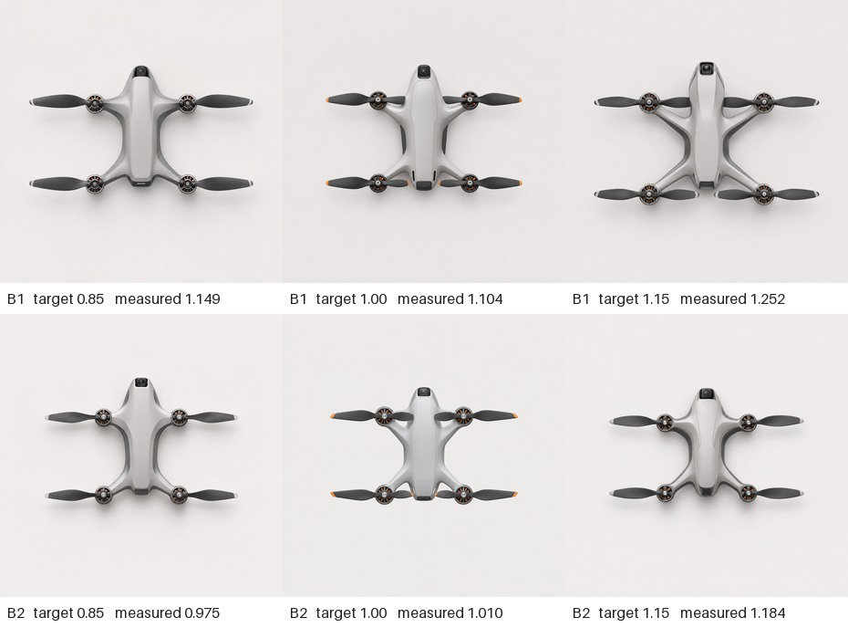

# 四旋随行航拍的双叶桨与布局响应预试 P04

**作者处置记录，2026-11-11。** 六张造型由作者全数否决，候选方案、外观父图、正式评议均为 0。P04 的角度读数仍可用于技术诊断，后续另核验叶长、叶宽。

六次真实调用均已返回，六张 1254 × 1254 原图全部留存。三档中各有两次独立请求。生成工具为对话内置 image_gen，未提供可固定的种子或可核验的底层模型版本。配置器在本机生成文字与四轴定位图。前一批 P03 的三叶数据按原条件保留。

四副共面、完全展开的双叶桨合计八叶。案例选型参考 DJI Mini 4 Pro 每个电机有两片可更换桨叶的说明。对置轴距 250 mm、桨径 127 mm、电机倾角 0° 是本研究输入值。正交俯视、机头朝上、机鼻与相机整合、臂根连续过渡等要求三档相同。四点图不画机身外轮廓。唯一改动为目标横纵跨度比，相邻机臂夹角与坐标按比例推导。[DJI Mini 4 Pro 官方换桨说明](https://www.dji.com/mini-4-pro/faq)

## 两轮读数

| 轴心横跨 / 纵跨目标 | 第一次实测 | 第二次实测 | 可逐副确认双叶完整展开的图 |
|---|---:|---:|---:|
| 0.85 | 1.1494 | 0.9754 | 0/2 |
| 1.00 | 1.1043 | 1.0101 | 1/2 |
| 1.15 | 1.2518 | 1.1837 | 0/2 |

四个电机均可定位的图有 6/6。冻结的跨度比绝对误差容限为 0.10，按本次中心读数有 2/6 落在容限内。第一次的 1.00 和 1.15 档离边界很近；若各轴心每一维容许 ±1 px 的读数扰动，两张的可能区间均跨过边界。这里的 ±1 px 是灵敏度检查的假设。两次重复中，只有第二次的实测值随三档目标严格递增。

24 副桨中，8 副的两个叶尖都能定位，较小夹角为 177.45°–179.67°。另有 4 副能辨出内侧叶身，但叶尖被主体遮住；其余 12 副只能辨出外侧一片。后两类的角度保留为空。从完整图看，只有第二次的 1.00 档可确认四副桨均有两叶且夹角至少 165°。这张图四副桨的外侧投影半径约 240 px，内侧约 128–131 px，桨毂显著偏离两叶尖连线中点。该不等长现象来自看图后的观察，未追加为预设门槛。轴心布局最接近的一张仍有桨形缺陷。

识读由同一知条件 AI 完成，正式参与者与独立读者均为 0。逐图先在原像素范围读出四个桨毂和可辨叶尖，随后仅在初读中心 ±2 px 内利用螺帽同心亮暗环细化中心。顶视图左上为原点，顺序为左上、右上、右下、左下。目标和输出各除以各自画幅，没有对齐或缩放补偿。四轴横向极差除以纵向极差得跨度比。此指标允许复核布局；单张渲染无法验证实际毫米尺寸、相机内外参、飞行可靠性或实体性能。

## 写作与接续

4.1.3 / 5.2 可据此报告技术预试的限制。当前四点输入在这些重复中未稳定保全布局和完全展开的双叶桨。主研究 D / S 两种设计工作方式在本轮均未比较，六张图退出正式评议。下一次可先在配置器离线构造每个轮毂两侧等距的叶尖点，使投影直径对应原比例尺，并检查叶尖是否被机身方向遮挡；保留四轴、机身轮廓自由与俯视条件。下一批若要比较四点与增加叶尖的条件，应让两组共享同一段桨径、相位和对称说明，独立记录新增的点位输入。

实验前记录见 [freeze.json](freeze.json)，各档确切输入见 [0.85](r085.txt)、[1.00](r100.txt)、[1.15](r115.txt) 及同名 PNG。以编号 `b1-r085.png` 等可打开六份原图。[初读点位](first-reading.json)、[输入坐标](targets.json)、[结果与哈希](outcomes.json)和[复算脚本](measure.py)可逐项核对。有 Python、NumPy、SciPy、Pillow 的环境可在本目录运行 `python measure.py`，无需调用生图工具。
