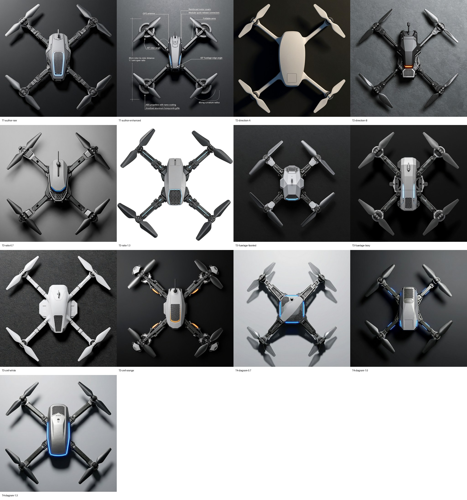
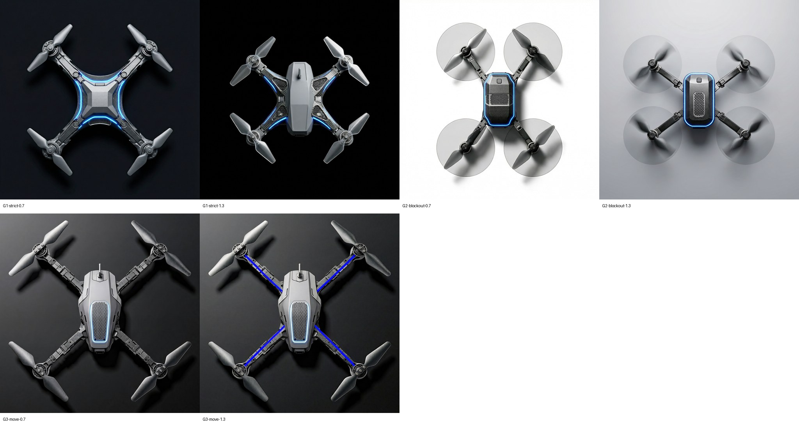
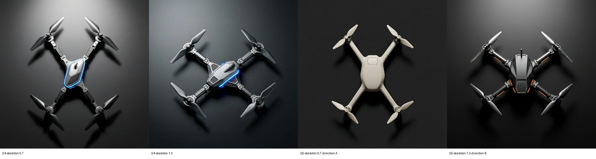

# P1 参数化提示词：MiniMax H3-Image 三轮开发试验（2026-11-13）

**作者 2026-11-13 看图后的反馈：这些图问题很大，不像在做产品设计。** 本批用的是一句通用特征清单，没有使用任务、目标部位和词对，23 张里辨认不出机鼻相机舱。下文凡说到画面质量的地方都是 Claude 的非盲判断，不是作者的认可。本批只能用来讨论参数响应；第 4 章的方案从[规格卡](https://github.com/Freeloop993/paper/pull/66)重新开始。

23 次调用，23 张图，全部 HTTP 200，无失败、无重跑。模型 `MiniMax-H3-Image`，1024×1024，PNG。每格一张，接口没有种子。这是开发调参，不进论文分母。脚本与说明见 [experiments/p1-param-prompt](../../experiments/p1-param-prompt/README.md)。

每格三个文件：`<格>.png` 原图，`<格>.request.json` 实际请求（参考图记文件名与摘要），`<格>.response.json` 响应（含服务端实际使用的 `revised_prompt` 和用量）。

**读数说明。** 下面的电机位置由 Claude 看图目测，知道条件，是非盲读数，不计入读者分母。第一轮和 G4-skeleton-0.7 在原图上读；第二、三轮其余各格在对照表的 512 px 缩略图上读，位置误差约 ±20 px，W/L 误差约 ±0.05。逐格坐标在 [claude-nonblind-readings.json](claude-nonblind-readings.json)。

## 结论

1. **原句在关闭提示词改写时能出完整的顶视渲染图。** 画面是正顶视、X 布局、有材质和部件细节（T1-author-raw）。这只说明画面完整，不说明它是合格的设计方案；作者已判定不是。
2. **文字格必须关闭提示词改写。** 开启后，服务端把句子里的数值改写成图上的标注线和文字（T1-author-enhanced，`revised_prompt` 里写明要画 callout）。
3. **造型、材质、配色参数有明显响应。** 机身风格词（切面、方正、卵石）、机架与配色（白、橙色点缀）、两个设计方向之间的差别一眼可辨（T2、T3）。
4. **写在句子里的布局数值不移动电机。** 跨度比写 0.7 和 1.3，读到 1.05 和 1.03（T3-ratio）。
5. **配置器式点线图不够。** 原说明下读到 0.95 和 1.07（T4）；换成严格说明后 1.3 档到 1.21，0.7 档仍是 1.01（G1）。点和线没有被画进图里。
6. **骨架图能保住跨度比，造型仍随参数句变化。** 参考图只画四条机臂和四个电机座（深色底、灰色块面，无桨盘、无机身），4 格读到 0.69、1.28、0.70、1.28，与目标相差不超过 0.02。整机比参考图略大：G4-skeleton-0.7 在原图上复读，电机离目标位置最多约 26 px；机身、材质、配色仍随参数句变化（G4、G5）。
7. **带桨盘和机身的块面图也能锚住电机，但有副作用。** 桨盘被画进成图，机身照抄了占位的圆角矩形（G2）。
8. **用点线图移动一张已有成图无效。** 电机不动，1.3 档还把蓝线画到了机臂上（G3）。

## 电机位置读数

目标：0.7 档 W 344 px、L 492 px；1.3 档 W 476 px、L 366 px。

| 格 | 布局怎样给 | 目标 W/L | 读到 W × L (px) | 读到 W/L | 参考图是否印进成图 |
|---|---|---|---|---|---|
| T3-ratio-0.7 | 只写在句子里 | 0.7 | 603 × 574 | 1.05 | 无参考图 |
| T3-ratio-1.3 | 只写在句子里 | 1.3 | 631 × 610 | 1.03 | 无参考图 |
| T4-diagram-0.7 | 点线图，原说明 | 0.7 | 525 × 552 | 0.95 | 否 |
| T4-diagram-1.3 | 点线图，原说明 | 1.3 | 639 × 595 | 1.07 | 否 |
| G1-strict-0.7 | 点线图，严格说明 | 0.7 | 508 × 504 | 1.01 | 否 |
| G1-strict-1.3 | 点线图，严格说明 | 1.3 | 470 × 390 | 1.21 | 否 |
| G2-blockout-0.7 | 块面图（桨盘、机臂、机身） | 0.7 | 346 × 492 | 0.70 | 桨盘画成灰色圆片 |
| G2-blockout-1.3 | 块面图（桨盘、机臂、机身） | 1.3 | 476 × 370 | 1.29 | 桨盘画成旋转虚影 |
| G3-move-0.7 | 成图加点线图 | 0.7 | 600 × 620 | 0.97 | 否 |
| G3-move-1.3 | 成图加点线图 | 1.3 | 600 × 620 | 0.97 | 蓝线画在机臂上 |
| G4-skeleton-0.7 | 骨架图（机臂、电机座） | 0.7 | 363 × 528 | 0.69 | 否 |
| G4-skeleton-1.3 | 骨架图（机臂、电机座） | 1.3 | 474 × 370 | 1.28 | 否 |
| G5-skeleton-0.7-direction-A | 骨架图，设计方向 A | 0.7 | 346 × 496 | 0.70 | 否 |
| G5-skeleton-1.3-direction-B | 骨架图，设计方向 B | 1.3 | 474 × 370 | 1.28 | 否 |

T4-diagram-1.0 未读数。

## 三轮对照表

**第一轮（13 格）：** 作者原句、两个设计方向、逐类参数、点线图。

**第二轮（6 格）：** 点线图加严格说明、块面图、移动已有成图，各做 0.7 和 1.3 两档。

**第三轮（4 格）：** 骨架图，基线两档，加两个设计方向。

参考图：[点线图](../../experiments/p1-param-prompt/diagrams/layout-wl0.7.png) · [块面图](../../experiments/p1-param-prompt/diagrams/blockout-wl0.7.png) · [骨架图](../../experiments/p1-param-prompt/diagrams/skeleton-wl0.7.png)（各有 0.7、1.0、1.3 三档）。

## 没有解决或没有测的

- 每格只有一张，没有重复。骨架图的 4/4 需要在确认批里用多次出图和盲读复核。
- 背景没有写进句子，所以在深色、浅灰、白色之间变（T3-ratio-1.3 是白底）。是否加一个背景参数由作者决定。
- “GPS antenna discreetly integrated”经常被画成一根天线杆（T1-author-raw、T3-ratio-0.7、T3-cmf-orange）。
- 原句里的 `8K`、`30cm rotor-to-rotor distance`、`80cm wing curvature radius`、`60° fuselage edge angle` 没有单独改动过，是否起作用未知。
- G4-skeleton-1.3 的机身略有偏转；G4-skeleton-0.7 的机身偏小。
- 骨架图的效果只在 MiniMax 的编辑接口上看到，Qwen 上是否成立要另测。
- 桨径与轴距之比（d/D）本轮没有涉及。

## 用量

23 张，响应里的 `usage.total_tokens` 合计 178,710（纯文字格约 4,250，带一张参考图约 9,700）。
