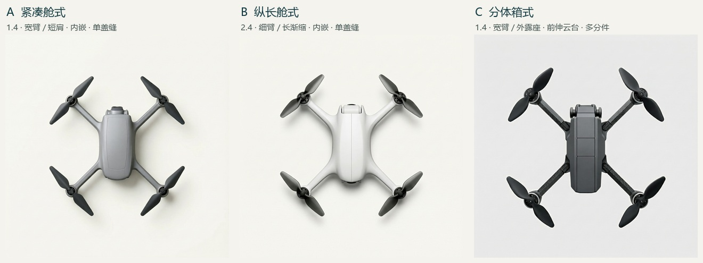

# 四旋候选的作者取舍与论文章节用图

作者确认几何验证可在 5.2 用数值表呈现。E0/E1 原图、输入、失败与分母留在证据目录供核查。第 4 章用图需要能追到作者为什么选、具体改了哪里、如何判断原先协调的部位是否受损，以及最后保留或回退的理由。当前先核对三个平行方向的规格与可见表现。

## 前一项工作留下了什么

- **12 张点选**用于核对真实输出上电机中心与桨尖的量测。1 份返回，48 个轴心、96 个叶尖；W/L、d/D 的人机绝对差中位数分别为 0.0041、0.0125。一份返回只计一人次，填写者与作者的关系未另行核实。自发文字提示了镜面朝向、前后支撑和桨叶比例等问题，不能折算为质量缺陷发生率。[按原方案复算与边界](../e1-open-20261112/point-return.md)
- **两张开发修订**从作者指出前后支架呈现不一致的 [E1 纯文字原图](../e1-open-20261112/E1-actual/E1-text-wl0.70-r2/original.png)出发。第一张调整为朝上顶视、收住前向相机的镜面、补齐四角电机座及支撑的可见线索；第二张以第一张和已有 [0.70 轴位图](../../experiments/l1-layout/guides/line-wl0.70.png)为输入进一步修正布局。内置图像编辑，确切模型版本未暴露。两张的相机舱顶部和四处电机座可见，单张顶视无法验证光轴或脚撑底部。W/L 目标 0.70，知条件 AI 初读约 1.00、0.83。两次的输入和措辞都有变化，观察只及这两图。作为 4.1.3 的开发记录及修订时检查结构保持的依据。两张均未获作者选定，正式实验分母无增量。[修订一](revision-01.png) · [修订二](revision-02.png) · [实发输入](edit-inputs.json) · [逐图坐标与摘要](visual-check.json)

## 4.2.1 三个可供讨论的开发候选

[三方向观察页（随仓库下载后可直接打开）](review.html)

使用 E 盘 form342 配置器当前的三组预设，匹配到 H3 原开发批每个组合的第一张、亦是唯一一张。图按 A/B/C 原顺序。共同输入为 True X、对角轴距 250 mm、轴心横纵跨度比 1.00、每轴双叶、5 英寸桨、无护圈和正交顶视。0.70 仅属于前述 E1 修订。三组均未在实发词中指定配色、具体材质和下支架形式。方向目标按预设参数解读，作者偏好待填。

| 方向与目标 | 生成时的预设 | 原图上的观察（知条件 AI 初读） | 最明显的问题 |
|---|---|---|---|
| [A 紧凑舱式](../../experiments/form342-h3-pilot/actual/A/original.png) · 展开后整机仍显紧凑，四臂从圆舱短肩接出。 | 流线舱 · 壳长宽比 1.4 · 臂宽 20 mm · 短肩包覆 · 内嵌鼻舱 · 单盖缝 | 中灰机壳与四臂连得上，中央上盖边界清楚，机鼻两侧有支座。 | 鼻端模组露出较多，像叠在壳前；从这张图很难读出预设的内嵌。 |
| [B 纵长舱式](../../experiments/form342-h3-pilot/actual/B/original.png) · 拉长机身，让壳面渐渐收成细臂，保留连续曲面。 | 流线舱 · 壳长宽比 2.4 · 臂宽 10 mm · 长渐缩融合 · 内嵌鼻舱 · 单盖缝 | 白色肩部顺着四臂外延，机鼻浅色横件夹在两片壳唇之间；前后电机座都可见。 | 尾端也露出一道黑弧，部件身份不明。仅凭顶视难辨首尾的功能分工，也难确定薄臂是否达到设定。 |
| [C 分体箱式](../../experiments/form342-h3-pilot/actual/C/original.png) · 让机身、接合座和前伸相机能各自读出来。 | 切角方壳 · 壳长宽比 1.4 · 臂宽 20 mm · 外露接合座 · 前伸云台 · 至少 4 条盖缝 | 可见直边切角、四处承座横缝、鼻端凸出的模组和两侧支点，上盖沿长轴分段。 | 长条箱体和横向云台在鼻端硬接，二者的轮廓过渡弱。这一点是造型判断；盖缝的精确数量也未确认。 |

[三案的实发提示词、规格和回执](../../experiments/form342-h3-pilot/README.md)。机身长宽比与臂宽是预设值。三张都可数出四副双叶；相机暗边、壳唇、支座或遮挡本身不能证明镜头实际朝向。

## 目前在哪一步

### 作者对 A、B 的方向复核

作者先看到色差，初看分不出 A、B 的造型；细看 B 时觉得曲面过渡更自然、协调。B 上端在作者看来是相机，下端黑件疑似生成异常，部件身份待核。作者仍分不出哪张更紧凑、哪张更舒展。此为作者对现有两张顶视样图的知情观察，没有给 C 新评价，也没有指定父图或确认任一案定稿。

**为什么这组图不足以表达词对。** [冻结词对表](https://github.com/Freeloop993/paper/blob/dad19783e8e798f3974f896ccb95e4a298685162/docs/protocols/word-pairs-v1-draft.md)把“紧凑—舒展”落在展开后部件之间的留白与整机收拢程度。[A 的实发词](../../experiments/form342-h3-pilot/exports/A/prompt.txt)与[B 的实发词](../../experiments/form342-h3-pilot/exports/B/prompt.txt)开头均要求 compact quadcopter；同一轴位图、250 mm 轴距、相同 5 英寸桨径、同一流线舱、相机内嵌和单盖缝。变化的三个字段是壳长宽比（1.4／2.4）、中段臂宽（20／10 mm）、臂根（短肩／长渐缩）；三个同时变，每个组合仅一张。整机舒展感如何随之变化，是尚待检验的设想。

**用导出值核对留白线索。** [A 规格](../../experiments/form342-h3-pilot/exports/A/spec.json)和[B 规格](../../experiments/form342-h3-pilot/exports/B/spec.json)中，中央壳体宽均为 50 mm，长度从 70 增至 120 mm。以居中矩形包络粗算，纵向半轴心跨度减半壳长，A 约 53.4 mm，B 约 28.4 mm；横向同项均约 63.4 mm。固定轴位而拉长机壳，前后方向这个间距反而缩小。数值是输入包络与电机轴心行之间的投影距离，不等同两张图的实际留白、机臂长度或语义读数。

**颜色与尾部件。** 两份实发词都未指定产品色，但服务端改写为 A 加了浅灰与炭灰、为 B 加了哑光珠白；色差有回执可查。镜片在顶视可被遮挡。B 尾端黑弧的可见性不支持判断它是第二摄像头，也不足以判定结构故障。[A 改写](../../experiments/form342-h3-pilot/actual/A/receipt.json) · [B 改写](../../experiments/form342-h3-pilot/actual/B/receipt.json)

**接续。** 用“短肩圆舱／长渐缩圆舱”描述两套已有规格，“紧凑—舒展”留作感知评价，B 的肩部过渡可作为具体设计线索。下一步宜先在配置器离线等尺度、同色比较一组单因素布局草图，移除共同提示词中对紧凑感的预设，有明确的部件间留白差异后再考虑出候选图。此次补查新增生成 0，不改变正式批次记录。

作者对三张的第一印象是“乍一看都还行”，之后对 A/B 作了上述部位观察。每个方向各有一张 H3 开发图，4.2.1 继续核对方向与整机观感之间的关系。

按[研究地基第 5 节 E3](../../docs/foundation.md)，正式流程为三个方向各三张候选，保留全表，再选择一案，至多修订两次，然后深化。没有合适对象时记录筛选边界。父图指一次局部编辑真正使用的那张原图；修订图与它配对，核对哪些改变、哪些保住，由作者决定保留或回退。E2 用预先登记的另两张父图验证编辑能力。
