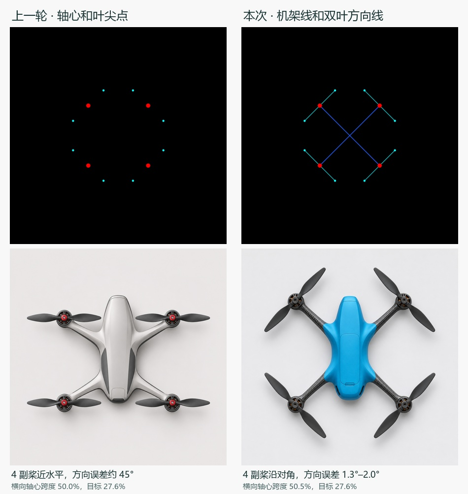

# 四旋结构预览、双叶方向与 CMF

作者指出 P06 的桨叶与参考图不一致，并提出轴位预览应看得到机臂夹角。原配置器把预览连接线与导出连接线共用一个开关，P06 默认关闭。实发文字还保留了配色探索，没有按部件写入同一套 CMF。

E 盘配置器现在提供[结构与夹角](structure-screen.png)和[实际导出图](quad-guide.png)两个视图。结构视图显示机架连接、从中心到轴心的射线、相邻扇区及双叶停放方向。图中双叶方向用于约定静止展示姿态。照片中桨叶的停放角度取决于转子所处位置，不能由轴心坐标唯一确定。H 架按其横梁和两侧连接显示，中心射线供标角。导出图使用蓝色机架中心线、红色电机轴心、穿过轴心的青色双叶方向线与一对叶尖，保留画幅尺度。机壳和机臂外轮廓交给模型探索。设置可以单独关掉导出线。已确认版本的导出预览读取保存的图像原件。

[70°/110° 交替布局的页面实测](angles-70-110.png)中，轴心、机架线和角标一起响应。另已从正常入口验过导出预览与实际下载 PNG 字节一致、四/六旋切换、窄屏及旧版记录，配置器模型请求为 0。

[CMF 示范](cmf-screen.png)采用本机原有主色和机架材料字段。当前随行航拍新稿以天蓝上壳、细砂哑光聚合物、炭灰色外露编织机臂、石墨黑平滑桨叶示范。上壳主色和表面处理可编辑，外露机架跟随机架页材料。该组要求可在生成文本中启用或关闭；比较几何条件时建议两侧采用同一组。这里记录概念图中的视觉线索，色卡、实物光泽与物料尚未实测。

## 一次真实样图

两轮的实际定位图与对应输出均保留完整画幅。旧轮仅有轴心与叶尖，本次在相同点位上连出了机架、双叶方向，同时明确了 CMF。本轮只有一次真实调用，参考与文字均有变化，没有配对种子，各项结果为知条件 AI 初读。

| 指标 | P06 参考 / 观察 | 本次参考 / 观察 |
|---|---|---|
| R1、R2、R3、R4 双叶连线偏差 | 44.87°、45.07°、44.93°、45.13° | 1.44°、1.28°、2.04°、1.84° |
| 轴心横跨 / 纵跨 | 1.00 / 1.277 | 1.00 / 1.050 |
| 轴心横跨占画幅宽 | 27.6% / 50.0% | 27.6% / 50.5% |
| CMF 分区 | 实发未指定这组 CMF | 蓝色细纹上壳、深色编织机臂、平滑黑桨可区分。机臂纹理显得偏粗 |
| 前摄整合 | 顶视无法确认 | 顶视仍无法确认 |

本次四轴中心依次读为 (311,298)、(942,298)、(944,901)、(311,901) px，原图为 1254²。静止桨叶方向是图像平面内一条无向直线与水平线的夹角，按模 180° 比较。两侧桨半径约 250–260 px，两侧中段宽约 50–55 px。画幅尺度仍失准。正式样本 0，独立真人读者 0，CMF 未取得美学评分。第 4.1.3 节可报告技术示范，D/S 工作方式的效果留待真实设计者场次。

[本轮原图](product.png) · [实际提示词](prompt.txt) · [出图前检查项](check-plan.json) · [坐标与角度](observation.json) · [复算脚本](measure.py)
