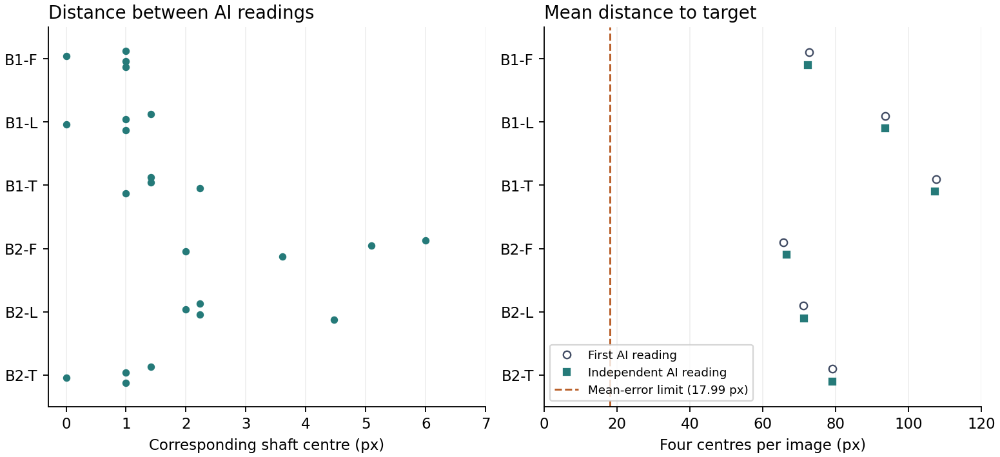

# S1 六图转轴复测

在同一张 1024 × 1024 原图上，两次读数的 24 个对应轴心平均相距 **1.81 px**，中位数 **1.41 px**，最大 **6.00 px**（B2-F 左上轴）。第二次读数中，各图四个轴心到各自设计目标的平均距离为 **66.47—107.18 px**。两次都得到 **0/6** 通过原坐标门槛。

| 图号 | 两次轴心间距，均值 / 最大 px | 第一次距目标均值 px | 复测距目标均值 px | 复测减初测 px |
|---|---:|---:|---:|---:|
| B1-T | 1.52 / 2.24 | 107.50 | 107.18 | −0.32 |
| B1-L | 0.85 / 1.41 | 93.60 | 93.54 | −0.06 |
| B1-F | 0.75 / 1.00 | 72.66 | 72.41 | −0.24 |
| B2-T | 0.85 / 1.41 | 79.07 | 79.12 | +0.04 |
| B2-L | 2.74 / 4.47 | 71.20 | 71.32 | +0.12 |
| B2-F | 4.18 / 6.00 | 65.63 | 66.47 | +0.84 |

**判读方法。** 第二个 AI 会话没有继承本线程。六张图在移除元数据、随机编号并逐张确认 RGB 字节相同后交给复测者。标注者仅收到匿名像素图、转轴定义及图面顺序，逐张看整图，再将轮毂区域放大四倍，以原图整数像素记录；标点封存后再对照分组、目标与首次记录。属于同类 AI 的独立读图，有共同的视觉判断偏差可能。24 个点来自 6 张图，每种条件各两个种子，未采集新的真人测量。

**原判据。** 在原图坐标系分别将左上、右上、左下、右下轴心与 (300,300)、(724,300)、(300,724)、(724,724) 比较。目标对角线约 599.63 px，四点平均误差须 ≤ 0.03 对角线（17.99 px），最大须 ≤ 0.05 对角线（29.98 px），纵横跨度比相对 1 的绝对偏差须 ≤ 0.10。两次均按图面顺序计算，未旋转或配准。所有图仅均值一项就已超过阈值。

**朝向与设计评价。** B1-L、B1-T 的机头朝向初测记为未知，复测读为朝上，其中 B1-L 的复测把握较低。其余四图两次都判为未朝上。两次均记录四个旋翼可见连接、整机在框。朝向两次记录分别保留。当前数据支持“这个 S1 输入协议在六张既有样图上未达到预定轴位要求”。外观吸引力、值得深化程度、其他控制方式和其他构型需各自的评价证据。

**复算。** [原 PNG](originals/)、[首次点位、编号映射与记录摘要](paired-input.json)、[封存的独立测量](independent.json)、[逐轴逐图结果](comparison.json)。在本目录执行 `python compare.py` 可核对 PNG 摘要并复算。

左图每点是一处轴心的两次读数间距；右图每个标记是一张图上四个轴心相对目标的平均误差。两图横轴均为原图像素，取值范围不同。
