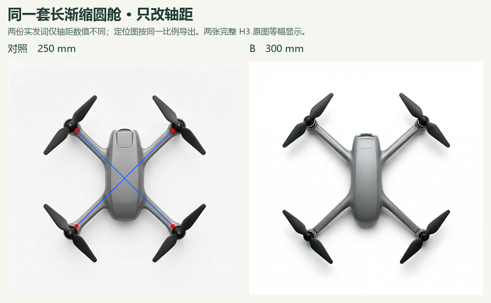
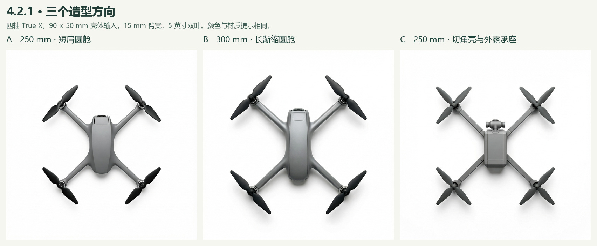

# 4.2.1 初始造型规格 · 轴距与臂根

作者在上一组图中看出 B 的曲面过渡较协调，但未辨出 A、B 的“紧凑—舒展”，并指出旧 B 尾端黑件可能混淆机头机尾。本轮沿用 B 的连续曲肩，先问轴距能否单独拉开布局，再看三个方向在正顶视里各能辨认什么。以下判断为知条件 AI 初读，每个输入一次，共四张真实 H3 开发原图。正式 E3 仍为 0/9。

作者新增反馈为“现在的 C 看起来没有刚刚的好”。[新旧 C、全篇进度和 Claude 复核问题](claude-review.md) · [本地看图页](review.html)。

## 同一 B 规格的两档轴距

轴距指相对两电机中心之间的距离。四轴 True X、壳长宽 90 × 50 mm、臂中段宽 15 mm、双叶桨径 127 mm、颜色和光照共用。E 盘导出的实发词仅将 250 改为 300；点线图在同一像素比例下相应移动四个轴心。每档一张，没有指定随机种子；服务端实际改写词逐张存入回执。轮廓、成像尺度和光泽可随生成变化。B 300 同一原件出现在两张拼图中。

| 正顶视读数 | B 250 | B 300 |
| --- | ---: | ---: |
| 输入定位图前排横向间距（px） | 419.84 | 503.81 |
| 成图前排两电机机械中心间距（px，约） | 476 | 512 |
| 输入桨径 / 对角轴距 | 0.508 | 0.423 |
| 成图平均可见桨径 / 平均对角轴距（约） | 0.498 | 0.432 |

每张原图为 1024 × 1024。按机械中心而非红点读图，成图前排间距约增加 7.6%，对应的输入增幅为 20%。桨径相对轴距的变化方向与输入一致。250 图的四个红点和蓝色 X 留在机身和臂上；300 图没有明显标记残留。两图可用于讨论轴与桨的相对尺度；每档一次不足以把作者的语义感受归因于轴距。[原图坐标与计算定义](readings.json) · [上一轮同尺度输入示意](../quad-author-selection/wheelbase-only.svg)

## 三套修正规格

| 方向 | 配置器输入 | 顶视上能看到什么 | 缺口 |
| --- | --- | --- | --- |
| A 短肩圆舱 | 250 mm；圆舱；肩部在一个臂宽内收至常宽；舱内相机、单盖缝 | 机舱两侧较快收成细臂，机头仅露一小段深色，四副双叶 | 与 B 同属光顺圆舱，难以划定准确的过渡终点。 |
| B 长渐缩圆舱 | 300 mm；圆舱；至少两个臂宽的无缝渐缩；舱内相机、单盖缝 | 四轴拉开，肩部曲面顺着四臂延伸；机头露件，尾部收净，四副双叶 | 机头顶露件的功能与朝向只能部分判断。轴距和肩部一起变化，A 对 B 无法单独检验臂根效果。 |
| C 切角壳与承座 | 250 mm；直边切角壳；承座横缝；前伸云台、至少四道盖缝 | 机头有独立前伸模组；直臂以横缝接入方壳，连接形式和 A/B 清楚可分 | 四个电机都画成三叶，服务改写词仍写双叶。四道独立盖缝未确认。 |

三个方向同用缎面中灰机壳／机臂、炭灰桨和白底柔光，避免颜色替代形态成为分组依据。A、B 相机配置相同，可见程度只作部件记录。顶视可见机头外伸或内收关系，看不到镜面也是可接受的。A 与 B250 的实发词只差臂根一句、参考图相同；可借现图继续核查肩部，B250 的标记须一并考虑。暂以可观察部件描述方向，暂缓“紧凑—舒展”语义结论。当前任务仍为作者规格核对，父图选择留待正式候选阶段。

## 原件与回执

| 档位 | 输入及规格 | 输出与服务改写 |
| --- | --- | --- |
| B 250 | [点线 PNG](exports/B250/guide.png) · [完整实发词](exports/B250/prompt.txt) · [导出规格](exports/B250/spec.json) | [原始 PNG](actual/B250/original.png) · [实发参数](actual/B250/submission.json) · [H3 回执及改写词](actual/B250/receipt.json) |
| B 300 | [点线 PNG](exports/B421/guide.png) · [完整实发词](exports/B421/prompt.txt) · [导出规格](exports/B421/spec.json) | [原始 PNG](actual/B421/original.png) · [实发参数](actual/B421/submission.json) · [H3 回执及改写词](actual/B421/receipt.json) |
| A 250 | [点线 PNG](exports/A421/guide.png) · [完整实发词](exports/A421/prompt.txt) · [导出规格](exports/A421/spec.json) | [原始 PNG](actual/A421/original.png) · [实发参数](actual/A421/submission.json) · [H3 回执及改写词](actual/A421/receipt.json) |
| C 250 | [点线 PNG](exports/C421/guide.png) · [完整实发词](exports/C421/prompt.txt) · [导出规格](exports/C421/spec.json) | [原始 PNG](actual/C421/original.png) · [实发参数](actual/C421/submission.json) · [H3 回执及改写词](actual/C421/receipt.json) |

[编译后的配置器](configurator/form342.html)、[配置器导出脚本](export_from_configurator.py)、[冻结清单](manifest.json)、[四张原件核对](verification.json)、[两档读数复算](measure.py)。本次 H3 编辑使用定位图、完整提示词和 1024 方形画布，四次各回一张。原图、定位图、实发参数、服务改写分别记录。[MiniMax 接口说明](https://platform.minimax.io/docs/guides/image-generation)
