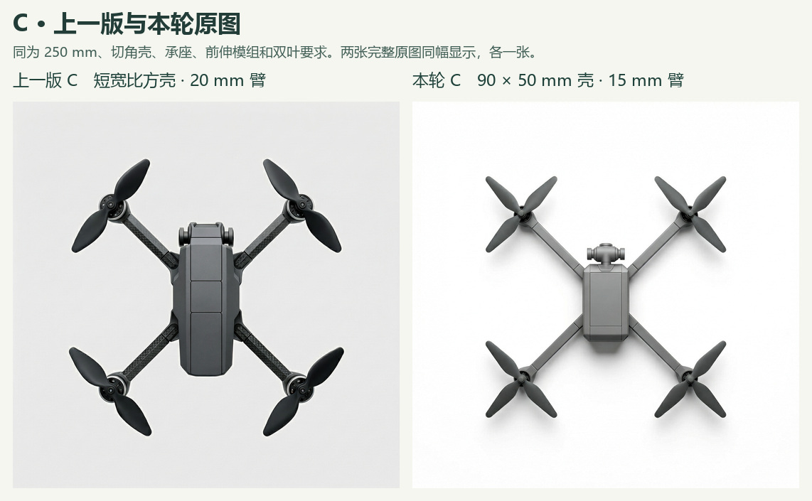

# 给 Claude 的复核交接 · 截至 4.2.1 本轮四张 H3 收齐

作者原话是“现在的 C 看起来没有刚刚的好”。本记录取此前发给作者的 E 盘配置器三方向中 C 作为上一版；两端原图字节已比对。此意见是作者对设计过程的反馈，尚未说明喜欢或不喜欢的具体原因。作者此前认可 B 的曲面过渡，未能在 A/B 之间读出“紧凑—舒展”，曾指出旧 B 机尾黑件身份存疑。当前三方向的规格均可修订，尚未选择第 4 章深化的父图。

[旧 C 原图](../../experiments/form342-h3-pilot/actual/C/original.png) · [旧 C 实发词](../../experiments/form342-h3-pilot/exports/C/prompt.txt) · [旧 C 服务改写](../../experiments/form342-h3-pilot/actual/C/receipt.json) · [本轮 C 原图](actual/C421/original.png) · [本轮 C 实发词](exports/C421/prompt.txt) · [本轮 C 服务改写](actual/C421/receipt.json)。

两版都使用 250 mm 对角轴距、X 布局、双叶要求、切角壳体、承座横缝与前伸云台。旧配置是壳长宽比 1.4、臂宽 20 mm；本轮为 90 × 50 mm（比值 1.8）、15 mm 臂宽，并统一中灰缎面。两次均未固定采样种子。旧 C 顶面分段和臂面纹理更明显，桨为双叶；本轮 C 壳体窄、前端模组较独立，四副全成三叶。上述为 Codex 知条件看图记录；哪项影响作者判断仍待澄清。同色适合比较轮廓，其应用范围应由研究问题决定。

## 请按图号回答

1. 看 [B 两档与三套规格](README.md)。单看 A 对 B300，能否指出肩部何处开始收窄、何处达到臂宽？再以相同 250 mm 的 A 与 B250 看臂根，并指出红蓝线残留可能影响哪里。如果分不出，请保留待判。
2. 对两版 C 分别说哪些部件的连接更容易理解，具体看机鼻模组与壳前缘、承座与机架、顶盖分段、桨叶数及材质区分。建议保留哪些旧特征、修正规格表哪一格？将作者已说的判断和你自行看出的原因分别列出。
3. A、B 相机规格相同。顶视可判断模组是否跨出机鼻轮廓，遮挡镜面时可记不可判。请明示可见证据足以支持哪一句写法；检查单张开发图、5.2 几何量测和第 4 章最终方案在目录中是否各归其位。
4. 回到 #1，按下表指出影响后续的缺项、对应章节、证据路径，以及下一项可离线完成的动作。请先做复核，再提是否需要补数据及其可回答的问题。

## 全局状态与证据

| 对应章节或实验 | 手头实际拥有的材料 | 还需要什么 |
| --- | --- | --- |
| 1–2 研究范围与方法来源 | [开题要求](../../docs/requirements.md)、[现行六章目录](../../manuscript/outline.md)、[研究地基](../../docs/foundation.md)、[文献地图](../../references/reading-map.md) | 第 2.1 节对构型及产品设计论断的全文页码继续补核。 |
| 3.2–3.3 需求与规格 | 7,443 个去重文本簇；36 张评论卡来自 35 条来源，词对 v1 已定。40 条匿名短引文的第二编码材料已准备。[评论卡表](../semantic-cards/README.md) | 回收独立第二编码，记录分歧及不可判。词对如何落到相机、臂根仍须结合实际部件检查。 |
| 3.4.4、5.2.1 · E0/E1 | E0 开源实收 6/6，闭源六个正式位置尚无归档；E1 开源 36/36，其中条件图 24、纯文字 12。一份真人点选已覆盖 12/12 抽样图，8 图有额外意见，其中 6 图提及相机。[E0](../e0-open-20261112/gallery.md) · [E1 全量](../e1-open-20261112/README.md) · [真人抽测](../e1-open-20261112/point-return.md) | 保留几何数值表和独立读数的适用范围。不得用同样本量的其他闭源开发批补 E0。 |
| 3.4.2、4.1.3 参数开发 | 两轮 H3 各 36 张。第二轮常规点线 18 张中，四项外形在同图可确认 11/18；7 张中机鼻 6 张、顶盖 1 张待判。[两轮总览与原图](../form342-h3-dev/round-2/README.md) · [补查](../form342-h3-dev/round-2-audit/README.md) · [历史批次与误差索引](../../docs/claude-context-20261113.md) | 可报告参数响应和读取困难；“协调”“产品感”的结论需要相应评议。 |
| 正式 E2 局部修订 | 两张 E1 父图与六份请求已登记，主后端 Qwen 正式提交 0/6。H3 的同题六张已另存。[Qwen 请求](../../experiments/e2-registered/README.md) · [H3 同题](../h3-e2-local-edit-20261113/) | 取得正式运行和独立读数后，才判断针对机鼻／臂根的可控修订。这里的两张父图只供 E2。 |
| **4.2.1 四旋方向规格，本轮所在** | E 盘配置器真实导出；H3 四份实发、四张独立原图，B300 同时供两张拼图使用。[全量原件与回执](README.md) · [此前作者观察](../quad-author-selection/README.md) | Claude 复核 A/B 的可辨部位、新旧 C、请求与成图的偏差，再修方向规格。 |
| 4.2–4.4 · E3 四旋正式展开与深化 | 正式候选 0/9；既有 H3 两张开发修订与历史反馈已标注。[开发记录](../quad-author-selection/README.md) · [E3 工单](https://github.com/Freeloop993/paper/issues/22) | 待前置和规格就绪，保留正式候选、作者取舍、局部修改前后，以及保留或回退理由。 |
| 5 章 · E4/E5 协同与终稿评议 | 已有流程、读数规则及历史开发评图。正式设计者配对场次和终稿盲评仍待收集。[执行协议](../../docs/execution-playbook.md) · [E4](https://github.com/Freeloop993/paper/issues/23) · [E5](https://github.com/Freeloop993/paper/issues/24) | 作者安排独立参与人，分开统计设计者、独立量测者与终稿评者。 |
| 5.5 · E6 农业植保六旋 | 三款产品手册已有部件页证；关注药箱与机架、喷洒杆件的平面整合。[六旋材料](../../experiments/hexa-plant-protection/README.md) · [E6](https://github.com/Freeloop993/paper/issues/25) | 正交顶视输入、按六旋自身基准归一的响应，以及完整的设计修订案例仍待补。 |
| 5.6、第 6 章 | [执行清单与逐节映射](../../docs/execution-playbook.md)及各实验独立分母可追溯 | 等对照、参与者资料和六旋证据齐备后再归纳结果、局限和可迁移范围。 |

本次只新增四张 H3 开发原图。未启动云 GPU，未新增真人样本，未代 Claude 作出复核结论。
