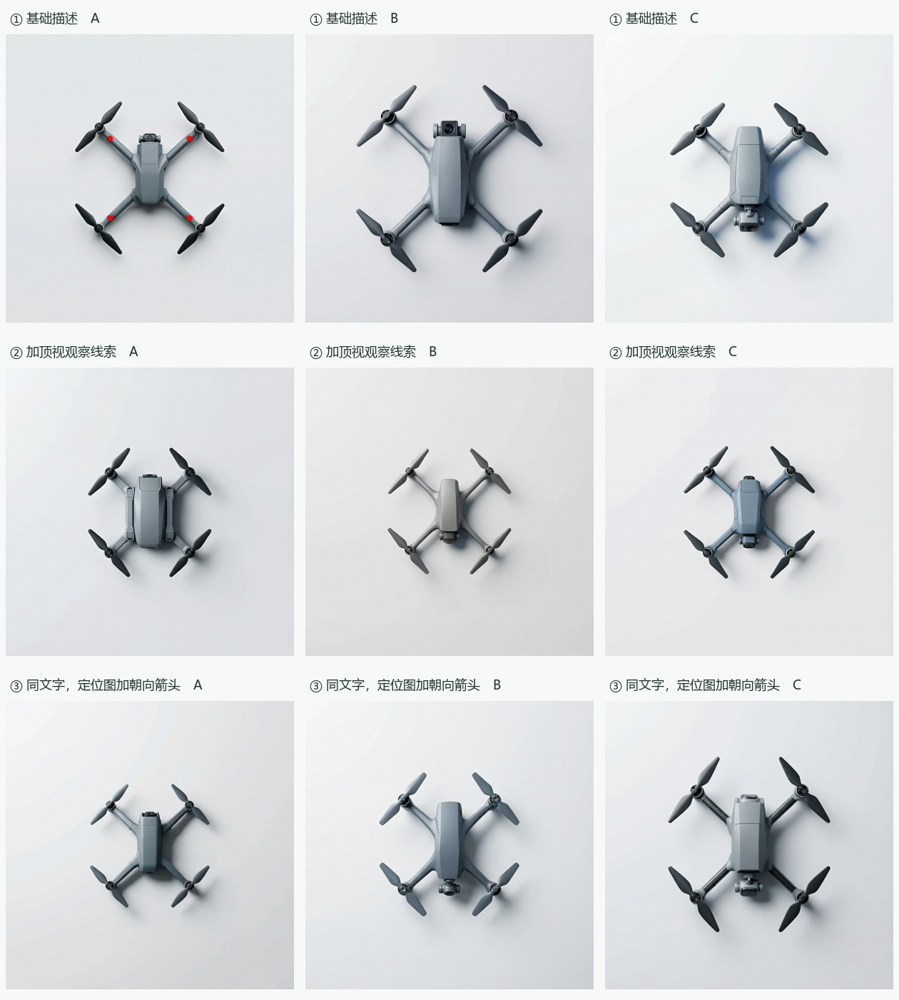

# 九张配置器开发图与论文目录复核

给 Claude 的审阅入口。九张图来自 E 盘配置器导出后调用 MiniMax-H3-Image 的三个开发轮次，每格一次。供作者讨论机身、臂根和机头相机舱。作者已请 Claude 主持目录和进度评估；此前 Codex 所标的章节位置供复核。

## 按图号打开

| 实际输入 | A · 紧凑、整体 | B · 舒展、连续 | C · 紧凑、接合清楚 |
|---|---|---|---|
| 1　基础文字＋对称 X · [定位图](row1-guide.png) | [1A 原图](1A/original.png) · [实发全文](1A/prompt.txt) · [输入与回执](1A/input-and-receipt.json) | [1B 原图](1B/original.png) · [实发全文](1B/prompt.txt) · [输入与回执](1B/input-and-receipt.json) | [1C 原图](1C/original.png) · [实发全文](1C/prompt.txt) · [输入与回执](1C/input-and-receipt.json) |
| 2　只改相机观察描述 · [定位图](row2-guide.png) | [2A 原图](2A/original.png) · [实发全文](2A/prompt.txt) · [输入与回执](2A/input-and-receipt.json) | [2B 原图](2B/original.png) · [实发全文](2B/prompt.txt) · [输入与回执](2B/input-and-receipt.json) | [2C 原图](2C/original.png) · [实发全文](2C/prompt.txt) · [输入与回执](2C/input-and-receipt.json) |
| 3　文字沿用第二轮，定位图加朝向箭头 · [定位图](row3-guide.png) | [3A 原图](3A/original.png) · [实发全文](3A/prompt.txt) · [输入与回执](3A/input-and-receipt.json) | [3B 原图](3B/original.png) · [实发全文](3B/prompt.txt) · [输入与回执](3B/input-and-receipt.json) | [3C 原图](3C/original.png) · [实发全文](3C/prompt.txt) · [输入与回执](3C/input-and-receipt.json) |

九件原图均为 1024 × 1024 PNG，文件和 RGB 摘要各不相同。每轮三案共用定位图；第一、二轮定位图文件相同，第二、三轮逐案实发文字相同。请求未指定种子，不能把画面差异量化成单一输入的因果效应。在每件回执内保留真实请求体、发送时间、输入图摘要、服务改写、配置器设计字段与验证值。请求体中的图名沿用运行时记录，仓库文件名见同一回执内的 input_guide。[逐图校验清单](manifest.json) · [开发卡和评论来源编号](cards.json)

## E 盘配置器的改动和作者反馈

原型支持设计者选择部件参数，查看编译全文，修改或保存版本，并导出实发文字、轴心坐标和定位 PNG。本批由 Codex 在页面代填，MiniMax 接收这些实际导出。日常随行航拍四旋共用 True X、250 mm 对角电机中心距、四个相邻角均 90°、5 英寸双叶、冷灰。图中只给轴心和机架连接线，三案均关闭叶尖和双叶方向线。初稿取消写死的机身尺寸、机鼻轮廓和相机安装法；舱体安装、身臂曲面与分件留给设计。新增小箭头是默认关闭的图层，只在第三轮启用。这里的“参考图”是 MiniMax 收到的 PNG；它与 Qwen 下 ControlNet 的控制参数分别记账。

作者看过九图，反馈“确实第二排的好很多”，并指出在制图者从正上方看、机载相机水平向前的设定下，整个镜面朝向屏幕是错误的。作者尚未指定正式父图、确认三案或给出盲评分。请对每张分别记录画面哪端有相机样部件、舱体前缘与机壳怎样相接、能否看到整块疑似镜面的正面；无法判断真实光轴时记不可判。

Codex 的知条件初读供交叉检查。1A 有四处红色标记残留；1B 有明显朝观察者的镜面；2A 的上端主要露出小段深色面。2B、2C、3B、3C 在画面下端有明显相机样部件。三个方向都趋近窄长机身，B 的肩臂延伸与 C 的接合边界值得逐图检验。九图四个桨毂均可数出双叶；此处没有独立真人测量或造型辨识结果。开发九图与正式 E3 的九个计划位置分账。

## Claude 作全局裁定时请先读原件

1. [作者开题原 PDF，第 6–7 页的五项内容](../../planning/proposal-original.pdf#page=6)；[实际修订目录 Word](../../planning/outline-revised.docx)；[可检索的全目录](../../manuscript/outline.md)。本次对 Word 正文与 Markdown 的全部 85 个编号章、节标题逐条比对，六章标题文字及顺序一致。导师唯一目录批注已在第 4 章“方法应用”落实。
2. [已经上传的前三章来源稿](../../manuscript/source-drafts/)；[现有章节证据矩阵](../../manuscript/evidence-matrix.md)；[学长学姐四篇论文的结构、篇幅与书目对照](../../planning/claude-materials.md)；[写作总记录与 Google Doc 入口](../../planning/claude-review.md)。同门论文用于结构与体量参照，方法主张回到本研究文献与数据。
3. [研究地基 v1.2](../../docs/foundation.md)、[研究计划](../../docs/research-plan.md)、[六章执行清单](../../docs/execution-playbook.md)、[历轮出图和错误索引](../../docs/claude-context-20261113.md)、[此前全程交接](https://github.com/Freeloop993/paper/issues/1#issuecomment-6850913665)。遇到网页历史进度、目录、正文和真实回执冲突，请点出行与证据，不沿用旧日期的结论。

## 供 Claude 独立判断的事实

| 已发生 | 尚缺的核验或材料 |
|---|---|
| 真实评论整理出 36 张证据卡、35 个来源；有词对 v1。 | 评论第二编码和真实机型顶视参照的完整覆盖。[评论证据](../../evidence/semantic-cards/) |
| E0 开源 6/6；E1 两因素的控制组 24、纯文字组 12，共 36 张已核，有两名独立 AI 的读数。 | 仓库当前登记 E0 正式闭源 0/6，D2 闭源六张另计；E1 真人抽读 12 张待补。几何命中不能外推到设计质量。[E0](../../evidence/e0-open-20261112/) · [E1](../../evidence/e1-open-20261112/README.md) |
| 旧 S1、G3 有小规模真人资料；L1 已回收 28 张；其他排错批保留实际完成与停止状态。三张 E 盘规格是开发提案，已收到本次作者反馈。 | 这些活动不填正式 E3 选稿、E4 真人设计对照或 E5 终稿盲评的位置。现有图能否支撑部件级方案讨论请 Claude 逐张判读。[历史批与限制](../../docs/claude-context-20261113.md) |
| E2 已事前指定两张 E1 中档父图和对照；E3 的方案父图另由作者从其候选中选择。六旋确定农业植保，观察药箱与机架、喷洒组件与支臂。 | E2 正式修订与 E3 正式选稿/修订、E4 场次、E5 独立评议、E6 植保案例及迁移边界待取证。正式主线、样本与失败处置按研究地基和逐项工单。[E2 原登记](https://github.com/Freeloop993/paper/issues/21#issuecomment-6821671015) · [E3](https://github.com/Freeloop993/paper/issues/22) |

## 请在 #1 交回的决定

- 通读原 Word、开题及现有来源稿，逐章给出“可按现目录写／需要补证／需要调整”的判断。给到受影响小节、具体理由和可打开的证据；如建议调整，列原题名、建议题名、理由及对开题五项承诺的影响。标明须作者或导师裁定的范围变化。
- 独立判定实验进展相对实际目录处在哪里、哪些已有稿需回改。请重点判断九图分别能支撑 4.1.3、4.2.1、4.2.2、4.2.3 中的什么，哪些结论还缺正式方案、独立读数或真人过程。
- 对照九张原图，按图号给相机舱前缘、臂根过渡的可见依据与不可判处；解释第二排的作者偏好允许写到哪一步。按依赖指定 Codex 的一个首要交付、验收标准，以及作者最近需要决定的事项。

请回复[主协作工单 #1](https://github.com/Freeloop993/paper/issues/1)，给出实际读过的文件、图号和你的目录决定。此次为材料复核，未产生新实验或新评议分数。
