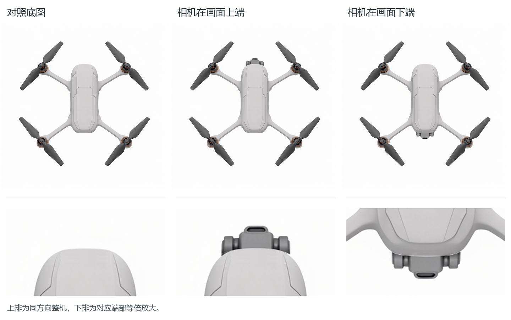

# 4.4 四旋翼深化父图与相机安装端选择

2026-11-15，作者看过下方对照后，指定去窗、尚未安装相机舱的 B2 为第 4.4 节深化父图。作者更倾向画面下端安装相机的版本，认为上端安装可能不太符合自己的设计意图。由下端方案接续深化，整机锁稿与独立评议另行记录。

| 角色 | 文件 | 用途 |
|---|---|---|
| 4.3 实验父图 | [E3R3-B2 原图](../../../evidence/e3-quad-qwen-20261115/round-3/originals/E3R3-B2.png) | 解释此前已执行的请求和读数，当时指令指定画面上方为机头。 |
| **4.4 深化父图** | [去窗 B2](B2-no-window.png) | 原上端黑色开窗容易让人预判机头方向。两版均以去窗底图为起点。 |
| **作者偏好，优先深化** | [相机在画面下端](B2-lower.png) | 保持本图显示方向，作者更认可这处安装关系。 |
| 同条件对照 | [相机在画面上端](B2-upper.png) | 留存上端安装的对照方案。 |

两版都取自[同一个 r01 相机舱](../camera-composite/B2-cam-r01.png)，同尺寸，按机身中线居中。下端安装时将相机舱在图像平面内转动 180°，机身朝向保持一致。两端原有壳缘形状使支点露出程度有差别。四张 PNG 均为离线设计过程材料，本次生成请求为 0。原件摘要与每版实际像素改动范围见[核对记录](comparison.json)。
