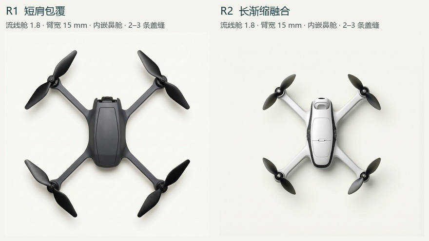
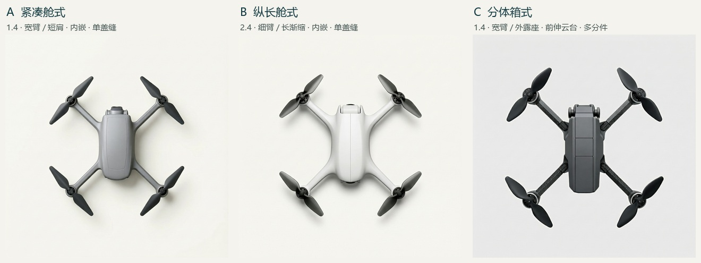

# 3.4.2 造型参数与 H3 首轮五图

五个独立开发请求全部返回 1024 × 1024 PNG，使用 MiniMax-H3-Image 编辑接口、同一张四点四线定位图。每个档位组合仅一张。正式 E2、E3 与 E4 分母沿用各自登记。

[本地对照页（每列含完整实发词与原图）](comparison.html) · [参数表：逐档依据、输入和顶视读法](parameters-3.4.2.md) · [五份完整实发提示词并排](prompts-side-by-side.md) · [点线原图](guide.png) · [知条件逐图初读](readings.md) · [原像素中央局部](body-details.jpg)

**臂根单因素。** R1/R2 的配置仅 root 不同，八行实发提示词中仅第 5 行不同。输出还随生成波动而出现色材、分缝和画幅差异。

**三方向组合。** 由配置器的字段逐句编译。A、B 同用内嵌鼻舱，C 选外伸；三张的差别不能归给某个单项参数。

|位置|原图|导出的规格与文本|实际请求与服务端改写|
|---|---|---|---|
|R1|[原 PNG](actual/R1/original.png)|[配置](exports/R1/spec.json) · [完整文本](exports/R1/prompt.txt)|[提交](actual/R1/submission.json) · [回执](actual/R1/receipt.json)|
|R2|[原 PNG](actual/R2/original.png)|[配置](exports/R2/spec.json) · [完整文本](exports/R2/prompt.txt)|[提交](actual/R2/submission.json) · [回执](actual/R2/receipt.json)|
|A|[原 PNG](actual/A/original.png)|[配置](exports/A/spec.json) · [完整文本](exports/A/prompt.txt)|[提交](actual/A/submission.json) · [回执](actual/A/receipt.json)|
|B|[原 PNG](actual/B/original.png)|[配置](exports/B/spec.json) · [完整文本](exports/B/prompt.txt)|[提交](actual/B/submission.json) · [回执](actual/B/receipt.json)|
|C|[原 PNG](actual/C/original.png)|[配置](exports/C/spec.json) · [完整文本](exports/C/prompt.txt)|[提交](actual/C/submission.json) · [回执](actual/C/receipt.json)|

[出图前的清单](manifest.json) · [逐图摘要、调用与 PNG 核验](verification.json)。没有固定种子、自动重试或筛图。可直接从共享仓库下载配置器的 [HTML](../../prototypes/drone-configurator/public/research-guides/form342.html) 与同目录的 [JS](../../prototypes/drone-configurator/public/research-guides/form342.js)，放在同一文件夹打开。E 盘本地配置器的四旋工作台与原条件图页都有该入口。浏览器使用真实导出按钮的 Blob，与页面显示文本一致。页面导出不含模型凭据。

源码在 [configurator/src/design/form342.ts](configurator/src/design/form342.ts)。复用 E 盘 layoutFor 和 drawGuide；此研究页指定固定导出比例，旧规格仍按原比例计算。用 esbuild 从此源码打包生成公开的 form342.js。构型输入通过点线图表达；相机、臂根、分件均经档位短句输入。请选择实际可辨的字段进入正式读数讨论。
