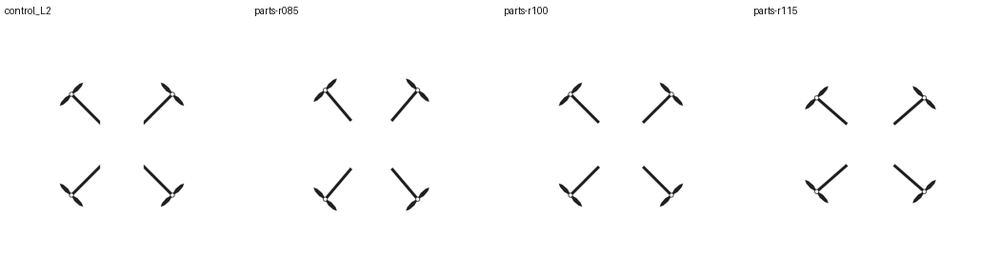

# G2d 部件控制图，出图前记录

本批按作者经 Claude 转达的决定，属于 G2b 停止规则之外的最后一次参数验证。依据是新核回的历史 C1 原件。G2b 仍为 0/4 可用。G2d 的六份请求及输入均已离线编译。实机费用上限须在 #3 记录。[研究规格](../../docs/protocols/G2d-G3b-spec.md)

**几何来源。** 以旧 C1 第二档 control_L2.png 为基准。原图轴径为 599.627 px，旧协议的桨径系数为 0.23，叶尖到轴心 68.957 px。按单叶自身坐标，轴向位置依次为 9、0.4R、0.8R、R、0.8R、0.4R、9，横向为 −4、−9、−7、0、7、9、4 px；另一叶旋转 180°。轴圈外半径 10 px、线宽 3 px，臂宽 12 px。复用原绘制几何和 3 倍栅格化后缩小的方式，在中档逐像素对比轴心周围半径 72 px 的四个圆区，四区灰度差异像素均为 0。该区域覆盖桨叶与轴圈。[基准 PNG](../../evidence/historic-guides/control_L2.png)

**固定臂长。** 从各轴心沿朝向中心的对角线扫描旧图，取亮度低于 128 的最内端像素，轴心至此处为 168.291、169.706、168.291、169.706 px。按四轴均值取 168.999 px。三个水平上臂段都采用此长度并指向中心，桨叶在同一象限的朝向固定为旧方形布局的切向。每张控制图直接画桨叶、圈与臂段，中央自然留白。这个选择约束了臂的长度、宽度和指向，机身截面与轮廓由生成端表达。

**六个输入。** 相对横纵跨度 0.85、1.00、1.15，各用种子 2026111105 和 2026111106。固定对置轴径 600 px（整数取整前）、B02 航拍文字、顶视、40 步、1024²。执行图继承旧 C1 的 Canny 0.4/0.8、Fun Union BF16 0.7、作用区间 0—1。相较旧 C1，任务文字、目标档位与种子也发生变化，跨批比较不能识别单一因素的因果效应。[输入清单与坐标](manifest.json)

**读数。** 随机编号的 RGB 原图先由两个独立 AI 会话分别封存读数，已有人工读者时追加。每图按画面左上、右上、左下、右下记录实体电机中心，未知位置留空；[逐图表](reading.csv)另记连接、标记照抄和机身形态的可见依据。形态描述封存后，分析员在同种子内列出三档差异，保留不可判。几何分母按图，主判据为两个种子均严格单调、六图均有四轴、各图相对跨度误差 ≤0.10。质心、尺度、残差按 G2 同一评分器另报。在揭盲后的六图 JSON 上运行 score.py，任一图缺少完整四轴时该图写 null。两读者分报。部分、失败或不可判均不作为新一轮调参理由。评分软件对照记录于离线验收中。
