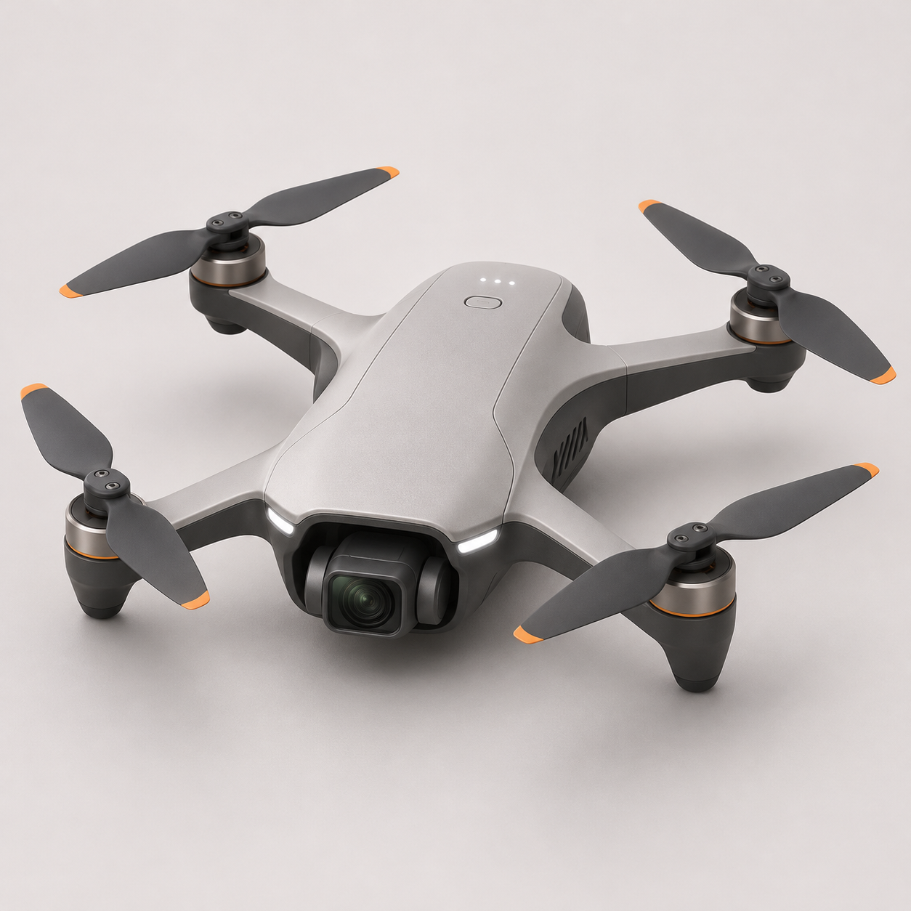
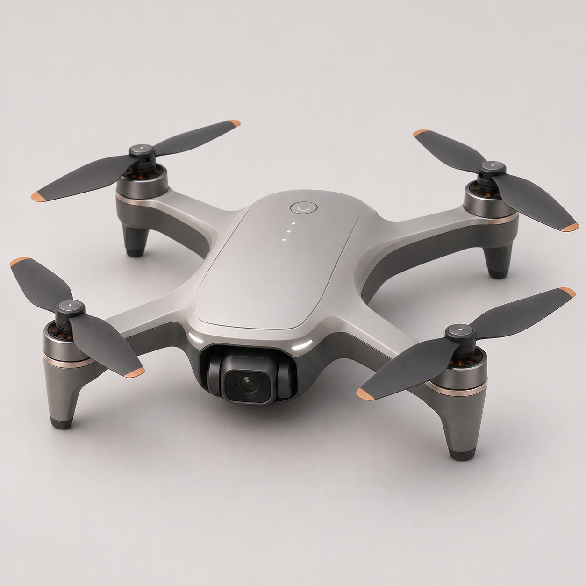
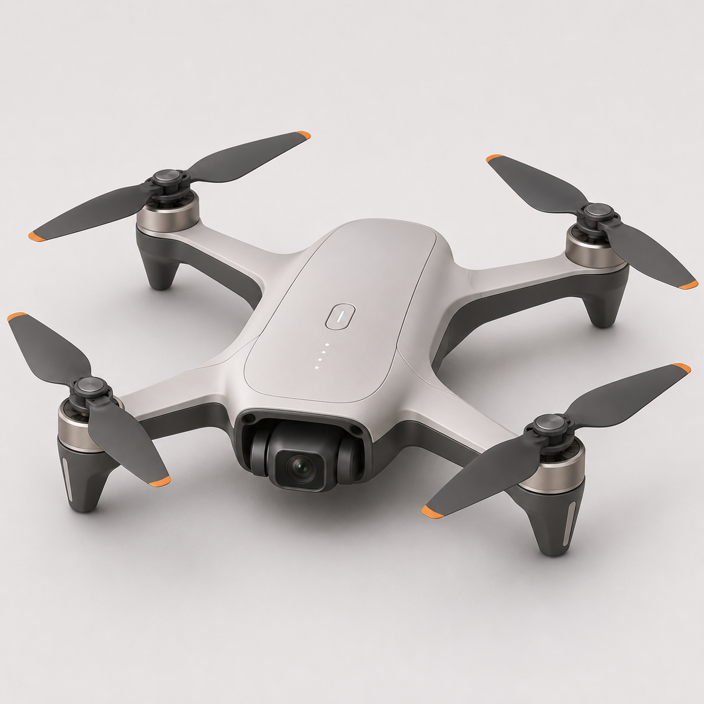
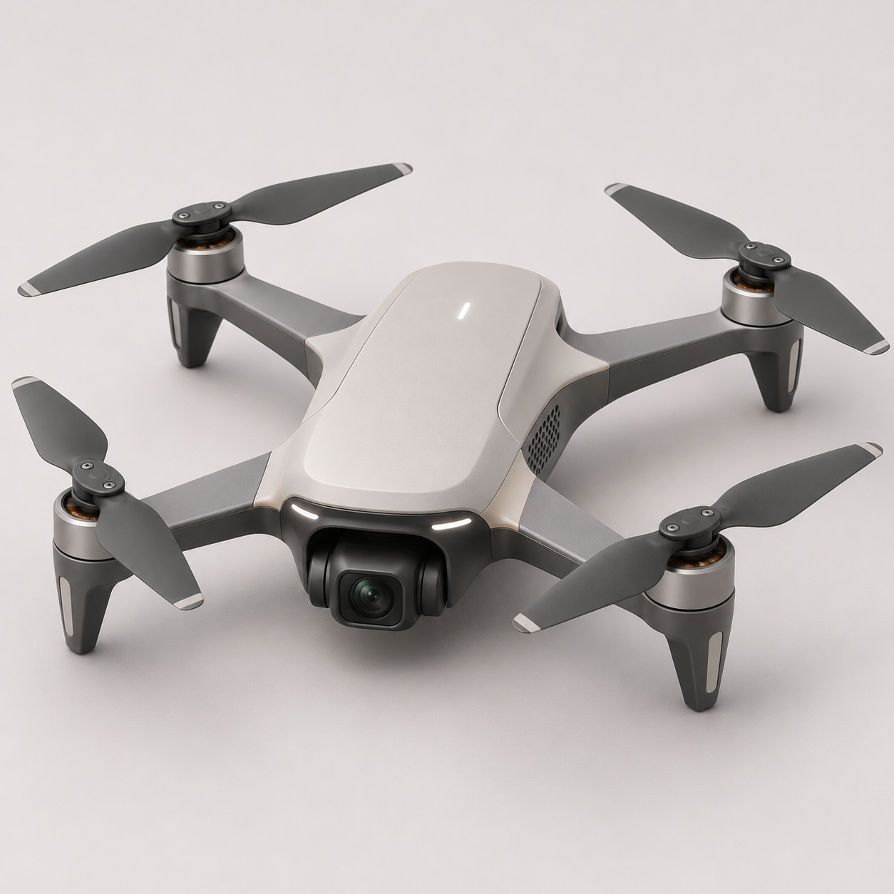
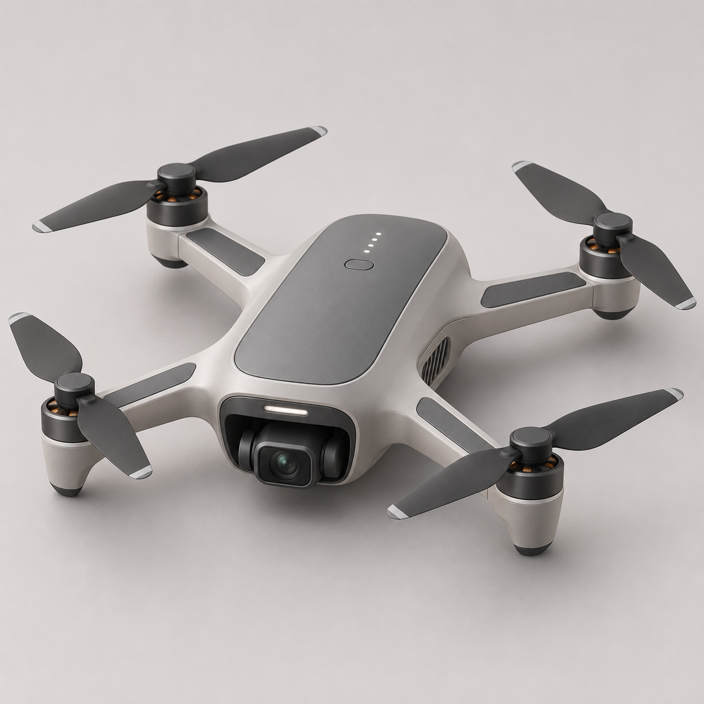

# 日常随行航拍四旋翼 · GPT Image 概念图试读

这组图用于检查视觉材料能否呈现机身前部相机与臂根过渡。每次调用内置 GPT Image，输入均为 [B02](../b02-view-calibration/protocol.json) 的同一段文字。将 Qwen 请求中的负向词改以普通文字加入 “Avoid” 句，并要求方形画面。调用参数均未附图。本轮在已有研究图的同一会话中进行，无法控制服务内部的上下文和随机性。

| 01 | 02 | 03 |
|---|---|---|
|  |  |  |
| **04** | **05** | **06** |
|  |  |  |

[提交文本、可观察设置与原件摘要](results.json)。编号按调用顺序。每张图均保留工具返回的原始 PNG。原协议的种子、采样步数和 ControlNet 强度属于 Qwen 工作流，本次 GPT Image 接口未暴露这些控制项。B02 的 Qwen 实机分母与 G2d 的参数实验见各自台账。

就现有工作流而言，[G2 的条件图](../g2-control/requests/G2-n4-r100-s2026111001.json)输入带权重的 ControlNet 节点以约束布局。[G3 的父图](../g3-reference/with-reference.json)则由图像编码节点读取，意在保留并修订已有方案。两种机制可以分别研究。

本轮六次调用均返回可解码的 1254 × 1254 PNG，六份原图像素摘要各异。Codex 非盲观察：03 在深色臂根与浅色机身之间有清楚的分界，06 的浅色壳面连续过渡到机臂。六图都采用相近的前置相机、四臂外廓和中性色。评者可用它们试读部位关系，当前真人评议数为 0。
