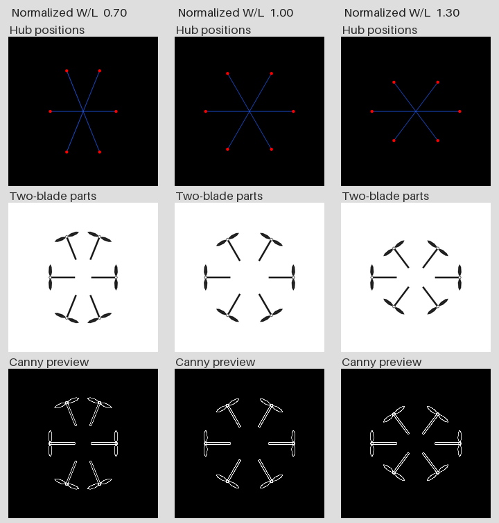

# E6 六旋顶视条件图 · 离线草案

三档各有一张轴心点线图、一张双叶部件图。两种画法共用六个轴心。另附每档部件图的本地 Canny 边缘预览。几何示意仅用于论文输入准备。本次模型调用、模型原图、新增正式样本均为 0。作者已确认[首案规格](../README.md)，基准点线图用于首案；正式出图待后端确定。



| 六旋归一化 W/L | 点线 PNG | 双叶部件 PNG | 边缘 PNG |
|---:|---|---|---|
| 0.70 | [轴心和臂向](points-0.70.png) | [部件](parts-0.70.png) | [原尺寸边缘](edges-0.70.png) |
| 1.00 | [设计基准](points-1.00.png) | [基准部件](parts-1.00.png) | [原尺寸边缘](edges-1.00.png) |
| 1.30 | [轴心和臂向](points-1.30.png) | [部件](parts-1.30.png) | [原尺寸边缘](edges-1.30.png) |

## 设计基准与几何响应

路线图第 4、5 节指定六旋正交顶视、机头朝上、六轴基准每相邻两臂 60°、每轴双叶，响应批按六旋自身基准归一。三档采用地基及条件图协议的 0.70、1.00、1.30。旧 G2 的 0.85、1.00、1.15 属于较早的提案。作者负责的箱体轮廓、整合方式和部件布置在这套输入中留白。[研究地基](../../../docs/foundation.md) · [条件图协议](../../../docs/protocols/E0-E1-guide-prompt-spec.md) · [变量口径](../../../docs/research-variables.md)

- 原 E 盘配置器的 `src/design/design.ts` 中，`layoutFor` 从机头向右为正，给 R1 至 R6 的默认方位为 −30°、30°、90°、150°、210°、270°。图像坐标 x 向右、y 向下，单位轴心向量为 `(sin θ, −cos θ)`。R1 在左前方，R1→R2 跨过机头，R6→R1 收环。
- W 取六个轴心最右与最左的 x 差，L 取最下与最上的 y 差，均排除叶尖。因此正六边形的原始基准比为 `2/√3 ≈ 1.154701`。表中档位 q 等于 `(W/L)/(2/√3)`。只有 q=1.00 对应正六边形。
- 实现先把每个单位轴心的 x 乘 q、y 保持原值，再给全部坐标乘同一系数，使全部 15 个两两轴心距离中的最大值为 600 px，最后平移至 (512,512)。变换后重算臂向、各臂的径向长度和相邻角。每对叶片垂直于该档自身的径向臂，桨叶图形本身保持尺寸。0.70→1.00 时 W 增大且 L 缩短；1.00→1.30 时 W 保持 600 px，L 继续缩短。
- **示意量**。1024² 画布和最大轴距 600 px 沿用实验绘图尺度。三档统一选用半径 90 px 的二维桨盘，即示意 d/D=0.30，可保留正的桨盘净距。若直接套用四旋中档 d/D=0.50，0.70 档的最近轴心距仅约 224.82 px，小于 300 px 直径。这里所有长度只用于像素制图；双叶半径、比例和相位属于本草案的绘图选择。

## 导出画法

点线图沿用配置器 `drawGuide` 与已有 form342 点线图的黑底、3 px 蓝色臂向线和半径 10 px 的红色轴心点，仅表达六轴和连接方向。双叶部件图沿用 G2d 的白底、`#222222` 实心叶、白心轴圈（半径 10 px、圈宽 3 px）、12 px 宽且朝中心延伸 169 px 的臂段，中央留白。脚本调用 L1 的坐标放大、缩图函数和 C1 叶形顶点，在 3 倍画布上绘制后用 Lanczos 缩至 1024²。六轴切向叶片的计算在本目录实现；E 盘原 `withTips` 仅对四轴开启。[form342 点线样例](../../../evidence/section421-h3-span/exports/B250/guide.png) · [G2d 绘图](../../g2d/build.py) · [L1 叶形及边缘绘图](../../l1-layout/build_guides.py)

三张边缘图均取自落盘部件 PNG，采用与 L1 相同的 OpenCV 灰度 Canny 阈值 102、204。小预览最下行适当提亮缩小后的细边；上表的原尺寸边缘 PNG 保存原始二值。服务端预处理、模型输出、真实部件尺寸及工作性能均超出本次核验范围。

## 实际输入自检

下表“PNG 归一值”从部件图六个白心孔的像素质心重新测得，归一分母采用解析基准。相邻角为解析坐标按 R1 起顺时针计算的六个间隔。净距逐对取轴心距减 180 px。叶尖余量取 12 个解析叶尖到最近边界像素坐标（0 或 1023）的最小距离。

| 归一档 | 原始 W/L | PNG 归一值 | 相邻角（°） | 轴／叶 | 桨盘最小净距（px） | 叶尖最小余量（px） |
|---:|---:|---:|---|---:|---:|---:|
| 0.70 | 0.80829 | 0.70034 | 44.01、67.99、67.99、44.01、67.99、67.99 | 6／12 | 44.82 | 199.13 |
| 1.00 | 1.15470 | 0.99973 | 60、60、60、60、60、60 | 6／12 | 120.00 | 206.19 |
| 1.30 | 1.50111 | 1.29983 | 73.78、53.11、53.11、73.78、53.11、53.11 | 6／12 | 69.88 | 211.00 |

每档检查 15 对桨盘，三档共 45 对。以部件 PNG 轴心重新计算，最小净距依次为 45.00、119.96、69.80 px。点线图中独立定位六个红点，并抽查每条蓝线的三个内部位置。部件图中，逐轴在中径环带上检出两个相反的叶片截面和一个朝内的臂截面，再核对两个叶尖的像素邻域。三档均为逐轴两叶，且四边无裁切墨迹。负例用基准图临时副本测试，抹去一叶中段、移动一处红色轴心各自触发自检失败。完整逐轴坐标、像素读数和九张 PNG 的 SHA256 见 [checks.json](checks.json)。

## 本地复算

在本目录用 Python 3.11、Pillow 12.3.0、NumPy 1.26.4、OpenCV 4.10.0 运行。此机可使用原实验已有的离线依赖。已有相应 Python 环境时可省去首行。

```powershell
$env:PYTHONPATH = 'D:/codex/thesis-research/2026-11-12/l1-ref-deps'
python -B build.py --check
```

`--check` 从现有 PNG 回读并比对清单。运行 `python -B build.py` 可在本目录重建六张输入、三张边缘和小预览，暂存文件通过验证后再发布。[导出与自检脚本](build.py)

源码核对所用的 E 盘目录为 `E:/RULERS/Memory_bank/product/uavdesign/drone_configurator_ui`。其中 `src/design/design.ts` 的 SHA256 为 `d6d6645dd725164958c58567944b7d3ffa04a9923533255eeedd407b429a6f78`。路线图来自本地 Git 对象 `6d36c27b87740421d5c3179c1aa15dae79f6c1df:docs/roadmap-20261114.md`，可用 `git show` 离线查阅。实验绘图实现取自工作树基线 `f8c540b`。以上核验均为条件输入的软件检查。
