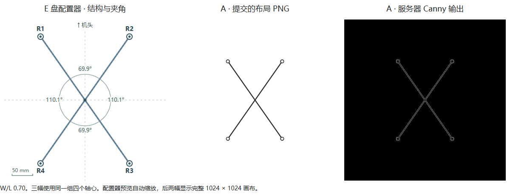

# L1 第 0 步

在已运行 E1 的 ComfyUI 上，以 W/L 0.70 执行两份纯预处理工作流。依次经过 LoadImage、ImageScale（1024²，nearest-exact）、Canny（0.4 / 0.8）和 SaveImage。两次均成功。输出 PNG 与下载的原始 ZIP 逐项校验，原 ZIP 的 SHA-256 为 `53d5b88146826f609ffab24b4965f1eaef6e8bee7f92b3f116d154f549813b16`。本步骤采样次数为 0。

左图以 E 盘 AxisPreview.tsx 的实际组件渲染，传入同一组取整轴心坐标，使用组件原有自动取景及角度标注。组件源码 SHA-256 为 `60cfbe58f0d414c1ac7e0bcdc4754bb75c3900386ab70a208c78bdebb1708bcd`。后两图显示完整画布。W/L 的名义前夹角是 69.984°，界面按实际整数坐标显示 69.9°。

| 核查项 | 结果 |
|---|---|
| A 布局线图 | [服务器原始边缘图](actual-canny-line-wl0.70.png)，白色像素 3727 个。|
| B 加桨叶轮廓 | [服务器原始边缘图](actual-canny-blades-wl0.70.png)，白色像素 6671 个。两图的输入、图节点、prompt ID 及输出摘要见[服务器回执](edge-receipts.json)。 |
| D/E 深度控制 | [Alibaba PAI 原始模型卡](https://huggingface.co/alibaba-pai/Qwen-Image-2.1-Fun-Controlnet-Union/blob/main/README.md)明确列有单目深度。该机加载的 Comfy-Org BF16 文件及来源见[环境记录](material.json)，节点接受 IMAGE 输入。D/E 传入的是人工灰度浮雕，其实际效果需采样后观察。 |
| F/G 编辑节点 | [当前节点定义](node-schemas.json)显示 TextEncodeQwenImage21 的 images 为动态 IMAGE 列表，含 image_1，vae 接受 VAE，三路输出依次为 CONDITIONING、CONDITIONING、LATENT。八份编辑请求均从节点 15 接图、节点 3 接 VAE，采样潜空间接输出 2。[工作流键表](edit-graph-keys.json) |
| 请求与条件图 | 按顺序串联 28 个请求 SHA-256 再哈希，得到 `47ac288b2994edb80d2d766329f9044932320a3dc902d99887cb18d6b97791d6`。四个 A/B 配对除输入文件名和存图前缀外逐字段相同。G 四张父图均已按 E1 原 PNG 绑定。 |
| 建图版本差异 | 第 0 步上传的是本机 Pillow 11.2.1 生成的 PNG。在独立目录用 Claude 所列的 Pillow 12.3.0 重建 9 张输入图，9 个文件摘要有差异，解码后的 RGB 逐像素全部一致。[逐图核查](pillow-comparison.json)。服务器环境记录显示 Pillow 11.3.0，第 0 步直接读取已绑定的文件。 |
