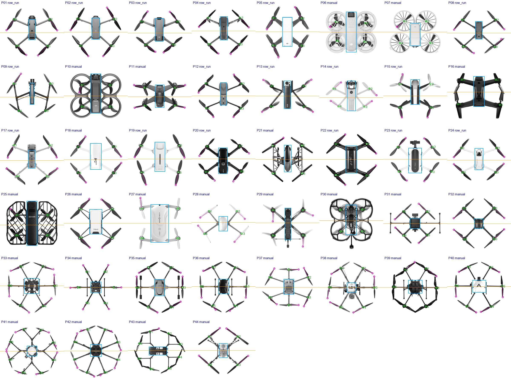

# 44 张评议用图的规格比例（S5 要对照的那一组量）

2026-11-20，Claude。给 44 张评议用图标了电机中心、机壳四缘和桨尖，算出规格里的四项比例，并与第一批评分对照。**这是一位判读者（AI，知道机型，也已经看过评分）的读数；登记任务要求的第二位独立判读者还没有。**

## 一、这一步对蓝图的要求

| 要求 | 出处 | 现在 | 还差 |
| --- | --- | --- | --- |
| 在评议用的真实机型图上量 W/L、机壳长宽比、机壳宽与对角电机距之比、d/D | [登记任务](../../../planning/2026-11-17-direction-and-todo.md) S5、A2；S4 把后三项列为“紧凑”的待验证代理量 | 44 张全部量了；d/D 有 2 张不可判 | 无 |
| 两名相互独立的判读者，报告两次标注的差 | A2 | 一名（本页） | 第二名。取点页面和对照脚本已备好，见第五节 |
| 判读者登记模型、版本、取点方式、事前接触 | A8 | 已登记，[readers.csv](readers.csv) | 无 |
| 与评分对照，挑出下一步配对评议要验的比例 | [方案](../protocol.md)第四节 | 已对照四旋翼组 3 份答卷 | 评议者补到 10 人后重算 |

## 二、怎么量的

坐标是 1024×1024 评议用图的像素。定义沿用 [A3 的图面口径](../../../evidence/20261117-research-update/a3/README.md)，并推广到六、八旋翼，公式在 [metrics.py](metrics.py) 开头。

| 量 | 定义 |
| --- | --- |
| 电机中心 | 有中心螺钉或桨帽的取它的中心；看不到的取电机圆盘的中心；两片折叠桨各有销轴的取两销轴的中点 |
| W/L | 全部电机中心左右方向的极差除以前后方向的极差 |
| D | 对角电机距。四旋翼取两条对角线的均值；六、八旋翼取相对两个电机之距的均值 |
| 机壳长 | 过电机中心平均位置的竖线上，机壳前缘到后缘。不算机头外挂的云台相机、天线、脚架、药箱 |
| 机壳宽 | 过电机中心平均位置的横线上，机壳左缘到右缘 |
| 桨径 d | 电机中心到桨尖的距离乘 2，取各桨读数的中位数 |

三遍取点，每一遍的读数都留着：

1. **粗点**（[rough.py](rough.py)）：看带坐标网格的拼图读出电机中心和机壳前后缘。
2. **逐点修正**（[fixes.py](fixes.py) 的 PASS1）：程序先在粗点附近找近似圆对称的中心（[mark.py](mark.py)），再把 204 个电机中心逐个放大 4 倍看。自动候选有 128 个偏了 5 像素以上，都按看到的改了。
3. **复看**（fixes.py 的 PASS2）：以改后的位置为中心再放大看一遍；对四旋翼做左右对称自查，查出 DJI Spark 三个电机取到了桨夹端头的螺钉，改回中间；13 个点做了小修正。

机壳左右缘和桨尖先由程序在图上量，再逐款看叠了标记的总览图。带护圈、涵道、桁架的机型自动量法失效：7 款的桨尖改为人工读，2 款不可判；每款的情况写在 [points.csv](points.csv) 的 note 一栏。

```sh
python3 metrics.py                                         # 由 points.csv 重算 metrics.csv，只用标准库
python3 geometry/relate.py responses/2026-11-19/*.json     # 在上一级目录运行：评分与比例的等级相关
```

## 三、量出来的范围

逐款数值在 [metrics.csv](metrics.csv)，全部标记叠在图上的总览见下（绿圈是电机中心，蓝框是机壳，紫线是电机中心到桨尖）。



| 比例 | 四旋翼 32 款：最小 / 中位 / 最大 | 六、八旋翼和共轴 12 款 |
| --- | --- | --- |
| W/L | 0.98 / 1.35 / 2.00 | 0.91 / 1.14 / 1.18 |
| 机壳长宽比 | 1.03 / 2.76 / 4.99 | 0.93 / 1.09 / 2.11 |
| 机壳宽 / D | 0.10 / 0.23 / 0.38 | 0.20 / 0.24 / 0.33 |
| d / D | 0.43 / 0.58 / 0.68（30 款） | 0.37 / 0.48 / 0.68 |

DJI 折叠机的 W/L 落在 1.22 到 1.54，与此前在手册图上量的 1.16 到 1.52 相符。

## 四、与第一批评分对照

四旋翼组，32 款，3 名评议者。全表在 [relate-20261119.md](relate-20261119.md)。等级相关，正值表示比例越大越被评为舒展。

| 比例 | 按中位数 | 三人各自 | 去掉护圈和涵道的 5 款 |
| --- | ---: | --- | ---: |
| W/L | −0.10 | +0.06、−0.02、−0.22 | −0.05 |
| 机壳长宽比 | −0.34 | −0.20、−0.44、0.00 | −0.20 |
| 机壳宽 / D | −0.44 | −0.42、−0.42、−0.36 | −0.21 |
| d / D | +0.41 | +0.24、+0.30、+0.25 | +0.11 |
| （对照）整机占外接框面积 | −0.81 | −0.75、−0.72、−0.44 | −0.71 |

读法：

- **W/L 与紧凑感没有关系。** 规格里调得最多的就是它。
- **机壳宽 / D 方向一致但不强**：机壳相对轴距越宽，越被评为紧凑，三个人都是这个方向。它正是 S4 登记的首要代理量。去掉带护圈和涵道的机型后减半。
- **d / D 的关系靠护圈机型撑着**，去掉以后基本消失。
- **四项规格比例没有一项接得住“占外接框面积”那条线索。** 人看的更像是“这个轮廓里填得多满”，它是机壳大小、护圈有无、机臂粗细合起来的结果，护圈属于造型档位，不是比例。

所以下一步配对评议值得验的是：机壳宽 / D（已登记），外加“有没有护圈”这一档；W/L 可以只作保持项。3 个人、一位判读者的读数，只能用来排这个先后。

非四旋翼组的评分彼此不一致（见[回件记录](../responses/2026-11-19/README.md)第四节），比例照量，相关不解读。

## 五、第二位判读者

A2 要求两名独立判读者。给对方的只有一个文件：[annotator/无人机取点.html](annotator/无人机取点.html)（2.3 MB，离线）。页面里没有机型名、评分和本页的任何读数。44 张，约 30 到 40 分钟；前 14 张是分层抽出的重点（约三成，对应 A8 的要求），时间不够可以只做这 14 张。对方不需要不知情于研究目的，但不能看过评分汇总和本页的点；细心即可，有制图训练更好。已经做过评分的评议者也可以做，但必须在评分之后。

回件放进 `geometry/returns/`，然后：

```sh
python3 geometry/compare.py geometry/returns/*.json
```

输出电机中心逐点相距、机壳四缘之差、四项比例两人之差和等级相关。页面走查 16 项通过（`node annotator/qa.mjs <输出目录>`）。页面里嵌的是评议者看到的同一批 720 像素的图，所以对方的读数精度约 1.4 个本页像素。

## 六、限度

- **判读者不盲。** 我知道每张是什么机型，标点之前也看过四旋翼组的评分汇总。电机中心是几何位置，受影响小；机壳前后缘要判断“云台算不算机壳”，有余地。第二位判读者的读数到了才知道差多少。
- 机壳宽取的是一条横线上的宽度，不是最大宽度；机身中段收窄的机型会偏小。
- 桨径：7 款人工读，精度约 ±5 像素（约 ±2%）；2 款不可判（Skydio 2 桨叶收拢，CineLog35 半透明桨叶在涵道内）；桨尖浅色的机型自动读数可能略短。
- Tornado H920 原图小，放大后发虚，电机中心约 ±5 像素。DJI Neo 的原图歪了约 2 度。
- 六、八旋翼的 D 和 W/L 是本页临时定的口径，方法章里还没有（登记任务 H1）。

## 七、标点时发现的图的问题

逐张放大看的时候发现 6 张评议用图有瑕疵，筛图时没有查出来。**作者 2026-11-20 决定 44 张全部保留**，后 7 名评议者看到的图与前 3 名相同。汇总时把这 6 张单独列出，并另给一组剔除它们之后的等级相关；这条处理办法在新答卷到来之前写进了 `summarize.py` 和 `relate.py`：

| 图 | 问题 |
| --- | --- |
| P41 DJI Agras MG-1 | 原图上下被裁，最上和最下两对桨不完整 |
| P18 Hubsan Zino Mini Pro | 机身近白，在白底上几乎看不见，只剩桨和电机 |
| P07 DJI Flip | 机头朝下，没有转正 |
| P43 Skyfront Perimeter 8 | 机身横置，机头不朝上 |
| P17 Skydio X10 | 可能是底面视图，待核 |
| P25 HOVERAir X1 Pro Max | 图是镜像的（机身上的字是反的） |

另有 Skydio 2 桨叶收拢且略带透视（方案里已注明），ANAFI、Nazgul5、CineLog35 的桨叶是半透明的。
