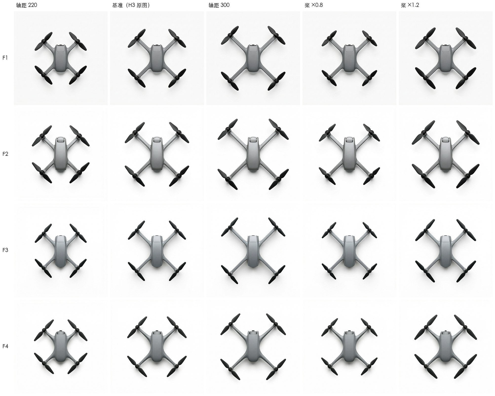
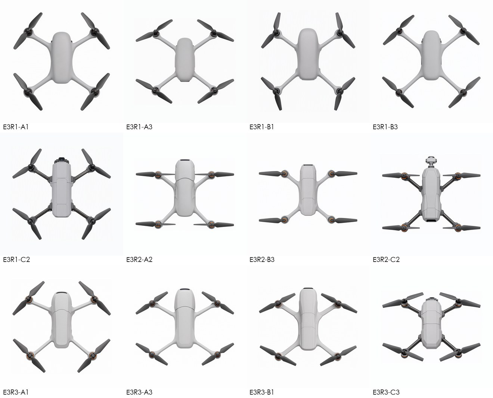

# 评议用图的审查与更换（2026-11-19）

**现行版本是 2.0，图出自 Qwen，见第七、八节。** 下面先记录换图的经过。

作者看过 1.0 版评议包后指出：图是早期失败实验的图，完全没有无人机的视觉特征，是平的，相机还朝上，不能用。本页记录按什么标准审查、旧图为什么不合格、新图怎样做出来。1.0 版在发出之前撤回，没有任何人作答。

## 一、评议用图的标准

| # | 要求 | 为什么 |
| --- | --- | --- |
| 1 | 看上去是一件真实的消费级航拍四旋翼：有体积、有材质、有光影 | 评议者评的是对产品的印象，示意图得不到这个印象 |
| 2 | 部件合乎常理：四条臂连在机身上，四个电机，四副双叶桨；相机在机头、朝前，不朝上 | 不合常理的部件会把注意力引到“哪里不对”上 |
| 3 | 严格顶视，机头朝上，臂完全展开，浅色素背景，没有定位标记和文字 | 研究登记的观察条件是展开状态的顶视 |
| 4 | 同一组里颜色、材质、光照一致 | 避免颜色代替形态成为判断依据 |
| 5 | 要比较的两张图只差一个量，其余完全相同 | 否则说不清评议者是对哪个差别作出反应 |
| 6 | 每张图上这个量的实际大小是量得出来、有记录的 | 结论要落在量到的比例上，不落在“想要的”比例上 |

## 二、旧图（E1 条件图组）为什么不合格

| 标准 | E1 图的情况 | 结论 |
| --- | --- | --- |
| 1 产品感 | 平涂的灰色剪影，没有体积和光影，像图标 | 不合格 |
| 2 部件合理 | 相机画成一个正对观看者的镜头，等于朝上；臂是细直杆，靠近机身处有白缝，连不上 | 不合格 |
| 3 观察条件 | 顶视、素背景 | 合格 |
| 4 一致 | 不同种子的桨深浅差很多（r4 很浅） | 勉强 |
| 5 只差一个量 | 同一种子的不同档位之间机身形状也在变（r2 最明显） | 不合格 |
| 6 可量 | 比例由两名 AI 读者量过，12/12 命中 | 合格 |

E1 自己的说明页已经写明这批图“留作参数与方法比较”，正式评议用另外冻结的设计稿，并且指出它没有证明同一输出兼具几何响应和合格的产品造型。把它拿来做感知评议是我选材的错误：只看了第 6 条，没有按第 1、2、5 条审。

## 三、新图怎样做出来

1. **基准图用 MiniMax H3 生成。** 走项目已登记的通路：`POST /v1/images/edits`，模型 `MiniMax-H3-Image`，输入一张点线定位图（对角轴距 260 mm 的正 X 布局）和一段文字。文字沿用 [4.2.1 节那一批](../../evidence/section421-h3-span/README.md)的 B 规格：圆舱、渐缩臂根、相机舱在机头轮廓内并朝前、缎面中灰机身、炭灰桨、白底柔光。同样的输入生成四次，得到四个设计（F1 到 F4）。
2. **各档由基准图派生，不重新生成。** [derive.py](h3/derive.py) 对同一张图做几何重采样：
   - 轴距三档（对角轴距 220、260、300 mm）：机身不动，沿每条臂的方向压缩或拉伸臂的直段，电机和桨整体平移。
   - 桨径三档（0.8、1.0、1.2 倍）：轴距和电机不动，桨叶绕电机中心径向缩放。
   - 中间档就是 H3 原图。
3. 这样每个设计有 5 张图、共 20 张；同一个设计里任意两张只差一个量，机身、相机、颜色、光照逐像素相同。每张图的对角轴距和桨径（像素）记在 [derive.json](h3/derive.json)。

为什么不让模型直接出各档：试过。把基准图作为父图连同新的定位图一起送入，四次里有三次返回的布局与父图相同（目标对角 523 px 实得 615 px；目标 W/L 1.25、1.50 实得 1.04），只有变化最大的 300 mm 一档动了。记录在 `h3/actual/F1-D220、F1-D300、F1-R125、F1-R150` 和 [readings.json](h3/readings.json)。这与此前“设计实际用的通路没有命中窄档”的结果一致，本身是第五章可以用的一条记录。

## 四、新图按标准逐条核对

| 标准 | 情况 |
| --- | --- |
| 1 产品感 | 四个设计都是有体积和光影的产品渲染 |
| 2 部件合理 | 四臂、四电机、四副双叶桨；相机舱在机头；臂与机身连续 |
| 3 观察条件 | 顶视、机头朝上、白底；没有定位标记残留 |
| 4 一致 | 四个设计同为中灰机身、炭灰桨；F1 的背景略灰 |
| 5 只差一个量 | 由同一张图派生，满足 |
| 6 可量 | 改动量是给定的，逐图记录；机身和桨的原始大小由程序在基准图上读出，不是独立判读 |

核对是我逐张看图加程序读数做的，没有第二个人看过。

## 五、调用记录

共 8 次调用，全部成功返回，合计约 9.0 万 token（单次 1.0 万到 1.3 万，耗时 12 到 26 秒）。4 次用于基准图，4 次是带父图的尝试。每次的实发参数和回执在 `h3/actual/<编号>/`。密钥只经环境变量传入，没有写进任何文件。

## 六、要知道的限度

- 两档以外的图是对 H3 原图的几何编辑，不是模型直接生成的。评议者看不出差别，但写进论文时要照实说明。
- 这组图回答“比例变了，人是否觉得紧凑感变了”，不回答“本文的方法能否把比例控制到位”。
- 轴距变化时，桨径与轴距之比、机身宽与轴距之比同时在变，这是轴距这个量本身带来的，分不开。
- 画幅没有归一：轴距长的一张在画面里占得更大。
- 四个设计出自同一段文字，造型语言相近，结论不能推广到别的造型方向。

## 七、统一到 Qwen：1.2 版的图（2026-11-19）

作者决定全文统一用一个模型（Qwen）。1.1 版的 H3 图因此没有发出，由 1.2 版取代。第三至五节记录的是 1.1 版的做法。

**基准图。** 第四章 E3 第三轮的四张 Qwen 原图：A1、A2、A3、B1（在本包里编号 Q1 到 Q4），没有新出图。B2 是作者选中的方案，不给预试的评议者看。B3 的桨离机身太近，桨加大或臂缩短后会与机身重叠，换成了 A2。

**第一次直接套用 1.1 版的脚本，不合格。** 短臂一档把机头挤尖，长臂一档把机头拉宽（[试验图](h3/qwen-edit-test.jpg)）。原因是这几个设计机身长、桨离机身近，臂也不是从中心沿对角线伸出的，而原脚本按“离中心多远”来划分哪里不动、哪里拉伸。

**改成分层的做法后合格。** [derive.py](h3/derive.py) 现在先把图分成机身和四个组件（臂、电机、桨）：机身一层逐像素不动；每个组件沿臂根到电机的方向按比例位移，臂根不动，电机和桨整体移动；桨叶可再绕电机中心缩放。三档轴距是电机到中心距离的 0.87、1.00、1.13 倍，三档桨径是 0.8、1.0、1.2 倍。

**逐条核对。** 标准 1 到 4：四个设计都是合格的产品渲染，四臂四桨，机头有相机舱，顶视白底，同为浅灰机身深灰桨。标准 5：同一个设计的五张图出自同一张原图，机身不变。标准 6：改动量给定并逐图记录在 [qwen/derive.json](qwen/derive.json)；脚本对每张图检查桨与机身重叠的像素数（全部为 0）和离画面边缘的最小距离（最少 22 像素），不满足就报错。

过程中发现并改掉的两个毛病：桨尖颜色浅，起初没被算进组件，缩小桨之后在原处留下残片；加边的做法会在图里留下一圈浅色边框，已去掉。

核对是我逐张看图加程序检查做的，没有第二个人看过。

## 八、2.0 版：第一部分换成 12 个不同的设计（2026-11-19）

作者打开 1.2 版后说图“完全一样，看不出差别”。核对后确认图是不同的，但他说得对：第一部分把同一个设计的五个版本一次一张地放出来，臂长只差 13%，桨的版本之间只有 1% 到 4% 的像素不同，人不可能逐张评出差别。这是设计上的错，不是图的问题。作者同时指出，现在还没到设计实验的阶段，先要弄清人把什么样的机子看成紧凑，用什么图都可以，真实照片也行。

**真实照片没有找到够用的。** 在自由许可的图库里按十几组关键词检索，返回的几乎都是无人机拍的航拍照，不是拍无人机的照片，随后被限流。此前那一轮找图的结论相同：正顶视、展开、整机完整的真实照片很少。

**改用自己的设计候选。** 第四章 E3 三轮共 27 张 Qwen 候选图，是合格的产品渲染，布局和机身差别明显。取其中 12 个（三轮、三个方向都有，不含作者选中的第三轮 B2），统一占幅后作第一部分。同一个模型、同一套配色，颜色和品牌不干扰判断；范围比真实产品窄，这一点写在方案的限度里。

**第二部分只留差别大的。** 每个因素只比最低档和最高档，并排呈现，共 8 组正题加 3 组核对题。所有图统一占幅。

走查 28 项通过。只有我看过这些图。

