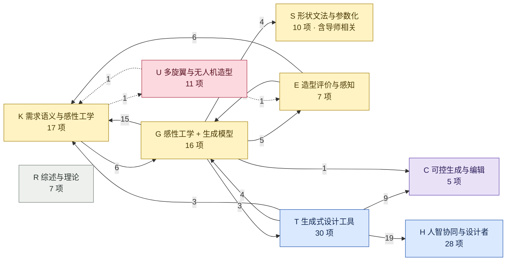

# 文献关系图

2026-11-19。对象是[目录](catalog.csv)里的 131 项：作者 11 月 19 日上传的 226 份 PDF 中保留的 117 份，加上仓库里原有的 14 份已核原件。关系有两种来源：一是逐篇打开后按主题分的九个簇；二是程序在每篇全文里查找其他各篇的题名，得到库内互引 231 条（[citations.csv](citations.csv)）。互引是机器匹配的结果，能说明谁引了谁，不能说明引用的用意。

## 一、先说结论

**这批文献分属三个很少互相引用的圈子，本文站在它们的交点上。**

1. **感性工学到生成式造型**（工程设计期刊，K、G 两簇 33 项）：从评论或问卷得到感性词，建立感性词与造型要素的映射，再用 GAN 或扩散模型出图。簇内互引密集，G 引 K 有 15 条。
2. **生成式设计工具与设计者研究**（CHI、UIST、DIS，T、H 两簇 58 项）：提示词怎样写、界面怎样让设计者探索和追溯、设计者怎样与生成模型协作。T 簇内互引 83 条，是全库最密的一块。
3. **无人机造型**（中文期刊与学位论文为主，U 簇 11 项）：几乎是孤岛，全簇与其余文献之间只有 3 条互引。

第 1 圈和第 2 圈之间只有 12 条互引，其中 6 条出自 AutoSpark（L056）一篇；两边都引用的技术底座是 ControlNet（L053，被库内 13 篇引用）。没有一篇文献同时做到这四件事：从用户语义出发、用参数控制几何、让设计者留下可追溯的取舍、落在多旋翼上。这是本文的位置，也是第二章 2.6 节比较表可以直接使用的结构。

箭头上的数字是互引条数，方向是“引用方 → 被引方”。簇内互引未画：T 83，G 18，K 17，H 10。

## 二、九个簇各自的脉络

每簇先写它在本文里的作用，再按时间列出脉络。括号里的数字是该文献被库内其他文献引用的次数。

### K 需求语义与感性工学（17 项）→ RQ1，第 2.2、3.2 节

脉络：Nagamachi 1995 提出感性工学（L012，被引 20，全库最高）→ 综述（L025、L026、L027、L022）→ 用网络评论代替问卷：感性文本挖掘（L013，2018）、新能源汽车外观的大数据挖掘（L018，2022，被引 10）、在线评论加模糊层次分析（L017，2024）→ 同对象：航拍无人机评论到需求的 TGRA–QFD（A08，2026，已核原页）。旁支是导师课题组的可供性与产品语义（L019、L020）。

给本文的：评论 → 感性词 → 评分 → 映射的整套做法，以及“便携”“小巧”这类词在同类产品里的归类。本文不同之处：保留原话、使用场景和设计者的确认，不把词直接换成权重。

### G 感性工学结合生成模型的造型设计（16 项）→ 最接近的工作，第 2.3、2.6 节

脉络：深度学习加感性工学生成概念（L041，2018；L034，2021，被引 6）→ 感性工学加 DCGAN（L037，2021）→ 感性工学加扩散模型（L028，2023，被引 8）→ 2024 年分出三条：评论加条件控制出图（L030，G 簇里唯一引用 ControlNet 的一篇，把评论、映射和条件控制连在了一起）；形状文法加感性工学加 Midjourney（L031）；评论加回归网络加 LoRA（L032，苏建宁）→ 情感与功能双约束的多模态生成（L029，2025）、汽车前脸（L039）、配色（L040）→ 视觉感知数据驱动的造型生成（A09，2026，已核原页）。

共同做法：评论或问卷 → 感性词 → 与造型要素建立映射 → 训练或微调模型出图 → 用问卷、模糊综合评价或层次分析评价。本文不同之处：不训练模型；几何由参数编译成条件图，不靠文字传达；在生成结果上直接量比例；记录设计者的取舍。本文因此不能说“首次把评论转成参数再生成”，可以说的是控制方式、量测方式和人的位置不同。

### S 形状文法、遗传算法与参数化造型（10 项，含导师相关工作）→ 第 2.3、3.4 节

脉络：曲线拟合遗传算法（L052，2007）→ 基于遗传算法的产品形态设计模型（L048，2010，被 G、K 簇 5 篇引用）→ 导师课题组：形状文法加交互式遗传算法的形态推演（朱天燕，期刊论文 L043，2019，及学位论文 L046）、权重化特征加形状文法的产品识别设计（厉茜茜，期刊论文 L044，2019，及学位论文 L045）→ 其他交互式遗传算法造型（L050、L051）。

给本文的：把造型写成可编码的参数和规则；交互式遗传算法里“算法出方案、人来打分、迭代到满意”就是早一代的人在回路中。本文可以把自己写成这条线在扩散模型时代的延续：规则换成条件图，人的评价保留并留下记录。这一层关系目前稿子里没有写。

### C 可控图像生成与编辑（5 项）→ RQ2，第 2.4、3.4–3.5 节

ControlNet（L053，2023，被引 13）是条件图控制的依据。Make It Count（A10）、SR-Edit（A06）、ArchiSet（A07）已核原页，分别给出“先判对象是否成形再计数”“改动与保持分开评”“按目标比例量测输出”的做法。这一簇原件最少，见第五节的缺件。

### T 生成式设计工具与提示交互（30 项）→ 工作台的依据，第 2.5、3.5 节

脉络：FashionQ（L060，2021，被引 8）、GANSpiration（L061，2022）→ 提示词的设计准则（L067，Liu 与 Chilton，2022，被引 16）→ 2023 年的提示探索工具：Promptify（L063，被引 8）、PromptPaint（L062，被引 7）、RePrompt（L064）、3DALL-E（L058，被引 8）、节点式的 Spellburst（L055）；同年指出非专家写不好提示词（L065，被引 7）→ 2024 年带领域知识的工具：AutoSpark（L056，感性工学加生成式 AI，汽车外观）、CreativeConnect（L059）、DesignPrompt（L068）、ProtoDreamer（L069）→ 2025 年：GenPara（L057，16 人）、Inkspire（L070）、ProductMeta（L071）、DesignFromX（B07）→ 2026 年已核原页的一组：InspirationGraph（A01）、DesignTrace（A03）、Workflow-Net（B05）、部件化汽车内饰（A02）、GenAlign（B00）、CogChat（B04）、InstructMesh（B06）。

给本文的：步骤放在画布上、直接操作、自动连线、侧栏随所选对象变化（拆解见 [PR #79](https://github.com/Freeloop993/paper/pull/79) 里的《画布式工作流拆解》）；语义绑定到部件；建议先预览再应用。

### H 人智协同与设计者研究（28 项）→ RQ3，第 2.5 节、第 4 章、5.4 节

人机交互准则（L074，Amershi 等，2019）→ 2023 年一批设计者使用文生图的观察研究（L076、L078、L079、L080，各被引 2–6）→ 自动化程度的对照实验（L072，2025：79 人，被试间，低、中、高三档自动化，测用时和创造体验）→ 中文语境下的应用与流程研究（L082 冯玉泉、L085 尹虎、L095 章彰、L098 与 L099 罗仕鉴）。

给本文的：RQ3 该怎样设计比较，以及样本量的参照。本文计划 3 名外部设计者，只能作形成性结论。

### E 造型评价与感知度量（7 项）→ RQ1′，第 3.6、5.3 节

产品外观的定量审美度量（L100，2022，被引 5）、基于深度学习的形态审美评价（L101）、汽车三维造型的视觉复杂度（L103，2025）、汽车尾部的感性评议（A11，已核原页）、导师课题组的造型意象机器评价（L102，周海海）。无人机上有两篇：多旋翼外观偏好的模糊综合评价加模糊层次分析（L005，31 份问卷）和无人机造型的层次灰关联评价（L006），按对象归在 U 簇。

### U 多旋翼与无人机造型（11 项）→ 研究对象，第 2.1 节、RQ4

工业设计角度的多旋翼设计（L001）、六旋翼造型（L002）、纵列双旋翼的感性意象造型（L003）、多旋翼外观偏好（L005，2020）、造型评价（L006，2020）、仿生造型（L009、L010）、巡检无人机使用方式（L011）、植保无人机：感性工学加 AI 绘图部件库加虚拟仿真加模糊综合评价（L007，2024）、面向平飞姿态的四旋翼机身（L004，2025，气动导向）。

这一簇与其余文献几乎不互引，也没有一篇做跨构型比较。对本文的含义有两面：RQ4 没有现成方法可依，是可以写的空白；同时意味着跨构型的判据要自己立，更需要预先登记。

### R 综述与理论（7 项）→ 第 1、2 章背景

国外生成式产品设计综述（L109）、设计智能综述（L111）、知识工程的产品设计综述（L110）、设计理论与方法回顾（L112）、AI 与设计研究二十年（L108）等。

## 三、被引用最多的文献

| 库内被引 | 编号 | 文献 | 簇 |
| --- | --- | --- | --- |
| 20 | L012 | Nagamachi，Kansei Engineering，1995 | K |
| 16 | L067 | Liu 与 Chilton，提示词设计准则，CHI 2022 | T |
| 13 | L053 | Zhang 等，ControlNet，ICCV 2023 | C |
| 10 | L018 | Lai 等，新能源汽车外观的感性工学大数据挖掘，2022 | K |
| 8 | L028 | Yang 等，感性工学加扩散模型的产品形态设计，2023 | G |
| 8 | L060、L063、L058 | FashionQ、Promptify、3DALL-E | T |
| 7 | L062、L065 | PromptPaint、Why Johnny Can’t Prompt | T |

连接不同圈子的文献：AutoSpark（L056）同时引用 G 簇 3 篇、K 簇 3 篇、T 簇 6 篇、H 簇 3 篇；L030 在本簇之外还引用了 K、S、E、C 四个簇；GenAlign（B00）、DesignFromX（B07）、InspirationGraph（A01）、Workflow-Net（B05）各自连着 T、H、C。写第二章时，这几篇是从一个圈子过渡到另一个圈子的落脚点。

## 四、按论证链：每一环依据哪些文献

今后的研究按这张表走：每一环先看文献里怎么做，再决定本文照做、改做还是不做，并写明理由。

| 环节 | 依据文献 | 文献里的做法 | 本文现在的做法 | 差在哪 |
| --- | --- | --- | --- | --- |
| 评论 → 意图（RQ1） | L012、L013、L018、L017、A08、L030、L032 | 评论或问卷 → 感性词（词频、因子分析、聚类）→ 语义差分问卷评分 → 映射模型 | 语料分层、36 张证据卡、设计者确认；没有问卷评分 | 文献都有一步“词 → 造型要素”的定量映射（偏最小二乘、回归网络、QFD），本文没有 |
| 意图 → 规格 | L005、L030、L031、L043–L046、L048 | 形态分析把产品拆成部件和造型要素并编码；形状文法规则 | 参数字段、比例、造型档位 | 感性词与部件要素之间的对应没有建立 |
| 规格 → 条件 → 生成（RQ2） | L053、L030、L028、L029、L032、A10、A07 | 多数训练或微调模型；L030 用条件控制；很少在输出上量几何，A07 是按目标比例量测的例子 | 不训练，参数编译成条件图，在输出上量比例 | 设计实际用的通路没有命中；独立盲测为 0 |
| 修订与局部编辑 | A06、B06、L057 | 选区域、指定操作、预览后确认；改动与保持分开评 | 流程有，目标修改 0 例被确认 | 缺通过的案例 |
| 工作台（RQ3 的系统一侧） | B05、A03、A01、L055、L056、B00、B07 | 画布上的内容节点、直接操作、自动连线、随选中变化的侧栏、领域知识注入 | 一块画布的工作台（PR #79） | 没有使用者验证 |
| 人智协同的比较（RQ3） | L072、B05、A03、L057、L065、L078 | 同一后端，比较界面或自动化程度；9 到 79 人；测用时、创造体验、可用性、负荷 | 计划作者预试加 3 名外部设计者 | 0 场；样本只够形成性结论 |
| 评价与感知（RQ1′） | L005、L006、A11、L100、L103、L029、L007 | 问卷加模糊综合评价或层次分析；统一刺激图、随机呈现、独立评分 | 不知情评议，目标 10 人 | 现有 3 人；紧凑感没有读出 |
| 对象与跨构型（RQ4） | L001–L007、L009–L011 | 都是单一构型；没有跨构型比较 | 农业六旋 39 张 | 没有先例，判据要自己立并预先登记 |

## 五、缺的原件

**目录里有、原件不完整的核心文献：** L002《六旋翼无人机造型设计》和 L003《面向用户感性意象的纵列双旋翼无人机造型研究与设计》上传的都只有 1 页扫描图。

**框架文件点名的最接近工作，仓库里没有原件：** AutoGen-Insight、Parametric-ControlNet、Davis 等（CHI 2024）、Brief2Design、Ceci N’est Pas un Drone、Mugge 等 2018、Raghubir 与 Krishna 1999。第二章 2.6 节的比较表要靠这几篇，写之前需要原件和页码。

**稿子引用了、仓库里没有原件的：** 两份稿子合计 47 条参考文献中，21 条有原件（18 条在本目录，其中 17 条来自这次上传；3 条在历史全文分支），26 条没有。26 条里有 7 条是模型卡和厂商手册，另外 19 条是论文和经典著作，包括 Crilly 等《Seeing things》、InstructPix2Pix、MagicBrush、GenEval、AIdeation、Osgood《The Measurement of Meaning》、Cohen 的 κ。

**库内被大量引用、但库里没有的经典：** 潜空间扩散模型（被库内 19 篇引用）、层次分析法（20）、CLIP（11）、NASA-TLX（11）、创造力支持指数 CSI（11）、QFD（10）、InstructPix2Pix（7）。其中本文会直接用到的是潜空间扩散模型、NASA-TLX、CSI、语义差异法和 InstructPix2Pix。

## 六、这张图的限度

- 117 份上传件只做了开卷识别和摘要级阅读，没有逐页核读；只有编号以 A、B 开头的 19 项核过原页。目录的“核读状态”一栏分开标注。写进正文的具体主张，仍要回到原件页码。
- 互引靠题名匹配：题名被改写、缩写或换了译名的引用会漏掉，中文文献之间的互引尤其可能被低估。
- 分簇和“核心、支撑”是我的判断，依据是它能否支撑论证链上的某一环或是否属于最接近的工作。作者可以改。
- 上传的是作者手头的文献，不是系统检索的结果，所以“三个圈子互不引用”说的是这个库的情况。它与此前 790 条文献导航的检索结论一致，但不等于整个领域的普查。
