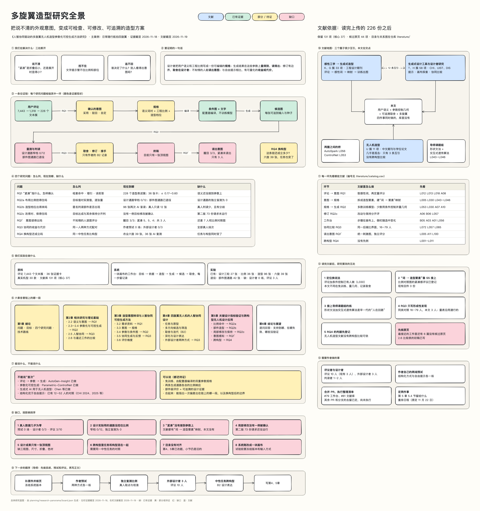

# 研究全景：一页看清在解决什么、证明到哪、缺什么

2026-11-19。供作者自己想问题和复盘用。只写第一性的东西：问题、主张、论证链、每一环怎么判、现在到哪、缺什么。数字取自 [STATUS](../../STATUS.md)、[总体框架](../2026-11-18-framework.md)、[导师反馈后的研究与验收表](../advisor-20261118/README.md) 和 [研究资料库方法](../research-library/method.md)，截至 11 月 18 日；本页没有新增任何实验数据。

**总体研究蓝图：[PDF](research-blueprint.pdf) · [JPG](research-blueprint.jpg)。** 一页图，左栏是下面九节，右栏是 11 月 19 日读完上传文献后加的文献依据。配套的两页：[研究进度与实际情况](progress-20261119.md)、[文献关系图](../../literature/map.md)。

可拖动、可改写的白板版是一条私有链接，只有发起这次整理的 Claude 账号能打开。它的全部元素在 [board.json](board.json)，由 [build_board.py](build_board.py) 生成；蓝图由 [render_blueprint.py](render_blueprint.py) 画出，[export_blueprint.mjs](export_blueprint.mjs) 导出。更新办法见[文末](#更新蓝图)。

## ① 在解决什么

生成式 AI 出图很快，但设计过程在三处断开：

| 断在哪 | 具体表现 |
| --- | --- |
| 说不清 | 用户说“紧凑”，是折叠后小，还是展开时显得小？ |
| 控不住 | 文字提示管不住比例和部位 |
| 追不回 | 谁决定了什么？不知情的人看得出设计意图吗？ |

## ② 要证明的一句话

设计者把用户语义和工程比例写成一份可编辑的规格；生成结果在这些参数上量得到、读得出；修订有边界，取舍在设计者；不知情的人能读出意图；与自由提示相比，有可量化的收益或代价。

## ③ 一条论证链

每个研究问题检验其中一环。绿色是已有证据，黄色是部分或待证，红色是缺口。

## ④ 四个研究问题

| 问题 | 怎么判 | 现在到哪 | 缺什么 |
| --- | --- | --- | --- |
| RQ1 “紧凑”指什么，怎样确认 | 检索命中、错引、该拒答 | 228 个造型表述簇；36 张卡；第二编码 κ 0.17–0.60 | 语义还没接到参数上 |
| RQ2a 布局比例控得住吗 | 目标值对实测值，逐张量 | 设计实际用的点线图通路窄档 0/12；部件图通路 12/12，但图不合格，11 月 19 日退役 | 设计通路的独立盲测为 0 |
| RQ2b 造型档位出得来吗 | 匿名判读部件是否出现 | 96 张两次 AI 盲读；真人只读 12 张 | 真人判读少，且有分歧 |
| RQ2c 改得对、保得住吗 | 目标达成与其余保持分开判 | 没有一例目标修改被确认 | 第二版 73 份请求未运行 |
| RQ1′ 意图读得出吗 | 不知情的人逐图评分 | 醒目 3/3；紧凑 5、5、4；共 3 人 | 还差 7 人和比例对照图 |
| RQ3 协同的收益与代价 | 同一人两种方式配对 | 作者预试 0 场；外部设计者 0/3 | 全部真人场次 |
| RQ4 换构型还成立吗 | 同一中性任务比构型 | 农业六旋 39 张，36 张 AI 复测 | 任务与构型同时变了 |

## ⑤ 实际在做什么

| | |
| --- | --- |
| 资料 | 评论 7,443 个文本簇、36 张证据卡、真实机型 30 款、[文献库](../../literature/README.md) 131 项（核心 37），另有文献导航 790 条 |
| 系统 | 一块画布的工作台：目标 → 依据 → 造型 → 生成 → 候选 → 取舍，每一步留记录（[PR #79](https://github.com/Freeloop993/paper/pull/79)） |
| 实验 | 已有：设计三轮 27 张、点线图通路比例 36 张、造型 96 张、六旋 39 张。退役：部件图通路 42 张，只留读数。缺：设计者场次 0，评议只有 3 人。写作取数以[哪些数据能进论文](../../evidence/usable-for-writing.md)为准 |

## ⑥ 六章各管链上的哪一段

第 4、5 章的标题按导师反馈后的框架。

| 章 | 管什么 | 对应 |
| --- | --- | --- |
| 第1章 绪论 | 问题、目标、四个研究问题、技术路线 | 全链 |
| 第2章 相关研究与理论基础 | 2.2 语义与意图；2.3–2.4 参数化与可控生成；2.5 人智协同；2.6 与最近工作的比较 | RQ1；RQ2；RQ3；定位 |
| 第3章 造型意图转译与人智协同可控生成方法 | 3.2 需求资料；3.3 意图 → 规格；3.4 参数与条件图；3.5 协同生成与反馈；3.6 评价维度 | RQ1；RQ1→RQ2；RQ2；RQ3；全部判据 |
| 第4章 四旋翼无人机的人智协同设计 | 任务与原型；多方向候选；取舍与迭代（B2）；深化与设计表达；外部设计者两种方式 | 设计者的决定，RQ3 |
| 第5章 关键设计指标验证与跨构型无人机设计应用 | 比例命中；部件造型；局部修改与保持；意图感知；跨构型 | RQ2a；RQ2b；RQ2c；RQ1′；RQ4 |
| 第6章 结论与展望 | 逐问回答：支持到哪、在哪失效、哪些没验证 | 全链 |

## ⑦ 能说什么，不能说什么

| 不能说“首次” | 已有的工作 |
| --- | --- |
| 评论 → 参数 → 生成 | AutoGen-Insight |
| 参数化可控生成 | Parametric-ControlNet |
| 生成式 AI 用于无人机造型 | Chen 等 |
| 评论加条件控制出图 | 感性工学一线已有（文献库 L030） |
| 结构化优于自由提示 | 已有 12–52 人的对照（CHI 2024、2025 等） |

可以说，但都还待证：免训练、由配置器编译的双重参数规格；两条生成通路各自的比例响应；部件级评价加可追溯的设计证据。合起来是一句话：**能指出一次偏差出在链上的哪一段，以及换构型后的边界。**

## ⑧ 缺口，按影响排序

1. **真人数据几乎为零。** 作者预试 0 场，外部设计者 0/3，评议 3/10。第四章改名为“人智协同设计”之后，重心在人的决定上，而现有证据只有作者一个人的记录，作者同时参与了系统的设计。
2. **设计实际用的通路没控住比例。** 命中的是部件图通路，它出的图不合格，11 月 19 日已经退役；设计用的是点线图通路，窄档 0/12，独立盲测为 0。题目里的“参数化可控”压在这一环上；作者已定若桥接失败则收窄为“可检验的控制”和偏差规律。
3. **“紧凑”没有接到参数上。** 评论里最主要的诉求是小巧和便携，但还没有一个经过检验的“语义 → 比例”对应；终稿的紧凑感也没被读出。这一环不接上，RQ1 和 RQ2 就是两个互不相干的研究。感性工学一线的文献都有“词 → 造型要素”的定量映射这一步，本文没有。
4. **局部修改没有一例被确认。** 第二版 73 份请求还没运行。
5. **设计成果只有一张顶视图。** 工业设计论文需要三视图或简模、尺寸、折叠方式和色材。规格里的 W/L 1.00 落在量过的真实机型范围（1.16–1.52）之外，作者没有给出设计理由，第四章要如实交代。
6. **跨构型里任务和构型混在一起。** 农业六旋和日常航拍四旋的差别不能当作构型差别；共轴的下层在顶视里看不到。
7. **目录没有对齐。** 第 4、5 章已改题，[现行目录](../../manuscript/outline.md)的小节还是旧标题下的（例如 5.5 仍是“六旋翼构型适配验证”）。先把新标题下的小节定下来，实验才知道往哪一节交数据。
8. **系统刚改成一块画布。** 预试前要冻结版本和输入方式，并由另一方用同一提交重新验收；参考图作为生成输入是新加的，没有对真实模型测过。
9. **检索增强在生成端还没成立。** 资料库两次本地生成的草稿都缺有效卡号；检索只在开发题上走查过，没有留出题。
10. **日程。** 11 月 7 日的计划把新增主数据采集的截止放在 11 月 22 日；按 11 月 18 日的状态，这个日期需要重排。

## ⑨ 下一步的顺序

导师的意见是先做系统、预试和评议，再写正文。

补 2.6 节要用的原件并核页 → 冻结系统版本 → 作者预试（两种方式各一场）→ 独立复测比例（真人取点与校准）→ 外部设计者 3 人与评议 10 人 → 中性任务跨构型与 B2 设计表达 → 写第 4、5 章。

## ⑩ 文献依据（2026-11-19 增补）

作者上传的 226 份 PDF 里保留 117 份，连同原有 14 份共 131 项，其中 44 项核过原页。它们分属三个很少互相引用的圈子，本文在交点上：

| 圈子 | 文献 | 给本文什么 |
| --- | --- | --- |
| 感性工学 → 生成式造型 | K、G 簇 33 项 | 评论 → 感性词 → 映射的做法；最接近的工作 |
| 生成式设计工具与设计者研究 | T、H 簇 58 项 | 工作台的交互依据；协同比较怎样做 |
| 无人机造型 | U 簇 11 项 | 研究对象与评价方法；没有跨构型比较 |

前两个圈子之间只有 12 条互引。没有一篇同时做到用户语义、参数控制几何、可追溯取舍和多旋翼这四件事。每一环先看哪些文献，见[关系图第四节](../../literature/map.md#四按论证链每一环依据哪些文献)；读完后研究要改的五处和等作者决定的事，见[研究进度与实际情况](progress-20261119.md)。

## 新找到、尚未核读的 CHI 论文

仓库的 [790 条文献导航](../research-library/literature/relevance-index.csv)里已经有 DesignWeaver、Luminate、PromptCharm、Davis 等（CHI 2024）、设计固着（CHI 2024）、When Designers Sweat（CHI 2026）、Ceci N’est Pas un Drone 等。下面几篇不在导航里，是 11 月 19 日网上检索得到的线索，只看过摘要或检索摘要，引用前要回到原文和页码。其中 Zamfirescu-Pereira 等和 Gmeiner 等两篇，作者上传的文献里有原件，已进文献库（L065、L078）；其余三篇仍没有原件。

| 论文 | 出处 | 可能用在哪 |
| --- | --- | --- |
| Naqvi、He、Kaur，*Catalyst for Creativity or a Hollow Trend? A Cross-Level Perspective on The Role of Generative AI in Design* | CHI 2025，[10.1145/3706598.3713233](https://doi.org/10.1145/3706598.3713233) | 2.5、RQ3：不同资历的设计者对生成式 AI 的态度与顾虑 |
| Zamfirescu-Pereira 等，*Why Johnny Can’t Prompt* | CHI 2023，[10.1145/3544548.3581388](https://doi.org/10.1145/3544548.3581388) | RQ3 的自由提示对照：非专家写提示词的困难 |
| Gmeiner 等，*Exploring Challenges and Opportunities to Support Designers in Learning to Co-create with AI-based Manufacturing Design Tools* | CHI 2023，[10.1145/3544548.3580999](https://doi.org/10.1145/3544548.3580999) | 2.5、RQ3：设计者学习与 AI 工具协同时的困难 |
| Baytas 等，*The Design of Social Drones: A Review of Studies on Autonomous Flyers in Inhabited Environments* | CHI 2019，[10.1145/3290605.3300480](https://doi.org/10.1145/3290605.3300480) | 2.1：无人机外观与行为怎样影响人的反应 |
| Herdel 等，*Drone in Love: Emotional Perception of Facial Expressions on Flying Robots* | CHI 2021（DOI 未核） | 2.1、RQ1′：无人机外观的感知评议方法 |

## 更新蓝图

1. 改 [build_board.py](build_board.py)。白板上的元素只增不重建，已有元素的编号不能变，新元素加在文件末尾。
2. `python3 build_board.py <临时目录>` 重新生成 board.json。
3. `python3 render_blueprint.py <临时目录>/blueprint.html`，再 `node export_blueprint.mjs <临时目录>/blueprint.html .`，得到 PDF 和 JPG。导出脚本会报告文字是否溢出方框。需要工作台目录已安装依赖和本机 Chrome。
4. 白板只写入有变化的元素。
