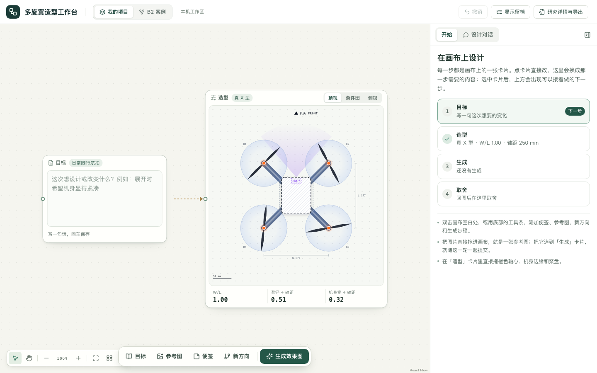
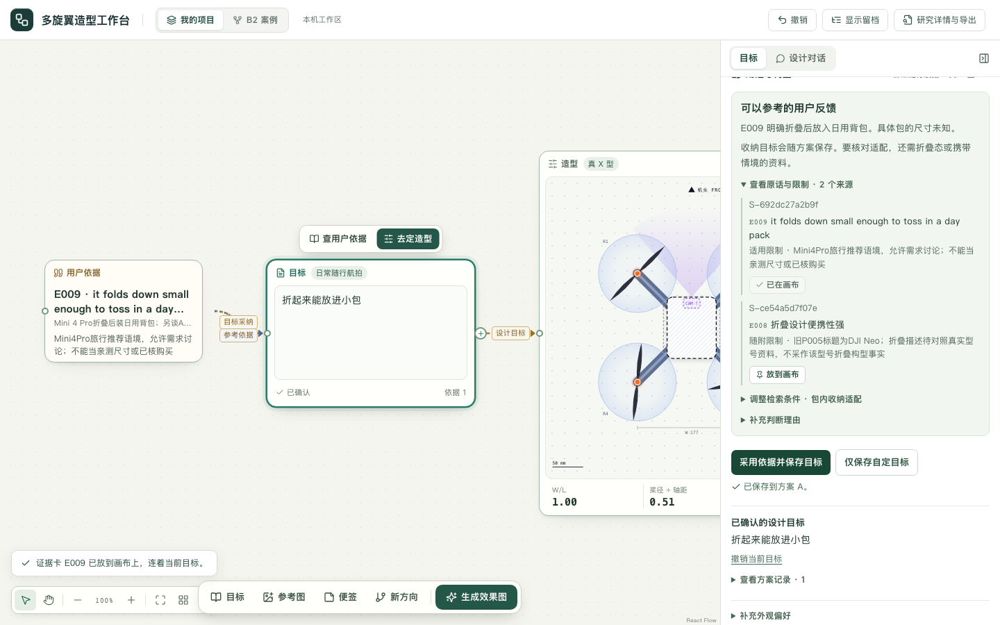
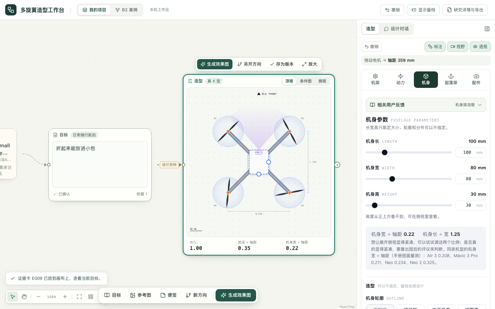
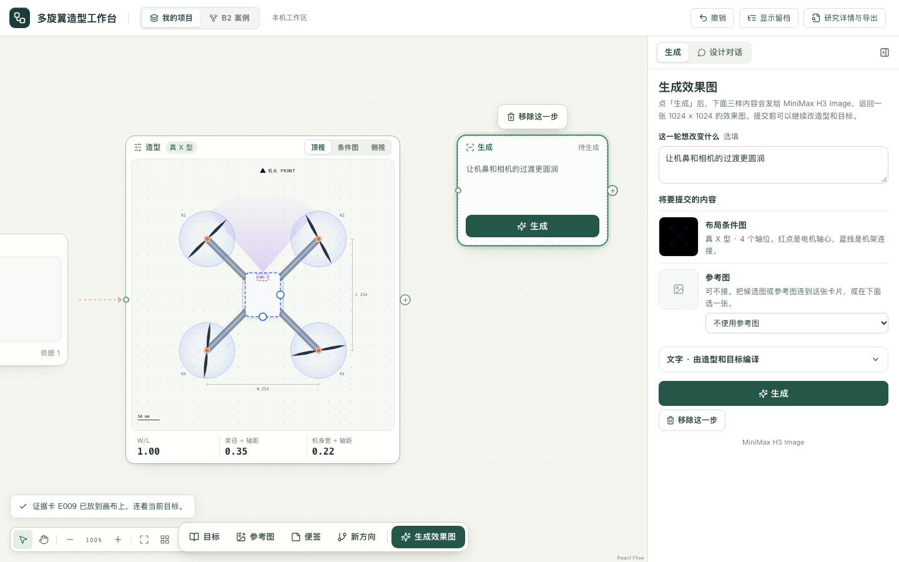
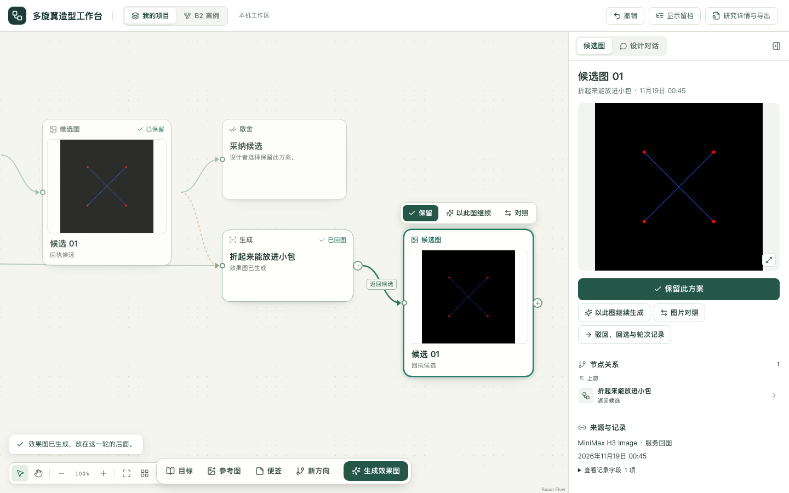
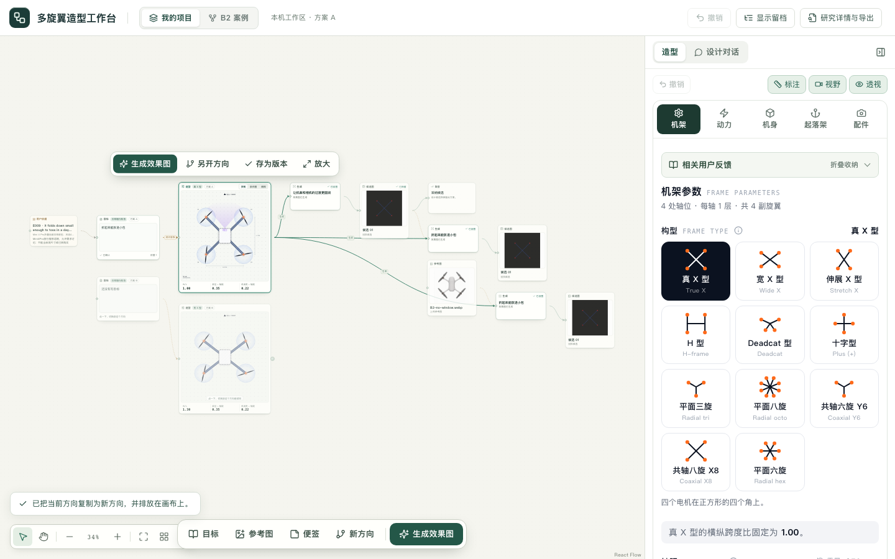

# 第四轮界面：一块画布，软件走查记录

2026-11-19。这一轮把目标、参数、候选图三个页面并进画布：每一步是画布上的一张卡片，在卡片上直接做，右侧面板跟着所选的卡片变化。设计依据见[界面设计说明](../../interface-design.md)和[画布式工作流拆解](../../../../planning/workbench-handoff/literature/画布式工作流拆解.md)。

**本页只记录软件检查。** 没有调用图像或文本模型，没有作者试用，没有外部设计者参与。界面是否更直觉、更省时，这些检查回答不了。

## 做了什么检查

环境：macOS，Node 22.22，Chrome 158，Playwright Core 1.62.1。每个浏览器检查都在全新的隔离浏览器数据里运行。图像作业由软件夹具应答：夹具把本轮的布局条件图原样当作“回图”返回。

| 检查 | 命令 | 结果 |
| --- | --- | --- |
| 画布走查 | `npm run walkthrough:canvas -- review/20261119-round4/screenshots` | 通过，[输出](canvas-walkthrough.json)；修复连线问题后连续运行 8 次通过，加入下面第二批检查后又连续 4 次通过 |
| 离线包 | `npm run package-offline`，`npm run check-offline` | 通过：以 `file://` 打开，画布、目标面板、六旋造型、三份导出、两个历史案例，0 个非本地请求 |
| 几何、导入导出、提示词 | `npm run verify` | 56 项通过 |
| 既有规格重放 | `npm run replay` | 10 份与当前源码输出逐项相同 |
| 本机服务 | `node --test scripts/image-jobs.test.mjs scripts/design-chat-contract.test.mjs` | 8 项通过 |
| 版本、手动连线、冻结来源 | `node scripts/graph-walkthrough.mjs <本机地址>` | 通过 |
| 对话建议的预览、应用、撤销与冻结留档 | `node scripts/chat-handoff-walkthrough.mjs <本机地址>` | 通过 |
| 对话记录随方向隔离、刷新后恢复 | `node scripts/chat-audit-walkthrough.mjs <本机地址>` | 通过 |
| 旧版回执导入、取舍、父图 | `node scripts/record-walkthrough.mjs <本机地址>` | 通过 |
| 旧版 ComfyUI 协议夹具 | `node scripts/dispatch-walkthrough.mjs <本机地址>` | 通过 |
| 类型与规范 | `npx tsc -b`，`npx eslint` 本轮改动的目录 | 无错误 |

后五个脚本原来针对四个页面的界面，这一轮改成从画布进入，断言没有放宽。

## 画布走查逐步核了什么

1. 打开就是一块画布，只有「目标」和「造型」两张卡片，没有另外的页面导航。
2. 在目标卡片上直接输入“折起来能放进小包”，右侧面板同步出现检索到的原句；把 E009 放到画布上，出现一张连着目标的证据卡；采用依据后卡片显示已确认。
3. 在造型卡片里拖动一个电机轴心，轴距由 250 变为 359 mm，右侧部件面板的数值同步变化；点机身，面板切到机身页签。
4. 选中造型卡片，点上方的「生成效果图」：一张待生成的卡片接在右边。填写这一轮想改变什么，点卡片上的「生成」，夹具回图作为候选卡片接在后面；提交的文字包含这一轮的目标，只带一张布局图。
5. 选中候选图点「保留」，出现取舍记录；点「以此图继续」，新的生成步骤带着这张候选，提交时是两张图，文字里按父图说明。
6. 导入一张 WebP 参考图，点「以此图生成」：提交时是两张图，文字里按“设计者选的外观参考”说明；导出的轮次记录里父图编号指向画布上那张参考图。
7. 从底部工具条加一张便签，写字，刷新页面后仍在；三张候选图仍在。
8. 「新方向」后画布上有两个造型，一个可拖、一个静态；把新方向改成宽 X 型，原方向仍是真 X 型；点原方向的卡片即可切回去编辑。
9. 留档默认收起；点「显示留档」出现 6 张冻结规格和条件图卡片。
10. B2 案例用同一块画布显示 6 张卡片；把一张图引用到自己的项目。
11. 390 像素宽：面板在画布下方，页面和顶栏都不横向溢出。

## 第二批：自查后补的四处

提交第一版后又从空白项目把没走过的操作试了一遍（双击空白处添加、很长的目标、共轴和六旋构型、收起面板、删除方向、1024 和 820 像素宽）。这些都正常，另外发现四处不足并已修掉，走查脚本里各加了一条断言：

- 换到另一个构型族时，目标卡片上的文字会随已确认的目标一起清空。现在文字留在卡片上，提示“用途或构型变了，请重新确认”，点「确认目标」即可。
- 选中便签、参考图或待生成步骤后按 Delete 没有反应。现在可以移除；在便签里打字时的退格不会删掉卡片。
- 证据卡放上画布后不能从卡片上拿下来。现在选中后可以「从画布移开」。
- 点卡片右侧的加号没有反应。现在会选中这张卡片，显示接下来能做什么。

## 这一轮顺带修掉的问题

- 节点连续更新时，画布上的连线可能整体消失，直到下一次交互才恢复。原因是每次重建节点都丢掉了量得的卡片尺寸和端口位置。现在把量得的尺寸留在节点上。画布走查曾因此四次里失败一次，修复后连续 8 次通过。
- 页面已经打开时再点一个带 `#step=` 的链接，原先不会跳到对应的卡片。
- macOS 上 `npm run package-offline` 因为找不到 `python` 命令而没有真正重新打包。现在依次尝试 `python3` 和 `python`。

## 截图

| | |
| --- | --- |
|  |  |
|  |  |
|  |  |

手机宽度见 [07-手机.png](screenshots/07-手机.png)。截图里的“候选图”是软件夹具返回的布局条件图，不是模型生成的效果图。

## 没有核的

- 真实的 MiniMax H3 Image 调用，包括参考图作为输入时模型的实际表现。
- 设计对话的真实模型答复（脚本里用软件应答）。
- Windows 上的运行；Safari 和 Firefox。
- 任何有人参与的使用。
